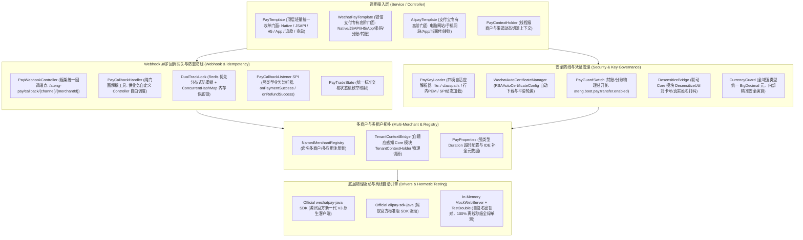

# 48. 企业级专有多渠道支付与资金底座架构决策 (Enterprise Multi-Channel Payment Architecture)

## 背景与痛点

在现代电商收单、SaaS 订阅缴费、政企在线服务及 O2O 本地生活场景中，在线支付与资金结算属于企业核心系统生命线。微信支付（WeChat Pay）与支付宝（Alipay）占据国内商业交易市场 95% 以上的份额。然而，由于两家平台在安全协议、交互模型、证书体系及业务语义上存在巨大的异构性，团队在研发支付组件或接入第三方开源库时普遍面临以下六大核心痛点：

1. **协议异构性与伪抽象的破坏性 (Protocol Heterogeneity & False Abstraction)**：
   微信支付 V3 全面推行 RESTful API、HTTP 请求标头验签、AES-GCM 密文解密与分账平台证书；而支付宝主流采用 RPC 式网关、表单 Form/JSON 提交、RSA2 验签与公钥证书链。业界诸多开源框架试图推行所谓的“统一支付大一统接口”（如仅暴露 `pay(UnifiedRequest)`），这种过度抽象抹平了各渠道的高阶原生特性（如微信的二级商户分账、支付分、商家券，支付宝的当面资金授权、花呗分期、单笔转账等），导致业务方在遇到特殊渠道参数时必须“穿透抽象”，架构迅速腐化。
2. **证书与私钥管理黑洞与过期中断 (Certificate & Key Governance Nightmare)**：
   微信 V3 强制要求商户 API 私钥、商户证书序列号以及微信平台公钥/证书。微信平台证书每隔几年或定期会被腾讯动态更新，若采用传统手动下载证书挂载到磁盘的方式，一旦证书到期或平台轮换，线上支付将瞬间全线瘫痪；支付宝又区分普通公钥模式与三证书模式（应用公钥证书、支付宝公钥证书、支付宝根证书）。企业在物理机、K8s 容器、多租户场景下加载密钥的方式割裂，缺乏统一的加载策略与动态切源能力。
3. **异步 Webhook 回调验签解密高门槛与并发重复入账漏洞 (Webhook Verification & False Idempotency)**：
   支付成功异步通知是资金落地的核心。微信 V3 回调需要从 HTTP 标头提取 `Wechatpay-Signature`、`Wechatpay-Timestamp`、`Wechatpay-Nonce`、`Wechatpay-Serial` 结合平台公钥验签，并使用 `apiV3Key` 进行 AES-GCM 密文解密；支付宝需要从 Request 参数中提取所有键值对并过滤 `sign`、`sign_type` 后计算 RSA2 验签。此外，渠道在网络波动时会发起毫秒级并发重试或阶梯重试，若缺乏严格的分布式防重幂等锁，极易引发订单重复入账、重复发货甚至超额分账等重大资损事故。
4. **高敏资金操作（转账与分账）缺乏物理防线与审计泄密隐患 (Unprotected Fund Operations & PII Leakage)**：
   单笔资金转账（微信商家转账到零钱、支付宝转账到支付宝账户）与分账（向合作方资金账户划拨分润）直接扣除企业商户真实资金池，属于最高危操作。普通系统往往未设立物理总开关，一旦接口被越权或因逻辑缺陷触发可能造成无法挽回的资金损失；同时，微信转账需要校验收款人真实姓名，银行卡号与收款账号等高敏感个人隐私信息（PII）若直接打入日志，严重触碰合规红线。
5. **金额单位“元 vs 分”心智陷阱与百倍资损风险 (Currency Unit & Precision Traps)**：
   微信底层全链路强制以“分”为单位（整数 Integer/Long，1 元 = 100 分）；支付宝底层强制以“元”为单位且必须保留两位小数（字符串，如 `"1.00"`）。在多渠道交互中，“单位混乱”是导致资金少扣或多扣（放大或缩小 100 倍）的最高发生产事故根源。
6. **单元测试外部网络强依赖与离线不可测 (Hermetic Testing Vacuum)**：
   绝大多数支付 SDK 或封装库严重依赖真实网络与腾讯/阿里服务器交互，在离线开发环境或持续集成（CI）流水线中无法运行单元测试，导致测试用例沦为无意义的 `assertNotNull` 空壳，核心验签、解密与回调状态机缺乏对抗性测试守护。

---

## 核心架构与决策内容

经由严格推演与场景研讨，正式确立 **`ateng-boot-pay`（企业级专有多渠道支付与资金底座）**，其整体架构拓扑如下：

---

## 关键架构设计与不变量 (The Architectural Invariants)

### 1. 官方权威 SDK 内核驱动与双规专有门面为主 (`WechatPayTemplate` & `AlipayTemplate`)
- **官方权威基线**：微信端引入腾讯官方权威 `com.github.wechatpay-apiv3:wechatpay-java:0.2.17`，支付宝端引入官方权威 `com.alipay.sdk:alipay-sdk-java:4.40.1044.ALL`，坚决杜绝第三方“二手包装库”的依赖膨胀与更新滞后。
- **双规专有独立门面**：
  - `WechatPayTemplate`：专职提供微信 100% 原生体验，涵盖 Native、JSAPI、H5、App、条码付（付款码被扫）、订单查询、关单、退款、退款查询、申请交易对账单、添加分账接收方、请求分账、解冻分账、商家转账到零钱等全套能力；
  - `AlipayTemplate`：专职提供支付宝 100% 原生体验，涵盖电脑网站支付（Page）、手机网站支付（Wap）、App 支付、当面付条码与扫码、统一收单交易查询、关闭、撤销（Cancel）、统一退款、退款查询、对账单下载、单笔转账到支付宝账户等全套能力；
  - 保留 `getWechatClient()` 与 `getAlipayClient()` 逃生舱，调用方可随时获取底层原生客户端执行罕见或定制化 API。
- **顶层轻量统一收单门面 (`PayTemplate`)**：
  - 针对 80% 仅需常规“统一扫码、统一查单、统一退款”的轻量场景，提供高直觉统一门面 `PayTemplate.pay(UnifiedPayRequest)`、`queryOrder(...)`、`refund(...)`、`closeOrder(...)`，底层依据 `request.getChannel()` 自动路由至对应渠道门面，大幅精简业务条件分支。

### 2. 扁平化场景直达凭据出参模型 (`PayResponse`) 与全自动服务端二次加签
- 消除传统多态强转（`NativeResponse`、`JsapiResponse` 等）带来的代码冗余与 `ClassCastException` 隐患；
- **服务端全自动二次加签与封包 (Auto Secondary Signing & Packaging)**：
  - 针对微信小程序 / 公众号支付（JSAPI），底座在统一下单获得 `prepay_id` 后，**全自动在服务端使用商户私钥计算 RSA 二次签名（`paySign`）**，并直接封装好 `wechatJsapi`（包含 `appId`、`timeStamp`、`nonceStr`、`package="prepay_id=" + prepayId`、`signType="RSA"`、`paySign` 5 元素对象），前端无需任何二次加工，直接将该对象喂给 `wx.requestPayment(res.wechatJsapi)` 即可成功拉起支付；
  - 针对 App 支付，底座自动完成参数组装加签，微信返回 App 调起包，支付宝生成标准 `orderString`；网页端自动拼接带自提交脚本的 `formHtml`；
- 统一收单出参 `PayResponse` 包含全局基础字段（`outTradeNo`、`channel`、`payTradeType`、`success`、`tradeState`），并根据场景直接挂载扁平直达凭据（`qrCode`、`payUrl`、`formHtml`、`wechatJsapi`、`orderString`、`rawResponse`）。

### 3. 四模自适应商户密钥加载与微信平台证书自动轮换
- **四模统一密钥解析引擎 (`PayKeyLoader`)**：支持跨平台部署的四种来源：
  1. `file:` 本地物理文件（如 `file:/data/cert/apiclient_key.pem`）；
  2. `classpath:` 类路径资源（如 `classpath:cert/apiclient_key.pem`）；
  3. `keyPem` 行内 PEM 纯文本（直接在 YAML 中注入，云原生容器环境变量友好）；
  4. `PayCertificateProvider` SPI：支持从企业 KMS、加密数据库中动态加载解密。
- **微信平台证书自动定时轮换 (`RSAAutoCertificateConfig`)**：
  - 默认装配微信官方 `RSAAutoCertificateConfig`，底座自动基于商户 APIv3 密钥从微信服务器拉取最新平台证书、验证证书有效性并在内存中定时平滑轮换，彻底消除人工维护与证书过期导致支付中断的生产事故；
  - 同时支持直接配置“微信平台公钥（WechatPay Public Key）”与公钥 ID 的静态模式。

### 4. 命名多商户注册表与服务商/特约子商户模式 (`ISV / Partner Mode`)
- **直连与服务商双规支持**：
  - 配置层支持 `service-provider-mode: true` 标记；
  - 微信支持服务商核心字段：`spMchId`（服务商商户号）、`spAppId`（服务商 AppId）、`subMchId`（特约商户号）、`subAppId`（子商户 AppId，可选）；专有门面底层自动根据服务商属性无缝切换服务商专属 API 端点；
  - 支付宝支持 ISV 模式：入参支持 `appAuthToken`（第三方应用授权令牌），底层自动在出站请求中注入，代表特约商家调用接口并分佣；
- **配置结构**：支持全局默认主商户（`default-merchant` / `default-app`），开箱即用；同时支持命名多商户映射（`merchants.<id>.*`、`apps.<id>.*`）；
- **动态切源优先级**：
  1. API 方法参数显式传入 `merchantId` / `subMchId`（最高优先级）；
  2. 线程上下文 `PayContextHolder.getMerchantId()`；
  3. 自适应感知 Core 模块 `TenantContextHolder.getTenantId()`，在多租户 SaaS 架构下实现 0 代码无感商户切源。

### 5. 双轨 Webhook 回调网关、防重放并发锁与业务监听器 SPI
- **双轨分发网关**：
  - 默认自动装配内置通用 Webhook 端点 `/ateng-pay/callback/{channel}/{merchantId}`，自动从 HTTP 标头与请求体提取验签要素，完成平台公钥验签与 AES-GCM 密文解密；
  - 同时暴露纯门面 `PayCallbackHandler`，供有严格自定义回调 URL 路径要求的业务方自由调用。
- **双轨防重并发锁 (`DualTrackLock`)**：
  - 验签通过后，框架以 `channel:outTradeNo`（或 `transactionId`）为锁粒度，自动尝试获取防重锁（默认 10 秒超时，使用强类型 `Duration` 配置）；
  - 优先桥接 `ateng-boot-redis` 分布式锁；无 Redis 时自动降级为单机 `ConcurrentHashMap` 内存锁保底。
- **业务监听器 SPI (`PayCallbackListener`) 与确定性响应**：
  - 业务层通过 `@Component` 实现 `PayCallbackListener` 处理 `onPaymentSuccess(PaymentSuccessCallback)` 或 `onRefundSuccess(RefundSuccessCallback)`；
  - 若订单已处理完成，监听器返回 `PayCallbackResult.ignore()`，框架向渠道静默回复 SUCCESS；
  - 若业务监听器执行报错或返回 `PayCallbackResult.fail(...)`，框架自动捕获并向渠道回复 FAIL 报文（微信 HTTP 500 / 支付宝 `fail`），精确触发官方阶梯退避重试；
  - 业务执行成功返回 `PayCallbackResult.success()`，框架自动向微信回复 `{"code":"SUCCESS","message":"成功"}`，向支付宝回复 `success`。

### 6. 高敏资金操作双重物理安全网、分账全生命周期与审计全链路脱敏
- **物理总开关守卫**：
  - 针对分账与单笔转账，标配物理配置守卫：`ateng.boot.pay.transfer.enabled = false` 与 `ateng.boot.pay.profit-sharing.enabled = false`，默认 `false`；未显式开启时对应的转账与分账 Bean 绝不装配，前置杜绝未授权调用；
- **分账全生命周期闭环 (Profit Sharing Lifecycle)**：
  - 下单请求模型显式固化 `profitSharing` 标记（默认 `false`），前置规避微信未打标阻断分账的致命陷阱；
  - 门面完整覆盖分账发起、添加/删除分账接收方、完结分账解冻剩余资金（`unfreeze`）及分账回退（`refund`），彻底闭环资金链；
- **全链路敏感数据脱敏 (`DesensitizeUtil`)**：
  - 微信转账收款人姓名（`userName`）、银行卡号、支付宝收款账号等 PII 字段，出入参日志一律联动 Core 模块 `DesensitizeUtil` 强制掩码（如 `张*`、`622202******1234`），坚决杜绝真实明文凭据入库或入日志。

### 7. 部分退款四要素与支付宝 `out_request_no` 自动映射
- 在统一退款入参 `UnifiedRefundRequest` 中严格固化四要素：`outTradeNo`（原订单号）、`outRefundNo`（本次商户退款单号）、`totalAmount`（原订单总额）、`refundAmount`（本次退款金额）；
- 底座出站调用支付宝时，自动将 `outRefundNo` 赋给支付宝专属的 `out_request_no` 字段，杜绝多次部分退款被支付宝误判为全额重复请求而被拦截；
- 支持退款状态统一查询与微信退款结果异步通知自动解密。

### 8. 自动化对账单拉取与流式结构化解析引擎 (`PayBillParser`)
- 不仅提供 `downloadBill` 下载原始字节流，底座额外提供开箱即用的对账单流式解析器 `PayBillParser`；
- 自动完成微信 GZIP 压缩包解压与校验和验证、支付宝 ZIP 压缩包解压，将异构 CSV/文本文件高效流式解析为统一强类型的明细实体列表 `List<PayBillEntry>`（包含记账时间、商户单号、渠道流水号、交易类型、交易状态、应结金额、退款金额、费率与手续费等）及汇总统计实体 `PayBillSummary`。

### 9. 线下扫码收银台辅助执行器 (`BarcodePayExecutor`) 与主动撤销冲正
- 针对付款码条码付（商户扫用户付款码）同步返回 `USERPAYING` / `WAIT_BUYER_PAY`（等待输入密码或网络超时）的收银台痛点：
- 专有门面保留底层单次原子 `payBarcode(...)` 与 `cancelOrder(...)` 方法；
- 额外封装收银执行器 `BarcodePayExecutor`，支持配置最大等待时间（`maxWaitTime`，如 30 秒）与轮询间隔（`pollInterval`，如 3 秒）；
- 若在超时阈值内用户完成付款则极速返回成功；若超出最大等待时间用户仍未付款，底座自动触发“撤销交易（`cancelOrder`）”并进行冲正，彻底防范扫码收银跑单资损与漏单对账不符。

### 10. 全域统一 `BigDecimal`（元）强类型契约
- 对外暴露的所有 Request、DTO 与 VO，凡金额字段一律强类型约定为 `BigDecimal amount`（单位：元，精确到两位小数）；
- 底座出站调用微信时，由门面在内部安全执行 `amount.multiply(new BigDecimal(100)).longValueExact()` 转换为分；出站调用支付宝时安全执行 `amount.setScale(2, RoundingMode.HALF_UP).toPlainString()`；
- 回调入站时自动将分与字符串换算为 `BigDecimal`，从根源消除开发者的心智换算负担与百倍资损事故。

### 11. 统一交易状态机标准枚举映射 (`PayTradeState`)
- 抹平微信与支付宝状态字符串差异，统一映射为标准枚举：
  - `SUCCESS`：支付成功（微信 `SUCCESS`，支付宝 `TRADE_SUCCESS` / `TRADE_FINISHED`）；
  - `NOTPAY`：未支付 / 等待买家付款（微信 `NOTPAY`，支付宝 `WAIT_BUYER_PAY`）；
  - `USERPAYING`：用户支付中 / 刷卡被扫输入密码中（微信 `USERPAYING`）；
  - `CLOSED`：交易已关闭（未付款超时关闭）；
  - `REFUND`：转入退款；
  - `REVOKED`：已撤销（当面付刷卡撤销）；
  - `PAYERROR`：支付失败；
- 出参同时挂载 `rawTradeState` 保持底层透明度。

### 12. 纯内存 MockWebServer + 离线自签名公私钥 TestDouble 沙箱
- 单测与 CI 流程恪守 100% 离线自洽不变量（Hermetic Test Invariant）；
- 单测资源内嵌预制的自签名 RSA 密钥对与自签名证书（兼作商户私钥与平台公私钥）；
- 结合 OkHttp `MockWebServer` 拦截支付网关请求，秒级验证出站签名计算、出站参数组装、平台响应解析、以及回调报文的 AES-GCM 解密与平台公钥验签全流程，单元测试 100% 离线秒级全绿。

---

## 权衡与后果分析 (Consequences & Trade-offs)

### 正向收益
1. **官方权威，零二手封装风险**：直接基于微信与支付宝官方权威 SDK 打造，享受官方安全补丁与协议更新红利，彻底杜绝个人开源项目的停更与二次包装缺陷。
2. **零资损隐患**：通过“全域 BigDecimal 元契约”、“双轨分布式防重锁”、“自动证书轮换”及“转账物理开关”四大安全防线，将生产支付资损风险降至理论最低。
3. **极佳的开发体验**：开箱即用的统一 Controller 与强类型 `PayCallbackListener`，业务方只需关注订单持久化，省去数百行繁复易错的加解密与验签模板代码。
4. **离线自洽可测**：摆脱了以往支付模块“测试环境必须依赖真实公网环境与沙箱账号”的弊端，CI 流水线毫秒级自动化守护。

### 妥协与成本
1. **依赖体积增量**：官方 SDK 自身包含部分依赖（如 bcprov、fastjson 或 okhttp），需要在 `ateng-boot-bom` 中对传递依赖执行严格的版本统管与排他性对齐，杜绝类路径版本冲突。
2. **多商户证书内存占用**：自动轮换微信平台证书需要在内存中维护定时器与证书缓存，通过限定刷新周期（默认 24 小时）与 LRU 机制确保内存开销完全可控。
