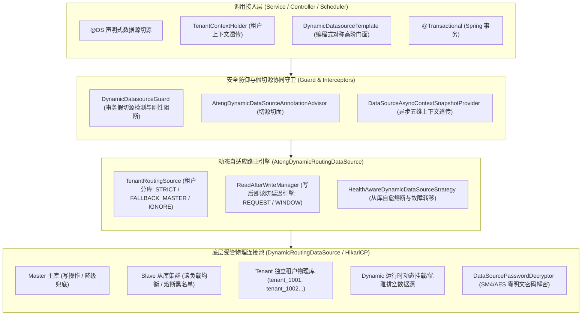

# 49. 动态多数据源与物理多租户隔离架构决策 (Dynamic Datasource and Physical Multi-Tenancy Architecture)

## 背景与痛点

在现代企业级中后台与 SaaS 云原生架构中，数据库访问拓扑早已超越单一关系型数据库实例。随着业务体量扩张与客户合规隔离要求的提高，系统通常需要应对高并发读写分离、SaaS 租户数据物理隔离、跨库数据批量巡检与动态外部数据源接入等复杂场景。

然而，在基于 Spring Boot 与传统多数据源框架（如单纯使用 AbstractRoutingDataSource 或直接引入未经验证的第三方组件）进行多数据源开发时，团队普遍面临以下五大核心架构痛点：

1. **Spring 事务假切源导致的静默数据串库漏洞 (False DataSource Switch & Silent Cross-Database Mutation)**：
   Spring 官方的 `DataSourceTransactionManager` 本地事务管理器在事务开启时即从当前数据源获取物理连接并绑定至线程上下文（`TransactionSynchronizationManager`）。若在带 `@Transactional` 的方法内部或者嵌套调用的下层方法中使用切源注解（如 `@DS`）或编程式切源，该切源指令会被 Spring 本地事务静默忽略，所有后续 SQL 依然在原物理连接上执行。这种“伪切源”破坏了开发者的心理预期，极易导致原本应写入租户 B 或从库的数据被静默写入主库或租户 A，造成严重的生产数据串库事故。
2. **SaaS 物理多租户与行级租户割裂，缺乏透明自适应路由 (Fractured Multi-Tenancy & Hardcoded Routing)**：
   中大客户通常要求数据物理隔离（独享数据库实例或独享 Schema），而普通小微客户则共享单库通过行级租户字段（`tenant_id`）隔离。业界方案往往在代码层硬编码分流逻辑，导致业务代码充斥大量的 `if-else` 分支与手工切源模板，业务与存储拓扑强耦合，缺乏统一透明的“上下文驱动切库 + 优雅回退”底座支撑。
3. **主从读写分离延迟与从库宕机缺乏自愈弹性 (Replication Delay & Brittle Failover)**：
   读写分离是数据库横向扩展的标准手段，但在高频写后即读场景下（如用户下单后立刻跳转订单详情页、修改密码后立刻拉取个人资料），从库由于主从复制物理毫秒级延迟，极易读取到旧数据，引发业务流程错乱；同时，从库网络抖动或临时宕机时，若缺乏自适应健康感知与快速熔断隔离机制，将导致正常的只读请求持续报错甚至拖垮应用线程池。
4. **全库批量巡检门面缺失与底层 SPI 泄露 (Asymmetric Facades & Leak of Low-Level SPI)**：
   运维对账、跨租户月度统计报表或全库 Schema 迁移等场景，需要对所有已注册数据源或所有租户库执行批量遍历。缺乏完备对称的批处理门面时，开发者被迫穿透底层 SPI 自行遍历连接池，容易发生连接泄漏、上下文污染与未捕获异常导致批量中断。
5. **数据库凭据明文配置与动态增删连接悬挂 (Plaintext Credentials & Connection Leaks)**：
   多数据源配置往往涉及数十个乃至数百个数据库密码，若在 YAML 或配置中心以明文存储，严重违背安全合规红线；而在微服务运行时动态挂载或卸载外部数据源时，若缺乏连接前置探测与在途事务优雅排空机制，极易引发应用假死或数据库连接池句柄泄漏。

---

## 核心架构与决策内容

经由严格推演与场景研讨，正式确立 **`ateng-boot-datasource`（动态多数据源与物理隔离底座）**，其整体架构拓扑如下：

### 1. 事务假切源刚性拦截防卫机制 (DynamicDatasourceGuard)

为了彻底根绝 Spring 本地事务与切源注解冲突导致的静默数据串库致命风险，框架引入 `DynamicDatasourceGuard`：
- 在切源拦截器（`AtengDynamicDataSourceAnnotationInterceptor`）及路由解析时，探测当前线程的 Spring 事务状态（`TransactionSynchronizationManager.isActualTransactionActive()`）；
- 若检测到当前事务已经绑定了物理数据源，且目标数据源与当前事务数据源不同，且未声明 `@Transactional(propagation = Propagation.REQUIRES_NEW)` 或多源分布式事务协调器时，依据 `ateng.boot.datasource.guard.fail-on-false-switch=true` 立即抛出 `DataSourceSwitchException` 刚性阻断本次执行，杜绝隐性串库；
- 若目标数据源为同物理库重入，或者目标方法显式标注 `REQUIRES_NEW` 挂起外层事务开启新事务，则安全放行。

### 2. SaaS 物理多租户透明切库与三级降级策略

框架将租户感知与存储路由彻底解耦：
- **透明感知**：自动提取 Core 模块 `TenantContextHolder.getTenantId()`，通过 `tenant_` 前缀或可插拔 `TenantDataSourceProvider` SPI 动态计算目标租户数据源 Key；
- **三级隔离模式 (MultiTenancyMode)**：
  1. `STRICT`（严格模式）：要求目标租户物理库必须存在，若不存在立即抛出 `TenantDataSourceNotFoundException` 快速失败，坚决杜绝静默降级；
  2. `FALLBACK_MASTER`（混合回退模式）：若租户未配置独立物理库，平滑回退至主库，自动无缝承接行级租户隔离；
  3. `IGNORE`（忽略模式）：无论上下文是否存在租户，均强制路由主库（用于全局系统任务与公共元数据维护）；
- **免租户穿透**：支持 `TenantContextHolder.isIgnoreTenant()` 动态穿透至主库。

### 3. 高可用主从读写分离与写后即读（Read-After-Write）防延迟

- **事务感知路由**：
  - 自动识别 Spring `@Transactional(readOnly = true)` 只读事务并路由至从库组（`slave`）；
  - 普通写事务 `@Transactional` 自动绑定主库并触发写操作标记。
- **写后即读一致性保障**：
  - 支持单请求作用域（`REQUEST`）与时间窗口作用域（`WINDOW`，默认 TTL 3 秒）；
  - 当某个用户/请求触发写操作后，后续只读查询在窗口期内自动拦截并强制回退路由至主库（Master），彻底杜绝从库复制延迟导致的脏读。
- **从库自愈熔断**：
  - 采用 `HealthAwareDynamicDataSourceStrategy`，实时捕获底层物理连接异常；
  - 故障从库自动进入隔离冷却窗口（默认 30 秒），负载均衡自动剔除故障节点；当从库集群全挂时，自动保底降级路由至主库，保障应用可用性。

### 4. 编程式对称完备门面 (DynamicDatasourceTemplate)

针对高阶批处理与动态交互场景，提供对称操作门面：
- **切源执行**：`execute(dsKey, action)`、`executeMaster`、`executeSlave`、`executeTenant(tenantId, action)`；
- **全库巡检**：`forEachDataSource`、`forEachDataSourceWithResult`、`forEachTenant`、`forEachTenantWithResult`，内置对单个库执行异常的受控隔离与结果聚合（`BatchExecutionResult`），避免单个坏库阻断全量批处理；
- **动态生命周期**：`addDataSource(dsKey, property)` 前置网络探活与元数据校验，`removeDataSource(dsKey, timeout)` 支持超时等待在途事务连接归还的优雅排空，避免暴力关闭连接池引发次生业务报错。

### 5. 零明文凭据安全与全链路异步透传

- **零明文解密**：实现 `DataSourcePasswordDecryptor`，自动识别 `enc:sm4:`（国密 SM4）与 `enc:aes:`（国际 AES）密文密码，在连接池创建前完成瞬态解密，并立即还原配置对象，确保内存与日志中杜绝明文凭据残留；
- **异步五维上下文透传**：注册 `DataSourceAsyncContextSnapshotProvider` 接入 Core 模块的 `AsyncContext` 基础设施，实现 `MDC TraceId`、`User`、`TenantId`、`IgnoreTenant` 与 `DataSourceKey` 五维快照跨线程池全链路透传与安全清理。

---

## 收益与架构权衡

| 评估维度 | 传统自研 / 朴素 AOP 切源 | 业界通用第三方多数据源 Starter | ateng-boot-datasource 解决方案 |
| :--- | :--- | :--- | :--- |
| **事务假切源防卫** | 完全无防备，静默串库造成重大资损事故 | 需手动声明外部分布式事务框架，缺乏单库事务拦截 | 内置 `DynamicDatasourceGuard` 刚性拦截，彻底阻断隐性串库 |
| **SaaS 物理多租户** | 代码大量 `if-else` 手工切源，与业务强耦合 | 缺乏透明租户上下文联动，需自定义复杂 AOP | 100% 联动 Core 模块 `TenantContextHolder`，三级模式平滑回退 |
| **主从延迟一致性** | 业务层手工休眠或轮询，体验差且不可靠 | 通常仅支持简单的按方法名切读从库 | 支持单请求与滑动时间窗口写后读主，毫秒级自愈熔断 |
| **全库巡检批处理** | 开发者穿透底层 SPI 自行遍历，容易连接泄漏 | 缺乏对称批处理门面，单个异常导致整体中断 | 对称门面 `DynamicDatasourceTemplate`，内置容错收集与结果聚合 |
| **密码安全与生命周期** | 明文密码写在 YAML，动态增删无优雅排空 | 依赖外部 KMS 或硬编码解密类，卸载易连接悬挂 | 支持国密 SM4/AES 零明文瞬态解密，支持在途连接优雅排空 |
