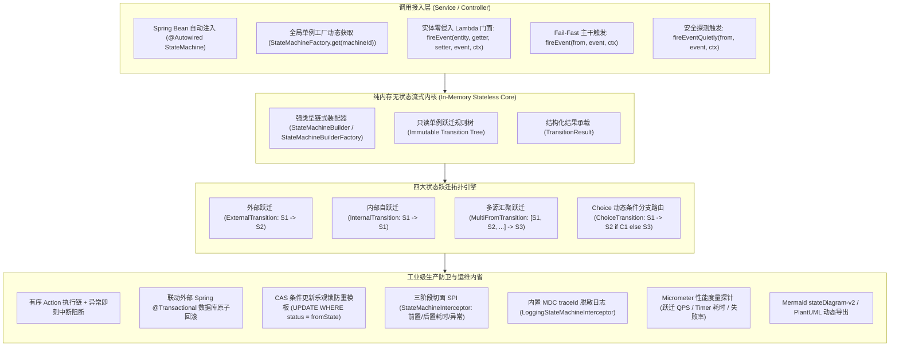

# 49. 高性能无状态业务状态机底座架构决策 (High-Performance Stateless Business State Machine Architecture)

## 背景与痛点

在企业级现代商业系统中（电商交易、支付收单、工单协同、履约物流、退款售后与物联网设备生命周期），业务状态的流转是领域模型的核心驱动力。状态流转的严谨性、确定性与执行性能直接关乎业务资产的安全与系统的一致性。然而，团队在研发状态管理或接入现有中间件时，普遍面临以下六大核心痛点：

1. **过程式代码腐化与边界失控 (Spaghetti Code & State Leaks)**：
   在常规业务研发中，状态流转逻辑通常以分散的 `if-else` 或 `switch-case` 散落在各个 Controller、Service 或 MQ 消费端中。随着业务迭代，逆向流转（如已关闭订单被错误发货）、跨状态跳跃或非法并发操作极易突破防线，状态合法性全靠工程师的个人经验，难以纵览全局生命周期视图。
2. **Spring StateMachine 重量级会话与并发性能瓶颈 (Heavyweight Session & Latency Penalty)**：
   Spring 官方 StateMachine 采用有状态会话模型（Stateful Session Model），每个业务实体请求需要实例化独立的 StateMachine 对象或从 Redis/数据库 Session 序列化恢复；其内部充斥着重量级的事件总线、线程调度与多层状态拦截，单次状态跃迁耗时常达数十毫秒，在高并发交易场景下会引发严重的线程锁争抢与内存暴涨，难以作为高吞吐微服务的基础底座。
3. **BPMN 流程引擎过度设计与维护包袱 (BPMN Overkill & Schema Pollution)**：
   Flowable、Camunda 等工作流引擎引入了数十张底层流程元数据表与复杂的任务调度器，适合面向人机交互审批流，但对于纯业务实体（如订单、支付单、物流单）的状态跃迁而言极其沉重，徒增数据库死锁与运维复杂度。
4. **事务边界与不可逆副作用割裂 (Transactional Boundary & Phantom Side-Effects)**：
   状态跃迁往往伴随本地数据库更新（持久化）与外部不可逆操作（调用退款 RPC、发送 MQ 消息、推送协同通知）。若状态机在事务未提交前提前触发外部调用，一旦本地事务因异常回滚，将产生严重的“幽灵通知”或“单边账”资损；若缺乏严格的异常中断与原子回滚机制，系统将陷入脏数据状态。
5. **并发竞争与状态防重断层 (Concurrency Race & Missing CAS Guard)**：
   在移动端用户点击取消与服务端支付回调并发到达的场景下，若缺乏轻量级的 CAS（Compare-And-Swap）条件更新协同，极易引发两次跃迁同时生效的竞态事故。许多框架将并发防御完全推给外部手写分布式锁，增加了 Redis 依赖与锁开销。
6. **架构黑盒与设计实现脱节 (Architecture Blindspot & Living Doc Vacuum)**：
   状态机代码写完后，产品、测试与新加入的开发人员无法直观获知系统支持哪些合法路径，状态转移图往往停留在过时的需求文档中，缺乏从真实运行时规则树 1:1 动态导出标准 Mermaid / PlantUML 状态图的内省能力。

---

## 核心架构与决策内容

经由严格推演与场景研讨，正式确立 **`ateng-boot-statemachine`（高性能无状态业务状态机底座）**，其整体架构拓扑如下：

### 1. 纯内存无状态单例架构 (Stateless Singleton Paradigm)
- **零数据库元数据表**：全生命周期不创建任何引擎专属数据库表，无持久化 Session 负担；
- **状态外部持有**：状态机实例保持严格无状态且线程安全，启动后为只读单例规则树；状态由业务实体（如 `t_order.status`）或外部调用方传入；
- **微秒级流式计算**：基于内存哈希路由计算目标状态，单次跃迁仅需纳秒至微秒级 CPU 时间，无外部 I/O 阻塞。

### 2. 四大流转拓扑与 Fluent Builder DSL
提供完全强类型泛型接口 `StateMachineBuilder<S, E, C>`（`S`: 状态类型, `E`: 事件类型, `C`: 上下文载荷），支持自解释链式组装：
1. **External Transition（外部跃迁）**：$S_1 \xrightarrow{Event} S_2$，标准状态变更；
2. **Internal Transition（内部自跃迁）**：$S_1 \xrightarrow{Event} S_1$，状态不变，仅执行附加动作（如追加物流备注、工单催办打标）；
3. **Multi-From Transition（多源汇聚跃迁）**：$[S_1, S_2, S_3] \xrightarrow{Event} S_4$，多个源状态在同一事件下收敛至同一目标（如“待付款”、“已付款”、“待审核”在“用户取消”事件下统一流转至“已关闭”）；
4. **Choice Transition（动态条件分支路由）**：$S_1 \xrightarrow{Event} (S_2 \text{ if } C_1) \text{ or } (S_3 \text{ if } C_2) \text{ or } (S_4 \text{ default})$，在单次跃迁中依据上下文动态裁决目标状态（如支付后风控质检分流）。

### 3. 双模触发契约与实体零侵入 Lambda 门面
- **Fail-Fast 主干调用**：`S fireEvent(S sourceState, E event, C context)`，未命中合法跃迁或条件不满足时立即抛出受管 `StateMachineException`，阻断业务流并触发事务回滚；
- **安全探测调用**：`TransitionResult<S> fireEventQuietly(S sourceState, E event, C context)`，不抛出异常，返回结构化报文（`isAccepted()`、`getTargetState()`、`getFailureReason()`），专供前端页面按钮可见性探测与业务预检；
- **实体 Lambda 回写门面**：提供 `fireEvent(entity, OrderDO::getStatus, OrderDO::setStatus, event, context)`，业务实体无需继承框架基类或实现标记接口，框架自动提取当前状态并回写流转结果。

### 4. 事务原子回滚与 CAS 并发防重协同
- **有序 Action 链与原子回滚**：支持链式挂载多个 Action；执行过程中一旦抛出异常，后续 Action 立即终止，状态机坚决不返回目标状态，并将原始异常完整抛出，由外部 Spring `@Transactional` 本地事务执行原子回滚；
- **CAS 乐观锁防重模板**：推荐结合持久层 SQL 条件更新（`UPDATE t_order SET status = :target WHERE id = :id AND status = :source`），受影响行数为 0 时判定为并发冲突，以极低开销化解并发竞态。

### 5. 切面拦截器 SPI 与运维度量
- **标准切面 SPI**：`StateMachineInterceptor<S, E, C>` 提供 `beforeTransition`、`afterTransition(from, to, event, ctx, Duration elapsed)` 与 `onException` 三阶段生命周期；
- **全链路追踪与脱敏日志**：内置 `LoggingStateMachineInterceptor`，出站日志自动绑定 MDC `traceId`，上下文载荷联动 `DesensitizeUtil` 审计脱敏；
- **Micrometer 指标打标**：自动向 Prometheus 暴露状态跃迁计数器（`statemachine.transition.total`）与耗时计时器（`statemachine.transition.timer`）。

### 6. 流转图动态导出与活文档
- 原生内置 `generateMermaid()` 方法，将内存中的状态规则树 1:1 动态生成为标准 Markdown 的 `stateDiagram-v2` 语法，支持状态、事件标注与 Choice 分支呈现；
- 同时支持 `generatePlantUML()` 格式导出。

---

## 架构准入不变量与红线 (Architectural Invariants & Review Redlines)

1. **严格无状态单例不变量 (Stateless Singleton Invariant)**：
   状态机实例本身必须保持完全无状态（Stateless），严禁在状态机内部使用实例字段缓存实体状态或瞬时业务数据，确保单个状态机 Bean 可安全跨线程并发复用。
2. **零数据库侵入不变量 (Zero DB Metadata Invariant)**：
   模块内严禁引入任何针对状态机自身运行状态的数据库建表语句与 ORM 映射实体。状态持久化必须且只能由业务层持有与更新。
3. **链式因果异常不变量 (Causal Exception Invariant)**：
   Action 执行失败或卫语句断言失败时，必须抛出封装了完整原始 `cause` 的 `StateMachineException`，严禁吞咽异常或转换为裸 `RuntimeException`。
4. **正交独立建模不变量 (Orthogonal Decomposition Invariant)**：
   严禁将业务多维度子状态硬塞入单个庞大的层级状态机中，强制推行正交解耦建模（如 `OrderStateMachine` 与 `LogisticsStateMachine` 独立并存）。

---

## 错误码标准契约 (StateMachineResultCode)

| 错误码 | 标识符 | 中文语义说明 | HTTP 映射 |
| :---: | :--- | :--- | :---: |
| `59001` | `TRANSITION_NOT_FOUND` | 当前状态未找到匹配的事件跃迁路由 | 400 Bad Request |
| `59002` | `CONDITION_FAILED` | 状态跃迁前置条件卫语句校验不满足 | 400 Bad Request |
| `59003` | `ACTION_EXECUTION_FAILED`| 状态跃迁动作执行失败（携带原始根因） | 500 Internal Error |
| `59004` | `DUPLICATE_MACHINE_ID` | 状态机标识重复定义冲突 | 500 Internal Error |
| `59005` | `CONCURRENT_CAS_CONFLICT`| 状态并发更新冲突（CAS 乐观锁防重拦截） | 409 Conflict |
