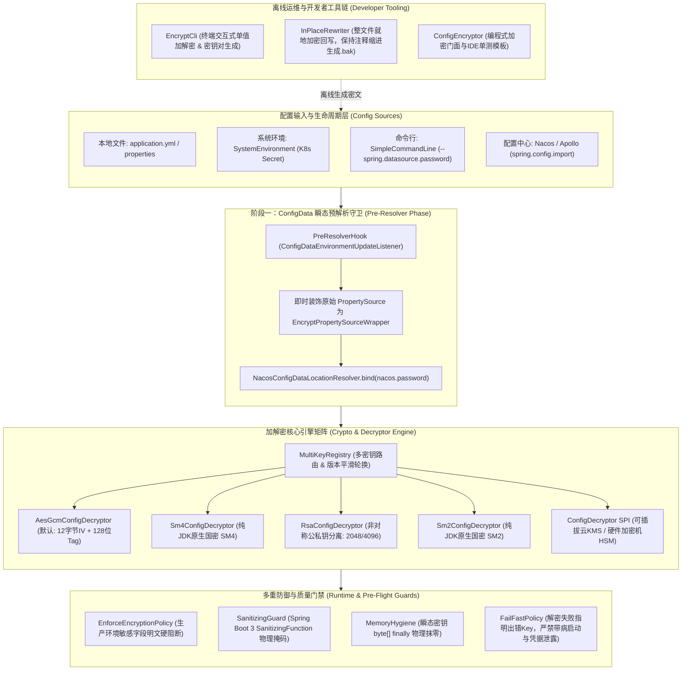

# 50. 配置加解密与运行时安全防御架构决策 (Configuration Encryption and Runtime Defense Architecture)

## 背景与痛点

在企业级中后台与微服务系统研发中，配置文件（`application.yml` / `application.properties`）往往承载着关系型数据库凭据、Redis 认证密码、消息队列鉴权密钥、第三方支付私钥及各类 SaaS 通信 Token 等高密级资产。

长期以来，业界在 Spring Boot 配置文件机密保护实践中普遍面临以下六大核心架构痛点与安全隐患：

1. **凭据静态落盘与源码仓库/部署制品明文泄露 (Plaintext Supply Chain Leaks)**：
   研发人员往往直接将数据库密码、Redis 密码等以明文形式硬编码在 `application.yml` 中。一旦代码仓库发生非授权访问、开发人员误开源、CI/CD 构建日志打印、Docker 镜像层解压或服务器磁盘文件被翻阅，核心凭据将彻底裸奔，构成严重的数据安全合规事故。
2. **Jasypt 等传统三方方案在 Spring Boot 3 下的 Nacos 启动时序死锁 (Bootstrap Dilemma & 403 Crashes)**：
   在 Spring Boot 3.x 全面启用 `ConfigData` 机制后，当 `application.yml` 声明了 `spring.config.import=nacos:...` 时，Spring 在解析本地 YAML 的过程中即会通过 `NacosConfigDataLocationResolver` 尝试连接 Nacos 服务端拉取远端配置。此时传统 Jasypt 依赖的 `EnvironmentPostProcessor`（排序为 `LOWEST_PRECEDENCE`）尚未被调用，导致 Nacos 客户端拿到的依然是裸密文字符串 `ENC(...)`，进而触发 HTTP 403/401 认证失败，应用直接崩溃。
3. **运行时端点 Actuator `/actuator/env` 导致已解密明文二次泄露 (Actuator In-Memory Reflection Leak)**：
   常规解密组件在启动期将密文还原到 Spring `Environment` 后，若应用开启了 Spring Boot Actuator 健康监控与环境端点（`/actuator/env`），所有解密后的数据库与 Redis 明文密码会通过 HTTP JSON 端点直接回显暴露，导致“防御了 Git 静态泄露，却在运行时后门大开”。
4. **开发运维职责边界混淆，缺乏非对称公私钥分离 (Lack of Asymmetric Key Separation)**：
   传统对称加密方案（AES/DES/SM4）要求加密与解密使用相同密钥。这导致开发人员为了在本地生成密文，必须获知生产主密钥，违背了金融安全与等保合规要求的“开发人员严禁接触生产密钥”原则；缺乏 RSA / SM2 公私钥分离能力（即开发仅持公钥加密，生产环境仅注私钥解密）。
5. **“自欺欺人式加密”与生产明文误提交漏洞 (Silent Plaintext Submissions in Prod)**：
   多数加密组件仅被动解密带有 `ENC(...)` 标记的字段。若某位开发者在生产配置 `application-prod.yml` 中图省事直接写了明文密码 `password: 123456`，系统仍会静默放行，导致安全门禁形同虚设，缺乏在生产环境下对敏感配置项进行“强制加密（Enforce Encrypted）”的刚性阻断能力。
6. **重型第三方依赖与算法现代性缺失 (Heavy Third-Party Bloat & Outdated Primitives)**：
   社区传统方案（如 `jasypt-spring-boot-starter`）不仅引入多个第三方臃肿依赖，且默认算法落后（多为易受填充提示攻击的 CBC/ECB 模式或过时的 PBE 算法），不支持现代带认证加密（AES-GCM，自带 128 位抗篡改 Tag），且在支持国产密码算法（SM4/SM2）时强依赖 BouncyCastle 等体积巨大的外部包，违背了框架纯原生零臃肿的底座原则。

---

## 核心架构与决策内容

经由严格推演与多轮对抗性研讨，正式确立 **`ateng-boot-encrypt`（配置加解密与运行时安全底座）**，其整体架构拓扑如下：

---

### 1. 两阶段加载穿透架构：彻底终结 Nacos 启动时序死锁

针对 Spring Boot 3 `ConfigData` 体系下配置中心客户端连接凭据加密的“启动死锁”问题，确立两阶段解密体系：

1. **第一阶段（Pre-Resolver Phase / 瞬态守卫）**：
   - 实现 `ConfigDataEnvironmentUpdateListener` 并在 Spring 启动最早期介入；
   - 当本地 `application.yml` 被解析成 `PropertySource` 且尚未触发 `NacosConfigDataLocationResolver` 时，立即对其进行轻量级 `EncryptPropertySourceWrapper` 动态代理；
   - 当 Nacos 解析器调用 `context.getBinder().bind("spring.cloud.nacos.password")` 时，底层代理**实时解密并返回真实明文**，保障 Nacos 客户端携带合规凭据握手服务端；
2. **第二阶段（Post-Environment Phase / 全量后置保障）**：
   - 伴随 Spring 标准的 `EnvironmentPostProcessor`（高优先级），自动扫描并动态装饰所有后续加入的属性源（包括从 Nacos 远端拉取下来的配置、系统环境变量与命令行参数）；
   - 实现“本地 Nacos 连接密码密文可解，Nacos 远端推送的数据库密码密文亦可解”的内外全链路闭环。

---

### 2. 100% 纯 JDK 原生算法矩阵与 SPI 逃生舱

坚持 `ateng-boot` 的 **Zero-Bloat 与 Core-First** 铁律，不引入 Jasypt 或 BouncyCastle 等冗余包，基于 JDK 17 原生能力与 `ateng-boot-core` 的 `CryptoUtil` 构建全算法矩阵：

1. **生产默认基线：AES-GCM 带认证加密 (AEAD)**：
   - 算法：`AES/GCM/NoPadding`，采用 12 字节随机 IV 前置，自带 128 位 GCM Authentication Tag；
   - 优势：不仅保障数据机密性，且具备抗位翻转（Bit-Flipping）与密文篡改校验能力，安全性远胜传统 CBC/ECB；
2. **信创与等保合规：纯 JDK 原生国密 SM4 / SM2**：
   - 纯原生 SM4（`SM4/CBC/PKCS5Padding` 与 `SM4/ECB`），免除外部 Bouncy Castle 依赖；
   - 纯原生国密非对称 SM2 加解密，满足等保三级对国产密码算法的强制合规要求；
3. **职责绝对隔离：非对称加密 RSA (2048 / 4096 位)**：
   - 开发与 CI/CD 流水线仅配置公钥（Public Key）生成密文，生产环境通过受管环境变量仅注入解密私钥（Private Key），从机制上杜绝开发人员接触生产解密凭据；
4. **金融级硬件逃生舱：`ConfigDecryptor` SPI**：
   - 定义极简 SPI 契约，支持下游企业一键无缝接入公司内网 PCI-E 硬件加密机（HSM）或公有云 KMS（阿里云/腾讯云/AWS KMS）。

---

### 3. 生产环境防明文误提交守卫 (Enforce Encryption Policy)

为了杜绝“防君子不防小人”以及开发人员因疏忽将明文密码提交至生产环境的隐患：

1. 提供 `ateng.boot.encrypt.enforce-encrypted=true` 声明式门禁（在 `prod` 等敏感 profile 下默认推荐开启）；
2. 启动时通过敏感键值正则模式（默认匹配 `.*password.*|.*secret.*|.*token.*|.*private-key.*`）扫描所有底层属性；
3. 若在生产环境下检测到上述属性的值**未以 `ENC(...)` 包裹**（即直接配置为裸明文），立即触发 Fail-Fast 阻断，抛出 `ConfigSecurityException` 中断启动，彻底消除明文带病上线的可能性。

---

### 4. 运行时端点 Actuator 物理掩码与内存转储保护

1. **自动装配 `SanitizingFunction` 守卫**：
   - 条件化装配 Spring Boot 3 标准的 `SanitizingFunction` Bean；
   - 只要某个属性在原始数据源中曾带有 `ENC(...)` 标记，不论属性名称是否包含敏感词，在访问 `/actuator/env` 或导出时**强制输出为掩码 `******` 或原始密文**，杜绝运行时端点二次泄露；
2. **内核级敏感字节数组瞬态抹零 (Memory Hygiene)**：
   - 在内部处理主密钥提取、IV 拼装与加解密管道中，优先使用 `char[]` / `byte[]` 瞬态处理；
   - 在运算完成的 `finally` 块中显式调用 `Arrays.fill(bytes, (byte) 0)` 执行物理抹零，最大程度压缩密钥在 JVM 堆内存中的留存生命周期，消除静态代码扫描安全告警。

---

### 5. 异常因果透明与精准出错 Key 指示

1. 当解密失败（如未配置密钥、密钥错误导致 GCM Tag 校验不通过、密文被非法篡改或算法不支持）时，严格恪守 **Fail-Fast** 铁律中断应用启动；
2. 异常信息中**精确指示具体是哪一个属性 Key（如 `'spring.datasource.password'`）解密失败**，极大降低排障成本；
3. **零明文与零密文泄露不变量**：在异常堆栈与控制台日志中，**绝对禁止打印解密失败的密文字符串与密钥内容**，确保排错信息对日志收集与审计系统 100% 安全。

---

### 6. 多密钥管理与整文件就地加解密工具链

1. **多密钥别名与平滑轮换 (`MultiKeyRegistry`)**：
   - 密文语法原生支持 KeyId 标识：`ENC[key-2026](密文)` 或默认 `ENC(密文)`；
   - 密钥轮换时，新旧密文可共存于同一 YAML 文件中，允许逐步轮换并支持不同微服务/不同数据源按域隔离密钥；
2. **三位一体开发者工具矩阵**：
   - **终端 CLI (`EncryptCli`)**：支持交互式命令行快速单值加解密与一键生成 RSA/SM2 公私钥对；
   - **整文件回写器 (`EncryptFileRewriter`)**：支持一键扫描指定 YAML 文件，自动识别敏感键值（或匹配 `# @encrypt` 标记），在**严格保持 YAML 注释、缩进与原有格式完全不变**的前提下，就地将明文重写为密文，并自动备份 `.bak` 文件；
   - **编程式门面与单测模板**：提供轻量 `ConfigEncryptor` 编程式门面，并在配套 Sample 工程中提供标准的 IDE 右键即跑单元测试用例。

---

### 7. 终极极限边界保障：多行文本、极早日志、动态防倒灌与切片单测宽容

针对真实生产极端复杂场景，补充构筑五道深度防御网：

1. **多行大文本机密与 PEM 格式保真 (Multiline Secret Hygiene)**：
   - 自动清洗 Base64 密文在 YAML 缩进折行中产生的空格与换行，解密还原出的 PEM 私钥或 SSL 证书 100% 保持原始首尾边界（`-----BEGIN...`）与换行符，保障第三方 SDK 零异常加载；
2. **配置中心动态热更新“防明文倒灌” (Plaintext Ingress Guard)**：
   - 收到 Nacos / Apollo 的 `EnvironmentChangeEvent` 时，采用原子引用刷新解密缓存；
   - 动态推送阶段持续激活 `EnforceEncryptionPolicy`，若运维在配置中心误提交裸明文，拦截器直接拒绝更新并告警，杜绝生产被动态穿透；
3. **极早日志系统协同穿透 (Logging Subsystem Synergy)**：
   - 将 `PreResolverHook` 提升至与 `LoggingApplicationListener` 协同阶段，保证 `logback-spring.xml` 中的 `<springProperty>` 在拉取远程日志（Logstash/Loki/Sentry）密码时即可完成动态解密；
4. **外部 KMS / 硬件加密机网络抖动弹性重试**：
   - 调用外部 KMS 或硬件加密机 SPI 时，无缝接入 `ateng-boot-core` 的 `RetryUtil`，默认支持 3 次指数退避重试，消除容器突发冷启动时的网络抖动引发的 CrashLoopBackOff；
5. **按需懒解密与切片测试友好 (Lazy Decryption)**：
   - 坚持按需评估原则，仅当代码真实调用 `getProperty()` 时才执行解密运算与密钥存在性断言；未被消费的敏感配置不阻塞 `@WebMvcTest` 等 Spring 切片单测，大幅提升日常研发敏捷度。

---

## 验证与实施计划

1. **模块与工程实施**：
   - 新建独立 Starter 子模块 `ateng-boot-encrypt`；
   - 新建配套独立场景验证工程 `ateng-boot-samples/ateng-boot-sample-encrypt`（严格遵守 1:1 映射铁律）；
   - 将构件纳入 `ateng-boot-bom` 与 `ateng-boot-all` 统管；
2. **全维度自动化测试门禁**：
   - 编写对称加密（AES-GCM、AES-CBC）、纯原生国密（SM4、SM2）及非对称（RSA）全真加解密单测；
   - 编写 `PreResolverHook` 对 Nacos 启动时序的离线模拟单测，验证在未进入上下文刷新前对凭据的透明解密；
   - 编写 `SanitizingFunction` 对 Actuator 端点输出物理掩码的断言测试；
   - 编写 `enforce-encrypted=true` 对明文误提交的刚性阻断测试；
   - 编写多 Key 动态路由与解密失败 Key 指示精准性单测。
