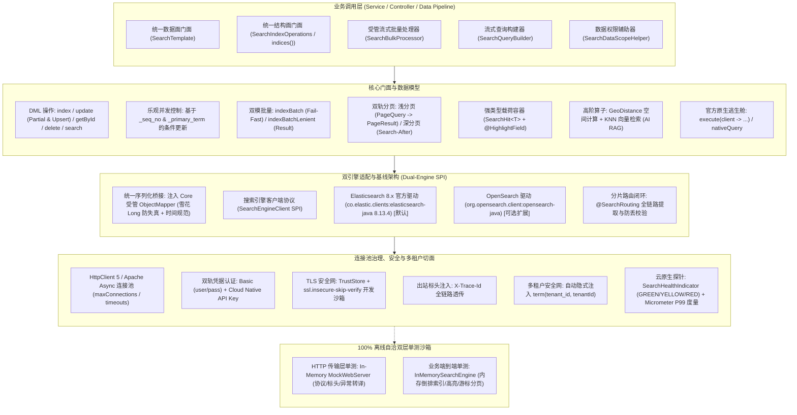

# 52. 企业级双引擎全文检索与流批分析底座架构决策 (Enterprise Dual-Engine Search and Analytics Architecture)

## 背景与痛点

在企业级现代应用与大数据中后台体系中（如电商商品检索、日志追踪审计、订单工单组合多维筛选、报表聚合、时序归档、地理位置服务与 AI 知识库向量检索），传统关系型数据库（RDBMS）在面对海量文本模糊匹配、动态组合条件筛选、空间计算以及高维聚合统计时存在严重的性能瓶颈与索引失效隐患。搜索引擎（Elasticsearch / OpenSearch）作为专职检索分析基础设施已成为不可或缺的核心底座。然而，团队在基于 Spring Boot 3 构建企业级检索能力时，普遍面临以下十大核心痛点：

1. **官方 Elasticsearch 8.x Java API Client 深度嵌套与代码膨胀 (Lambda Hell & Builder Bloat)**：
   Elasticsearch 在 7.15+ 全面废弃了传统的 `RestHighLevelClient`，强推基于纯函数式 Builder 的新一代 `elasticsearch-java` 客户端。其语法充斥着极深的 Lambda 嵌套（如一个简单的多字段布尔查询往往需要嵌套 5 到 7 层闭包 `s -> s.query(q -> q.bool(b -> b.must(...)))`），常规 CRUD 与高频检索充斥着臃肿的样板代码，开发心智负担沉重。
2. **Elasticsearch 8.x 与 OpenSearch 协议与依赖分道扬镳 (Ecosystem Divergence & Dual-Engine Dilemma)**：
   自 Elastic 协议变更后，AWS 主导的 OpenSearch 与 Elasticsearch 8.x 在依赖坐标、包命名空间、线缆握手 Header 强校验（ES 8 官方 Client 严格检测服务端是否为 Elastic 官方版本并阻断与 OpenSearch 通信）上完全割裂。传统业务要么绑定 ES 无法信创，要么强行引入两套重型 SDK 造成 Classpath 冲突与臃肿。
3. **序列化脱节导致雪花 ID 精度丢失与时间格式崩溃 (Serialization Rift & Snowflake Bug)**：
   官方 Client 默认内建隔离的 `ObjectMapper`，脱离了应用全局 Jackson 定制规则，导致 Long 型分布式雪花主键（Snowflake）在输出到前端或解析时由于 JavaScript 53 位精度限制发生尾数精度截断；同时 `LocalDateTime` 无法遵循 `yyyy-MM-dd HH:mm:ss` 规范解析，极易造成序列化崩溃。
4. **全量覆盖覆写开销与并发竞态丢失 (Missing Partial Update & Concurrency Race)**：
   业务更新频繁只涉及一两个状态字段（如订单状态变更为 `PAID`）。若仅支持全量 `index` 覆写，不仅需要先查后改浪费网络 I/O，还极易在并发场景下覆盖其他并发线程修改的属性，且缺乏轻量级的乐观并发控制（OCC：`_seq_no` / `_primary_term`）。
5. **批量写入局部失败静默丢失风险 (Partial Failure & Silent Data Loss)**：
   ES 的 `_bulk` 批量写入不具备跨文档关系数据库事务的原子回滚语义。一次提交 1000 条文档可能其中 5 条因 Mapping 格式冲突或版本冲突失败，而其余 995 条成功。很多二次封装框架直接以 HTTP 200 判定成功，静默吞咽了 `BulkResponse.errors()` 中的失败明细，导致严重的数据丢失或同步不一致。
6. **高频流式写入缺乏反压缓冲导致停机丢数据 (Missing Managed BulkProcessor & Shutdown Hazard)**：
   在对接 Canal Binlog、Kafka 消息队列或日志流水同步时，单条同步写入吞吐极低；手写外部缓冲队列容易缺乏反压保护造成内存溢出，且应用发版重启时残留在内存中的消息直接丢失。
7. **深度分页导致协调节点内存暴涨与集群雪崩 (Deep Paging OOM & Cluster Meltdown)**：
   当业务列表进行翻页查询时，开发者常沿用传统 SQL 的 `from + size` 逻辑。一旦查询越过 `index.max_result_window`（默认 10,000 条），ES 集群需要将全部前置分片数据加载至协调节点进行全量内存堆排序，引发严重的 GC 停顿与 OOM 崩溃；而官方弃用的 Scroll API 又会在服务端残留未释放快照上下文句柄。
8. **分片路由（Routing）全生命周期缺失引发性能劣化与空指针异常 (Routing Blindspot)**：
   在大规模分片索引中，未按商户/用户绑定路由键会导致所有查询演变为昂贵的全分片广播；更严重的是，在启用了强制路由的索引上，若 `getById` 或 `deleteById` 漏传 `routing`，底层驱动将直接报错或无法命中。
9. **高亮切片提取繁琐与数据安全性割裂 (Highlight Snippet Decoupling & In-Memory Purity)**：
   ES 高亮返回的 HTML 文本（如 `<em>关键词</em>`）独立存在于 Hit 的 `highlight` 字典中，与 `_source` 业务实体脱节。业务层常常需要编写大量反射与正则胶水代码将高亮文本替换回实体；甚至直接将带 HTML 标签的数据写回持久层，彻底破坏了 [ADR-0012](./0012-lifecycle-separated-data-security.md) 确立的“内存真明文”与传输隔离不变量。
10. **生产索引缺乏零停机平滑运维能力与离线单测断层 (Missing Atomic Alias Swap & Non-Hermetic Testing)**：
    企业生产变更分词器与 Mapping 时，若缺乏原生的原子别名切换（Atomic Alias Swap）门面，容易导致切换期间产生无索引空窗期；同时，单测强依赖外部真实集群或 Docker Testcontainers，导致本地与离线 CI 矩阵频繁阻断。

---

## 核心架构与决策内容

经由严格推演与多轮架构审查，正式确立 **`ateng-boot-search`（企业级双引擎全文检索与流批分析底座）**，其整体架构拓扑如下：



### 1. 双驱解耦与 Elasticsearch 8.x 专有优先架构 (Dual-Driver SPI)
- **BOM 原生基线**：直接依托 Spring Boot 3.3.13 官方依赖管控的 `co.elastic.clients:elasticsearch-java:8.13.4`，确保字节码与依赖生态零冲突；
- **驱动 SPI 隔离**：抽象统一底层 `SearchEngineClient` SPI 接口，默认装配 `ElasticsearchClientDriver`；将 OpenSearch 驱动作为可选扩展提供，实现“上层门面 100% 统一，底层引擎按需平滑插拔”；
- **官方原生逃生舱**：在 `SearchTemplate` 中显式提供底层原生客户端获取方法 `getClient()` 与函数式执行器 `execute(Function<ElasticsearchClient, R> action)`，允许调用端在极端定制场景下直接调用官方 8.x 原生高阶 API，杜绝平庸过度抽象带来的功能折损。

### 2. Jackson 统一序列化注入与格式防失真 (Unified Jackson Bridge)
- **受管序列化对齐**：摒弃 ES 驱动默认新建裸 `ObjectMapper` 的做法，自动装配时强制将应用受管的 `ObjectMapper` 注入 `JacksonJsonpMapper`；
- **雪花主键防精度截断**：严格遵循 [ADR-0005](./0005-jackson-customizer-over-objectmapper-override.md)，实体中的 `Long` 型分布式 ID 在序列化为 JSON 时自动转为 `String`，彻底消除前端 JavaScript 53 位精度溢出；
- **标准时间格式化**：统一装配 `JavaTimeModule`，所有 `LocalDateTime` 与 `LocalDate` 字段遵循 `yyyy-MM-dd HH:mm:ss` 标准规范出入参。

### 3. 数据面与结构面清晰隔离 (DML vs DDL Separation)
- **数据面（`SearchTemplate`）**：聚焦于业务文档的高频 CRUD、局部更新（Partial Update / Upsert）、批量写入、复杂布尔检索、高亮提取、Search-After 分页、空间与向量查询；
- **结构面（`SearchIndexOperations`）**：通过 `searchTemplate.indices()` 独立暴露，专职收敛索引与 Mapping 生命周期：
  - `exists(index)` / `existsAlias(alias)`；
  - `create(index, mappingJsonOrBuilder)` / `delete(index)`；
  - `putMapping(index, mappingJson)` / `getMapping(index)`；
  - `putIndexTemplate(name, templateJson)` / `existsIndexTemplate(name)`：支持时序分表模板定义；
  - `swapAlias(aliasName, oldIndex, newIndex)`：**生产原子别名热切换**，在底层单次请求中原子执行 `remove` 旧索引 + `add` 新索引，彻底消除无索引空窗期。

### 4. 局部更新 (Partial Update) 与乐观并发控制 (OCC)
- **轻量局部更新与 Upsert**：提供 `update(index, id, Map<String, Object> partialDoc)` 与 `update(index, id, T partialDoc, boolean docAsUpsert)`，底层仅发送需变更字段的 `_update` 报文，避免全量文档重查与重写；
- **乐观锁防竞态**：`SearchHit<T>` 载荷显式承载 `seqNo` 与 `primaryTerm`；在更新方法中支持传入预期版本号，若服务端版本不匹配触发 HTTP 409 冲突，立即抛出语义清晰的受管异常 `SearchVersionConflictException`。

### 5. 分片自定义路由（Routing Key）全生命周期闭环
- **注解声明驱动**：实体字段支持标注 `@SearchRouting`，在 `index` 与 `update` 时由框架自动反射提取并设置进请求参数；
- **主键操作防漏校验**：在 `getById` 与 `deleteById` 中提供带 `routing` 的重载契约，对标注了 `@SearchRouting` 的实体强制约束路由传递，杜绝分片错位或全分片广播；
- **定向检索加速**：`SearchQueryBuilder` 支持 `.routing(routingKey)`，将复杂检索限定在单分片极速执行。

### 6. 动态时序索引 (Date Patterns & SpEL)
- **动态后缀解析**：`@SearchIndex(value = "sys_log_#{T(java.time.LocalDate).now().format('yyyyMM')}")` 支持 SpEL 表达式与动态时间后缀计算，开箱即用支持按月、按天分表；
- **方法级显式重载**：所有 API 均提供显式 `indexName` 重载，允许调用方覆盖注解默认索引名。

### 7. 受管流式批量处理器 (`SearchBulkProcessor`) 与反压防爆
面向日志流水、Canal Binlog 消费与大数据同步场景，提供高性能受管写入处理器：
- **多维自适应刷盘**：满足以下任一条件立即触发物理批处理执行：
  1. 缓冲文档条数达到阈值（默认 `1000 条`）；
  2. 时间窗口到达（默认 `1 秒`）；
  3. 缓冲数据体积达到阈值（默认 `5MB`，采用 Core 模块强类型 `DataSize` 规范）。
- **受管线程隔离与反压防爆**：由 Core 模块 `ThreadPoolTaskExecutor` 调度刷盘任务，队列积压超限时触发微退避防爆保护；
- **优雅停机排空安全网**：实现 Spring `SmartLifecycle`，应用退出阶段自动强制 Flush 队列中残留文档，彻底杜绝发版停机丢失数据。

### 8. 轻量流式查询构建器 (Fluent `SearchQueryBuilder`)
收敛设计高直觉 Fluent 流式查询构建器，兼顾全文分词、空间计算与 AI 向量检索：
- **精确匹配**：`term(field, value)`、`terms(field, Collection<?> values)`；
- **分词检索**：`match(field, text)`、`multiMatch(text, fields...)`；
- **区间筛选**：`range(field, from, to)`、`gt` / `gte` / `lt` / `lte`；
- **通配与前缀**：`wildcard(field, pattern)`、`prefix(field, prefix)`；
- **布尔复合运算**：`must(...)`、`filter(...)`（**默认推行 filter 优先，享受 ES 节点位图缓存红利且不计相关度分**）、`should(...)`（支持 `minimumShouldMatch(int)`）、`mustNot(...)`；
- **排序与高亮**：`orderByAsc(field)`、`orderByDesc(field)`、`orderByScore()`、`highlight(fields...)`；
- **聚合度量快捷算子**：`termsAggregation(name, field)`、`sumAggregation`、`avgAggregation`；
- **地理空间算子**：`geoDistance(field, lat, lon, distanceStr)` 筛选 + `orderByGeoDistance(field, lat, lon, Order.ASC)` 排序；
- **AI 向量检索算子**：`knn(field, float[] vector, int k, int numCandidates)`，原生对接 ES 8.x dense_vector 相似度计算与混合检索（RRF）；
- **原生语法无损逃生舱**：支持 `nativeQuery(Query esQuery)`，兼容直接注入官方原生复杂 Query。

### 9. 强类型 `SearchHit<T>` 载荷与安全高亮机制
- **强类型载荷容器**：统一返回 `SearchHit<T>`，包含反序列化业务实体 `T data`、高亮切片 `Map<String, List<String>> highlights`、相关度分数 `Float score`、版本凭据（`seqNo`, `primaryTerm`）及排序游标 `Object[] sortValues`；
- **声明式 `@HighlightField`**：支持在出参 VO 属性上标注 `@HighlightField(target = "title")`，由底座自动完成高亮碎片提取与拼接并安全回填；若未标注，原始高亮数据保留在 `highlights` 字典中；
- **数据安全与内存真明文**：严格恪守 [ADR-0012](./0012-lifecycle-separated-data-security.md)，高亮富文本仅在展示层/VO 层呈现，严禁污染业务核心实体或持久层。

### 10. 双模批量写入治理 (Strict Fail-Fast vs Lenient Result)
针对 `_bulk` 局部失败痛点，提供双轨处理策略：
- **严格快速失败模式（`indexBatch(List<T>)`）**：批量写入后强制校验 `BulkResponse.errors()`，只要存在任一文档写入失败，立即抛出受管强类型异常 `SearchBulkException`，异常内部结构化封装失败文档 ID、HTTP 状态码及底层根因（`error.reason()`），保障交易核心流程绝对严密；
- **宽容明细模式（`indexBatchLenient(List<T>)`）**：不向外抛出异常，返回包含 `successCount`、`failureCount` 与 `List<SearchBulkFailure>` 的结构化载荷 `SearchBulkResult`，专供 MQ/Canal 大数据同步场景下记录死信或局部重试。

### 11. 双轨自适应分页与万级刚性熔断 (Dual-Track Pagination)
- **浅分页（UI 列表交互）**：当 `(page - 1) * size + size <= 10000` 时，无缝对接 `ateng-boot-core` 的 `PageQuery` 与 `PageResult<SearchHit<T>>` 标准传输契约，支持前端自由跳页；
- **深度分页（大数据滚动拉取）**：提供专职游标接口 `searchAfter(SearchQuery query, Object[] sortValues, int size)`，返回结果透传下一次滚动所必需的 `nextSortValues` 游标，微秒级寻址且对集群零内存常驻压力；
- **刚性安全熔断**：当浅分页 `from + size` 超过阈值（默认 10,000，可配置）时，底座执行 Fail-Fast 快速失败，抛出受管业务异常 `SearchPaginationExceededException`，从根源切断大深翻击穿集群引发 OOM 的隐患。

### 12. 四维链路透传与逻辑多租户隔离
- **出站链路追踪透传**：底层 HTTP 传输层自动挂载出站拦截器，提取当前线程 MDC `traceId` 注入 HTTP 请求头 `X-Trace-Id`，与 Web 模块和全链路监控体系对齐；
- **逻辑多租户隐式隔离**：当开启多租户（`ateng.boot.search.multi-tenancy.enabled = true`）且当前线程 `TenantContextHolder.getTenantId()` 存在时：
  - 查询阶段：自动在所有搜索请求的最外层 BoolQuery `filter` 作用域隐式注入 `term(tenant_field, tenantId)`；
  - 写入阶段：自动为文档补全租户字段值；
  - 豁免机制：标注 `@IgnoreTenant` 或调用 `runWithoutTenant` 时静默跳过租户注入。

### 13. 云原生可观测性探针与性能度量
- **健康度量探针 (`SearchHealthIndicator`)**：联动 `ateng-boot-observability` 自动装配，定时探测 ES 集群健康度（GREEN / YELLOW / RED）与活跃节点数，继承 ADR-0040 2 秒硬超时熔断保护防网络假死；
- **Micrometer 性能度量**：对核心 DML、DSL 检索与 Bulk 批量操作挂载 Timer 采样指标（`ateng.search.query.time`、`ateng.search.bulk.time`），一键无缝接入 Prometheus / Grafana 看板监控慢查询。

### 14. 双层 100% 离线自洽测试沙箱架构 (Hermetic Testing Strategy)
彻底摆脱对外部物理 ES 集群或 Docker Testcontainers 的强依赖，构建纯内存离线双层测试体系：
- **传输层契约测试**：基于轻量 In-Memory `MockWebServer`，拦截 REST 请求，自验 HTTP 请求头（`X-Trace-Id`）、序列化传输及异常错误码转译；
- **业务集成与 Sample 场景测试**：自研纯内存 `InMemorySearchEngine` / `SearchTemplateTestDouble`，依托 `ConcurrentHashMap` 与内存分词倒排索引，秒级自验 CRUD、局部更新、高亮回填、空间距离、组合布尔筛选与 Search-After 游标分页，保证本地与 GitHub Actions CI 在完全离线网络下 100% 秒级全绿。

---

## 配置属性契约规范

```yaml
ateng:
  boot:
    search:
      enabled: true
      engine: ELASTICSEARCH            # ELASTICSEARCH | OPENSEARCH
      uris:
        - http://localhost:9200
      username: elastic
      password: YOUR_PASSWORD
      api-key: YOUR_API_KEY            # 可选：云原生 API Key 认证
      path-prefix: ""                  # 可选：反向代理前缀路径
      connect-timeout: 5s              # 强类型连接超时 Duration
      socket-timeout: 30s              # 强类型套接字读取超时 Duration
      max-connections: 100             # 最大并发连接池容量
      max-connections-per-route: 50    # 单节点最大并发路由连接数
      keep-alive: 30s                  # 连接保活时长 Duration
      ssl:
        enabled: false
        trust-store-path: ""
        trust-store-password: ""
        insecure-skip-verify: false    # 本地开发沙箱跳过自签名证书合法性校验
      multi-tenancy:
        enabled: true
        column: tenant_id              # 多租户字段名（兼容下划线与驼峰）
      pagination:
        max-result-window: 10000       # 浅分页深度熔断安全阈值
      bulk-processor:
        enabled: true                  # 是否开启受管流式批量写入器
        batch-size: 1000               # 批量文档数量阈值
        flush-interval: 1s             # 刷盘时间窗口 Duration
        buffer-size: 5MB               # 内存缓冲容量阈值 DataSize
        concurrent-requests: 2         # 最大并发刷盘执行数
```

---

## 接口契约速查全景

| 接口 / 组件 | 核心方法 / 属性 | 功能职责与设计语义 | 典型应用场景 |
| :--- | :--- | :--- | :--- |
| `SearchTemplate` | `index(T doc)` / `index(String idx, T doc)` | 写入或全量替换单条文档，自动解析 `@SearchIndex` 与 `@SearchId` | 单据创建/更新实时同步 |
| `SearchTemplate` | `update(String idx, String id, Map<String, Object> doc)` | **局部更新**，仅更新指定非空字段，支持 upsert | 订单支付成功变更状态/时间 |
| `SearchTemplate` | `update(String idx, String id, T doc, long seqNo, long primaryTerm)` | **乐观并发控制条件更新**，版本冲突抛出 `SearchVersionConflictException` | 高并发并发防竞态更新 |
| `SearchTemplate` | `indexBatch(List<T> docs)` | **严格快速失败批量写入**，任一失败即抛出 `SearchBulkException` | 核心交易数据强一致同步 |
| `SearchTemplate` | `indexBatchLenient(List<T> docs)` | **宽容批量写入**，返回包含成功数与失败明细的 `SearchBulkResult` | MQ/Canal 大数据批量落库 |
| `SearchTemplate` | `getById(Class<T> clazz, String id, String routing)` | 根据主键与路由键精准检索单条文档 | 详情页极速查询 |
| `SearchTemplate` | `deleteById(Class<T> clazz, String id, String routing)` | 根据主键与路由键精准删除单条文档 | 单据物理删除下线 |
| `SearchTemplate` | `search(SearchQuery query, Class<T> clazz)` | 结构化查询返回 `SearchPage<SearchHit<T>>` 或 `List<SearchHit<T>>` | 列表页组合筛选与高亮 |
| `SearchTemplate` | `searchAfter(SearchQuery q, Object[] sort, int size, Class<T> c)` | **Search-After 深度游标分页**，返回结果附带下一页游标 | 超万条数据大批量导出/滚动拉取 |
| `SearchTemplate` | `execute(Function<ElasticsearchClient, R> action)` | **官方底层原生 Client 逃生舱**，支持直接调用原生高阶 API | 极限定制聚合、RRF 复杂混合重排 |
| `SearchBulkProcessor` | `add(T doc)` / `addAll(List<T> docs)` | **非阻塞流式缓冲写入**，自动根据数量/时间/容量阈值异步刷盘 | Canal Binlog / 日志流水高吞吐入库 |
| `SearchIndexOperations` | `searchTemplate.indices().swapAlias(alias, oldIdx, newIdx)` | **生产原子别名热切换**，单次请求完成 remove + add 零空窗切换 | 索引全量重建零停机切源 |
| `SearchIndexOperations` | `searchTemplate.indices().putIndexTemplate(name, json)` | 维护时序索引分表模板与 Mapping 映射 | 按天/月滚动索引自动生效 |
| `SearchQueryBuilder` | `geoDistance(field, lat, lon, dist)` / `knn(field, vec, k)` | 链式组装地理位置筛选与 AI 向量相似度检索 | 外卖周边商户检索、AI 知识库 RAG |
| `@SearchIndex` | `value()`, `shards()`, `replicas()` | 标注于实体类上，支持 SpEL 动态时序表达式解析 | 实体模型与 ES 索引元数据绑定 |
| `@SearchId` | 无 | 标注于实体字段上，声明文档唯一 ID（自动兼容 `@Id` 与 `id` 属性） | 文档主键自动提取 |
| `@SearchRouting` | 无 | 标注于实体字段上，声明物理分片路由键 | 多商户/多租户单分片定向命中 |
| `@HighlightField` | `target()` | 标注于 VO 字段上，将命中切片富文本自动回填至目标属性 | 搜索结果关键字高亮富文本渲染 |

---

## 后果与权衡 (Consequences & Trade-offs)

### 正向收益
1. **彻底终结 Lambda 嵌套地狱**：高频常用检索代码行数削减 70% 以上，API 直觉优雅，大幅提升业务研发效率；
2. **生产高可用与防 OOM 安全底线**：Search-After 游标分页结合万级浅分页刚性熔断，从根本上杜绝了深翻查询打垮 ES 集群的风险；
3. **数据一致性与局部失败感知**：双模批量写入与 OCC 乐观锁使上层调用方对局部写入失败与并发竞态具备 100% 确定性的感知与补偿手段；
4. **流式高吞吐与停机安全**：受管 `SearchBulkProcessor` 解决高吞吐异步写入痛点，依托 `SmartLifecycle` 确保重启优雅排空零丢件；
5. **前瞻赋能地理位置与 AI 场景**：开箱支持 Geo 空间计算与 KNN 向量检索，无缝承接未来 O2O 与大模型 RAG 混合检索；
6. **无缝多租户、追踪与云原生度量**：与既有 `TenantContextHolder`、MDC `traceId` 及 Actuator 深度互通，生产开箱即用；
7. **100% 离线秒级测试**：无需 Docker 与外部网络，本地与 CI 矩阵秒级全绿，保障框架交付质量。

### 妥协与规约
1. **运行时不自动变更 Mapping**：底座严禁在 Spring 启动时根据注解自动修改生产 ES 索引 Mapping（仅提供显式 DDL API）；生产 Mapping 必须受控管理，防止因实体属性微调导致生产分词或类型错误锁定；
2. **OpenSearch 首发为可选驱动**：核心以 Spring Boot 3 官方纳管的 `co.elastic.clients:elasticsearch-java 8.13.4` 为第一优先级打透，避免初始阶段引入不必要的外部多引擎 Jar 包膨胀。
