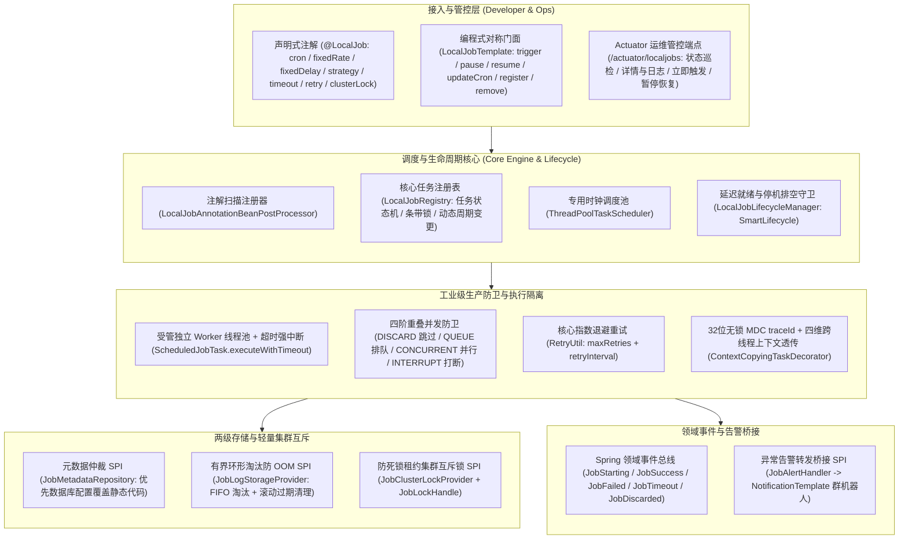

# 52. 工业级单机定时任务与轻量调度底座架构决策 (Industrial-Grade Standalone Local Job and Scheduling Architecture)

## 背景与痛点

在现代化企业级应用研发中，轻量级定时任务与周期性批处理是系统健康检查、数据对账、缓存预热、状态轮询与清理归档的核心支撑。然而，业务团队在使用 Spring 原生 `@Scheduled` 注解或外部调度系统时，普遍面临以下六大核心痛点：

1. **静态配置固化与动态管控缺失 (Static Rigidity & Zero Runtime Governance)**：
   Spring 原生 `@Scheduled` 注解在 Bean 初始化阶段由 `ScheduledAnnotationBeanPostProcessor` 固化装配。应用启动后，运维与开发人员无法在运行时动态添加、修改 Cron 周期、暂停、恢复或手动即时触发一次任务；一旦需要调整执行周期，必须重新编译打包并重启应用。
2. **并发重叠与线程池雪崩 (Uncontrolled Concurrency Overlap & Cascading Hang)**：
   默认情况下，Spring `@Scheduled` 仅采用单线程执行任务。单个任务若因慢 SQL 或网络抖动发生阻塞，会导致后续所有定时任务无限延期；即便配置了多线程调度池，长耗时任务在周期到达时若未结束，默认会并发多次触发同一任务，引发数据库死锁、数据脏写或线程池耗尽雪崩。
3. **缺乏硬超时熔断与自适应重试 (Missing Hard Timeout & Exponential Backoff)**：
   原生调度不支持针对单次任务配置硬执行时限。当下游依赖假死或死循环时，线程将永久挂死；同时，原生调度缺乏任务失败后的自适应重试机制，网络瞬时抖动引发的偶发失败无法自动修复。
4. **全链路追踪断层与日志散落 (MDC Trace Loss & Diagnostic Blindspot)**：
   定时任务由后台调度线程触发，缺乏 HTTP 请求上下文。原生调度没有自动注入链路追踪标识（MDC `traceId`），导致任务执行日志散落于海量控制台日志中，无法通过链路 ID 一键过滤关联，排查异常如同大海捞针。
5. **内存泄漏隐患与日志堆 OOM (Memory Leak Risk & Unbounded Log Growth)**：
   许多团队为了自研任务运维看板，在内存中直接使用无界 `List` 记录任务每次执行历史。长周期高频调度的任务在持续运行数周后，历史记录与异常堆栈无限膨胀，极易引发堆内存溢出（OOM）。
6. **轻量集群部署下的重复执行竞态 (Multi-Instance Duplicate Execution Race)**：
   在微服务或多副本容器部署架构下，单机定时任务会在每个 Pod 节点上同时触发，引发竞态冲突与重复扣款/对账风险。引入 XXL-JOB、PowerJob 或 Quartz 等重量级分布式调度中心又需要额外维护独立调度服务、数据库元数据表及复杂通信探活协议，对轻量单体应用或无外部运维支撑场景而言过度设计。

---

## 核心架构与决策内容

经由严格技术推演与场景验证，正式确立 **`ateng-boot-job-local`（工业级单机定时任务与轻量调度基础设施）**，其整体架构拓扑如下：

### 1. 声明式与编程式双模对称门面
- **声明式 `@LocalJob` 注解**：支持标注于任意 Spring 单例 Bean 方法，提供清晰且强类型的配置属性（`cron`、`fixedRate`、`fixedDelay`、`initialDelay`、`strategy`、`timeout`、`maxRetries`、`retryInterval`、`clusterLock`、`clusterLockLeaseTime`、`description`）；支持方法注入 `JobContext` 记录上下文日志，支持返回 `JobResult`、`String` 或 `void`；
- **编程式 `LocalJobTemplate`**：提供完备对称的运行时操作门面，支持 `trigger`（无参或带参手动触发）、`pause`、`resume`、`updateCron`、`registerCron`、`registerFixedRate`、`registerFixedDelay`、`remove`、`getJob`、`listJobs` 与 `listRecentLogs`。

### 2. 调度池与执行池物理隔离及硬超时强中断
- **时钟调度与业务执行物理隔离**：专用 `ThreadPoolTaskScheduler` 仅负责时间轮触发与调度时钟推进，严禁直接在调度池线程中执行耗时业务；
- **受管 Worker 线程超时中断**：当配置 `timeout` 阈值时，任务提交至受管执行线程池，并通过 `Future.get(timeout)` 实施硬超时监控。超时到达时主动向 Worker 线程发送 `Thread.interrupt()` 中断信号，并抛出受管 `JobTimeoutException`。

### 3. 四阶重叠并发防卫策略 (Overlapping Strategy)
针对前序任务尚未结束、后序触发周期已到达的高并发竞争场景，提供四大确定性防卫策略：
1. **`DISCARD`（默认防雪崩跳过）**：前序任务执行中时，后序调度安全丢弃，发布 `JobDiscardedEvent`，彻底防御线程池堆积雪崩；
2. **`QUEUE`（平滑排队执行）**：后序任务进入条带排队锁等待，前序执行完毕后紧随执行，保障无漏单执行；
3. **`CONCURRENT`（并发并行执行）**：不同触发周期在独立 Worker 线程中并发执行，适合完全无状态并行处理；
4. **`INTERRUPT`（打断前序执行）**：新调度到达时立即向前序执行中任务发送中断信号，优先保障最新周期任务获得执行权。

### 4. 32 位无锁 MDC 链路追踪与四维上下文透传
- **链路标识自闭环**：每次任务调度前，无论由 Cron 自动触发还是通过 REST API 手动触发，均通过纯原生无锁原语 `IdUtil.fastSimpleUUID()` 生成 32 位全局唯一 `traceId` 并注入 MDC；
- **四维跨线程快照透传**：依托 Core 底座 `ContextCopyingTaskDecorator` 与 `AsyncContext`，实现 $\langle\text{MDC}, \text{User}, \text{TenantId}, \text{IgnoreTenant}\rangle$ 全生命周期安全透传，并在 `finally` 块中绝对可靠地清理现场，杜绝线程污染。

### 5. 两级存储 SPI 与有界环形淘汰防堆 OOM
- **元数据仲裁 SPI `JobMetadataRepository`**：支持将任务配置持久化至数据库。当 `prefer-database-config=true`（默认）时，数据库动态配置优先覆盖代码注解静态配置；提供默认内存保底实现 `InMemoryJobMetadataRepository`；
- **有界环形淘汰防 OOM `JobLogStorageProvider`**：默认提供 `InMemoryJobLogStorageProvider`，基于每个任务独立的固定容量有界队列（默认最多保留 100 条）执行 FIFO 自动环形淘汰，彻底杜绝长期运行导致的堆内存溢出；支持 `cleanExpiredLogs(Duration)` 滚动清理过期历史。

### 6. 轻量集群互斥防死锁租约机制
- **轻量集群锁 SPI `JobClusterLockProvider`**：抽象 `tryLock` 与 `JobLockHandle`；提供默认内存单机/多节点虚拟共享实现 `LocalJobClusterLockProvider`，可无缝扩展为 Redis 或数据库分布式锁；
- **租约到期自动失效防死锁**：锁携带业务租约时长（默认 5 分钟），节点崩溃或异常宕机后租约自然过期，杜绝永久死锁；
- **抢锁失败安全跳过**：未抢到锁的节点安全跳过本次调度并标记状态为 `SKIPPED_CLUSTER_LOCKED`，防范重复执行。

### 7. 优雅停机排空与生命周期守卫
- **SmartLifecycle 延迟就绪**：实现 Spring `SmartLifecycle`（phase = `Integer.MAX_VALUE - 100`），确保所有依赖的 Service、Mapper、MQ 与连接池完全就绪后，才正式激活定时调度；
- **停机确定性排空**：应用收到退出信号时，首先关闭时钟触发器阻止新任务排队，随后等待已在 Worker 线程池中运行中的任务优雅完成（默认等待最多 30 秒超时），杜绝任务被强杀导致产生半事务脏数据。

### 8. Actuator 运维管控端点与领域事件总线告警桥接
- **Actuator 运维端点 `@Endpoint(id = "localjobs")`**：
  - `GET /actuator/localjobs`：全量任务清单与调度状态巡检；
  - `GET /actuator/localjobs/{jobName}`：单任务详情与最近审计日志查询；
  - `POST /actuator/localjobs/{jobName}`：支持 `{"action":"trigger|pause|resume"}` 执行即时运维管控；
- **领域事件总线与告警桥接**：全流程发布 `JobStartingEvent`、`JobSuccessEvent`、`JobFailedEvent`、`JobTimeoutEvent`、`JobDiscardedEvent`；在配置 `ateng.boot.job.local.alert.enabled=true` 时，通过 `JobAlertHandler` SPI 自动向企业微信、钉钉、飞书等群机器人转发富文本告警。

---

## 后果与权衡 (Consequences & Trade-offs)

### 正向收益
1. **全面超越原生调度**：彻底解决 Spring `@Scheduled` 无法动态增删、无并发治理、无超时熔断、无 MDC 链路追踪与无运维端点的历史局限；
2. **纯原生零依赖底座**：100% 依托 Spring Boot 3 与 JDK 17，零引入任何庞大外部依赖，启动极速（毫秒级初始化），内存开销极小；
3. **开箱即用与生产韧性**：默认零 DB 纯内存即可独立运行，并内置环形淘汰防 OOM、租约防死锁与停机排空，全面满足工业级高可用要求；
4. **统一运维与多端告警**：标准接入 Spring Boot Actuator 与 Notification 协同通知体系，提供开箱即用的运维监控与故障告警体验。

### 妥协与非目标
1. **单机与轻量集群定位**：本模块聚焦于单机应用、微服务独立实例或轻量多节点互斥调度场景；对于海量数据分片分段调度（如千亿级订单分批并行拉取）、复杂 DAG 依赖调度拓扑等场景，应选用专业分布式调度引擎（如 XXL-JOB 或 PowerJob）；
2. **无中心化控制台依赖**：本模块不内嵌独立 Web 管理控制台，管理功能通过标准 REST API 与 Spring Boot Actuator 端点暴露，建议与团队现有的运维中台或云原生监控系统集成。
