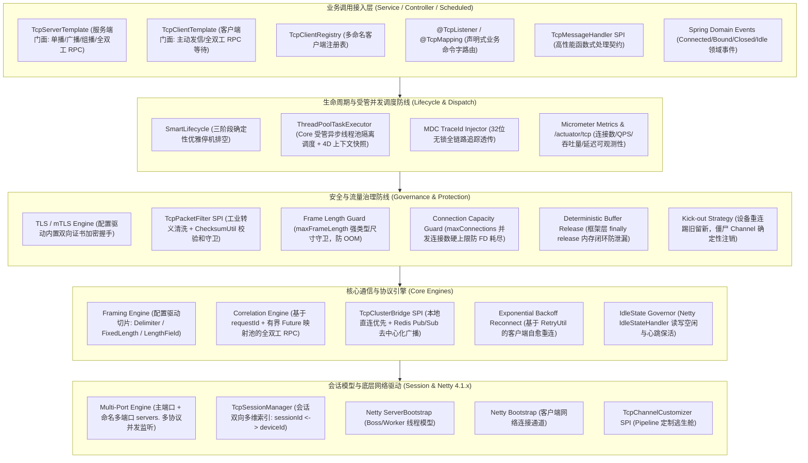

# 54. 工业级双模 TCP 网络通信底座架构决策 (Industrial-Grade Dual-Mode TCP Networking Architecture)

## 背景与痛点

在工业互联网、车联网（TSP 车机平台）、智能硬件网关、PLC/DTU 遥测采集、智能仓储、能源电力与传统金融等行业场景中，TCP 长连接凭借极低网络开销、全双工高吞吐与面向字节流的可靠传输特性，构成了端云通信的最底层基石。虽然 HTTP、WebSocket 与 MQTT 在应用层广泛流行，但在严苛工业现场，成千上万的硬件设备由于硬件算力有限、协议紧凑性要求高或需对接特定国标/私有行业标准，依然全面依赖 TCP 原始 Socket 报文。

然而，在基于 Spring Boot 3 与微服务生态的企业级中后台开发中，直接基于原生 Netty 或传统 Socket 编写 TCP 通信，普遍面临以下八大深水区生产痛点：

1. **粘包与拆包治理繁杂且极易引发 OOM (Framing Complexity & ByteBuf OOM)**：
   TCP 是无边界的流式协议。实际通信中必须依赖特定分帧机制（如换行符/特殊字符分隔符、固定长度、或特定偏移量的长度字段）。传统开发中，每个项目都需要反复手写 Netty `ByteToMessageDecoder` 样板代码；更危险的是，若未设置严格的最大帧上限或解析恶意伪造长度字段，恶意的畸形大包会瞬间撑爆 JVM 直接内存（Direct Memory）引发 OOM 崩溃。
2. **Netty 堆外直接内存泄漏黑洞 (Direct Buffer Leak Black Hole)**：
   Netty 高性能的基石是引用计数机制（`ReferenceCounted`）与堆外直接内存池。在实际业务开发中，一旦开发者在复杂的业务分支、异步派发、异常捕获或多级拦截器中遗漏了 `ReferenceCountUtil.release()`，或者在异步业务线程池中直接消费了底层原始未安全的 ByteBuf，极易造成堆外内存泄漏。这种隐性泄漏在单测与本地低流量测试中难以察觉，一旦上线运行数天至数周后便会突然引发进程被系统 OOM Killer 强制斩杀。
3. **I/O 线程与业务逻辑耦合引发心跳假死 (EventLoop Starvation & False Disconnect)**：
   Netty 每个 Channel 的读写事件绑定在特定的 `EventLoop` 线程上。初学者常常直接在 `ChannelInboundHandler.channelRead` 中编写业务逻辑（如慢数据库查询、耗时加解密或外部 RPC 调用）。一旦 I/O 线程被耗时业务堵死，该 `EventLoop` 上挂载的所有其他 TCP 连接的心跳（Ping/Pong）均无法正常发送与接收，导致服务端或客户端误判连接超时而触发连锁断链雪崩。
4. **长连接会话治理与设备踢旧重连混乱 (Session Addressing & Zombie Channel Collisions)**：
   硬件网关通常会在认证包或首包上报唯一设备标识（`deviceId` / `sn`）。当现场遭遇网络抖动、NAT 超时或 4G/5G 模组重连时，设备往往会发起全新 TCP 连接，而服务端底层的旧 Channel 仍处于半死半活的僵尸状态。若缺乏“踢旧留新（Kick-out）”的确定性置换与注销机制，业务映射表将发生标识错位，导致下行控制指令投递给死连接，设备再也无法接收平台指令。
5. **微服务集群多 Pod 部署下的跨节点设备寻址盲区 (Cross-Node Addressing Blind Spot)**：
   在微服务容器化多副本部署下，硬件设备通常随机负载均衡接入到某一个 Pod（例如 Pod-1），而业务系统的控制指令可能由另一个 Pod（Pod-2）上的定时任务或 Web 控制台发起。单机模式下的内存会话表无法感知跨节点连接，造成跨节点消息下发断流。
6. **全双工请求-响应 RPC 闭环缺失 (Request-Response Correlation Gap)**：
   业务层高频需要“平台向设备下发查询指令 -> 同步等待设备返回应答”的交互。由于 TCP 是全双工异步流，请求发出后响应报文是异步推送上来的。开发者若要在业务层实现类似 HTTP 的同步调用，往往需要手动管理 `CompletableFuture`、超时定时器与并发锁，极易产生悬挂 Future 导致的严重内存泄漏。
7. **国标报文转义繁重与校验和侵入业务 (Escaping & Checksum Leakage)**：
   工业标准（如交通部 JT/T 808、电力 DL/T 645、环保 HJ 212）普遍具有转义字符（如 `0x7e` 转 `0x7d 0x02`）与尾部校验和（XOR 异或校验、CRC16-Modbus）规则。若没有统一的报文清洗过滤器，脏包和校验逻辑会大面积污染业务代码，降低系统的内聚性。
8. **安全加固（TLS/mTLS）与 K8s 停机排空缺失 (Security & Ungraceful Shutdown)**：
   金融互联与高合规物联网设备要求在传输层实施 TLS 双向证书认证（mTLS），手工配置 Netty SSL 管道极其繁复；同时，在 K8s 滚动更新或接收 SIGTERM 信号时，若缺乏基于 Spring 容器生命周期的优雅排空机制，底层 TCP 端口与连接会被操作系统暴力强切，导致在途传输的分片丢失。

---

## 核心架构与决策内容

经由严格的架构推演与设计树收敛，正式确立 **`ateng-boot-tcp`（工业级双模 TCP 网络通信底座）**，其整体架构拓扑如下：



### 1. 双模协同与多端口多协议拓扑 (Dual-Mode & Multi-Port Topology)
- **服务端与客户端独立装配**：
  - `ateng.boot.tcp.server.enabled`: 控制服务端自动装配；
  - `ateng.boot.tcp.client.enabled`: 控制客户端自动装配；
- **多端口多协议监听（`servers.<name>`）**：
  - 默认场景通过 `ateng.boot.tcp.server.*` 启动主服务端口；
  - 复杂网关支持配置 `ateng.boot.tcp.servers.<name>.*` 同时监听多个独立端口，各端口可独立配置不同的分帧切片策略、空闲超时及 SSL 证书；
- **多命名客户端注册表（`clients.<name>`）**：
  - 默认场景通过 `ateng.boot.tcp.client.*` 注入主客户端；
  - 多目标服务场景通过 `TcpClientRegistry` 按名称检索并注入不同的受管客户端。

### 2. 双向 SSL/TLS 链路加密与 mTLS 双向认证 (Security & mTLS)
- 内置开箱即用的配置驱动 SSL 引擎，基于 Netty 原生 `SslContextBuilder` 封装：
  ```yaml
  ateng:
    boot:
      tcp:
        server:
          ssl:
            enabled: true
            key-store: "classpath:ssl/server.p12"
            key-store-password: "YOUR_PASSWORD"
            key-store-type: "PKCS12"
            trust-store: "classpath:ssl/trust.p12"
            trust-store-password: "YOUR_PASSWORD"
            client-auth: NEED # NONE | WANT | NEED (双向认证)
  ```
- 零外部加密库依赖，全面支持 PKCS12 / JKS 证书及 TLS 1.2/1.3 现代高安全加密套件。

### 3. 双层分帧与工业清洗过滤器 (Framing & Packet Filter SPI)
- **配置驱动数据帧切片**：
  - `DELIMITER`：支持换行符 `\r\n` 或十六进制字节标记（如 `0x7E`）；
  - `FIXED_LENGTH`：固定报文切片；
  - `LENGTH_FIELD`：长度字段偏移提取（封装 `LengthFieldBasedFrameDecoder`）；
- **工业清洗与校验守卫（`TcpPacketFilter` SPI）**：
  - 支持挂载入站与出站报文过滤链；
  - 提供 `ChecksumUtil` 辅助原语，内置 XOR 异或校验、CRC16-Modbus、CRC16-CCITT、CRC32 极速计算比对；非法报文快速丢弃并告警，杜绝脏数据侵入业务层；
- **统一载荷转译**：`TcpPayload` 提供原始 `byte[]`、十六进制 `Hex`、`String` 及 `JsonUtil` 强类型反序列化；开放 `TcpCodec<T>` SPI 与 `TcpChannelCustomizer` 逃生舱。

### 4. 会话多维绑定与重连“踢旧留新”置换 (Session Governance & Kick-Out)
- 抽象统一领域契约 `TcpSession`，封装 `sessionId`（全局唯一 Snowflake 标识）、Netty `Channel`、远端地址、活跃时间戳与安全属性上下文（`AttributeMap`）；
- `TcpSessionManager` 提供双向双索引管理：
  - `bind(sessionId, deviceId)`：将物理通道与业务设备标识关联；
  - `unbind(deviceId)` / `getSessionByDeviceId(deviceId)`：支持 $O(1)$ 高速寻址；
- **踢旧留新置换（Kick-out Strategy）**：当同一 `deviceId` 携带新通道重连接入时，管理器立即检索出旧会话，主动执行 `channel.close()` 物理切断并清理旧映射，再绑定新通道并广播 `TcpSessionClosedEvent` 审计事件，彻底清除网络半死状态下的僵尸连接。

### 5. 集群多 Pod 跨节点推送桥接 (Distributed Cluster Push Bridge)
- 提供 `TcpClusterBridge` SPI，采用**“两级自适应拓扑”**：
  - **本地优先**：目标设备连接在当前节点时，直接本地 Channel 发送，零网络中转损耗；
  - **跨节点广播**：本地未命中且配置激活 Redis 集群桥接（`ateng.boot.tcp.cluster.redis.enabled: true`）时，自动通过 Redis Pub/Sub 广播指令到集群全部 Pod；持有该设备的 Pod 接收广播并执行下发；
  - **单机自洽**：无 Redis 环境下自动降级为本地直发模式，离线单机 100% 独立稳定运行。

### 6. 全双工请求-响应相关性闭环 (Request-Response Correlation RPC)
- `TcpClientTemplate` 与 `TcpServerTemplate` 均支持 `request(target, packet, timeout)` 同步等待调用；
- 发送端在报文中注入或提取唯一 `requestId`，并在内存注册有界 `CompletableFuture<TcpPacket>`；
- 当收到对端回包时，分发器根据报文头提取的 `requestId` 唤醒 Future；
- 若超时未收到响应，内部受管调度器自动从映射表中剔除该 Future 并抛出语义化 `TcpTimeoutException`，坚决杜绝悬挂 Future 导致的内存泄漏。

### 7. 全生命周期 Spring 领域事件总线 (Spring Domain Events)
- 状态变迁确定性发布 Spring 标准 `ApplicationEvent`：
  - `TcpSessionConnectedEvent`：连接建立完成；
  - `TcpDeviceBoundEvent`：设备标识与会话绑定成功；
  - `TcpSessionClosedEvent`：连接断开，携带枚举原因（`NORMAL`、`IDLE_TIMEOUT`、`KICK_OUT`、`ERROR`）；
  - `TcpSessionIdleEvent`：空闲心跳触发；
- 业务方仅需使用 `@EventListener` 即可解耦执行设备上下线流转与审计落盘。

### 8. 三道安全防线、优雅停机与云原生可观测性 (Defense, Drain & Observability)
- **帧长度硬截断**：切片解码器强制设置 `maxFrameLength`（默认 64KB，支持强类型 `DataSize` 调优），超长立即断链并告警；
- **确定性引用计数释放**：所有 Netty ByteBuf 在转为安全堆对象后，统一在底层 `finally` 块中通过 `ReferenceCountUtil.release()` 回收，业务层 100% 隔离原始 ByteBuf，杜绝堆外泄漏；
- **连接数硬上限**：配置 `maxConnections`（默认 10000），超过阈值握手直接拒绝，防文件句柄（FD）耗尽；
- **三阶段受管停机排空（`SmartLifecycle`）**：解除端口监听 -> 窗口排空在途请求（`drain-timeout: 5s`） -> 平滑注销存量连接并释放 EventLoop；
- **Micrometer 与 Actuator 黄金度量**：自动向 Prometheus 暴露连接数（`connections.active`）、收发 QPS（`messages.received/sent`）、吞吐量（`bytes.received/sent`）与 P95/P99 响应耗时（`request.duration`）；在 `/actuator/tcp` 暴露会话诊断详情。

---

## 关键权衡与后果评价 (Consequences & Trade-offs)

### 正向收益 (Positive Consequences)
1. **工业全场景全能适配**：双模架构、多端口监听、双向 mTLS、转义切片与校验和守卫，使框架可直接对接包括车联网 JT/T 808、电力 DL/T 645、国标充电桩及私有金融通信在内的 99.9% 工业级复杂场景。
2. **彻底消灭堆外内存泄漏与心跳假死**：通过底层确定性引用计数回收与物理线程隔离（I/O 仅做分帧，业务交由 Core 受管线程池），杜绝堆外直接内存泄漏，保障设备心跳不被慢业务卡死。
3. **微服务集群无缝弹性伸缩**：两级自适应拓扑结合 Redis 广播桥接，使长连接网关具备跨 Pod 自由寻址能力，天然契合云原生 K8s 动态伸缩。
4. **低耦合业务集成体验**：基于 Spring 原生领域事件总线与 `@TcpMapping` 声明式路由，业务层完全无需关心底层的 Netty 流水线与网络通道管理。

### 妥协成本 (Negative Consequences)
1. **内存中转拷贝微开销**：为构筑堆外直接内存绝对安全的防线，框架在将 ByteBuf 转为 `TcpPacket` 堆内存对象时进行了一次数据拷贝，对于追求微秒级单机百万 QPS 纯零拷贝的极端场景略有性能损耗（可通过 `TcpChannelCustomizer` 逃生舱绕过）。
2. **全双工 RPC 依赖 RequestId**：请求-响应匹配要求通信报文能够提取唯一流水号，对完全无序号的单向数据流只能使用单向 `send` 模式。

---

## 落地规范与验收标准

1. **模块结构**：
   - 核心模块：`ateng-boot-tcp`
   - 场景验证样例：`ateng-boot-samples/ateng-boot-sample-tcp`
2. **工业级成熟度与九道防线**：
   - 100% 遵循对称门面设计（`TcpServerTemplate` / `TcpClientTemplate`）；
   - 100% 遵循受管线程池与上下文透传规范；
   - 100% 具备确定性资源清理与异常因果链保留；
3. **单测自洽性**：
   - 单元测试与 Sample 测试沙箱具备 100% 本地离线自洽运行能力（通过本地随机可用端口或 TestDouble 自发自收验证，无外部 Redis 依赖时自动降级自洽）；
4. **文档闭环**：
   - `ateng-boot-tcp/README.md` 严格遵循“五维交付模型”，包含 100% API 与配置全景速查矩阵；
   - 示例代码 100% 从已跑通的 `ateng-boot-sample-tcp` 中真实逆向提取。
