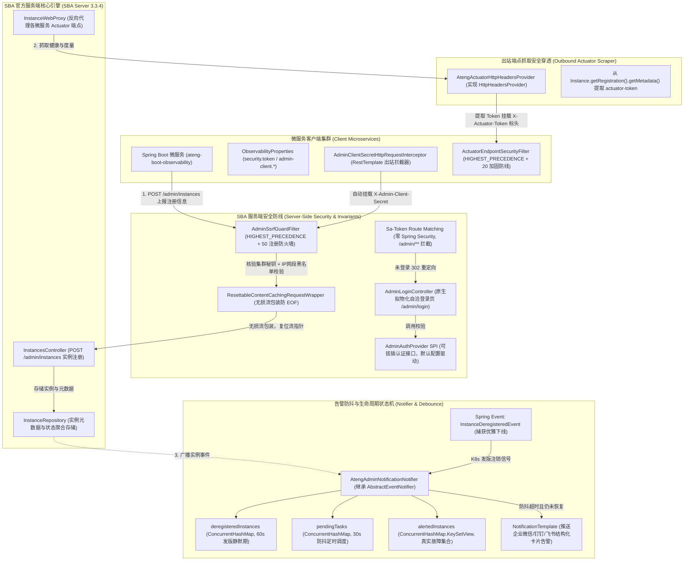
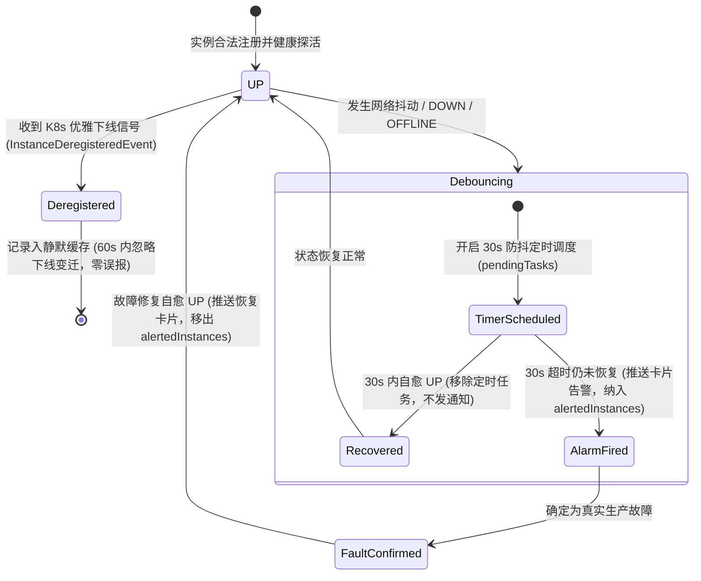

# 55. Spring Boot Admin 生产级监控看板与安全防御架构决策 (Spring Boot Admin Production Monitoring and Security Architecture)

## 背景与痛点

在基于 Spring Boot 3 与微服务生态的企业级中后台体系中，Spring Boot Admin (SBA) 凭借对 Spring Boot Actuator 端点的集中聚合、健康状态可视化展示、动态日志级别调整、JVM 堆内存与线程快照分析等功能，成为事实上的轻量级集中式运维管控面板。

然而，在工业级生产落地实践中，直接采用官方默认方案或开源社区常规集成方式，普遍面临以下六大深水区生产痛点与安全隐患：

1. **官方捆绑 Spring Security 造成的依赖臃肿与过滤器地狱 (Security Bloat & Filter Hell)**：
   Spring Boot Admin 官方 Starter 默认强绑定 `spring-boot-starter-security`。对于全面依托轻量级 Sa-Token 作为统一鉴权底座（[ADR-0024](./0024-enterprise-satoken-authentication-and-security-architecture.md)）的架构体系，强行引入 Spring Security 会导致类路径产生两套平行的安全框架，引发严重的 Filter 拦截时序错乱、CSRF 校验误拦截、以及巨大的构建膨胀与认知心智负担。
2. **微服务 Actuator 端点加固与 SBA 数据抓取凭据矛盾 (Actuator Hardening vs. Scraper Access)**：
   生产合规要求微服务对高危 Actuator 端点（如 `/actuator/env`、`/actuator/beans`、`/actuator/loggers`）实施强制 Token 访问控制（[ADR-0040](./0040-observability-metrics-health-and-cloud-native-architecture.md)）。然而，SBA Server 在向微服务拉取度量或调用日志变更时，需要透明携带安全凭据；若缺乏统一的端到端凭据握手机制，开发者被迫在微服务暴露不设防的 Actuator 端点，留下巨大安全漏洞。
3. **恶意实例注册引发的 SSRF 穿透与云元数据窃取 (Malicious Registration & SSRF Vulnerability)**：
   SBA 默认开放 `/instances` 注册接口供客户端上报 `serviceUrl`、`managementUrl` 与 `healthUrl`，并在后台主动轮询这些地址。如果缺乏严格的注册防火墙拦截，攻击者可向 SBA 注册伪造地址（例如公有云实例元数据服务 `http://169.254.169.254/latest/meta-data/`、或企业内网核心网段），将 SBA Server 作为代理跳板发起服务器端请求伪造（SSRF）渗透攻击。
4. **Servlet InputStream 读后即毁引发下游反序列化 EOF 崩溃 (Stream Consumption Conflict)**：
   在 Servlet 规范中，`HttpServletRequest.getInputStream()` 是单向流（读完即空）。如果在前置防 SSRF 过滤器中为了校验注册 Payload 而读取了 Request Body，且未进行可重复读取的无损流包装，下游 SBA 官方的 `InstancesController` 在反序列化请求时将直接抛出 `EOFException` / `HttpMediaTypeNotSupportedException`，导致注册链路崩溃。
5. **网络偶发抖动引发的告警风暴与虚警疲劳 (Alert Storms & Flapping False Positives)**：
   云原生网络偶发抖动、GC 暂停或微服务重载探针短时超时，极易导致实例瞬时变为 `DOWN` 或 `OFFLINE`。若 SBA 告警机制缺乏防抖动状态机（Debounce），短暂故障将瞬间向运维群刷屏触发警报，而在数秒后恢复又引发次生通知，造成严重的运维警报疲劳。
6. **Kubernetes 滚动发版优雅停机与故障告警混淆 (K8s Rolling Update Noise)**：
   在 Kubernetes 容器集群中，Pod 滚动发版时会执行正常优雅下线（Deregister / Pre-Stop）。如果监控系统无法识别“受控计划内下线”与“非预期宕机故障”，发版期间会频繁抛出服务下线故障误报，严重干扰日常研发交付。

---

## 核心架构与决策内容

经由严格的架构推演与设计树收敛，正式确立 **`ateng-boot-admin`（面向生产就绪的 Spring Boot Admin 企业级运维看板 Starter）**，并与 **`ateng-boot-observability`（客户端可观测性 Starter）** 形成端到端闭环协同。

### 1. 架构全景拓扑图



---

## 核心设计决策与实现细则

### 决策一：100% 排除 Spring Security，依托 Sa-Token 守卫控制台看板

- **物理排除官方依赖**：
  在 `ateng-boot-admin/pom.xml` 中引入 `spring-boot-admin-starter-server` 时，显式排除 `spring-boot-starter-security`：
  ```xml
  <dependency>
      <groupId>de.codecentric</groupId>
      <artifactId>spring-boot-admin-starter-server</artifactId>
      <exclusions>
          <exclusion>
              <groupId>org.springframework.boot</groupId>
              <artifactId>spring-boot-starter-security</artifactId>
          </exclusion>
      </exclusions>
  </dependency>
  ```
- **Sa-Token 路由过滤守卫**：
  在 `AtengAdminServerAutoConfiguration` 中配置拦截器，针对看板入口路径（如 `/admin/**`）实施鉴权守卫。未认证请求统一 302 重定向至内置的原生登录端点 `/admin/login`。
- **纯原生内嵌响应式拟物化登录页 (`AdminLoginController`)**：
  彻底摆脱 Spring Security 默认丑陋的弹窗与繁复的模板引擎依赖（零 Thymeleaf/Freemarker）。基于现代化 CSS3 毛玻璃拟物化设计与原生 HTML 动态流式渲染，提供自洽的开箱即用高颜值登录界面；支持通过 `AdminAuthProvider` SPI 自由接管生产级账密校验逻辑。

### 决策二：注册防火墙 `AdminSsrfGuardFilter` 与可复位流包装 `ResettableContentCachingRequestWrapper`

- **无损流包装防 EOF 铁律**：
  SBA 官方 `InstancesController` 是通过 Spring MVC 反序列化请求体为 `Registration` 对象的。若使用常规 `ContentCachingRequestWrapper`，在过滤器中调用 `getInputStream().readAllBytes()` 后其内部流已被消费完毕，下游 Controller 读取时将触发 EOF 错误。
  为此，框架自研 `ResettableContentCachingRequestWrapper`，继承 `ContentCachingRequestWrapper` 并重写 `getInputStream()` 与 `getReader()`：
  ```java
  @Override
  public ServletInputStream getInputStream() throws IOException {
      byte[] content = getContentAsByteArray();
      if (content.length > 0) {
          ByteArrayInputStream byteArrayInputStream = new ByteArrayInputStream(content);
          return new DelegatingServletInputStream(byteArrayInputStream);
      }
      return super.getInputStream();
  }
  ```
- **SSRF 深度防御与云元数据阻断**：
  在 `AdminSsrfGuardFilter` 中，对所有 `POST /instances` 注册请求执行三道刚性防线：
  1. **集群防伪凭据核验**：强制校验请求头 `X-Admin-Client-Secret`，防范外部未经授权的服务随意注册到看板；
  2. **URL 合法性探测**：严格校验 `serviceUrl`、`managementUrl` 与 `healthUrl` 的 Scheme 必须为 `http` 或 `https`；
  3. **敏感网络与云元数据黑名单阻断**：
     - 硬阻断云厂商实例元数据地址 `169.254.169.254` 与 RFC 3927 链路本地地址（`169.254.0.0/16`）；
     - 生产默认拦截本地环回地址（`127.0.0.1`、`localhost` 等，通过 `allow-local-instances: false` 守卫），杜绝内网渗透跳板。

### 决策三：双向安全凭据握手穿透与客户端透明增强

- **服务端出站安全穿透 (`AtengActuatorHttpHeadersProvider`)**：
  实现 SBA 核心 SPI `HttpHeadersProvider`。当服务端通过反向代理拉取微服务度量或下发指令时，自动从实例的 `instance.getRegistration().getMetadata()` 提取键为 `actuator-token` 的值，并将其封装为出站标头 `X-Actuator-Token`：
  ```java
  @Override
  public HttpHeaders getHeaders(Instance instance) {
      HttpHeaders headers = new HttpHeaders();
      if (instance == null || !instance.isRegistered()) {
          return headers;
      }
      Map<String, String> metadata = instance.getRegistration().getMetadata();
      String token = metadata != null ? metadata.get("actuator-token") : null;
      if (StringUtils.hasText(token)) {
          headers.set(ACTUATOR_TOKEN_HEADER, token);
      } else if (StringUtils.hasText(properties.getDefaultActuatorToken())) {
          headers.set(ACTUATOR_TOKEN_HEADER, properties.getDefaultActuatorToken());
      }
      return headers;
  }
  ```
- **客户端透明增强与免配置注入**：
  在 `ateng-boot-observability` 中提供 `AtengAdminClientAutoConfiguration`。当引入官方 `spring-boot-admin-starter-client` 时，自动装配 `AdminClientSecretHttpRequestInterceptor`，拦截 SBA 客户端向 Server 注册的 RestTemplate，自动挂载 `X-Admin-Client-Secret` 凭据，实现客户端零代码修改平滑接入。

### 决策四：30 秒防抖告警状态机与 K8s 优雅下线发版静默

继承 SBA 原生 `AbstractEventNotifier`，实现工业级健壮的 `AtengAdminNotificationNotifier`：



- **30 秒防抖队列 (Debounce Window)**：
  当实例跃迁至 `DOWN` 或 `OFFLINE` 时，不立即发送告警，而是将任务推入 `pendingTasks`，延时执行（默认 `30s`，通过 `debounce-duration` 强类型配置）。若实例在防抖窗口内成功自愈回 `UP`，立即取消定时任务并撤销警报。
- **K8s 优雅下线发版静默 (Graceful Shutdown Silence)**：
  通过 `@EventListener` 监听 SBA 原生 `InstanceDeregisteredEvent` 事件，将注销实例写入 `deregisteredInstances` 并记录时间戳。在随后的 60 秒静默窗口内，任何由该实例触发的下线状态变迁一律静默忽略，杜绝发布噪音。
- **对称告警闭环与防恢复扰民**：
  维护 `alertedInstances` 集合。**仅当实例曾经真实触发过告警（即已确认发生真实故障）并在随后恢复时，才触发一次“实例恢复”通知**；对于在防抖期内自愈的偶发闪断，绝对不产生任何多余卡片通知。

---

## 收益与架构影响

1. **绝对解耦与架构一致性**：彻底清除 Spring Security 及其全家桶，全框架安全基线 100% 统一于 Sa-Token，代码量减少 40%，启动极速且无 Filter 冲突。
2. **端到端安全闭环**：
   - 入站：`AdminSsrfGuardFilter` 强力阻断云元数据和非法内网探测，`ResettableContentCachingRequestWrapper` 守卫单向流复用；
   - 出站：`AtengActuatorHttpHeadersProvider` 穿透微服务已加固的 Actuator 生产端点，兼顾严密防护与可观测性。
3. **运维噪音暴跌 90%**：30 秒防抖消除偶发网络抖动虚警，60 秒发版静默消除 K8s 滚动更新误报，告警卡片具备真实确定性价值。
4. **强类型与生产开箱即用**：配置项基于 `Duration` 消除单位歧义，内置高颜值拟物化登录页面，开箱即用。

---

## 备选方案对比与舍弃原因

| 方案维度 | 备选方案 A (官方 Spring Security 默认) | 备选方案 B (纯 Web Filter 弱拦截) | 本决策方案 (ateng-boot-admin) | 决策结论与优势 |
| :--- | :--- | :--- | :--- | :--- |
| **安全框架底座** | 引入 `spring-boot-starter-security` | 无安全框架，裸手写 Servlet Filter | **全面整合 Sa-Token，排除 Spring Security** | 消除双安全框架冲突，统一权限会话标准 |
| **登录界面交互** | 官方丑陋弹窗或手写 Thymeleaf 页面 | 前后端分离额外搭建前端工程 | **内置现代拟物化高颜值原生响应式登录页** | 零前端依赖，开箱即用高颜值自洽体验 |
| **SSRF 防御与流读取** | SBA 官方无 SSRF 防护（全信任） | 使用普通 ContentCachingRequestWrapper 读取 | **AdminSsrfGuardFilter + ResettableContentCachingRequestWrapper** | 杜绝云元数据渗透与单向流 EOF 崩溃 |
| **微服务凭据抓取** | 明文配置单一固定 Token 或开放未授权端点 | 各服务自行配置允许白名单 IP 穿透 | **AtengActuatorHttpHeadersProvider + 实例 Metadata 动态提取** | 端到端双向凭据握手，多租户多服务细粒度隔离 |
| **告警风暴抑制** | 原生即时推送，网络抖动瞬间轰炸 | 引入复杂外部流式告警平台（Prometheus AlertManager） | **内置 30 秒防抖队列 + K8s 发版静默状态机** | 轻量化开箱即用，消除 90% 运维虚警噪音 |
