# 56. 持久层全生命周期闭环、高阶并发加固与全场景样例实装架构决策 (MyBatis-Plus Lifecycle Completeness, Concurrency Hardening & Full-Scenario Sandbox Architecture)

## 背景与痛点

在企业级高并发、高可用与高安全持久层架构演进过程中，`ateng-boot-mybatis-plus` 已经确立了实体五级阶梯链、行级多租户隔离、声明式细粒度数据权限、原生多值批量插入与受管游标防 OOM 等工业级能力。但在对标行业前 80%~90% 复杂生产场景与框架“九道代码成熟度防线”时，仍暴露出一系列隐蔽的架构死角与生产隐患：

1. **逻辑删除生命周期半残与对称语义缺失 (Asymmetric Soft-Delete Lifecycle)**：
   MyBatis-Plus 在启动期即通过 `@TableLogic` 将 `WHERE deleted = 0` 静态编译固化至 SQL 映射中。导致后续所有原生 `updateById` 与 `selectList` 默认无法触碰已删除记录。在业务实际运行中，管理员误删数据的“撤销/恢复”（Recycle Bin）、合规归档审计以及历史单据校验需要穿透逻辑删除，传统做法要么强迫业务手写原生 SQL 越过框架，要么破坏实体注解，触碰了九道防线中的“对称语义完备性”红线；
2. **Spring Boot 3 下 JSON 字段映射缺乏受管整合与空安全保底 (Unmanaged JSON & NPE Vulnerability)**：
   复杂业务对象常以 `List<String> tags`、`Map<String, Object> extra` 或强类型 POJO 形式持久化为 JSON。MyBatis-Plus 原生 `JacksonTypeHandler` 默认在类加载时通过私有 `new ObjectMapper()` 初始化，丢失了 Spring 上下文中配置的 `JavaTimeModule`（导致 `LocalDateTime` 反序列化崩溃）与全局脱敏命名定制；同时，当数据库列为 `NULL` 时原生直接返回 `null`，违反了“查询列表/集合无匹配时保底返回空集合，严禁返回 null”的空安全铁律；
3. **任务队列高并发排队与跳锁原语缺失 (Lack of Dialect-Aware Skip-Locking Primitives)**：
   在利用数据库构建轻量任务队列、抢单分配或分布式批处理时，`SELECT ... FOR UPDATE SKIP LOCKED` / `NOWAIT` 是避免 Worker 线程锁等待堵塞的工业解法。过去开发者被迫拼接脆弱的 `.last("FOR UPDATE SKIP LOCKED")` 魔法字符串，且在低版本方言（如 MySQL 5.7 或 SQLite）上缺乏防御性快速失败校验，极易在生产环境造成连接池耗尽雪崩；
4. **1:1 样例工程存在显著场景缺失债务 (Sample Coverage Debt & Phantom Code)**：
   按照《ateng-boot 研发指南》与 ADR-0028 确立的“100% 场景实测铁律”，模块实现的每一个对外公开功能必须在归属 Sample 工程中提供真实、自洽、端到端可运行的演示用例。此前外部动态 SQL、多表联表动态 AST 查询、慢 SQL 告警 SPI、联合唯一键防冲突软删除以及多数据源协同守卫在 Sample 中缺乏独立演示与断言，形成了隐形死代码债务。

---

## 核心架构与决策内容

立足于纯原生、零臃肿依赖与工业级代码成熟度九道防线，`ateng-boot-mybatis-plus` 正式确立 **持久层全生命周期闭环、高阶并发加固与全场景样例实装体系 (Phase 2.4)**：

```mermaid
flowchart TD
    subgraph SoftDelete["1. 逻辑删除全生命周期闭环 (LogicDelete Engine)"]
        Holder["LogicDeleteContextHolder\n计数器防嵌套闭包 (runWithDeleted)"]
        Interceptor["AtengLogicDeleteInnerInterceptor\nJSqlParser AST 递归剥离 WHERE deleted = 0"]
        ServiceRestore["AtengBaseService 恢复门面\nrestoreById / restore / getByIdWithDeleted"]
        UniqueEntity["BaseDeleteIdEntity\n(code, deleted) 联合唯一索引防冲突"]
        Holder --> Interceptor
        Interceptor --> ServiceRestore
        UniqueEntity -.-> ServiceRestore
    end

    subgraph ManagedJson["2. Spring 受管 JSON 类型转换与空安全 (JSON Engine)"]
        SmartInit["SmartInitializingSingleton 启动后置注入\n全局对齐 Spring Boot 受管 ObjectMapper"]
        AtengHandler["AtengJacksonTypeHandler<T>\nList/Set/Map 空值保底返回不可变空容器"]
        GenericHandler["GenericJsonTypeHandler<T>\nTypeReference 深度解析复杂泛型嵌套"]
        SmartInit --> AtengHandler
        SmartInit --> GenericHandler
    end

    subgraph LockEngine["3. 强类型悲观排队锁与方言防御 (PessimisticLock Engine)"]
        LockModeEnum["LockMode 强类型枚举\nFOR_UPDATE / NOWAIT / SKIP_LOCKED / FOR_SHARE"]
        LockUtil["PessimisticLockUtil 防御工具\n方言探测 + MySQL 5.7/SQLite 快速失败 (Fail-Fast)"]
        LockFacade["AtengBaseService 锁门面\ngetByIdForUpdate / listForUpdate"]
        LockModeEnum --> LockUtil
        LockUtil --> LockFacade
    end

    subgraph SampleSandbox["4. 1:1 样例工程全场景闭环沙箱 (ateng-boot-sample-mybatis-plus)"]
        S1["DynamicSqlScenario\n外部 XML 扫描预热与动态执行"]
        S2["MultiTableDynamicQueryScenario\nAST 别名自愈与动态流式分页"]
        S3["SoftDeleteUniqueKeyScenario\n联合唯一索引与误删数据恢复"]
        S4["SlowSqlAlertScenario\n慢 SQL 耗时拦截与敏感脱敏"]
        S5["DynamicDatasourceGuardScenario\n活跃事务假切源与越权守卫"]
        S6["JsonFieldScenario\n受管 JSON 序列化与空安全保底"]
        S7["PessimisticLockScenario\n跳锁多 Worker 并发防重消费"]
    end

    SoftDelete --> S3
    ManagedJson --> S6
    LockEngine --> S7
```

### 1. 逻辑删除全生命周期对称闭环架构
- **闭包上下文持有者 (`LogicDeleteContextHolder`)**：
  采用 ThreadLocal 结合嵌套调用计数器（`AtomicInteger` 或局部变量防重入）实现，提供 `runWithDeleted(Runnable)` 与 `callWithDeleted(Supplier<T>)` 编程式闭包，在 `finally` 块中执行严格现场清理，杜绝跨请求线程污染；
- **JSqlParser AST 动态穿透拦截器 (`AtengLogicDeleteInnerInterceptor`)**：
  当检测到 `LogicDeleteContextHolder.isIncludeDeleted()` 激活时，拦截器在 SQL AST 语法树层级递归遍历 `WHERE` 表达式，精准剥离框架默认追加的 `deleted = 0` 条件，同时严格保留业务显式指定的其他过滤条件；
- **对称恢复门面扩展 (`AtengBaseService`)**：
  在通用服务层扩展 `restoreById(Serializable id)` 与 `restore(Wrapper<T> wrapper)` 门面，在穿透闭包中执行 `UPDATE table SET deleted = 0, update_time = ?, update_by = ? WHERE id = ?`，全自动触发审计元数据回填；并提供 `getByIdWithDeleted`、`listWithDeleted` 与 `pageWithDeleted` 查询语法糖；
- **联合唯一索引防冲突占位基类 (`BaseDeleteIdEntity`)**：
  将逻辑删除字段声明为 `Long deleted`，未删除状态保持 `0L`，删除时自动填充分布式雪花 ID 占位，天然兼容数据库 `UNIQUE KEY (code, deleted)` 复合约束。

### 2. Spring 受管 JSON 字段类型转换与空安全保底体系
- **全局统一生命周期注入 (`SmartInitializingSingleton`)**：
  在 `AtengMybatisPlusAutoConfiguration` 中通过 `SmartInitializingSingleton` 在所有单例就绪后，将 Spring 容器受管的 `ObjectMapper`（已装配 `JavaTimeModule`、ADR-0005 规范及脱敏模块）注入 `JacksonTypeHandler.setObjectMapper`，彻底杜绝独立的未受管实例；
- **空安全保底类型处理器 (`AtengJacksonTypeHandler<T>`)**：
  继承 `JacksonTypeHandler`，重写 `getNullableResult` 方法：若实体属性为 `List`、`Set` 或 `Map`，在数据库读取到 `NULL` 或空白字符串时，保底返回不可变空容器（`Collections.emptyList()`、`Collections.emptySet()`、`Collections.emptyMap()`），消除上游无防卫读取触发的空指针异常（NPE）；普通 POJO 对象则保底返回 `null`；
- **深度复杂泛型模板基类 (`GenericJsonTypeHandler<T>`)**：
  针对包含多层泛型（如 `Result<Map<String, List<ItemVO>>>`）的持久化字段，提供抽象基类，允许业务通过子类或匿名内部类携带 `TypeReference<T>` 精准解析复杂类型结构。

### 3. 强类型悲观排队锁与方言快速失败防御原语
- **强类型枚举契约 (`LockMode`)**：
  显式收敛悲观排队与并发跳锁语义：`FOR_UPDATE("FOR UPDATE")`、`NOWAIT("FOR UPDATE NOWAIT")`、`SKIP_LOCKED("FOR UPDATE SKIP LOCKED")` 与 `FOR_SHARE("FOR SHARE")`，取缔散落各处的裸魔法字符串；
- **方言自适应与快速失败工具 (`PessimisticLockUtil`)**：
  内置底层方言探测机制，前置校验数据源方言。若在不支持并发跳锁的低版本引擎（如 MySQL 5.7、SQLite）上调用 `SKIP_LOCKED` 或 `NOWAIT`，立即抛出 `UnsupportedOperationException` 快速失败（Fail-Fast），彻底阻断假切源与锁等待超时雪崩；
- **业务服务层语法糖 (`AtengBaseService`)**：
  扩展高频门面方法：
  - `T getByIdForUpdate(Serializable id)`（默认阻塞排队行锁）；
  - `T getByIdForUpdate(Serializable id, LockMode lockMode)`；
  - `List<T> listForUpdate(Wrapper<T> wrapper, LockMode lockMode)`（任务队列批量拉取并跳过已锁定行）。

### 4. 1:1 样例工程场景化实测沙箱闭环
在 `ateng-boot-samples/ateng-boot-sample-mybatis-plus` 中针对新增能力及存量核心扩展点，补齐 7 大业务场景组件与端到端集成测试，实现 100% 覆盖率验证：
1. **`DynamicSqlScenario`**：验证外部 XML 脚本动态注册、启动预热加载、流式分页元数据回填及运行时热替换；
2. **`MultiTableDynamicQueryScenario`**：验证 JSqlParser AST 多表别名自动推导自愈（如 `deptName:like=研发` $\rightarrow$ `d.dept_name`）、方法引用流式分页与 `existsDynamic` 单页短路存在性判定；
3. **`SoftDeleteUniqueKeyScenario`**：验证 `BaseDeleteIdEntity` 联合唯一键删除防冲突、`restoreById` 误删数据恢复与穿透查询；
4. **`SlowSqlAlertScenario`**：验证纳秒级执行耗时拦截、可执行多行格式化 SQL 缩进输出、精准业务调用栈定位与 `@FieldEncrypt` 敏感参数掩码；
5. **`DynamicDatasourceGuardScenario`**：验证活跃 Spring 事务内部切源主动阻断（防御假切源）、数据权限上下文残留跨库越权防卫与租户一致性校验；
6. **`JsonFieldScenario`**：验证 Spring 受管 `ObjectMapper` 映射、Java 8 时间流转及集合/映射空安全保底；
7. **`PessimisticLockScenario`**：验证 `SKIP_LOCKED` 多 Worker 并发抢占任务防重消费与锁隔离。

---

## 质量不变量与设计准则

1. **确定性现场清理与上下文零污染 (Deterministic Cleanup)**：
   `LogicDeleteContextHolder`、`TenantContextHolder` 与 `DataPermissionContextHolder` 必须在所有测试用例与生产代码的 `finally` 块中无条件执行清理，严禁线程复用导致脏数据穿透；
2. **内存真明文与零实体泄露 (In-Memory Plaintext & Zero-Entity-Leakage)**：
   慢 SQL 告警与参数反填在持久层边界完成掩码脱敏，内存实体保持真实明文；Controller 传输边界 100% 严禁接收或直接返回 ORM 实体，统一通过 `PageUtil` / DTO / VO 纯净流式解耦；
3. **空安全与保底返回 (Null Safety)**：
   `AtengJacksonTypeHandler` 针对集合与字典反序列化统一保底返回不可变空容器，查询列表无匹配时保底返回空集合，严禁返回 `null`；
4. **100% 离线自洽单测铁律 (Hermetic Testing)**：
   所有新增单元测试与样例工程测试全部依托本地内存数据库 H2 运行，零外部网络依赖，测试结束后由 JUnit 5 自动物理销毁测试数据。

---

## 架构影响与追踪

- **关联工单**:
  - 父级任务工单: [#405](https://github.com/atengk/ateng-boot/issues/405)
  - 子任务工单: [#406](https://github.com/atengk/ateng-boot/issues/406), [#407](https://github.com/atengk/ateng-boot/issues/407), [#408](https://github.com/atengk/ateng-boot/issues/408), [#409](https://github.com/atengk/ateng-boot/issues/409), [#410](https://github.com/atengk/ateng-boot/issues/410), [#411](https://github.com/atengk/ateng-boot/issues/411), [#412](https://github.com/atengk/ateng-boot/issues/412)
- **文档与上下文同步**:
  - 核心文档更新至 `ateng-boot-mybatis-plus/README.md`
  - 领域模型与词汇更新至 `ateng-boot-mybatis-plus/CONTEXT.md`
  - 全局上下文图映射更新至 `CONTEXT-MAP.md`
