# 57. Excel 异构多表流式编排、动态列投影裁剪与整工作簿原生安全加密架构决策 (Excel Multi-Sheet Streaming, Dynamic Column Projection & Native Workbook Encryption Architecture)

## 背景与痛点

在企业级应用开发中，Excel 导入导出是与业务核心数据交互最频繁的环节之一。随着业务复杂度提升与数据安全合规要求提高，原有流式 Excel Starter 暴露出以下高频痛点与架构死角：

1. **多工作表读取不对称与重复 I/O (Asymmetric Multi-Sheet Reading)**：
   模块通过 `ExcelBuilder` 已支持流式多工作表写入，但在读取侧，原有 API 仅能默认读取第 1 个工作表或单一数据类型。在企业级“主子订单”、“多单据汇总报表”等复合导入场景中，开发者被迫多次重新打开 `InputStream` 重复解析，或被迫穿透到底层 Apache Fesod 编写底层解析逻辑，破坏了门面的对称完备性；
2. **动态列裁剪破坏强类型注解契约 (Brittle Dynamic Column Projection)**：
   业务导出经常需要“用户前端自定义导出勾选列”或基于角色权限剔除未授权敏感字段。原有实现只能退化为纯无实体动态导出（`exportDynamic`），采用裸二维字符串列表拼装，彻底丧失了 Java VO 模型上声明的 `@ExcelTheme` 主题排版、`@ExcelSensitive` 动态脱敏、`@ExcelEnum` 双向枚举转义及自适应列宽补偿等强类型注解能力；
3. **整文件安全强加密能力缺失 (Lack of Full Workbook AES Encryption)**：
   原有工作表只读保护（`sheet.protectSheet`）仅属于 UI 界面层级的防误改，物理文件仍为明文 ZIP/XML 结构。对于薪酬报表、金融对账、上市公司敏感数据等高密场景，缺乏基于 POI 原生 `EncryptionInfo` 的整文件 AES-256 强加密与透明密码解密，无法满足等保三级与金融行业数据防泄密要求；
4. **客户端网络中断导致磁盘临时文件泄漏隐患 (Client Abort & Temp File Leakage Risk)**：
   流式处理海量数据时，底层依赖磁盘临时文件做换页缓冲。当 Web 浏览器用户在下载过程中主动取消、关闭标签页或发生网络闪断时，Servlet 容器抛出 `ClientAbortException` 或网络重置中断。若框架缺乏防御性网络中断异常识别与确定性清理，未完成的工作簿临时文件可能悬挂于 `/tmp`，高并发下存在打满磁盘风险；
5. **样例工程缺乏专职业务场景驱动 (Sample Architecture & Controller Bloat)**：
   原有 `ateng-boot-sample-excel` 中集中堆砌了包含 19 个接口的单一超大类 `ExcelSampleController`，将纯底座逻辑与 Web 传输契约强行混杂，未遵循业务场景命名与分层规范。

---

## 核心架构与决策内容

立足于纯原生算力、零臃肿依赖与工业级代码成熟度九道防线，`ateng-boot-excel` 正式确立 **异构多表流式编排、动态列投影裁剪、整工作簿原生安全加密与客户端防中断清理体系**：

```mermaid
flowchart TD
    subgraph MultiSheet["1. 异构多表流式对称编排 (ExcelReaderBuilder)"]
        InStream["单个 InputStream 数据流"]
        ReaderBuilder["ExcelReaderBuilder 链式门面\n(按索引/表名寻址 + 异构 Class 绑定)"]
        StreamConsumer["分批流式消费模式\n(sheet(0, MasterVO, size, batchConsumer))"]
        AggregateResult["小文件全量聚合模式\n(ExcelMultiSheetResult 统一结果容器)"]
        InStream --> ReaderBuilder
        ReaderBuilder --> StreamConsumer
        ReaderBuilder --> AggregateResult
    end

    subgraph ColumnProjection["2. 强类型动态列投影 (Dynamic Column Projection)"]
        VOModel["强类型实体类 (@ExcelProperty + @ExcelSensitive + @ExcelTheme)"]
        ProjectionRule["includeColumns(Set) / excludeColumns(Set)"]
        CompactLayout["自动左移紧凑排版\n(被剔除列物理消失，保留列紧凑对齐，100% 继承注解)"]
        VOModel --> ProjectionRule
        ProjectionRule --> CompactLayout
    end

    subgraph WorkbookSecurity["3. 整工作簿 AES-256 原生加解密 (WorkbookEncryption)"]
        POIEncryptor["POI 原生 EncryptionInfo (Agile Encryption / AES-256)"]
        TempBuf["磁盘临时文件缓冲 (try-finally 确定性物理销毁)"]
        TransparentDecrypt["ExcelUtil.read(in, clazz, password)\n透明识别 OLE2 加密流并解密还原"]
        POIEncryptor --> TempBuf
        TransparentDecrypt --> TempBuf
    end

    subgraph WebResilience["4. Web 响应解耦与防中断治理 (ExcelWebUtil)"]
        WebFacade["ExcelWebUtil 专职门面\n(toResponseEntity / export)"]
        StreamingResp["Spring 现代响应契约: ResponseEntity<StreamingResponseBody>"]
        ClientAbortGuard["多容器网络中断自适应防御\n(识别 ClientAbortException，DEBUG/INFO 记录，强制回收临时文件)"]
        WebFacade --> StreamingResp
        WebFacade --> ClientAbortGuard
    end

    subgraph SampleMatrix["5. 1:1 样例工程场景化重构 (ateng-boot-sample-excel)"]
        ScenarioServices["6 大专职业务场景服务 (@SpringBootTest 强断言)\nStreamingPage / MultiSheet / Validation / Async / Security / Projection"]
        MinimalWebCtrl["极简 ExcelWebContractController (仅验证 RFC 5987 / 6266 与上传)"]
    end
```

### 1. 核心决策要点

1. **读写对称：`ExcelReaderBuilder` 流式读取门面**：
   - 建立单次 I/O 流内多工作表异构解析能力，允许同一流同时分派多个 `ReadSheet`；
   - 兼顾大文件分批流式消费回调（恒定低内存）与中小型文件聚合返回（`ExcelMultiSheetResult`），并在流解析结束时自动闭合底层流句柄。
2. **强类型零失真：动态列投影机制**：
   - 依托 Apache Fesod 原生 `includeColumnFieldNames` / `excludeColumnFieldNames` 底层能力，在 `ExcelBuilder` 与 `ExcelUtil` 顶层门面开放强类型列投影；
   - 被排除字段在物理 Excel 中自动剔除，保留列紧凑左移无空洞排版，完整继承 VO 上的脱敏、样式与类型转换逻辑。
3. **零臃肿原生安全：整工作簿 AES-256 加解密**：
   - 100% 依托 POI 原生 `org.apache.poi.poifs.crypt.EncryptionInfo`（Agile Encryption / AES-256 + SHA-512），坚决杜绝引入第三方外部加密包；
   - 加密过程采用本地受管临时文件缓冲，并在 `finally` 块中确定性物理删除，防止堆内存暴涨与临时文件堆积；读取加密工作簿时通过 POI `Decryptor` 实现透明解密流还原。
4. **防御性生产就绪：客户端中断安全拦截与临时文件清理**：
   - 在 `ExcelWebUtil` 中建立多容器自适应异常分类器，精准识别 `ClientAbortException`、`Broken pipe` 与 `Connection reset`；
   - 捕获后记录温和链路日志，抑制 500 堆栈抛出，在 `finally` 块触发 Fesod/POI 资源清理钩子，无条件回收所有临时文件碎片。
5. **样例工程业务场景驱动重构**：
   - 将原单体 Controller 解耦为 6 个真实业务场景组件（`*ScenarioService`）并配套 `@SpringBootTest` 全真测试；
   - 保留极简 `ExcelWebContractController` 仅演示标准响应头编码与文件上传。

---

## 影响与向后兼容性

- **向后兼容性 100% 保障**：原有 `ExcelUtil.export(HttpServletResponse, ...)`、`ExcelUtil.read(...)`、`ExcelBuilder` 等核心 API 签名完全保持不变，内部平滑代理至加固逻辑；
- **配置与依赖平滑**：无新增第三方外置依赖，完全复用现有 POI 5.4.1 与 Fesod 2.1.0 原生能力；
- **交付闭环**：新领域词汇已同步至 `ateng-boot-excel/CONTEXT.md` 与根目录 `CONTEXT-MAP.md`。
