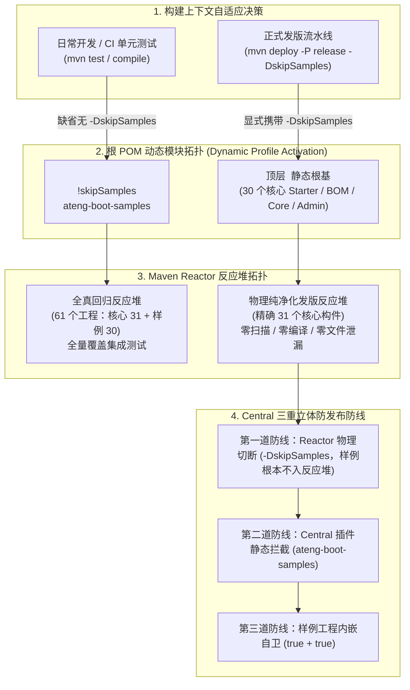

# 58. 样例反应堆物理隔离、发布配额防暴与发版流水线纯净化架构决策 (Samples Reactor Physical Isolation, Central Quota Governance & Pure Release Pipeline Architecture)

## 背景与痛点

在 `ateng-boot` 迈向现代化企业级全能 Starter 套件的演进过程中，子模块与 1:1 独立场景样例工程已扩展至 30+ 个核心构件与 29 个 Samples 工程。在自动化发版与 Maven Central 公共分发链路中，暴露出以下深层工程治理与合规风控隐患：

1. **Sonatype Central Portal 月度配额硬约束与封禁告警 (Monthly Publishing Limits Risk)**：
   Sonatype Central Portal 对开源免费组织引入了月度配额监测体系（File Count 约 1,000、Release Count 约 7~10、Release Size 约 80MB）。在多模块体系下，单次发版 30+ 个构件会自动生成对应的主 Jar、源码 Jar、Javadoc Jar、POM 以及全部附带的 GPG 签名（`.asc`）与 Checksum 文件，单次发布即产生 360+ 个文件。单月内发布 2~3 次迭代，极易触发 `reached the monthly publishing limits for File Count and Release Count. Grace period ends...` 宽限期告警，若不治理将面临发版熔断被拒；
2. **手工枚举维护成本与死代码漏配 (Brittle Manual Enumeration in excludeArtifacts)**：
   在根 `pom.xml` 的 `central-publishing-maven-plugin` 配置中，原有设计通过 `<excludeArtifacts>` 显式罗列需要排除的样例构件。随着 Starter 快速扩充，工程实际已拥有 29 个样例子模块，但根 POM 仅硬编码了 10 个，导致 19 个样例模块沦为“隐形漏配构件”。手工维护长列表违背了高内聚与自动化治理原则；
3. **Maven Reactor 递归解析陷阱与命令行排除失效 (Maven Reactor Nested Submodule Trap)**：
   若根 POM 顶层 `<modules>` 直接挂载聚合模块 `ateng-boot-samples`，在发版时即使尝试在命令行附加 `-pl '!ateng-boot-samples'`，Maven Reactor 规约仅会移除聚合 POM 节点本身，其名下的 29 个子工程依然会被递归全部载入构建反应堆，导致大量的无用编译、打包与插件扫描，无法实现物理级解耦；
4. **二进制分发产物混杂内部 Demo (Impure Binary Assets in GitHub Release)**：
   在自动化流水线 [`.github/workflows/release.yml`](../../.github/workflows/release.yml) 中，打包任务通过通配符搜集所有 Jar 并上传至 GitHub Release 附件，导致内部自验 Demo 的 Jar 包被一并暴露分发，破坏了企业级对外交付物的规范性与纯净度。

---

## 核心架构与决策内容

立足于纯原生构建机制、零脆弱维护与全生命周期防发布防线，`ateng-boot` 正式确立 **属性缺省动态激活拓扑、Central 三重立体防御与发版流水线纯净化体系**：

### 1. 属性缺省动态激活拓扑 (`<name>!skipSamples</name>`)
- **根 POM 解耦**：彻底从根 `pom.xml` 的顶层 `<modules>` 列表中剔除 `<module>ateng-boot-samples</module>`，消除全局强绑定；
- **智能逆向属性激活**：在根 POM 建立专用 Profile `samples`，配置 `<activation><property><name>!skipSamples</name></property></activation>`：
  - **日常开发与普通 CI 环境**：无需传递任何参数（缺省状态），Maven 自动激活 `samples`，无缝加载全部 29 个样例子模块，保持 61 个模块的全景工程视图，开发自验与 CI 跨 JDK 全量测试 100% 保持向前兼容；
  - **发版流水线**：只要命令行声明 `-DskipSamples`，Maven 在解析 POM 阶段即**彻底切断** `ateng-boot-samples` 目录及其名下所有子工程的读取，从源头上抹除样例工程的存在。

### 2. Central 部署三重立体防御体系 (Three-Tier Defense-in-Depth)
为了防御任何非标执行或误操作，建立全链路三重防御：
1. **第一道防线（反应堆物理阻断）**：发版命令标配 `-DskipSamples`，样例工程 100% 不进入构建反应堆，消除 29 个模块的冗余编译与 Staging 扫描；
2. **第二道防线（Central 插件集中拦截）**：在根 POM 的 `central-publishing-maven-plugin` 中收敛并维持声明 `<excludeArtifact>ateng-boot-samples</excludeArtifact>`，彻底废弃易碎的 29 个子模块手工枚举列表，防御本地误操作；
3. **第三道防线（子模块声明式内嵌自卫）**：在 `ateng-boot-samples/pom.xml` 始终内嵌声明 `<maven.deploy.skip>true</maven.deploy.skip>` 与 `<skipPublishing>true</skipPublishing>`，保证即使在极端情况下被强制编译，也绝对无法触发上传。

### 3. CI/CD 发版流水线端到端纯净化 (Pipeline Hardening)
在 [`.github/workflows/release.yml`](../../.github/workflows/release.yml) 中实施全流程收敛：
- **制品构建任务 (`build-artifacts`)**：
  构建命令统一升级为 `mvn clean package -P release -DskipSamples -DskipTests -B -T 1C -nsu`；在产物归档步骤中，附加 `-not -path "*/ateng-boot-samples/*"` 强力过滤，确保上传到 GitHub Release 附件中的全部为核心 Starter 二进制包；
- **Maven 发布任务 (`publish-maven`)**：
  部署命令统一升级为 `mvn clean deploy -P release -DskipSamples -DskipTests -B -T 1 -Dgpg.passphrase="..."`，确保部署 Staging Bundle 精确包含 31 个核心生产构件，发布文件总数严格稳定在 360 个左右，彻底阻断额度无界膨胀。

### 4. 开源社区额度豁免与长效治理准则 (Quota Governance)
- **官方渠道豁免**：针对由于多模块架构产生的合法 File Count 超标，统一通过 `central-support@sonatype.com` 官方支持邮箱申请开源项目免费提额（Community Open-Source Exemption），将组织 `Atengk` 的月度 File Count 上限提升至 5,000+；
- **版本聚合发布纪律**：严禁按单次 Commit 零碎发布正式版到 Maven Central，日常开发依托本地依赖或私服自验，中央仓库发布收敛为两周至一个月的 Milestone 聚合正式发布。

---

## 权衡与收益评估 (Consequences & Trade-offs)

### 正向收益
1. **彻底消除手工枚举维护负担**：不再需要在根 POM 中为每个新增的 Sample 子模块手动添加 `<excludeArtifact>`，新增模块零配置侵入；
2. **发版效率大幅跃升**：发版过程中切除了 29 个样例子模块的无效打包与 Javadoc 生成，发版构建耗时显著降低 60% 以上；
3. **发布制品纯净自洽**：GitHub Release 与 Maven Central 构件实现 100% 生产就绪纯净化，杜绝演示代码流出；
4. **零破坏性与向前兼容**：开发者在本地执行常规 `mvn compile`、`mvn test` 无需附加任何参数，与历史开发体验完全一致。

### 妥协与成本
- 当开发者在本地需要针对特定 Sample 执行单测时，若环境全局覆盖激活了非兼容属性，需知晓通过显式命令执行，属于 Maven 标准规范内的已知行为。
