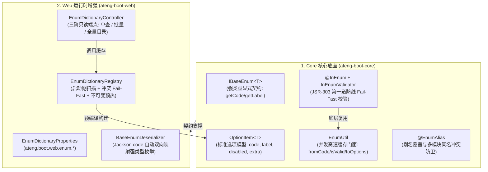

# 60. 强类型通用枚举契约、出入界双防闭环与 Web 只读字典架构决策

## 背景与痛点

在企业级前后端分离架构与分布式系统中，状态码、业务类型、流程状态等枚举类无处不在。传统的枚举处理方式在工业级交付中存在以下系统性断层与安全隐患：

1. **前后端字典割裂与硬编码维护成本高**：
   - 前端开发者在下拉选择器（Select）、表格列筛选器（Filter）、单选框（Radio）中，往往通过前端代码静态硬编码或复制粘贴枚举的数值与文本；
   - 一旦后端枚举新增、废弃或文案调整，前后端不同步即引发线上数据不一致或展示 Bug。
2. **临时 Controller 泛滥与数据泄露隐患**：
   - 为向前端提供下拉选项，各业务线在 Controller 中随意散落编写诸如 `GET /user/status-list`、`GET /order/types` 的临时接口，返回格式各异（`List<Map<String, Object>>`、`List<String>` 等）；
   - 甚至直接将包含内部敏感字段的枚举结构全量序列化输出给前端。
3. **任意类名反射探测的高危安全漏洞**：
   - 某些通用字典端点粗暴允许前端传入全限定类名（如 `?className=com.xxx.SensitiveEnum`）并在服务端执行 `Class.forName(...)` 动态反射，引发类加载漏洞、服务端敏感信息探测及拒绝服务（DoS）隐患。
4. **入界校验脱节（第一道防线漏检）**：
   - 前端拿到枚举选定 `code: 1` 提交至后端表单时，后端在 DTO 处缺乏开箱即用的 JSR-303 枚举合法性校验注解，业务层被迫散落编写手写 `if` 判断；甚至直接放任非法数值穿透至持久层。
5. **DTO 强类型失位与 Jackson 转换胶水代码**：
   - 在接收请求的 Request DTO 中，开发者若希望直接使用强类型枚举字段（如 `private UserStatusEnum status;`），Jackson 默认行为仅支持枚举常量名匹配（如 `"ACTIVE"`），无法识别前端提交的数字 `code: 1`，导致反序列化崩溃；开发者被迫将 DTO 降级为无量纲的裸 `Integer`，并在业务层手动调用 `fromCode` 转换。

---

## 核心架构决策 (The 6 Pillars)



### 1. 架构分层解耦：契约下沉 Core，运行时收敛 Web
- **`ateng-boot-core`**：收敛无 Web 依赖的通用枚举契约 `IBaseEnum<T>`、标准选项模型 `OptionItem<T>`、别名注解 `@EnumAlias`、高速门面 `EnumUtil` 及 JSR-303 校验注解 `@InEnum`。使得 RPC 消费端、异步任务与持久层均可无缝复用该契约体系（参见 [ADR-0011](./0011-zero-bloat-and-co-located-utilities.md)、[ADR-0021](./0021-core-baseline-convergence-and-zero-bloat-freeze-strategy.md)）；
- **`ateng-boot-web`**：收敛 Spring MVC 运行时的 `EnumDictionaryController`、启动期扫描注册中心 `EnumDictionaryRegistry`、配置属性类 `EnumDictionaryProperties` 以及 Jackson 强类型双向反序列化器 `BaseEnumDeserializer`。

### 2. 强类型显式契约与语义增强 (`IBaseEnum<T>`)
- 强制对外暴露的枚举实现 `IBaseEnum<T>`：
  - `T getCode()`：强类型编码（支持 `Integer`、`String`、`Long` 等）；
  - `String getLabel()`：用户友好的中文展示文本；
  - `default boolean matches(T code)`：空安全的编码比对；
  - `default OptionItem<T> toOption()`：一键将自身映射为前端选项模型；
  - `default Boolean getDisabled()`：默认 `false`，支持业务枚举按需重写标记禁用；
  - `default Map<String, Object> getExtra()`：扩展元数据兜底；
  - `default T getValue() { return getCode(); }`：自然兼容 MyBatis-Plus 的 `IEnum<T>` 签名。

### 3. 前端标准选项模型 (`OptionItem<T>`)
统一收敛前端下拉选项的数据契约，杜绝随意返回裸 Map：
```json
{
  "code": 1,
  "label": "正常启用",
  "disabled": false,
  "extra": {}
}
```

### 4. 启动期白名单扫描、防冲突阻断与不可变预热
- **严禁运行时任意类反射**：仅在应用启动时基于配置项 `ateng.boot.web.enum.scan-packages` 执行一次类路径扫描；
- **短类名寻址与 `@EnumAlias`**：默认将 `UserStatusEnum` 转换为小驼峰 `userStatus` 或下划线 `user_status`；若存在多模块同名类冲突（如 `order.StatusEnum` 与 `user.StatusEnum`），必须通过 `@EnumAlias` 显式重写；
- **冲突 Fail-Fast 铁律**：扫描期若发现别名碰撞，立即抛出 `IllegalStateException` 终止应用启动，坚决杜绝运行时静默覆盖；
- **只读不可变缓存**：校验通过后，全量枚举预编译为 `Collections.unmodifiableMap(...)`，运行时达到 $O(1)$ 寻址、零锁争用、零反射与零瞬态 GC 分配。

### 5. 三阶只读 HTTP API 矩阵
控制器挂载于 `ateng.boot.web.enum.path-prefix`（默认 `/api/system/enums`），显式声明返回强类型 `Result<T>`（恪守 [ADR-0002](./0002-explicit-result-contract-no-response-body-advice.md)）：
1. **单个枚举查询**：
   - `GET {prefix}/{name}` $\rightarrow$ `Result<List<OptionItem<Object>>>`
2. **多枚举批量聚合**：
   - `POST {prefix}/batch`（入参 `["userStatus", "orderType"]`） $\rightarrow$ `Result<Map<String, List<OptionItem<Object>>>>`，降低前端复杂表单的多并发连接风暴；
3. **全量目录索引端点 (Catalog Discovery)**：
   - `GET {prefix}`（无参） $\rightarrow$ `Result<Map<String, List<OptionItem<Object>>>>`，供前端系统在初始化时一次性拉取并持久化至 Pinia / Vuex 全局状态。

### 6. 入界校验防卫与 Jackson 强类型双向互通
- **第一道防线 JSR-303 闭环 (`@InEnum`)**：
  在 Controller DTO 中直接标注 `@InEnum(value = UserStatusEnum.class)`，入参不合法时在传输边界直接抛出 `MethodArgumentNotValidException` 并由全局异常拦截器转化为统一友好响应（对齐 [ADR-0027](./0027-defense-in-depth-validation-and-standardized-primitives.md)）；
- **Jackson 强类型反序列化**：
  注册 `BaseEnumDeserializer`，使 DTO 可直接声明 `private UserStatusEnum status;`，前端无论传入数值 `1` 还是字符串 `"1"` 抑或常量名 `"ACTIVE"`，均能精准自动映射为枚举实例；
- **多语言 (i18n) 透明回退**：
  若 Spring 环境注入了 `MessageSource`，组装 `OptionItem` 时优先按 `enum.{SimpleName}.{NAME}` 尝试提取当前请求区域设置（`LocaleContextHolder`）的本地化文本；未配置时平滑降级为枚举硬编码的 `getLabel()`。

---

## 配置规范 (`ateng.boot.web.enum.*`)

| 配置项 | 类型 | 默认值 | 说明 |
| :--- | :--- | :--- | :--- |
| `ateng.boot.web.enum.enabled` | `boolean` | `false` | 是否启用枚举字典 HTTP 暴露与自动装配（防未配置盲目扫描） |
| `ateng.boot.web.enum.path-prefix` | `String` | `/api/system/enums` | 枚举字典 HTTP 接口访问统一路径前缀 |
| `ateng.boot.web.enum.scan-packages` | `List<String>` | `[]` | 待扫描的枚举类所在基础包路径列表（支持 Ant 路径通配） |
| `ateng.boot.web.enum.naming-strategy` | `EnumNamingStrategy` | `LOWER_CAMEL_CASE` | 短类名转别名策略：`LOWER_CAMEL_CASE` / `SNAKE_CASE` / `ORIGINAL` |

---

## 衍生影响与不变量保障 (Consequences & Invariants)

1. **正向收益**：
   - 前后端建立统一、自解释、强类型的选项契约，消除硬编码字典；
   - 形成“出界枚举展示 $\rightarrow$ 入界 `@InEnum` 校验 $\rightarrow$ DTO 强类型绑定”的 360 度端到端数据闭环；
   - 彻底斩断动态类名反射的类加载与内存泄漏隐患。
2. **纪律红线**：
   - 禁止在 `ateng-boot-core` 中引入任何 Spring Web 或 Servlet 依赖；
   - 对外暴露的枚举必须实现 `IBaseEnum<T>`，未实现的枚举即使在扫描包内也不会被暴露；
   - Controller 必须显式声明返回 `Result<T>`，严禁依赖任何自动包装机制。
