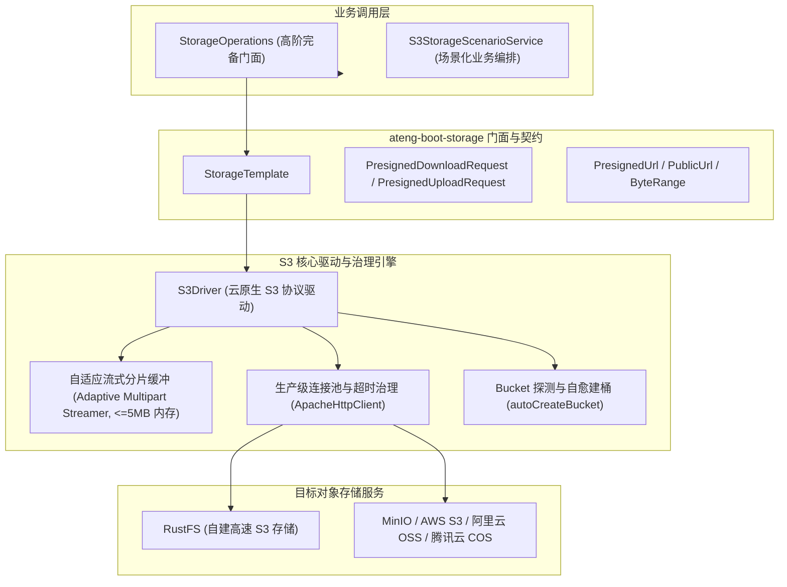

# 61. 云原生 S3 企业级对象存储全场景加固与连接治理架构决策 (Cloud-Native S3 Production Hardening & Connection Governance Architecture)

## 状态
`Accepted`

---

## 背景与痛点 (Context & Problem Statement)
在 [ADR-0030](./0030-storage-module-architecture.md) 中，`ateng-boot-storage` 确立了 Local 本地文件与 S3 兼容协议的双核驱动一体化底座。然而在深入高并发生产实践与真实 S3 云原生环境（AWS S3、MinIO、RustFS、阿里云 OSS、腾讯云 COS 等）的落地中，仍暴露出以下关键差距与系统隐患：
1. **连接治理缺失与无界悬挂隐患**：底层 S3Client 仅使用 SDK 默认配置，未暴露针对底层 HTTP 传输引擎（`ApacheHttpClient`）的连接池与强类型超时控制（`connectTimeout`、`socketTimeout`、`maxConnections`、`connectionAcquisitionTimeout`），高并发及网络波动时易引发线程悬挂阻塞。
2. **未知流长上传内存爆破 (OOM)**：当前对未知大小流（`size < 0`）采用 `readAllBytes()` 全量读入堆内存，面对大报表流式生成时存在严重内存溢出风险。
3. **对象生命周期与高阶治理缺失**：缺少对对象冷热分层存储（StorageClass）、服务端加密（SSE-S3 / SSE-KMS）、对象业务标签（Tagging）、字节范围读取（Byte-Range / Partial Download）以及公开桶永久直连链接（PublicUrl / getUrl）的标准支持。
4. **测试架构缺乏双模真实联调**：样例工程仅覆盖 Local 离线场景，缺乏无外部依赖 CI 离线自洽与直连真实 S3/RustFS 服务的双模自适应验证闭环。

---

## 决策内容与架构拓扑 (Decision & Architecture)

### 1. 生产级连接池与强类型超时治理 (Connection Pool & Timeout Governance)
- 在 `S3StorageProperties` 中统领强类型时间（`java.time.Duration`）配置：
  - `connectTimeout`：HTTP 连接建立硬超时（默认 10s）；
  - `socketTimeout`：数据流读取等待超时（默认 30s）；
  - `apiCallTimeout`：单次 S3 API 调用总体硬超时（默认 60s）；
  - `maxConnections`：HTTP 连接池最大允许并发连接数（默认 50）；
  - `connectionAcquisitionTimeout`：从连接池获取空闲连接的最长等待租约（默认 10s）；
- 显式引入 `software.amazon.awssdk:apache-client`（optional 依赖，纳管于根 BOM），在 `S3Driver.createS3Client` 中以强类型建造者模式完成装配，彻底杜绝无超时网络悬挂。

### 2. 双阶自适应流式分片缓冲防 OOM (Adaptive In-Memory Multipart Streamer)
- 针对 `upload(path, inputStream, contentType, size)` 中 `size < 0`（未知流长）的高频动态生成场景：
- **零磁盘 IO、内存恒定 $\le 5\,\text{MB}$ 原语**：在内存中维持固定 5MB（S3 规范最小分片阈值）的有界步长缓冲区；
- 若流在 5MB 内读尽，自动回退为单次 `PutObject` 一步上传；若超过 5MB，自动激活 S3 原生 Multipart Upload，边读边切片上传，最后触发 `completeMultipartUpload`；
- 彻底废除 `readAllBytes()`，杜绝堆内存击穿，完全解耦宿主磁盘权限（K8s 只读容器友好）。

### 3. 公开桶永久直连链接与公共读授权 (PublicUrl & CannedAcl)
- 暴露 `getUrl(String path)`：针对公开存储桶（Public Bucket）或已挂载 CDN 域名的场景，生成永久直接访问 URL（无临时签名参数）；
  - 优先使用配置的 `domain`；未配置时根据 `pathStyle` 自适应输出（Path-Style: `{endpoint}/{bucket}/{path}`，Virtual-Host Style: `https://{bucket}.{endpointHost}/{path}`）；
- 上传契约扩充 `uploadPublic` 与 `cannedAcl` 支持，支持声明 `ObjectCannedACL.PUBLIC_READ`，实现公开资源的极速直链交付。

### 4. 企业级高阶 S3 能力对称完备性
- **字节范围读取 (Byte-Range Read)**：`download(String path, long startOffset, long length)`，直接基于 S3 `Range: bytes=M-N` 按需拉取部分流；
- **预签名下载响应头重写**：`getPresignedUrl(String path, Duration duration, String downloadFilename)` 与 `PresignedDownloadRequest`，指定 `response-content-disposition` 强制浏览器以友好中文名触发下载；
- **对象标签管理 (Object Tagging)**：`getObjectTags(path)`、`setObjectTags(path, tags)`、`deleteObjectTags(path)`，打通生命周期归档与费用审计；
- **存储分层与服务端加密**：支持指定 `StorageClass`（STANDARD, STANDARD_IA, GLACIER 等）与 `ServerSideEncryption`（AES256/KMS）；
- **存储桶初始化自愈**：`autoCreateBucket: false`（默认 false），开启时首次检测到 404 自动执行 `createBucket`。

### 5. 双模自适应集成测试架构 (Dual-Mode Integration Testing)
- 遵循 ADR-0028 规范，在 `ateng-boot-sample-storage` 建立双模测试沙箱：
  - 默认/CI 模式：使用 Mock 桩自洽秒级运行通过；
  - Local 真实模式（激活 `local` profile）：基于 `application-local.yml`（由 `application-local.example.yml` 模板衍生），直连真实 RustFS（`http://103.236.97.120:47875`）进行核心读写、预签名直传、分片合并与全真断言。

---

## 后果与权衡 (Consequences & Trade-offs)

### 正向收益 (Positive Consequences)
1. **生产连接绝对安全**：连接池最大连接数与 3 级强类型超时拦截，杜绝网络假死导致应用线程耗尽；
2. **内存极度安全**：双阶流式分片缓冲确保未知流长上传内存始终被限制在 5MB 以内；
3. **功能对标业界顶级**：Range 读取、公共直链、标签治理、冷热分层、服务端加密一应俱全；
4. **联调无缝且 CI 零污染**：兼顾本地 RustFS 真实实测与 GitHub Actions 100% 离线自洽。

### 妥协与规约 (Trade-offs & Constraints)
1. **LocalDriver 定位保持极简**：LocalDriver 维持基础开发与测试沙箱职责，不实现冷热分层或服务端加密等仅存在于云原生 S3 的特性。
2. **S3 分片最小尺寸约束**：除末片外，S3 分片上传要求每片不小于 5MB，自适应流式缓冲固定使用 5MB 步长。
