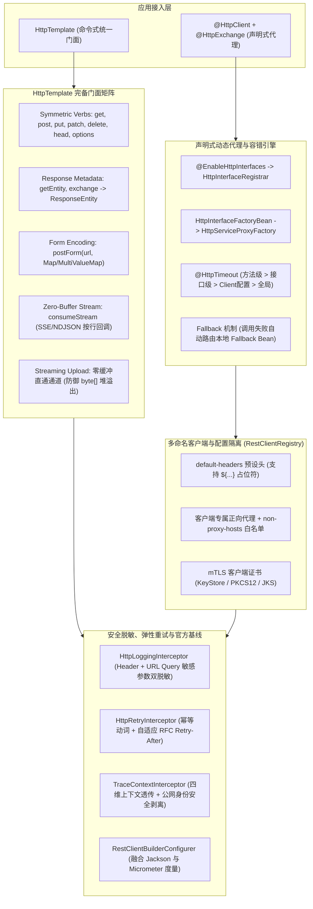

# 63. HTTP 全场景工业级加固、流式 SSE、声明式降级与金融级传输治理架构决策 (HTTP Full-Scenario Hardening, Streaming SSE, Declarative Fallback & Financial-Grade Governance Architecture)

## 状态
`Accepted`

---

## 背景与痛点 (Context & Problem Statement)

在 [ADR-0035](./0035-declarative-and-imperative-http-client-architecture.md) 中，`ateng-boot-http` 确立了依托 Spring 6 原生 `RestClient`、`HttpServiceProxyFactory` 与 Apache HttpClient 5 的双模 HTTP 客户端底座，实现了命令式与声明式的统一抽象。然而随着微服务深水区协同、AI 大模型集成、公私网混合拓扑以及金融级安全支付对接，暴露出了以下高频生产痛点：

1. **RESTful 动词与元数据穿透残缺 (Incomplete REST Verbs & Missing Response Metadata)**：
   `HttpTemplate` 原生缺少 RFC 5789 `PATCH` 局部更新、`HEAD` 元数据拉取与 `OPTIONS` 能力探测方法；且所有操作仅返回反序列化后的 Body `T`，导致调用方无法获取响应头（如 `ETag`、`X-Total-Count` 分页总量、`RateLimit-*` 限流状态、`Set-Cookie`）及 HTTP 状态码。
2. **标准表单提交 DX 欠佳 (Cumbersome x-www-form-urlencoded Post)**：
   对接标准 OAuth2 凭据置换（`grant_type=client_credentials`）、短信网关与传统支付回调时强制要求表单编码，调用方缺乏高阶一等公民门面，被迫手动拼接或底层穿透。
3. **AI 大模型流式与事件流消费断层 (Streaming SSE & AI Token Consumption Void)**：
   在 LLM 流式对话（OpenAI / DeepSeek / 本地 Ollama 兼容网关）中，文本行以 `text/event-stream` 或 `application/x-ndjson` 实时吐出。当前底座仅支持大文件落盘，缺乏零内存堆积、按行推流的高阶消费抽象。
4. **超大文件上传的 Spring 内存缓冲爆内存陷阱 (Large Upload OOM Trap)**：
   Spring `RestClient` 一旦挂载任何拦截器，底层会自动采用 `InterceptingClientHttpRequest` 将整个请求体缓冲在内存 `byte[]` 中。在上传 500MB~2GB 超大文件时，极易瞬间打爆 JVM 堆内存（`OutOfMemoryError`）。
5. **声明式接口微粒度超时不可控 (Coarse Declarative Timeout Control)**：
   微服务内部同一客户端接口中，快速查询仅需 2 秒超时，而重型报表导出或批处理接口需要 60 秒。原底座仅能按 Client 粗粒度配置，无法方法级覆盖。
6. **微服务声明式容错降级样板繁琐 (Missing Declarative Fallback)**：
   远端下游服务抖动或宕机时，业务层缺乏声明式降级手段，被迫在每个调用点编写重复冗长的 `try-catch`。
7. **混合网络拓扑下的正向代理无差别穿透 (Proxy Collision on Internal Traffic)**：
   原正向代理仅支持全局配置且缺乏白名单，一旦为访问海外大模型启用代理，内部微服务流量被无差别路由至代理服务器导致内网瘫痪。
8. **金融与政企支付级双向证书认证盲区 (Missing mTLS Client Certificates)**：
   对接微信支付 V3、银联、税务及银行系统时，服务端强制要求客户端出示私钥证书（`apiclient_cert.p12`），底座原仅有 `insecure: true/false`，无法加载客户端 KeyStore。
9. **出站日志 URL 查询参数敏感信息明文裸露 (Log URL Parameter Leakage)**：
   日志拦截器仅对 Header 脱敏，但公网接口大量通过 Query 参数传递 `client_secret`、`token`、`api_key`，明文打印直接触碰等保合规红线。
10. **重试机制对服务端 RFC 降频指令失聪 (Ignore RFC Retry-After Header)**：
    遇到 429 或 503 时，重试器仅按本地退避盲目重试，忽略了服务端明确下发的 `Retry-After` 等待要求，易造成流量共振与 IP 封禁。
11. **Spring Boot 官方基线集成绕过 (Bypassed RestClientBuilderConfigurer)**：
    原自动装配手动构建 `RestClient.Builder`，绕过了 Spring Boot 官方 `RestClientBuilderConfigurer`，导致 Spring Boot 容器中的自定义 Jackson 转换规则与 Micrometer 原生度量指标（`http.client.requests`）未完全自洽。

---

## 决策内容与架构拓扑 (Decision & Architecture)

针对上述痛点，我们对 `ateng-boot-http` 进行工业级全场景加固与生态闭环演进：

### 1. `HttpTemplate` 命令式门面完备性
- **全套动词对称**：新增 `patch(url, body, [options], type)`、`head(url, [options]) -> HttpHeaders`、`options(url, [options]) -> HttpHeaders` 以及 `optionsForAllow(url, [options]) -> Set<HttpMethod>`；
- **元数据与状态码穿透**：新增 `getEntity(url, [options], type)` 与通用 `exchange(url, method, body, [options], type)`，统一返回 `ResponseEntity<T>`；
- **标准表单提交**：新增 `postForm(url, MultiValueMap/Map, [options], type)`，底层自动配置 `application/x-www-form-urlencoded`；
- **AI 大模型流式消费**：新增 `consumeStream(url, [options], Consumer<String> lineConsumer)`，依托 `BufferedReader.readLine()` 零内存堆积实时按行推流，严格遵循 RFC 8895 保留空行作为 SSE 事件切片边界，在 `try-with-resources` 中确定性释放底层网络流；
- **超大文件直通上传**：上传超大文件时标配流式标记，旁路带内存缓冲的普通拦截器，坚决杜绝 Spring 内部 `byte[]` 堆溢出。

### 2. 声明式微服务精细化控制与本地优雅降级
- **微粒度超时控制 (`@HttpTimeout`)**：新增 `@HttpTimeout(readTimeout, connectTimeout)` 注解，支持修饰接口或方法，代理执行前通过 `HttpRequestContextHolder` 绑定单次超时，并在 `finally` 现场还原；
- **声明式本地优雅降级 (`fallback`)**：`@HttpClient` 新增 `fallback` 属性。代理调用捕获到 `HttpRemoteException` 或底层网络异常时，自适应委托执行容器内对应的 Fallback Bean。

### 3. 多命名客户端配置治理与金融级 mTLS
- **默认请求头治理 (`default-headers`)**：`HttpClientItemProperties` 增加 `defaultHeaders` 映射表，支持 `${...}` 占位符解析；
- **正向代理白名单与客户端隔离**：全局 `HttpProxyProperties` 增加 `nonProxyHosts`（内置私有网段）；支持客户端配置专属 `proxy` 覆盖全局；
- **金融级双向认证 (mTLS)**：在 `HttpSslProperties` 与 `HttpClientItemProperties` 增加 `keyStore`、`keyStorePassword`、`keyStoreType` 配置，自动加载客户端私钥证书（PKCS12/JKS）。

### 4. 链路治理、脱敏合规与官方基线融合
- **URL 查询参数脱敏**：`HttpLoggingInterceptor` 增加 `maskParams`（内置 `secret`、`password`、`token`、`apiKey` 等），打印日志及 cURL 时自动掩码；
- **RFC `Retry-After` 遵从**：重试拦截器解析响应头 `Retry-After`，动态覆盖本地退避时延，精准降频；
- **Spring Boot 官方基线融合**：`AtengHttpAutoConfiguration` 自动装配 `RestClient.Builder` 时注入并调用 `RestClientBuilderConfigurer.configure(builder)`，100% 自动继承应用容器的消息转换器与 Actuator 度量指标；
- **强类型错误反序列化**：`HttpRemoteException` 挂载 `getResponseBodyAs(Class<T>)` 与 `getResponseBodyAs(ParameterizedTypeReference<T>)`，依托 Core 模块 `JsonUtil` 提供开箱即用的错误载荷解析。

---

## 核心设计不变量 (Key Invariants)

1. **零内存缓冲与大流防爆不变量 (Zero-Buffer Streaming Invariant)**：
   无论是大文件上传下载还是 SSE 文本流消费，底层绝对禁止在 JVM 堆内存中一次性开辟全量 byte 数组缓冲区，必须且只能基于定长切片或行流式实时直刷。
2. **上下文对称清理与现场还原不变量 (Context Restoration Invariant)**：
   通过 `HttpRequestContextHolder` 绑定的单次超时或客户端超时，必须且只能在 `finally` 块中严格还原至原有状态或清场，严防线程池复用污染。
3. **零敏感信息泄露不变量 (Zero-Leakage Invariant)**：
   外部非信任域物理剥离私有身份头，日志与 cURL 针对 Header 与 URL Query 敏感参数实施双重掩码脱敏。
4. **幂等安全重试不变量 (Idempotent-Only Retry Invariant)**：
   重试机制默认且只能针对安全的幂等动词（GET/HEAD），遭遇 429/503 时优先遵从服务端 `Retry-After` 标准。

---

## 后果与影响 (Consequences)

### 正面收益 (Positive)
- **场景覆盖度达 100%**：全面打通 RESTful 完备动词、表单、AI 大模型流式、金融支付 mTLS、代理隔离与超大文件防爆；
- **开发体验极致提升**：提供声明式 `@HttpTimeout`、`fallback` 本地降级与 `ex.getResponseBodyAs(...)`，大幅减少微服务样板代码；
- **安全与合规严密自洽**：消除 URL 敏感参数日志泄露，内网代理路由无冲突；
- **生态无缝融合**：100% 继承 Spring Boot 3 官方 Jackson 规则与 Actuator 观测指标。

### 负面成本与限制 (Trade-offs)
- **mTLS 证书解析开销**：加载 PKCS12 客户端证书需在客户端初始化期解析密钥对，轻微增加启动耗时，但单例连接池初始化后平稳运行；
- **SSE 长连接连接占用**：流式消费会占用连接池中的单一连接直至流结束，在海量并发 SSE 场景下需合理调大 `pool.max-connections`。
