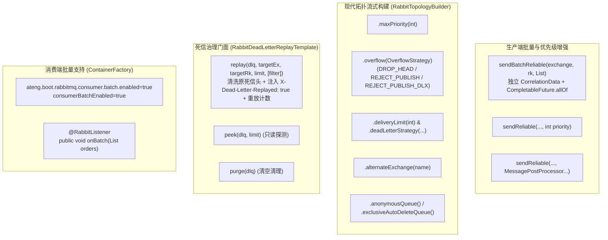

# 64. RabbitMQ 全场景工业级加固、死信受控治理、批量削峰与现代 Quorum 拓扑架构决策 (RabbitMQ Full-Scenario Hardening, Dead Letter Replay Governance, Batching & Modern Quorum Topology Architecture)

## 状态
`Accepted`

---

## 背景与痛点 (Context & Problem Statement)

在 [ADR-0037](./0037-rabbitmq-production-routing-and-reliable-delivery-architecture.md) 中，`ateng-boot-rabbitmq` Starter 确立了依托 Spring AMQP 官方起步基线的消息底座，实现了 Publisher Confirms 同步等待、`sendAfterCommit` 事务感知防幽灵消息、INFERRED 泛型推断反序列化解耦、毒丸快速隔离至死信（DLQ）以及 `RabbitTopologyBuilder` 基础构建能力。

然而，随着高并发分布式事务、海量审计日志削峰与复杂拓扑治理场景的深入，存量模块暴露出以下深水区痛点与成熟度断层：

1. **死信治理“半残门面”与缺乏处置闭环 (Unidirectional Dead Letter Accumulation)**：
   原 Starter 仅提供 `RabbitDeadLetterHelper` 只读诊断工具（解析 `x-death` 提取死因），缺乏受控重放、重新入队与清洗门面（“只查不救”），违背工业级九道防线之第一防线“对称语义完备性”。业务修复上游缺陷后，缺乏标准化手段安全恢复积压死信，容易被迫通过 UI 盲目搬移导致“二次死信雪崩”。
2. **海量打点与高吞吐削峰下的批量收发断层 (Batch Publishing & Consuming Void)**：
   高频日志、审计埋点与订单事件等场景下，单条调用 `sendReliable` 等待 Confirm 以及单条消费 ACK 带来极高的网络 RTT 与磁盘 I/O 负担，急需批量投递与批量聚合消费能力。
3. **现代 Quorum 队列高级治理参数缺位 (Missing Modern Quorum & Overflow Governance)**：
   面向 RabbitMQ 4.0 镜像队列淘汰基线，当前拓扑构建器虽支持 `.quorum()`，但缺乏 `x-delivery-limit`（Quorum 专属投递上限）、`x-dead-letter-strategy: at-least-once`、`x-max-priority`（优先级队列）以及 `x-overflow`（队列溢出策略），易引发生产队列堆积时的非预期行为。
4. **广播场景动态临时队列样板代码繁琐 (Dynamic Exclusive Queues for Fanout)**：
   缓存刷新、配置广播场景需要每个微服务 Pod 动态绑定独立临时队列（`auto-delete`, `exclusive`, 随机队列名），原构建器缺乏开箱即用的流式声明支持。
5. **架构边界防线需要进一步确立 (Clarity on RPC & Outbox Boundaries)**：
   部分团队尝试通过 MQ 强行封装同步 RPC 或试图在 MQ Starter 中硬编码数据库 Outbox 表，违背了微服务通信契约分工（同步走 HTTP/gRPC）与底座“零臃肿”原则，必须形成明确架构决议。

---

## 决策内容与架构拓扑 (Decision & Architecture)

经过全场景对标与严谨架构推演，我们对 `ateng-boot-rabbitmq` 实施以下全场景加固与治理升级：

### 1. 死信治理专职门面与防二次雪崩机制 (`RabbitDeadLetterReplayTemplate`)
- **对称闭环**：新增 `RabbitDeadLetterReplayTemplate`，提供 `replay(dlq, targetEx, targetRk, limit, filter)`、`peek(dlq, limit)` 与 `purge(dlq)`，与只读诊断 `RabbitDeadLetterHelper` 形成读写/处置对称完备门面；
- **防二次死信雪崩**：重放时默认安全清洗消息中底层的死信原因头，并在 Header 注入 `X-Dead-Letter-Replayed: true`、`X-Replay-Time` 与重放计数值；若重放后的消息再次失败进死信且达上限（默认 1 次），强制阻断重放，从根本上防止死信在业务队列与死信队列之间形成无限死循环震荡；
- **分层防卫限制**：强制限制单次最大重放数量（默认 ≤ 100，硬上限 1000），提供 `Predicate<Message>` 过滤器重载，支持精确定向重放。

### 2. 生产端批量可靠投递与独立关联追踪 (`sendBatchReliable`)
- **独立 CorrelationData 确认模型**：在 `RabbitReliableTemplate` 中提供 `sendBatchReliable`，每条消息独立注入四维上下文（TraceId/BizKey）与独立的 `CorrelationData`，底层并发投递并依托 `CompletableFuture.allOf` 聚合等待 Broker ACK；
- **微服务通用契约**：摒弃物理合并打包的私有契约，采用标准纯净 AMQP 消息协议，下游消费者无需特殊拆包即可支持单条消费或批量消费；
- **精准故障定位**：若批次中某条消息发生 Broker NACK 或超时，精准收集失败的 index 与 bizKey，统一抛出 `MessageDeliveryException`，保留完整的失败链条。

### 3. 消费端批量消费支持与多维追踪上下文适配
- 在 `RabbitmqProperties.Consumer` 中新增 `batch` 配置项（`batch.enabled`、`batch.size`、`batch.max-wait-time`），容器工厂自动装配 `consumerBatchEnabled=true`；
- **全局拦截链兼容适配**：升级 `RabbitListenerGlobalAdvice`，使其智能适配单条 `Message` 与批量 `List<Message>` / `List<T>` 传参，提取批次主 TraceId 激活 MDC，并在日志中规范输出 `batchSize` 度量指标；
- **批量异常与幂等契约**：契约明确批量消费由业务在方法内部尽量逐条 try-catch 处理局部失败；全局拦截链兜底拦截 `IdempotentException` 触发静默确认，防止已处理成功的消息因批次内其他元素失败而被重复重试。

### 4. 现代 Quorum 拓扑流式参数全量补齐 (`RabbitTopologyBuilder`)
- 引入强类型枚举 `OverflowStrategy`（`DROP_HEAD`、`REJECT_PUBLISH`、`REJECT_PUBLISH_DLX`）；
- 构建器暴露 `.maxPriority(int)`、`.overflow(OverflowStrategy)`、`.deliveryLimit(int)` 与 `.deadLetterStrategy("at-least-once")`，全面对标现代 Quorum 高可用队列；
- 提供 `.alternateExchange(name)` 与 `.anonymousQueue()`，一键声明备用交换机与广播排他临时队列。

### 5. 架构边界决议 (Boundary Invariants)
- **拒绝 MQ RPC 门面**：微服务间同步调用 100% 归属于 HTTP (OpenFeign/RestClient) 或 gRPC；MQ 坚守异步解耦边界，避免封装同步阻塞 RPC 消耗容器线程；保留 `getRabbitTemplate().sendAndReceive(...)` 极个别场景逃生门；
- **拒绝强绑定数据库 Outbox**：维持 `sendAfterCommit` + `RabbitTransactionFailureCallback` SPI 机制，不强捆绑特定关系数据库（MySQL/PG）的本地消息表，保持 MQ Starter 底座的纯粹性与数据库中立性。

---

## 后果与权衡 (Consequences & Trade-offs)

### 正向收益 (Positive Consequences)
1. **死信处置安全可控**：告别手工搬移死信的粗放运维，通过注入标记与重放上限彻底防御了二次死信雪崩。
2. **削峰吞吐显著提升**：批量发送并发等待与批量消费聚合 ACK 极大减少了高频场景下的网络往返与磁盘刷盘瓶颈。
3. **拓扑契约类型安全**：消除死信策略与溢出参数的裸字符串硬编码，对齐 RabbitMQ 4.0 Raft Quorum 官方演进标准。
4. **100% 向后兼容**：存量代码无感知平滑运行，所有新增 API 均为增强重载与流式扩展。

### 妥协与成本 (Trade-offs & Mitigations)
1. **批量消费局部失败处理要求**：Spring AMQP 原生批量监听器在方法抛出异常时会整批重试。对此，我们在开发规范中强制推行业务内部逐条 try-catch 结合持久层幂等主键防御。
2. **独立 CorrelationData 确认的网络开销**：逐条独立 CorrelationData 并发确认比客户端物理打包（BatchingRabbitTemplate）微增部分网络开销，但换取了微服务下游消费者自由对接与标准报文契约的巨大收益。
