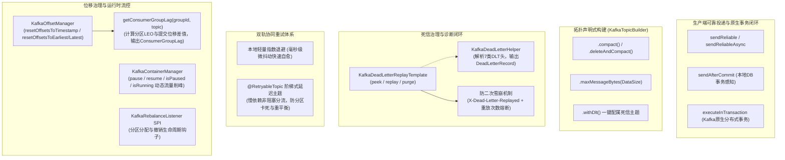

# 65. Kafka 全场景工业级加固、死信受控治理、非阻塞阶梯重试、位移与积压监控及日志压实拓扑架构决策 (Kafka Full-Scenario Hardening, Dead Letter Replay Governance, Non-blocking Tiered Retry, Offset Lag Monitoring & Log Compaction Architecture)

## 状态
`Accepted`

---

## 背景与痛点 (Context & Problem Statement)

在 [ADR-0038](./0038-kafka-high-throughput-streaming-and-offset-governance-architecture.md) 中，`ateng-boot-kafka` Starter 确立了依托 Spring Kafka 官方起步基线的高性能消息底座，实现了微批高吞吐预调优、`sendAfterCommit` 事务感知防幽灵消息、推断反序列化解耦、毒丸快速隔离至死信（`*.DLT`）以及批量多租户安全执行器 `KafkaRecordExecutor`。

然而，随着高并发事件驱动微服务架构、分布式日志流批处理与复杂生产环境运维的深入，存量模块暴露出以下深水区痛点与成熟度断层：

1. **死信治理“半残门面”与缺乏处置闭环 (Unidirectional DLT Accumulation)**：
   原 Starter 仅提供将不可自愈毒丸转移到 `*.DLT` 的单向流转，缺乏受控重放、只读探查与清空门面（“只死不救”），严重违背工业级九道防线之第一防线“对称语义完备性”。业务修复下游缺陷后，无法标准化安全恢复积压死信，易引发“二次死信雪崩”。
2. **死信诊断黑盒 (Lack of Structured DLT Diagnostics)**：
   Spring Kafka 将死信原因记录在底层字节数组标头中（如 `kafka_dlt-exception-message`、`kafka_dlt-exception-stacktrace`），缺乏面向业务与 SRE 的强类型结构化诊断解析工具，导致故障排查繁琐。
3. **单主题本地阻塞重试易引发线头阻塞与重平衡风暴 (Head-of-Line Blocking & Rebalance Storms)**：
   当前错误处理依赖单消费线程内的 sleep 退避重试。面对慢响应外部下游，重试会阻塞整个分区（Head-of-Line Blocking），长时间重试极易触发 `max.poll.interval.ms` 超时导致 Consumer 被踢出 Group 发生重平衡风暴。
4. **运行期位移治理与实时 Lag 积压探测工具缺位 (Missing Offset Governance & Realtime Lag Monitoring)**：
   发生业务故障需要回拨数据、灾备修复或日常 SRE 巡检时，缺乏安全受管的按时间戳/起止点位移重置 API，亦缺乏单 Starter 内聚计算实时 Lag（`LogEndOffset - CommittedOffset`）的轻量工具，过度依赖堡垒机敲脚本或重型监控。
5. **日志压实（Log Compaction）与高级拓扑配置表达受限**：
   Kafka 在状态快照（最新账户余额、配置广播、元数据同步）场景下强依赖 `cleanup.policy=compact`，原拓扑构建器缺少开箱即用的链式语法支持。
6. **运行期消费流控与维护窗口挂起缺失 (Missing Runtime Pause/Resume Facade)**：
   下游系统深夜维护、DDL 变更或突发瓶颈时，无法通过受管门面优雅暂停/恢复指定 Topic 的消费，被迫停机或修改配置重启服务。

---

## 决策内容与架构拓扑 (Decision & Architecture)

经过全场景对标与严谨架构推演，我们对 `ateng-boot-kafka` 实施以下全场景工业级加固与治理升级：

### 1. 死信治理专职门面与防二次雪崩机制 (`KafkaDeadLetterReplayTemplate`)
- **对称闭环**：新增 `KafkaDeadLetterReplayTemplate`，提供 `peek(dltTopic, limit)`、`replay(dltTopic, targetTopic, limit, filter)` 与 `purge(dltTopic)`，与发送端形成读写/处置对称完备门面；
- **防二次死信雪崩熔断**：重放时自动清洗底层 `kafka_dlt-*` 错误头，注入 `X-Dead-Letter-Replayed: true`、`X-Replay-Time` 与 `X-Replay-Count`；若重放后的消息再次失败进死信且达到最大允许重放次数（默认 1 次），强制熔断阻断，彻底封死业务主题与死信主题之间的无限死循环震荡；
- **受管消费组与位移提交**：重放基于受管消费组 `ateng-kafka-dlt-replay-group`，每批投递成功后同步提交位移，杜绝重复重放；`purge` 基于 `AdminClient.deleteRecords` 推进起始位移，物理排空积压死信；
- **分层防卫限制**：强制限制单次最大重放数量（默认 ≤ 100，硬上限 1000）。

### 2. 死信结构化诊断模型与解析器 (`KafkaDeadLetterHelper`)
- 对标 `RabbitDeadLetterHelper`，自动提取并解析 Spring Kafka 写入 DLT 消息头的 7 类元数据（原主题、原分区、原位移、原时间戳、异常全限定类名、异常消息与完整调用堆栈），转换为强类型结构体 `DeadLetterRecord`；
- 与 `peek` 门面联动，实现死信可视、可查、可溯源的诊断闭环。

### 3. 双轨协同重试体系 (Local Backoff + `@RetryableTopic`)
- **本地轻量退避**：保持 `AtengKafkaErrorHandler` 针对毫秒级瞬态网络抖动的本地快速退避重试（默认 3 次，间隔 1s，上限 30s）；
- **非阻塞阶梯延迟主题**：针对慢业务/依赖故障，深度适配 Spring Kafka 官方 `@RetryableTopic` 机制，自动分流至阶梯延迟重试主题（如 `topic-retry-1000`、`topic-retry-2000`、`topic-dlt`），保持主主题高吞吐不阻塞，全链路穿透四维上下文（TraceId、TenantId、UserId）与推断反序列化。

### 4. 运行期位移治理与实时 Lag 积压探测 (`KafkaOffsetManager`)
- **位移安全回拨与重置**：封装 `AdminClient` 池化调用与 `try-with-resources` 释放，提供 `resetOffsetsToTimestamp`（按时间戳回溯对账重放）、`resetOffsetsToEarliest` 与 `resetOffsetsToLatest`；
- **实时 Lag 积压探测**：`getConsumerGroupLag(groupId, topic)` 并行拉取最新高水位（LEO）与消费组已提交位移，精确计算每个分区的 Lag 及全主题总积压 `totalLag`，为告警探针与自愈调度提供原生算力支撑。

### 5. 拓扑压实构建器扩展 (`KafkaTopicBuilder`)
- 链式扩充 `.compact()`（设置 `cleanup.policy=compact`）、`.deleteAndCompact()`，原生支撑状态快照与广播元数据场景；
- 扩充 `.maxMessageBytes(DataSize)` 与 `.compressionType(String)`，消除裸字符串单位歧义。

### 6. 运行期消费容器动态流控门面 (`KafkaContainerManager`)
- 封装 `KafkaListenerEndpointRegistry`，提供 `pause`、`resume`、`stop`、`start`、`isPaused`、`isRunning`；
- 下游系统维护或突发削峰时，支持精细化按 Topic 或 Listener ID 动态暂停消费拉取并在维护后一键恢复，杜绝粗暴停机重启。

### 7. 原生 Kafka 分布式事务与再均衡扩展点
- `KafkaReliableTemplate` 扩充 `executeInTransaction(OperationsCallback<T>)`，补齐纯流式原子多写场景；
- 引入 `KafkaRebalanceListener` SPI 扩展点，在分区撤销与重新分配时赋予有状态消费清理本地缓存与 Flush 位移的生命周期钩子。

---

## 后果与权衡 (Consequences & Trade-offs)

### 正向收益 (Positive Consequences)
1. **死信与重试全生命周期闭环**：彻底解决死信“只堆不救”与单主题重试“线头阻塞”两大业界深水区难题。
2. **运维排障与 SRE 体验跃升**：`KafkaOffsetManager` 的时间戳回拨与 Lag 探测、`KafkaDeadLetterHelper` 的结构化诊断、`KafkaContainerManager` 的动态流控，大幅降低对堡垒机和外部脚本的依赖。
3. **状态快照拓扑标准对齐**：日志压实 DSL 使 Kafka 在分布式快照与广播场景下的配置表达更自然安全。
4. **100% 向后兼容与零臃肿底座**：100% 基于原生 Spring Kafka 与 `ateng-boot-core`，零冗余第三方大包，存量业务代码无缝运行。

### 妥协与规约 (Trade-offs & Mitigations)
1. **重放消息的位移记录**：Kafka 基于日志而非破坏性出队，死信重放依赖专职消费组 `ateng-kafka-dlt-replay-group` 提交位移并注入重放计数标记防二次雪崩。
2. **Lag 探测的 AdminClient 开销**：获取全分区最新 LEO 与提交位移涉及集群元数据交互，方法显式配属 5 秒硬超时并禁止在极高频循环内无节制高频轮询。
