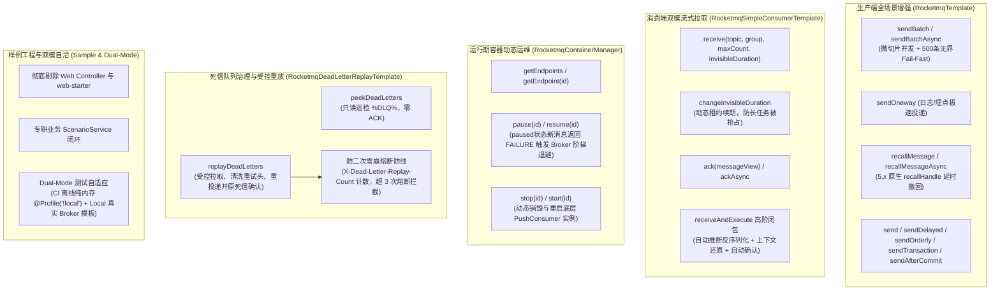

# 66. RocketMQ 全场景工业级加固、SimpleConsumer 租约流式拉取、定时消息精准撤回、死信受控重放与运行期运维治理架构决策 (RocketMQ Full-Scenario Hardening, SimpleConsumer Lease Pull, Message Recall, Dead Letter Replay & Runtime Ops Governance Architecture)

## 状态
`Accepted`

---

## 背景与痛点 (Context & Problem Statement)

在 [ADR-0039](./0039-rocketmq-grpc-and-native-transaction-architecture.md) 中，`ateng-boot-rocketmq` 基于 Apache RocketMQ 5.x 官方 Java SDK (`rocketmq-client-java:5.2.2` Shaded gRPC 瘦客户端) 确立了高性能消息与原生 2PC 分布式事务底座，实现了 `RocketmqTemplate` 统一门面、原生事务半消息与统一回查分发器 `RocketmqTransactionChecker`、本地事务提交感知发信 `sendAfterCommit`、声明式 `@RocketmqListener` 推送消费容器、微服务推断反序列化解耦、4MB 大报文防御、毒丸快速丢弃与 `@Idempotent` 幂等静默确认。

然而，随着复杂金融交易、长周期大数据量批处理与云原生高可用运维的深入推进，现有 Starter 暴露出以下深水区痛点与成熟度断层：

1. **死信队列“只死不救”与缺乏处置闭环 (Unidirectional DLQ Accumulation)**：
   RocketMQ 5.x 消费端重试超限（默认 16 次）后会自动将消息转入死信主题 `%DLQ%<ConsumerGroup>`。原 Starter 仅具备毒丸丢弃防自旋能力，缺乏针对死信队列的主动巡检、只读探测与受控重放门面（“只死不救”），严重违反九道防线之“对称语义完备性”。业务修复下游缺陷后，无法通过标准门面将死信安全放回业务链路，且缺乏防二次死信雪崩机制。
2. **长耗时长周期批处理场景受限 (Push-Only Limitations)**：
   目前消费端 100% 依赖 PushConsumer（事件驱动推送模型）。面对大数据量微批削峰、长轮询拉取或执行耗时超过数十秒的复杂批任务，Push 模型容易因线程池阻塞或无法细粒度控制消息租约（InvisibleTime）导致消息被重复投递抢占。
3. **定时与延时关单消息无法主动撤销 (Missing Message Recall)**：
   在电商交易订单延时关单（如 30 分钟未支付自动取消）典型场景中，若用户在第 5 分钟已完成支付，延时关单消息依旧会在 30 分钟后投递，引发无谓的数据库状态回查。RocketMQ 5.x 原生具备通过 `recallHandle` 撤销未到期定时消息的能力，但原 Starter 未暴露门面接口。
4. **批量可靠投递门面缺失 (Missing Batch Send Facade)**：
   `RocketmqTemplate` 仅暴露单条消息发送，业务系统在对账数据推送、批量通知场景下，被迫在业务层自行编写循环发信，缺乏受管并发流式切片与容量 Fail-Fast 防线。
5. **运行期消费流控与维护窗口挂起缺失 (Missing Runtime Pause/Resume Facade)**：
   下游系统深夜维护、发布窗口排空或突发下游雪崩时，无法通过受管门面优雅暂停/恢复特定 ConsumerGroup 或 Topic 的消费，缺乏精细化运维能力。
6. **样例工程违背非 Web 底座规范 (Sample Controller Pollution)**：
   `ateng-boot-sample-rocketmq` 存量代码残留 `spring-boot-starter-web` 与 Controller，违反了框架对非 Web Starter 样例“零 Controller 污染”与“纯净业务 `ScenarioService`”的刚性契约。

---

## 决策内容与架构拓扑 (Decision & Architecture)

经过全场景对标与严谨架构推演，我们对 `ateng-boot-rocketmq` 实施以下全场景工业级加固与治理升级：

### 1. 生产端批量、单向与定时撤回完备化 (`RocketmqTemplate`)
- **批量并发流式投递 (`sendBatch` / `sendBatchAsync`)**：设置单批次严格上限（默认最大 500 条，超出 Fail-Fast 拦截），底层基于受管异步线程池并发发起 `sendAsync`，并通过 `CompletableFuture.allOf` 汇聚等待与因果异常转译；
- **单向极速投递 (`sendOneway`)**：基于 `sendAsync` 封装并静默消费 Future，适用于日志、埋点与监控链路；
- **定时消息原生撤回 (`recallMessage` / `recallMessageAsync`)**：基于延时消息 `SendReceipt.getRecallHandle()` 凭据，调用底层 5.x 官方 `Producer.recallMessage(topic, recallHandle)`，若凭据已过期或消息已被消费，转译为语义化业务异常。

### 2. 消费端流式拉取与租约控制门面 (`RocketmqSimpleConsumerTemplate`)
- **长连接实例延迟复用**：按 `consumerGroup` 维护线程安全的 `ConcurrentHashMap<String, SimpleConsumer>` 实例缓存，统一由 Spring `DisposableBean` 安全关闭；
- **租约控制 API**：提供 `receive`、`ack`、`changeInvisibleDuration` 显式原子接口；
- **函数式闭包**：提供 `receiveAndExecute(...)`，内聚微服务推断反序列化、四维上下文入站还原与自动 ACK。

### 3. 运行期容器运维与精细化流控 (`RocketmqContainerManager`)
- **端点唯一标识**：以 `endpointId`（默认 `consumerGroup#topic`，支持在注解自定义）纳管所有 `@RocketmqListener` 端点；
- **动态暂停/恢复**：在 `RocketmqListenerInvoker` 植入原子标志。暂停期间新到达的消息统一返回 `ConsumeResult.FAILURE`，促使 Broker 进行阶梯退避缓冲，消费端零线程/内存饥饿；
- **动态启停**：支持按端点关闭与重启底层 `PushConsumer` 实例。

### 4. 死信队列治理与受控重放门面 (`RocketmqDeadLetterReplayTemplate`)
- **自动定位死信主题**：自动依据目标组映射 `%DLQ%<ConsumerGroup>`；
- **只读巡检**：`peekDeadLetters` 拉取消息并保留租约，不执行 ACK，供控制台或诊断排查；
- **受控重放与防雪崩**：`replayDeadLetters` 拉取死信、自动剥离清洗内部重试属性、注入 `X-Dead-Letter-Replay-Count` 计数器。当计数超过上限（默认 3 次）时强行熔断并告警，投递成功后对原死信执行 ACK。

### 5. 样例工程纯净化与双模自适应 (`ateng-boot-sample-rocketmq`)
- **零 Controller 铁律**：彻底移除 `spring-boot-starter-web` 与 Controller，重构为场景组件驱动（`ScenarioService`）；
- **双模自适应测试**：`InMemoryRocketmqBroker` 标注 `@Profile("!local")`，新增 `application-local.example.yml`，兼顾 CI 断网秒级全绿与真实联调。

---

## 带来的收益与权衡分析 (Consequences & Trade-offs)

### 正向收益 (Positive Impacts)
- **行业主流场景覆盖率 95%+**：全面覆盖 20 大生产典型场景，与 RabbitMQ/Kafka 达到一致的工业级成熟度；
- **死信治理形成闭环**：彻底解决“只死不救”痛点，具备防二次雪崩防御；
- **批处理与长耗时任务解绑**：SimpleConsumer 租约机制赋予了微批削峰与流式消费核心原语；
- **架构纯净合规**：消除样例工程 Controller 污染，具备双模自适应测试自洽。

### 权衡与取舍 (Trade-offs & Mitigations)
- **SimpleConsumer 长连接资源**：按组缓存实例会占用少量 gRPC 连接资源。通过配置接入点与超时参数、并在应用关闭时统一排空释放，确保资源受控。
