# 66. RocketMQ 全场景工业级加固、SimpleConsumer 租约流式拉取、定时消息精准撤回、死信受控重放与运行期运维治理架构决策 (RocketMQ Full-Scenario Hardening, SimpleConsumer Lease Pull, Message Recall, Dead Letter Replay & Runtime Ops Governance Architecture)

## 状态
`Accepted`

---

## 背景与痛点 (Context & Problem Statement)

在 [ADR-0039](./0039-rocketmq-grpc-and-native-transaction-architecture.md) 中，`ateng-boot-rocketmq` 基于 Apache RocketMQ 5.x 官方 Java SDK (`rocketmq-client-java:5.2.2` Shaded gRPC 瘦客户端) 确立了高性能消息与原生 2PC 分布式事务底座，实现了 `RocketmqTemplate` 统一门面、原生事务半消息与统一回查分发器 `RocketmqTransactionChecker`、本地事务提交感知发信 `sendAfterCommit`、声明式 `@RocketmqListener` 推送消费容器、微服务推断反序列化解耦、4MB 大报文防御、毒丸快速丢弃与 `@Idempotent` 幂等静默确认。

然而，随着复杂金融交易、长周期大数据量批处理与云原生高可用运维的深入推进，现有 Starter 暴露出以下深水区痛点与成熟度断层：

1. **死信队列“只死不救”与缺乏处置闭环 (Unidirectional DLQ Accumulation)**：
   RocketMQ 5.x 消费端重试超限（默认 16 次）后会自动将消息转入死信主题 `%DLQ%<ConsumerGroup>`。原 Starter 仅具备毒丸丢弃防自旋能力，缺乏针对死信队列的主动巡检、只读探测与受控重放门面（“只死不救”），严重违反九道防线之“对称语义完备性”。业务修复下游缺陷后，无法通过标准门面将死信安全放回业务链路，且缺乏防二次死信雪崩机制。
2. **长耗时长周期批处理场景受限 (Push-Only Limitations)**：
   目前消费端 100% 依赖 PushConsumer（事件驱动推送模型）。面对大数据量微批削峰、长轮询拉取或执行耗时超过数十秒的复杂批任务，Push 模型容易因线程池阻塞或无法细粒度控制消息租约（InvisibleTime）导致消息被重复投递抢占。
3. **定时与延时关单消息无法主动撤销 (Missing Message Recall)**：
   在电商交易订单延时关单（如 30 分钟未支付自动取消）典型场景中，若用户在第 5 分钟已完成支付，延时关单消息依旧会在 30 分钟后投递，引发无谓的数据库状态回查。RocketMQ 5.x 原生具备通过 `recallHandle` 撤销未到期定时消息的能力，但原 Starter 未暴露门面接口。
4. **批量可靠投递门面缺失 (Missing Batch Send Facade)**：
   `RocketmqTemplate` 仅暴露单条消息发送，业务系统在对账数据推送、批量通知场景下，被迫在业务层自行编写循环发信，缺乏受管并发流式切片与容量 Fail-Fast 防线。
5. **运行期消费流控与维护窗口挂起缺失 (Missing Runtime Pause/Resume Facade)**：
   下游系统深夜维护、发布窗口排空或突发下游雪崩时，无法通过受管门面优雅暂停/恢复特定 ConsumerGroup 或 Topic 的消费，缺乏精细化运维能力。
6. **样例工程黑盒化与五维体验契约缺失 (Missing Interactive Sample Webification)**：
   `ateng-boot-sample-rocketmq` 早期仅以测试驱动验证核心调用，缺少按能力领域拆分的交互式 `@RestController` 体验端点与四段式体验卡，开发者与 AI 助手无法通过标准 HTTP/cURL 一键体验生产、延时撤回、2PC 事务、租约续期、容器运维与死信诊断闭环。

---

## 决策内容与架构拓扑 (Decision & Architecture)

经过全场景对标与严谨架构推演，我们对 `ateng-boot-rocketmq` 实施以下全场景工业级加固与治理升级：

```mermaid
flowchart TD
    subgraph ProducerDomain["生产端全场景增强 (RocketmqTemplate)"]
        BatchSend["sendBatch / sendBatchAsync<br>(微切片并发 + 500条无界Fail-Fast)"]
        OnewaySend["sendOneway (日志/埋点极速投递)"]
        RecallSend["recallMessage / recallMessageAsync<br>(5.x 原生 recallHandle 延时撤回)"]
        ExistingProducer["send / sendDelayed / sendOrderly / sendTransaction / sendAfterCommit"]
    end

    subgraph ConsumerDomain["消费端双模流式拉取 (RocketmqSimpleConsumerTemplate)"]
        SimpleReceive["receive(topic, group, maxCount, invisibleDuration)"]
        LeaseRenewal["changeInvisibleDuration<br>(动态租约续期，防长任务被抢占)"]
        ManualAck["ack(messageView) / ackAsync"]
        ExecuteClosure["receiveAndExecute 高阶闭包<br>(自动推断反序列化 + 上下文还原 + 自动确认)"]
    end

    subgraph OpsDomain["运行期容器动态运维 (RocketmqContainerManager)"]
        EndpointQuery["getEndpoints / getEndpoint(id)"]
        PauseResume["pause(id) / resume(id)<br>(paused状态新消息返回 FAILURE 触发 Broker 阶梯退避)"]
        StartStop["stop(id) / start(id)<br>(动态销毁与重启底层 PushConsumer 实例)"]
    end

    subgraph DLQDomain["死信队列治理与受控重放 (RocketmqDeadLetterReplayTemplate)"]
        DLQPeek["peekDeadLetters / peekDiagnosed<br>(只读巡检 %DLQ%{Group}，零 ACK)"]
        DLQReplay["replayDeadLetters<br>(受控拉取、清洗重试头、重投递并原死信确认)"]
        DLQDiscard["discardDeadLetters / discardDeadLetter<br>(物理丢弃清理，彻底移出死信队列)"]
        AntiAvalanche["防二次雪崩熔断防线<br>(X-Dead-Letter-Replay-Count 计数，超 3 次熔断拦截或丢弃移出)"]
        DLQReplay --> AntiAvalanche
        AntiAvalanche -.->|discardOnMaxAttemptsBlocked=true| DLQDiscard
    end

    subgraph SampleDomain["样例工程 Web 体验化与双模自洽 (Sample & Dual-Mode)"]
        WebControllers["6 大领域 @RestController 体验端<br>(/sample/rocketmq/*)"]
        ScenarioServices["专职业务 ScenarioService 闭环"]
        DualMode["Dual-Mode 测试自适应<br>(CI 离线纯内存 @Profile('!local') + Local 真实 Broker 模板)"]
    end
```

### 1. 生产端批量分片、单向、定时撤回与批量事务后发信完备化 (`RocketmqTemplate`)
- **批量双层容量防护与自动分片并发投递 (`sendBatch` / `sendBatchAsync`)**：设置单次调用防 OOM 硬上限 `maxBatchSize = 500` 与单分片并发单元 `batchSliceSize = 64`，前置全量校验每条消息体积不超过 `4MB`，底层复用 Core `BatchSliceUtil` 自动执行分片并发发起 `sendAsync`，并通过 `CompletableFuture.allOf` 汇聚等待与因果异常转译；
- **批量与单条事务提交感知发信 (`sendAfterCommit` / `sendBatchAfterCommit`)**：在注册 Spring `TransactionSynchronization` 钩子时立即捕获当前线程四维上下文快照，确保 `afterCommit` 阶段跨线程或上下文变动时不丢失 `traceId` / `tenantId` / `userId`；发信失败回调 `RocketmqTransactionFailureCallback`（支持携带 `topic`、`tag`、`bizKey`、`payload`、`traceId`、`cause` 的 6 参数默认重载）；
- **单向极速投递 (`sendOneway`)**：基于 `sendAsync` 封装并静默消费 Future，适用于日志、埋点与监控链路；
- **定时消息原生撤回与对称重载 (`recallMessage` / `recallMessageAsync`)**：基于延时消息 `SendReceipt.getRecallHandle()` 凭据，调用底层 5.x 官方 `Producer.recallMessage(topic, recallHandle)`；同时补齐 `sendBatch`、`sendDelayed[Async]`、`sendDeliverAt[Async]` 的 `userProperties` 与简化参数对称重载。

### 2. 消费端流式拉取、租约自动续期守护与单条容错门面 (`RocketmqSimpleConsumerTemplate`)
- **长连接实例延迟复用与动态订阅刷新**：按 `consumerGroup` 维护线程安全的 `SimpleConsumer` 缓存，当同一消费组对同一 `topic` 的 `FilterExpression` 发生变化时主动调用 `consumer.subscribe(topic, filter)` 刷新；实现 `SmartLifecycle`（`phase = Integer.MAX_VALUE - 200`）确保停机时在 `PushConsumer` 之后、`Producer` 销毁之前确定性关闭；
- **租约控制 API**：提供 `receive`、`ack`、`changeInvisibleDuration` 显式原子接口；
- **函数式闭包、单条容错与租约自动续期守护 (`receiveAndExecute`)**：内聚微服务推断反序列化、四维上下文入站还原、单条异常容错隔离（单条命中 `IdempotentException` 自动静默 `ack`，单条业务异常回调 `failureHandler` 并跳过该条 `ack` 留待 Broker 重试，绝不中断同批后续消息）与受管租约自动续期守护（`autoRenewLease = true`，按 `max(1s, invisibleDuration / 2)` 周期自动续期，受 `maxLeaseRenewAttempts = 5` 防无限续期活锁上限保护）。

### 3. 运行期容器运维、不可变状态快照与无 Pinning 并发 (`RocketmqContainerManager`)
- **端点唯一标识与双轨别名**：以 `endpointId`（`@RocketmqListener` 中 `id` 与 `endpointId` 通过 `@AliasFor` 双向绑定，默认 `consumerGroup#topic`）纳管所有监听端点；
- **不可变状态快照 (`RocketmqContainerStatus`)**：新增 `getContainerStatuses()` / `getContainerStatus(id)` 产出不可变快照（同时保留 `getEndpoints()` 兼容）；
- **短时退避削峰 (`pause`/`resume`) 与长时维护停机 (`stop`/`start`) 边界分明**：`pause` 保持底层连接并返回 `ConsumeResult.FAILURE` 触发 Broker 秒级阶梯退避；长时维护窗口使用 `stop` 物理断开连接以实现零重试配额消耗；
- **全链路 `ReentrantLock` 与取缔野线程**：全模块彻底清除 `synchronized` 与 `RocketmqConsumerContainer.stop()` 中的野线程，统一采用 `ReentrantLock`（`if (lock.isHeldByCurrentThread()) lock.unlock()`）与 Core 受管线程池执行停机排空。

### 4. 死信队列结构化诊断、毒丸归档与受控重放 (`RocketmqDeadLetterReplayTemplate`)
- **毒丸自动归档与回调 (`RocketmqPoisonPillCallback`)**：当 `@RocketmqListener` 捕获到不可自愈毒丸异常时，在返回 `ConsumeResult.SUCCESS` 阻断 16 次无脑自旋前，支持按 `consumer.forward-poison-pill-to-dlq = true` 将原始报文附带 `X-Dead-Letter-Exception-*` 诊断头归档至 `%DLQ%<ConsumerGroup>` 并触发 `RocketmqPoisonPillCallback` SPI，实现“0 次重试防自旋 + 毒丸可追溯不丢信”；
- **只读巡检与结构化诊断 (`peekDeadLetters` / `peekDiagnosed`)**：`peekDeadLetters` 拉取消息并保留租约（零 ACK）；`peekDiagnosed` 自动解析原主题、原消息 ID、重放次数、异常诊断头与解压后的 UTF-8 载荷预览，产出强类型不可变 `RocketmqDeadLetterRecord`；
- **受控重放与防雪崩 (`replayDeadLetters`)**：拉取死信、自动剥离清洗内部重试及异常诊断属性、注入 `X-Dead-Letter-Replay-Count` 计数器。当计数超过上限（默认 3 次）时强行熔断并告警；若配置 `discardOnMaxAttemptsBlocked=true`，则自动 ACK 移出死信队列以彻底阻断死循环；投递成功后对原死信执行 ACK；
- **对称丢弃清理 (`discardDeadLetters` / `discardDeadLetter`)**：提供物理丢弃清理能力，确保死信生命周期完整闭环（巡检诊断、重放、丢弃三位一体）。

### 5. 样例工程纯净化与双模自适应 (`ateng-boot-sample-rocketmq`)
- **场景服务专职化**：业务逻辑下沉至专职业务组件驱动（`ScenarioService`）；
- **双模自适应测试**：`InMemoryRocketmqBroker` 标注 `@Profile("!local")`，新增 `application-local.example.yml`，兼顾 CI 断网秒级全绿与真实联调。

### 6. Sample 全面 Web 体验化与五维文档规范治理 (Sample Multi-Controller Webification & 5D Docs Alignment)
依据仓库统一《工业级文档与样例工程标准规范》（`docs/agents/documentation-specification.md`），对样例工程架构与模块文档进行标准化演进：
1. **统一引入 Web 底座与多 Controller 拆分**：Sample 工程在 `pom.xml` 中统一引入 `ateng-boot-web`，彻底打破控制台或单测黑盒限制。杜绝单一臃肿胖 Controller，按功能领域拆分为 6 大高内聚 `@RestController`：
   - `RocketmqProduceController` (`/sample/rocketmq/produce/**`)：同步/异步/单向/FIFO/SQL92/同步与异步批量发信与消费审计；
   - `RocketmqDelayController` (`/sample/rocketmq/delay/**`)：同步与异步相对延时/绝对定时调度与原生延时精准撤回；
   - `RocketmqTransactionController` (`/sample/rocketmq/transaction/**`)：2PC 事务半消息、单条/批量本地事务提交感知发信与回查审计；
   - `RocketmqSimpleConsumerController` (`/sample/rocketmq/simple-consumer/**`)：微批流式拉取、动态租约续期、显式 ACK、函数式闭包与故障隔离自动续期消费；
   - `RocketmqContainerController` (`/sample/rocketmq/container/**`)：消费端点元数据与不可变状态快照审计、单点/全局动态暂停削峰/恢复与物理优雅启停；
   - `RocketmqDeadLetterController` (`/sample/rocketmq/dead-letter/**`)：死信只读探查（零 ACK）、结构化诊断窥视（`peek-diagnosed`）、样本毒丸 `%DLQ%` 转储演练（`poison-pill`）、受控清洗重放（剥离历史 `X-Dead-Letter-*` 故障头与防二次雪崩熔断）与批量物理丢弃。
2. **传输契约与模型绝对解耦 (Zero-Entity-Leakage)**：Controller 边界 100% 严禁暴露底层持久层实体或 RocketMQ 原生 `MessageView`，出入参统一采用强类型 Request/DTO 与 VO / 不可变诊断 Record（`RocketmqContainerStatus` / `RocketmqDeadLetterRecord`），统一显式返回强类型 `Result<T>`。
3. **Starter 五维文档 11 大章节重构与 Sample-First 逆向同步**：第 0 节建立 100% 全景速查矩阵，第 1.2 节提供 BOM 与独立版本双写法，第 2 章补充核心架构拓扑、`pause`/`resume` vs `stop`/`start` 运维边界及 `SmartLifecycle` 停机时序图；正文按能力大章收敛且小节单屏闭环“专属 YAML + 1:1 Sample 业务代码 + 机制边界防御”三要素；Sample 同步升级为四段式极简体验卡。

---

## 带来的收益与权衡分析 (Consequences & Trade-offs)

### 正向收益 (Positive Impacts)
- **行业主流场景覆盖率 95%+**：全面覆盖 20 大生产典型场景，与 RabbitMQ/Kafka 达到一致的工业级成熟度；
- **死信治理形成闭环**：彻底解决“只死不救”痛点，具备防二次雪崩防御；
- **批处理与长耗时任务解绑**：SimpleConsumer 租约机制赋予了微批削峰与流式消费核心原语；
- **全面 Web 体验化与五维文档对齐**：提供 6 大领域 Controller 与一键 cURL 体验表，开发者可直观发起 HTTP 请求体验与验证全部 RocketMQ 生产特性；
- **架构纯净与传输模型解耦**：Zero-Entity-Leakage 契约确保业务层与网络边界清晰分层，具备双模自适应测试自洽。

### 权衡与取舍 (Trade-offs & Mitigations)
- **SimpleConsumer 长连接资源**：按组缓存实例会占用少量 gRPC 连接资源。通过配置接入点与超时参数、并在应用关闭时统一排空释放，确保资源受控。
