# 67. 云原生全场景可观测性加固、防假死异步探针熔断、K8s 探针硬分级隔离、业务度量双驱门面与双层端点安全治理架构决策 (Cloud-Native Observability Full-Scenario Hardening, Anti-Hang Safe Probes, K8s Liveness/Readiness Decoupling, Dual-Drive Metrics Facade & Dual-Layer Actuator Security Architecture)

## 状态
`Accepted`

---

## 背景与痛点 (Context & Problem Statement)

可观测性是现代化云原生微服务高可用运维与韧性架构的核心基石。随着 `ateng-boot` 反应堆接入全量中间件（Redis、Kafka、RabbitMQ、RocketMQ、Storage、Search、MyBatis-Plus 多数据源等），生产集群在 Kubernetes 调度、微服务治理与日常排障中显露出一系列深水区稳定性隐患与架构断层：

1. **同步阻塞探针假死与 Pod 死亡螺旋 (Synchronous Probes & Death Spiral)**：
   Spring Boot Actuator 原生健康探针默认在主调用线程中同步执行网络探测。当下游物理中间件（如 Redis 阻塞、Kafka Broker 网络闪断、对象存储或数据库死锁）发生假死时，探针线程将无限挂起，迅速耗尽 Tomcat / Undertow 工作线程池。更致命的是，若存活探针（Liveness Probe）因此超时失败，Kubernetes 将误判容器死亡而强行杀进程重启，引发集群级“雪崩式死亡螺旋”。
2. **K8s Liveness 与 Readiness 边界混乱 (Liveness / Readiness Entanglement)**：
   云原生黄金运维规范明确要求：**Liveness（存活）仅表征进程是否存活与自锁，绝不能依赖外部中间件；Readiness（就绪）才表征流量接收能力与外部依赖健康度**。若存活探针误捆绑外部依赖，外部组件的瞬时网络抖动将直接拉崩可用进程。
3. **业务度量门面割裂与缺乏通用抽象 (Scattered Metrics Facade & High-Cardinality Risks)**：
   业务层需要针对核心接口耗时、交易金额分布、订单创建量进行精细化度量。原先直接注入 Micrometer `MeterRegistry` 门槛过高，开发人员易在标签中拼入动态用户 ID 或订单号导致 Prometheus 维度爆炸（High Cardinality）；且缺乏如 Spring 声明式切面般的极简打点注解。
4. **Actuator 端点暴露安全风险与重型依赖矛盾 (Endpoint Lockdown vs. Heavyweight Security)**：
   生产环境暴露 `/actuator/env`、`/actuator/beans` 等端点极易引发配置凭据与网络拓扑泄漏；但引入 `spring-boot-starter-security` 机制过重、配置极其繁琐，严重违背本框架零臃肿（Zero-Bloat）核心原则。急需原生零依赖的 CIDR IP 白名单穿透与 Basic Auth / Token 互斥鉴权双层防护。
5. **运维领域事件总线断层 (Missing Observability Domain Events)**：
   端点拦截、探针降级、线程池任务拒绝（RejectedExecution）等关键高危运行事件，缺乏统一的 Spring 领域事件定义与发布机制，上层告警中台无法感知并做出秒级熔断或联动处置。

---

## 决策内容与架构拓扑 (Decision & Architecture)

经过深入推演与云原生标准对标，我们在 `ateng-boot-observability` 模块确立并落地以下工业级可观测性加固与治理体系：

```mermaid
flowchart TD
    subgraph K8sDomain["Kubernetes 云原生分级探针硬隔离"]
        EPP["ObservabilityEnvironmentPostProcessor<br>(环境后处理器自动注入配置)"]
        LivenessGroup["Liveness Group<br>include: livenessState, ping<br>(100% 纯进程自洽，外部依赖物理剥离)"]
        ReadinessGroup["Readiness Group<br>include: * (动态聚合 Redis, Kafka, MQ, DB, Storage)"]
        EPP --> LivenessGroup
        EPP --> ReadinessGroup
    end

    subgraph ProbeDomain["防假死异步安全探针体系 (AbstractSafeHealthIndicator)"]
        AsyncExecutor["独立受管线程池<br>(CompletableFuture.supplyAsync 物理隔离)"]
        TimeoutGuard["强类型 Duration 超时硬切断<br>(默认 2s 快速失败)"]
        DegradeFallback["状态机降级 (UNKNOWN/TIMEOUT)<br>防假死拖垮 Actuator"]
        ProbeDegradedEvent["广播 HealthProbeDegradedEvent 领域事件"]
        
        AsyncExecutor --> TimeoutGuard --> DegradeFallback --> ProbeDegradedEvent
    end

    subgraph SecurityDomain["双层轻量防御与 CIDR 免密穿透 (ActuatorEndpointSecurityFilter)"]
        Req["客户端请求 Actuator 敏感端点 (/env, /beans)"]
        CidrCheck{"第一层: CIDR IP 白名单匹配<br>(CidrMatcher 原生无依赖匹配)"}
        AllowDirect["免密 200 直接放行 (运维/内网穿透)"]
        AuthCheck{"第二层: 凭据鉴权 (OR 逻辑)<br>HTTP Basic Auth 或 X-Actuator-Token"}
        AllowAuth["鉴权通过 200 放行"]
        Deny["403 Forbidden 拦截阻断<br>广播 ActuatorAccessDeniedEvent"]

        Req --> CidrCheck
        CidrCheck -->|命中白名单| AllowDirect
        CidrCheck -->|未命中| AuthCheck
        AuthCheck -->|凭据合法| AllowAuth
        AuthCheck -->|无/错误凭据| Deny
    end

    subgraph MetricsDomain["业务度量双驱体系与线程池治理"]
        MetricTemplate["MetricsTemplate 统一门面<br>(Counter / Gauge / Timer / Summary)"]
        ObservedAnno["声明式注解 @ObservedMetric<br>(AOP 切面透明记录耗时、分位数、状态与异常)"]
        PoolBinder["AtengThreadPoolMeterBinder<br>(全量受管线程池容量、活跃数、队列深度打标)"]
        RejectHandler["TrackingRejectedExecutionHandler<br>(防 NPE 包装、度量打标、广播 ThreadPoolRejectedEvent)"]
    end
```

### 1. Kubernetes 黄金分级探针硬隔离
- **环境后处理器自动装配 (`ObservabilityEnvironmentPostProcessor`)**：在 Spring 启动最早阶段动态注入 `management.endpoint.health.group.liveness.include=livenessState,ping` 与 `management.endpoint.health.group.readiness.include=*`；
- **物理硬隔离**：存活探针（`/actuator/health/liveness`）仅由内部存活状态和系统 ping 组成，坚决不包含任何外部依赖；就绪探针（`/actuator/health/readiness`）聚合全部外部中间件组件；
- **防死亡螺旋**：即使外部中间件网络完全中断，存活检查依然保持 200 OK，杜绝 Pod 盲目重启。

### 2. 全中间件防假死异步探针体系 (`AbstractSafeHealthIndicator`)
- **线程池物理隔离**：所有子系统探针执行逻辑被封装进 `CompletableFuture.supplyAsync`，由独立受管线程池调度执行；
- **超时硬切断机制**：支持强类型 `Duration` 配置（默认 2s），一旦探测超时，立即调用 `future.cancel(true)` 强行切断，返回 `Status.UNKNOWN`（附带 `status=TIMEOUT` 说明）；
- **全生命周期降级事件**：当探测发生超时、异常或返回 DOWN 时，自动通过 `ApplicationEventPublisher` 广播 `HealthProbeDegradedEvent`，记录组件名称、耗时与根因。

### 3. 业务度量双驱门面体系
- **编程式度量门面 (`MetricsTemplate`)**：
  - 封装 Micrometer 核心原语，提供 `increment`、`gauge`、`record`、`recordTime` 等强类型流式方法；
  - 自动执行 Tag 键值对合法性防御性清洗与奇数截断防护，防止高基数维度污染；
- **声明式切面注解 (`@ObservedMetric`)**：
  - 支持方法与类级别标注，由 `ObservedMetricAspect` 环绕拦截；
  - 透明采集调用总次数、执行成功与失败计数、执行耗时 Timer、分位数（默认 P50/P95/P99），并在失败时自动打标异常类名；
  - 切面内部实行降级容错，度量指标收集异常绝不影响业务主流程。

### 4. 双层轻量级安全加固与 CIDR 白名单
- **零依赖原生 CIDR 匹配器 (`CidrMatcher`)**：
  - 基于位运算与标准 `InetAddress` 实现，支持 IPv4（如 `10.0.0.0/8`）与 IPv6 网段匹配，单 IP 兼容；
  - 拒绝引入第三方重量级网络工具包，严格遵循零臃肿原则；
- **双层防御过滤器 (`ActuatorEndpointSecurityFilter`)**：
  - **白名单免密穿透**：优先判定客户端来源 IP（解析 `X-Forwarded-For`、`X-Real-IP` 或 RemoteAddr），命中 `allowed-ip-ranges` 直接 200 放行；
  - **凭据互斥核验**：非白名单客户端支持 HTTP Basic Auth（RFC 7617）与 `X-Actuator-Token` 头互斥（OR）校验；
  - **防时序攻击**：令牌比对采用 `MessageDigest.isEqual` 恒定时间比对，严禁普通 `equals`；
  - **未授权拦截**：凭据校验失败时输出标准 `Result.fail(403)` JSON 报文，并广播 `ActuatorAccessDeniedEvent`。

### 5. 线程池全周期治理与拒绝事件总线
- **受管线程池动态打标 (`AtengThreadPoolMeterBinder`)**：
  - 自动发现 Spring 容器内所有 `ThreadPoolTaskExecutor` 与 `ThreadPoolExecutor`；
  - 统一暴露核心指标：`ateng_threadpool_core_size`、`ateng_threadpool_max_size`、`ateng_threadpool_active_count`、`ateng_threadpool_queue_size`、`ateng_threadpool_rejected_tasks_total`；
- **防饱和与拒绝事件拦截器 (`TrackingRejectedExecutionHandler`)**：
  - 装饰包装原生 `RejectedExecutionHandler`，拦截饱和拒绝时刻；
  - 递增 Prometheus 拒绝计数器，并在抛出异常前广播 `ThreadPoolRejectedEvent`，携带当前活跃数、队列容量、最大线程数快照，完整保留原始因果链。

---

## 带来的收益与权衡分析 (Consequences & Trade-offs)

### 正向收益 (Positive Impacts)
1. **彻底消除 Pod 死亡螺旋**：K8s Liveness 探针 100% 进程内自洽，杜绝因外部网络波动导致服务容器反复被杀。
2. **探针假死免疫**：所有外部组件探测均有超时硬切断防护，Actuator 线程池绝对安全。
3. **零门槛接入业务度量**：通过 `@ObservedMetric` 一行注解即可完成全链路耗时与分位数监控。
4. **轻量无感知安全防护**：无需引入臃肿的 Spring Security，实现 CIDR 白名单与 Basic/Token 鉴权一体化。
5. **运维事件全链路闭环**：通过三大领域事件（`ThreadPoolRejectedEvent`、`HealthProbeDegradedEvent`、`ActuatorAccessDeniedEvent`），支持企业级告警中心一秒定位故障源。

### 权衡与取舍 (Trade-offs & Mitigations)
- **探针异步超时切断与底层网络句柄**：`future.cancel(true)` 会中断执行线程，但对于不可中断的阻塞 Socket IO，底层连接可能需要等待 TCP 超时释放。在实现中结合了底层驱动自身的连接超时（ConnectTimeout）作为第二道防线。
- **Basic Auth 与 Token 的 OR 认证**：允许运维脚本通过 Token 快速访问，同时支持标准监控系统（如 Prometheus Server / Consul）配置 HTTP Basic Auth，兼顾灵活性与安全性。

---

## 实施与验证标准 (Implementation & Verification)

1. **单测覆盖率与自洽性**：
   - `CidrMatcherTest`、`AbstractSafeHealthIndicatorTest`、`MetricsTemplateTest`、`ObservedMetricAspectTest`、`TrackingRejectedExecutionHandlerTest` 100% 离线自洽通过。
2. **1:1 场景工程端到端验证 (`ateng-boot-sample-observability`)**：
   - 验证 Prometheus 抓取线程池与 `@ObservedMetric` 业务指标；
   - 验证 `/actuator/health/liveness` 外部依赖绝对排除；
   - 验证 CIDR 白名单直通与 Basic Auth / Token 403 阻断；
   - 验证三大领域事件在真实容器与请求中被完整发布与捕获。

---

## 影响与相关文档 (References & Related Decisions)
- [ADR-0004: HTTP 200 业务状态码与异常屏蔽统一契约](./0004-http-200-with-business-code-and-exception-masking.md)
- [ADR-0011: 零臃肿与就近内聚工具类设计原则](./0011-zero-bloat-and-co-located-utilities.md)
- [ADR-0026: 生产级环境加固与底座统一原则](./0026-production-hardening-and-foundations-unification.md)
- [ADR-0028: 样例工程场景化与增量集成测试准出原则](./0028-samples-modularization-and-incremental-integration-testing.md)
- Kubernetes Liveness and Readiness Probes Best Practices: https://kubernetes.io/docs/tasks/configure-pod-container/configure-liveness-readiness-startup-probes/
