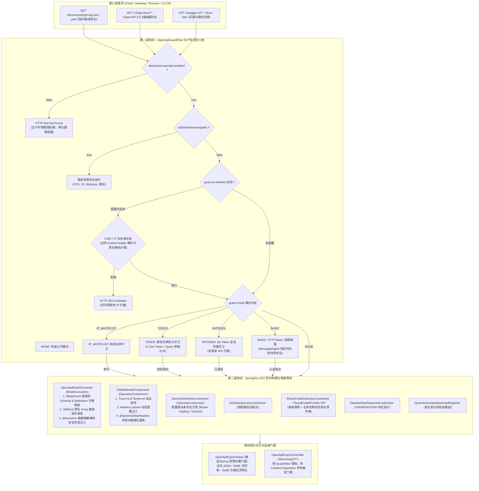

# 68. OpenAPI 全场景契约治理加固、五模生产安全守卫与 CIDR 防火墙、强类型枚举及脱敏模型转换器、精细化请求头豁免与离线导出架构决策 (OpenAPI Full-Scenario Contract Governance Hardening, Five-Mode Security Guard with CIDR Firewall, Strongly-Typed Enum & Sensitive Model Converters, Fine-Grained Header Exemption & Offline Spec Export Architecture)

## 状态
`Accepted`

---

## 背景与痛点 (Context & Problem Statement)

随着 `ateng-boot` 接口契约治理体系的演进，RESTful OpenAPI 3.0 / Swagger 规范已成为微服务前后端协同、开放平台网关集成、客户端 SDK 自动生成与 API 自动化测试的单一真实可信源（Single Source of Truth）。然而在真实金融、电商及政企中后台系统的深水区落地中，现有的 OpenAPI 接口文档基础设施暴露出五大核心痛点：

1. **生产访问守卫模式单一与内网白名单缺失 (Rigid Guard Modes & Missing Network Firewall)**：
   既有 `OpenApiGuardFilter` 仅支持 `NONE`、`BASIC` 与 `SATOKEN` 模式。在生产环境中，大型企业通常要求文档端点仅允许企业内网或办公网段（如 `10.0.0.0/8`, `192.168.0.0/16`, `127.0.0.1`）访问，外部公网直接静默切断；同时，CI/CD 流水线或 API 网关自动化同步文档时需要静态秘钥头（如 `X-Doc-Token: secret`）免弹窗拉取，原有 Basic 认证会导致自动化脚本受阻。
2. **多级反向代理穿透与客户端 IP 伪造隐患 (Proxy Traversal & Header Spoofing Risks)**：
   微服务通常部署在 Nginx、Envoy、Kubernetes Ingress 等反向代理之后。若直接读取 `request.getRemoteAddr()` 仅能拿到反代节点内网 IP；而若无条件信任 `X-Forwarded-For`，在未经保护的公网环境下易遭受客户端伪造标头绕过白名单。急需严格的“配置式受信任反代标头”与防伪造保底机制。
3. **强类型业务枚举 (IBaseEnum) 契约失真 (Enum Schema Distortion & Loss of Semantics)**：
   `ateng-boot-core` 定义了标准的强类型通用枚举契约 `IBaseEnum<T>`（ADR-0060）。但在默认 SpringDoc 反射下，字段仅显示无业务意义的枚举常数名或无量纲数值，前端工程师无法获知枚举的实际状态码取值与业务描述标签（如 `1: 启用 (ENABLE), 0: 禁用 (DISABLE)`），严重削弱了强契约价值。
4. **敏感数据脱敏不透明与批量数组包装渲染歧义 (Masking Opacity & ValidList Array Ambiguity)**：
   视图对象被 `@Sensitive` 标记后在生产出界时将被掩码，接口调用方在文档中看到明文示例而在实际调用时得到掩码，缺少显式安全提示；同时，Core 模块为批量入参规范的 `ValidList<E>` 包装器在缺少专职模型转换器介入时，易被误解析为普通 JavaBean 从而破坏真实的 JSON 数组 `[ { ... } ]` 报文结构。
5. **全局请求头一刀切缺乏精细化豁免控制 (Monolithic Global Headers & Missing Exemption)**：
   `GlobalHeaderCustomizer` 统一注入 `X-Tenant-Id`、`X-Trace-Id` 与自定义头，但部分公开接口（如登录 `/api/auth/login`、健康检查、开放回调）在业务上并不应展示或要求传入内部多租户头，亟需方法/类级别的声明式精准豁免机制；同时缺乏通用离线契约一键导出与 CI/CD 自动生成 SDK 的标准化门面支持。

---

## 决策内容与架构拓扑 (Decision & Architecture)

经由深度场景推演与设计树收敛，确立并落地 **“五模生产安全守卫、模型语义保真增强、精细化标头豁免与离线导出门面”** 的全场景加固架构体系：

---

### 1. 五模生产安全守卫与 CIDR 前置防火墙 (`OpenApiGuardFilter`)

1. **守卫模式全面扩展 (`GuardMode`)**：
   - `NONE`：默认免密模式，适合本地与开发环境；
   - `BASIC`：利用 HTTP 401 `WWW-Authenticate: Basic` 响应头触发浏览器原生登录弹窗，采用 `MessageDigest.isEqual` 恒定时间防时序攻击比对；
   - `SATOKEN`：弱依赖联动 Sa-Token 鉴权中心，仅允许有效会话查阅；
   - `IP_WHITELIST`：纯 IP 白名单守卫模式，仅允许授权网段访问；
   - `TOKEN`：静态令牌标头守卫模式，比对请求头 `X-Doc-Token`（支持在 `guard.token.header-name` 自定义）或可选的 URL Query 参数 `?doc-token=xxx`，专为 CI/CD 流水线与自动化测试工具设计。
2. **正交 IP 白名单网络防火墙 (`guard.ip-whitelist`)**：
   - 支持与任意 Guard 模式叠加正交生效。凡配置了白名单列表，无论处于何种模式，非白名单请求直接阻断（响应 HTTP 403 Forbidden），作为第一道网络物理防线；
   - 支持 IPv4、IPv6 及标准 CIDR 子网格式（如 `10.0.0.0/8`, `192.168.1.0/24`, `127.0.0.1`, `::1`）；
   - **反向代理受信任标头防护**：支持配置 `guard.ip-whitelist.trusted-header`（如 `X-Forwarded-For` 或 `X-Real-IP`）。未配置时严格只读取物理连接地址 `request.getRemoteAddr()`，彻底杜绝外部客户端随意伪造 Header 绕过白名单。

---

### 2. 强类型模型转换与契约保真引擎 (`OpenApiModelConverter`)

实现 SpringDoc `ModelConverter`，在 AST 模型解析期深度赋能 Core 模块通用原语：

1. **`IBaseEnum` 强类型保真与 Markdown 字典自动生成**：
   - 自动探测实现 Core 模块 `IBaseEnum` 的枚举字段；
   - 依据 `getCode()` 运行时类型将 Schema 规范化为真实强类型（Integer 映射为 `IntegerSchema`，String 映射为 `StringSchema`），并将枚举选项所有合法的 `code` 填入 `schema.setEnum(...)`；
   - 自动在 `schema.description` 追加标准 Markdown 字典（如 `**枚举选项**：\n- 1: 启用 (ENABLE)\n- 0: 禁用 (DISABLE)`）；
   - 自动将首个合法选项的 `code` 设为 `schema.example`，杜绝 Swagger UI 生成无效的字符串占位符。
2. **`ValidList<E>` 批量入参原生数组契约保真**：
   - 拦截并识别 `ValidList<E>` 泛型包装类（ADR-0027），将其精准转换为标准 OpenAPI Array Schema `[ { item } ]`，消除默认反射引起的泛型擦除与对象属性包装歧义。
3. **`@Sensitive` 数据脱敏掩码安全警示**：
   - 探测被 `@Sensitive` 标注的字段，自动在 `schema.description` 注入形如 `[脱敏字段: 手机号掩码]` 警示前缀，并根据脱敏规则生成示例脱敏数据（如 `138****0000`），保证前后端对生产出界格式的认知 100% 对齐。

---

### 3. 全局请求头配置驱动与声明式精细化豁免 (`@IgnoreGlobalHeaders`)

1. **动态全局请求头扩展 (`ateng.boot.openapi.headers.custom`)**：
   - 支持在 YAML 配置中声明任意业务通用请求头（包括 Header 名称、描述、是否必填、默认值），由 `GlobalHeaderCustomizer` 统一注入；
2. **声明式精细化豁免注解 (`@IgnoreGlobalHeaders`)**：
   - 可标注于 Controller 类或具体方法上；
   - 支持无参全量豁免 `@IgnoreGlobalHeaders`（忽略所有全局注入的 Header）；
   - 支持精准指定豁免名单 `@IgnoreGlobalHeaders({"X-Tenant-Id", "X-App-Version"})`；
   - `GlobalHeaderCustomizer` 自动感知并跳过被豁免的请求头，保持公开接口与鉴权端点文档的绝对纯净。

---

### 4. 多安全方案配置化与业务状态码字典 SPI (`ResultCodeProvider`)

1. **通用安全方案配置化 (`ateng.boot.openapi.security-schemes`)**：
   - 新增 `SecuritySchemesCustomizer`，支持在 YAML 声明标准 `BEARER` (HTTP Bearer / JWT)、`API_KEY` (Header / Query) 及 `BASIC` 认证方案并全局挂载，在非 Sa-Token 环境下亦能开箱激活 Swagger UI 锁头；
2. **业务状态码字典扩展点 SPI (`ResultCodeProvider`)**：
   - `ResultCodeDictionaryCustomizer` 提供 SPI 接口 `ResultCodeProvider`，各业务子模块可通过实现该 SPI 动态向全局 `Info.description` 追加专属状态码表格（如订单域、支付域专用错误码）。

---

### 5. 标准化离线契约导出门面与安全端点 (`OpenApiExportHelper`)

1. **导出门面类 (`OpenApiExportHelper`)**：
   - 提供开箱即用的静态与 Spring 容器受管方法：
     - `exportJson(String group)` / `exportYaml(String group)`：返回格式化的 OpenAPI 规范字符串；
     - `export(String group, OpenApiFormat format, OutputStream out)`：流式导出；
   - 支撑单测断言、本地构建及 CI/CD 流水线自动提取契约生成客户端 SDK。
2. **受管导出 REST 端点 (`OpenApiExportController`)**：
   - 开启 `ateng.boot.openapi.export.enabled: true` 时自动暴露：
     - `/docs/export/{group}.json` 与 `/docs/export/{group}.yaml`；
     - 缺省路由：`/docs/export/json` 与 `/docs/export/yaml`（指向 `default` 分组）；
   - 响应头自动挂载 `Content-Disposition: attachment; filename="openapi-{group}.json"` 触发浏览器下载；
   - 导出端点完全处于 `OpenApiGuardFilter` 守卫覆盖之下，守卫未通过或 `enabled=false` 时坚决物理切断，绝不泄露。

---

## 质量与红线合规对照 (Robustness & Compliance)

1. **九道成熟度防线无死角贯彻**：
   - 对称完备：导出工具提供 JSON/YAML 对称导出，守卫模式与白名单启闭对称；
   - 分层防卫：CIDR 掩码解析严格校验合法性，Token 与 Basic 凭据采用恒定时间比对防御时序攻击；
   - 确定性清理：契约导出流在 `try-with-resources` 块中确定性关闭；
   - 生产就绪配置：所有新配置项标配 JavaDoc、生产合理默认值与 `@NestedConfigurationProperty` 强类型绑定；
   - 零臃肿与底座收敛：100% 依托 SpringDoc 官方原生能力，深度协同 Core 模块的 `IBaseEnum`、`SensitiveType`、`ValidList` 与 `MessageHeaderConstants`，杜绝重复造轮子。
2. **100% 向后兼容承诺**：
   - 既有 `ateng.boot.openapi.*` 配置属性与行为默认 100% 保持原样；所有新特性均为纯增量扩展或平滑无感增强。
