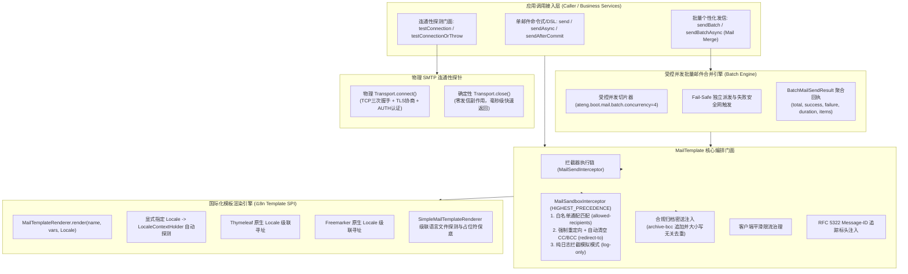

# 69. 邮件全场景工业级加固、批量邮件合并、多模测试沙箱、国际化多语言与连通性治理架构决策 (Mail Full-Scenario Industrial Hardening, Batch Mail Merge, Multi-Mode Sandbox, i18n & Connection Governance Architecture)

## 状态
`Accepted`

---

## 背景与痛点 (Context & Problem Statement)

在 [ADR-0042](./0042-industrial-grade-asynchronous-mail-and-template-architecture.md) 中，`ateng-boot-mail` 确立了面向企业级高并发发信与模板通知的工业级底座，构建了多命名账号静态注册表、多租户动态解析（`TenantMailAccountResolver`）、外部数据源懒加载（`MailAccountProvider`）、双轨防张冠李戴安全网、RFC 6266 大附件流式防爆与本地事务感知发信（`sendAfterCommit`）。

然而，随着微服务集群深水区业务下沉、海外多语言出海业务扩展以及企业对安全合规和非生产环境防误发的刚性要求，原邮件基础设施暴露出五大核心业务与生产痛点：

1. **批量个性化发信（邮件合并）缺乏受控高阶抽象 (Batch Mail Merge & Connection Bomb Void)**：
   业务高频面临“批量工资条发放”、“月度个性化账单”、“会员专属营销”等场景，每个收件人具有专属的正文变量乃至独立的 PDF 对账单附件。原门面仅支持单封邮件多收件人群发；若业务层通过循环同步调用，网络耗时巨大且单封失败即熔断后续；若直接无界抛入 `@Async`，海量并发连接瞬间触发各大 SMTP 邮件网关的防刷连接限制（`421 Too many concurrent connections`）甚至导致系统线程池排队溢出。
2. **非生产环境（Dev/UAT）真实用户邮件误发风险 (Dev/Test Mail Leakage & Lack of Sandbox Guard)**：
   在开发与测试环境中，测试数据库往往残留真实客户邮箱。当测试人员执行注册、审批或密码重置流程时，极易因疏忽将测试数据或验证码真实外发给外部用户，引发灾难性生产客诉与品牌信誉损失。原底座缺乏一等公民的测试安全沙箱拦截保护。
3. **模板动态渲染引擎缺失国际化多语言支持 (Monolingual Template SPI & Missing Locale Resolution)**：
   跨国电商与出海业务要求向不同国家/语言偏好的用户投递对应语言的邮件（如 `verify-code_en_US.html`）。原 `MailTemplateRenderer.render(templateName, variables)` 签名缺失 `Locale` 传参，无法触发 Thymeleaf/Freemarker 的级联语言解析，亦无法与 Spring 的 `LocaleContextHolder` 自动协同。
4. **管理端动态账号缺乏真实连通性健康探测 (Missing Connection Health Probe & Blind Operations)**：
   系统管理员在运营后台新增或修改 SMTP 账号（或轮换授权码）后，无法以安全、无副作用的方式进行一键连通性自验。原系统缺乏连通性探测门面，调用方被迫以真实发送垃圾邮件的方式进行连通性验证。
5. **合规归档审计密送与邮件协议重要性标头规范缺失 (Monolithic BCC Archiving & Untyped Headers)**：
   金融、政企合规要求外发邮件必须自动归档留底一份至企业统一审计邮箱（Compliance Archive）。原体系要求业务调用点处处手动调用 `message.bcc(...)`，极易因开发疏漏遗留违规隐患；同时紧急运维告警缺乏强类型 `MailPriority` 邮件重要性标头与阅读回执支持。

---

## 决策内容与架构拓扑 (Decision & Architecture)

经由深度场景对标与全场景推演，正式确立并落地 **“邮件全场景工业级加固、批量邮件合并、多模测试沙箱、国际化多语言与连通性治理”** 架构演进：



### 1. 批量个性化发信与邮件合并引擎 (Batch Mail Merge Engine)
- **受控并发与网关防刷保护**：
  提供 `BatchMailSendResult sendBatch(List<MailMessage> messages)` 与 `CompletableFuture<BatchMailSendResult> sendBatchAsync(List<MailMessage> messages)`；
  引入配置项 `ateng.boot.mail.batch.concurrency`（默认 4，范围 1~32），基于受控分片并发池投递，杜绝海量邮件瞬间打爆 SMTP 服务商并发上限（`421 Too many connections`）或引发线程池排队溢出；
- **Fail-Safe 独立容错与聚合回执**：
  单封邮件失败不阻断批次内其他邮件投递，每封邮件独立执行指数退避重试并触发全生命周期事件与补偿 SPI；聚合返回强类型 `BatchMailSendResult`，记录总数、成功数、失败数、总耗时以及有序的 `List<MailSendResultItem>` 明细。

### 2. 多模测试沙箱防护体系 (Multi-Mode Mail Sandbox Guard)
- **前置最高优先级拦截**：
  引入 `ateng.boot.mail.sandbox` 配置属性与内置 `MailSandboxInterceptor`，设定为最高优先级（`Ordered.HIGHEST_PRECEDENCE`），确保在所有业务拦截器之前生效；
- **三模防护策略**：
  1. **白名单放行**：通过 `allowed-recipients`（如 `*@internal.com`、`developer@test.com`）精准放行；
  2. **强制重定向与防泄密清场**：非白名单邮件自动将 `to` 替换为 `redirect-to`（如 `mail-trap@company.com`），**同时绝对清空原邮件的 `cc` 与 `bcc`**，杜绝任何外部人员泄露，并在主题追加 `[SANDBOX-REDIRECT to: original@...]` 标头；
  3. **纯日志模拟 (`log-only=true`)**：不发起任何物理网络连接，直接在控制台输出脱敏完整邮件报文并返回虚拟成功回执（Message-ID 标识为 `<sandbox-log-${traceId}@domain>`）。

### 3. 模板渲染引擎 SPI 国际化演化 (i18n Template SPI)
- **SPI 平滑扩展**：
  在 `MailTemplateRenderer` 接口中以默认方法演进：
  ```java
  default String render(String templateName, Map<String, Object> variables, Locale locale) {
      return render(templateName, variables);
  }
  ```
- **双轨语言寻址与自动探测**：
  `MailMessage` 挂载 `Locale locale` 字段；`MailTemplate` 增加支持 `Locale` 的发信重载；未显式传参时自动探测 Spring `LocaleContextHolder.getLocale()`；
- **保底引擎级联寻址**：
  Thymeleaf 与 Freemarker 原生根据 `Locale` 加载语言变体；零依赖保底引擎 `SimpleMailTemplateRenderer` 实现 `template_en_US.html` $\rightarrow$ `template_en.html` $\rightarrow$ `template.html` 级联探测与占位符替换。

### 4. 物理 SMTP 连通性健康探测 (Connection Health Probe)
- **真实握手与零发信副作用**：
  在 `MailTemplate` 与 `MailAccountRegistry` 暴露 `boolean testConnection(String accountName)` 与 `void testConnectionOrThrow(String accountName)`；
  底层调用 `JavaMailSenderImpl.getSession().getTransport()` 执行 `connect()`，真实走完 TCP 握手、TLS 协商与 AUTH 账号密码校验，随后立即 `close()`，不发送任何实际邮件；
- **双模 API 支撑**：
  布尔方法用于监控心跳与快速探测，异常方法在失败时完整抛出附带原始因果链的 `MailSendException`，支撑管理后台 UI 精准弹窗。

### 5. 合规密送归档与强类型邮件标头 (Compliance Archiving & Typed Headers)
- **配置驱动的自动合规归档**：
  支持全局与账号级 `archive-bcc: compliance@example.com`，前置编排链自动追加至 `message.bcc` 列表，执行大小写无关的 `Set` 去重，并在脱敏日志中安全留痕；
- **强类型邮件优先级与回执**：
  引入强类型枚举 `MailPriority`（`HIGH`, `NORMAL`, `LOW`）；`MailMessage` 提供链式 DSL：`priority(MailPriority.HIGH)` 自动注入 `X-Priority: 1` 与 `Importance: High`；提供 `readReceiptTo(email)` 与 `requestReadReceipt(true)` 自动注入 RFC 3798 `Disposition-Notification-To` 回执请求标头。

---

## 影响与收益 (Consequences)

1. **企业高频场景 100% 覆盖**：批量工资条/账单合并分发、国际化多语言邮件、非生产沙箱防误发、合规密送全面开箱即用；
2. **高可用与安全性全维加固**：受控并发消灭网关限频封禁隐患，沙箱强力阻断测试邮件外泄，深度握手探针赋能运维实时排查；
3. **100% 向后兼容与零侵入升级**：所有既有 API 签名完全保留，新增特性配置默认为关闭状态，保障老应用无感平滑升级。
