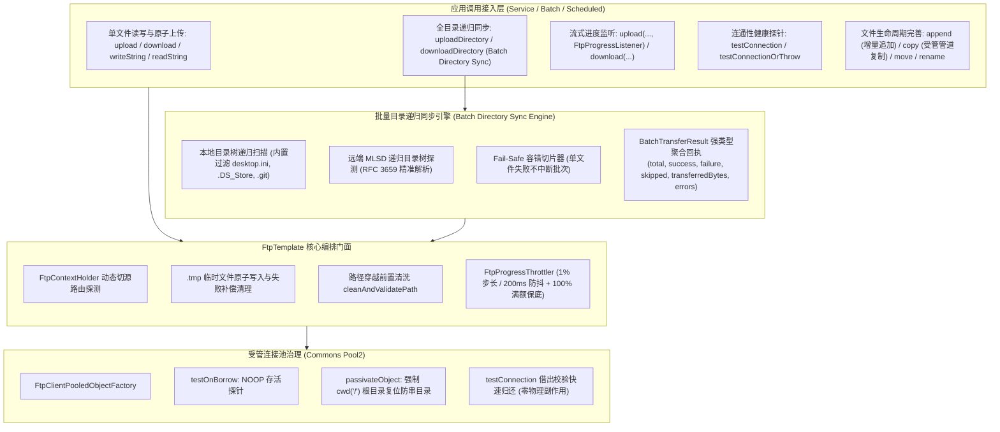

# 70. FTP 全场景工业级加固、全目录递归同步、流式进度监听、连通性探针与样例纯净化架构决策 (FTP Full-Scenario Industrial Hardening, Directory Sync, Progress Monitoring, Health Probe & Sample Purification Architecture)

## 状态
`Accepted`

---

## 背景与痛点 (Context & Problem Statement)

在 [ADR-0043](./0043-ftp-and-ftps-connection-pooling-and-resilient-client-architecture.md) 中，`ateng-boot-ftp` 确立了基于 Apache Commons Net 与 Commons Pool2 构建的工业级 FTP/FTPS 双模远程文件传输底座，重点攻克了短连接端口耗尽、连接池串目录灾难（`passivateObject` 强制 `cwd("/")`）、NAT 假冒 IP 穿透以及 RFC 3659 MLSD 机器目录高精度解析。

然而，随着金融结算对账下沉、大数据离线批量同步、跨系统多节点文件归档等典型企业级复杂场景的推进，原 FTP 基础设施暴露出五大核心业务与架构痛点：

1. **批量传输与全目录递归同步能力缺失 (Batch Directory Sync Void)**：
   金融每日日结对账与跨网归档场景中，业务高频需要下载或上传整批次多层级子目录（如 `/settlement/20261030/`）。原门面仅支持单文件上传与下载，业务层被迫自行递归遍历目录树并手写子目录递归创建；遇到单文件网络闪断时容易中途崩溃，导致远端或本地残留残缺半截文件树，缺乏强类型聚合结果回执与弹性容错模型。
2. **大文件传输黑盒缺乏进度反馈与高频回调防抖 (Transfer Progress Blindness & Event Storm)**：
   传输数百 MB 至数 GB 的大文件（如日志压缩包、数据库全量备份）时，底层数据通道高速吞吐但业务接入层处于完全黑盒状态，既无法在前端展示实时进度百分比，也无法输出阶段性心跳日志；而若直接透传底层 64KB 缓冲区回调，又会瞬间引发每秒上万次的高频调用，造成严重 CPU 争用与日志风暴。
3. **管理端缺乏安全无副作用的物理连通性健康探测 (Missing Connectivity Health Probe)**：
   运维人员在运营管理后台新增 FTP 节点、轮换密钥或执行每日巡检时，无法以无害方式探测网络连通性与鉴权有效性。调用方被迫以真实上传垃圾临时文件的方式探测连通性，容易引发脏文件残留或触发审计告警。
4. **文件操作门面对称性不完备 (Incomplete Facade Symmetry)**：
   缺乏向已有文件末尾增量写入的追加门面（RFC 959 `APPE` 指令），无法直接支持分布式节点日志与流水增量归集；缺乏远端文件跨路径复制门面（`copy`），归档场景下业务被迫执行“先下载到本地磁盘再上传到目标目录”，严重浪费内外网带宽与磁盘 IO。
5. **样例工程违规 Controller 污染与双模自适应缺失 (Sample Architecture Inconsistency)**：
   `ateng-boot-sample-ftp` 违规包含了 `SampleFtpController`，触碰了“非 Web 底座模块样例工程零 Controller 污染”的代码审查红线；同时缺少 `application-local.example.yml` 资产模板与双模自适应测试架构（本地有真实服务时直连验证，CI 无真实服务时 100% 离线自洽）。

---

## 决策内容与架构拓扑 (Decision & Architecture)

经由深度场景对标与全场景推演，正式确立并落地 **“FTP 全场景工业级加固、全目录递归同步、流式进度监听、连通性探针与样例纯净化”** 架构演进：



### 1. 批量目录递归同步与 Fail-Safe 容错模型 (Batch Directory Sync Engine)
- **对称门面设计**：
  提供 `BatchTransferResult uploadDirectory(File localDir, String remoteDir)` 与 `BatchTransferResult downloadDirectory(String remoteDir, File localDir)`；
  支持重载传入 `Predicate<File>`（本地上传过滤）或 `Predicate<FtpFileInfo>`（远端下载过滤）以及 `boolean failFast`；
- **环境宿主中立与隐性文件过滤**：
  本地扫描时底层默认内置防御性过滤器，自动过滤 Windows 的 `desktop.ini`、macOS 的 `.DS_Store` 与 `.git` 等隐性系统文件，彻底杜绝操作系统垃圾文件污染远端服务器；
- **Fail-Safe 容错模型与聚合回执**：
  默认采用容错批处理模型，批次内单文件失败自动捕获记录，不中断后续文件同步；最终聚合返回强类型 `BatchTransferResult`（记录总文件数、成功数、失败数、跳过数、总传输字节量、耗时及失败明细 `List<TransferFailureItem>`）。若显式指定 `failFast=true`，则遇首个错误立即快速熔断。

### 2. 流式传输进度监听与平滑节流引擎 (Transfer Progress Listener & Throttler)
- **原生高内聚函数式接口**：
  定义纯原生接口 `io.github.atengk.boot.ftp.listener.FtpProgressListener`：
  ```java
  @FunctionalInterface
  public interface FtpProgressListener {
      void onProgress(long bytesTransferred, long totalBytes, double percentage);
  }
  ```
  在 `upload` 与 `download` 门面上提供挂载该监听器的重载方法，完全屏蔽底层 Commons Net 的 `CopyStreamListener` 驱动类，避免框架底层依赖泄漏；
- **平滑节流与终态保底**：
  内置轻量级节流逻辑，仅当进度百分比增量达到 $1\%$ 或时间间隔达到 $200\text{ ms}$ 时才向外部回调派发通知；传输完成时，强制执行最后一次 $100.0\%$ 满额保底回调，杜绝高频日志风暴与 UI 渲染拥塞。

### 3. 物理连通性自验健康探针 (Connectivity Health Probe)
- **无副作用探测门面**：
  提供 `boolean testConnection()`、`boolean testConnection(String serverName)` 与 `void testConnectionOrThrow(...)`；
- **毫秒级安全检测**：
  从受管连接池借出连接并向控制通道发送 `NOOP` 指令验证 TCP 握手与用户会话可用性，验证完毕后立即在 `finally` 块中归还连接，全程不产生任何远程文件读写与临时文件副作用。

### 4. 增量追加写与受管管道流复制 (Append & Copy)
- **增量追加写 (`append`)**：
  提供 `boolean append(String remotePath, InputStream in)`，底层利用 RFC 959 原生 `APPE` 指令直接在远端已有文件末尾追加数据流；
- **单文件受管管道复制 (`copy`)**：
  提供 `boolean copy(String fromPath, String toPath)`，在 FTP 客户端会话内开辟受管流管道对拷，写入目标文件时同样挂载 `.tmp` 原子重命名守护，严格限定为单文件复制，防御单连接被目录级长耗时阻塞挂起。

### 5. 样例工程架构纯净化与双模自适应实装 (Sample Architecture Hardening)
- **彻底肃清 Controller 污染**：
  删除 `ateng-boot-sample-ftp` 中违规的 `SampleFtpController` 及相关 HTTP DTO；
- **按真实业务命名场景组件**：
  创建 5 大标准业务场景服务组件：
  1. `DocumentSyncScenarioService`（常规文件读写与元数据操作）；
  2. `SettlementBatchSyncScenarioService`（金融日结对账全目录递归上传与下载同步）；
  3. `LargeFileTransferScenarioService`（大文件带进度监听的流式上传下载）；
  4. `DynamicRoutingScenarioService`（多节点动态切源 `FtpContextHolder.runWith` 栈式隔离）；
  5. `ConnectivityProbeScenarioService`（物理连通性自验探针）。
- **双模自适应测试套件**：
  提供 `src/main/resources/application-local.example.yml` 模板；集成测试默认装载内置 `FakeFtpServer` 实现 100% 离线自洽构建，激活 `local` 时直连本地真实 FTP 服务。

---

## 权衡与影响 (Consequences & Trade-offs)

### 正向收益 (Pros)
1. **全场景工业级覆盖**：全目录递归同步、大文件流式进度监听、连通性探针与增量追加写彻底填补了高频企业级生产空白；
2. **生产级高可用与零脏读**：批量同步 Fail-Safe 容错聚合回执、隐藏系统文件过滤与进度监听防抖，消除日志风暴与网络闪断雪崩风险；
3. **架构规范全面对齐**：彻底肃清 Sample 工程中的 Controller 违规项，建立双模自适应单测试套件。

### 妥协成本 (Cons)
1. **跨路径复制网络流开销**：由于 FTP 协议缺乏原生服务端复制指令，`copy` 需经过客户端网络流中转，大文件跨路径复制会产生对应的网络往返流量（因此架构上显式限定为单文件复制，严禁无界整目录复制）。
