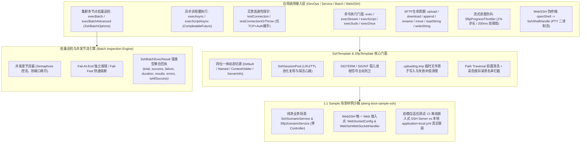

# 71. SSH 与 SFTP 全场景工业级加固、流式进度防抖、无害连通性探针、批量巡检聚合与样例纯净化架构决策 (SSH & SFTP Full-Scenario Industrial Hardening, Progress Throttling, Health Probes, Batch Inspection Aggregation & Sample Purification Architecture)

## 状态
`Accepted`

---

## 背景与痛点 (Context & Problem Statement)

在 [ADR-0044](./0044-ssh-and-sftp-remote-governance-architecture.md) 中，`ateng-boot-ssh` 奠定了基于 Apache MINA SSHD 的工业级 SSH 远程命令执行与 SFTP 文件传输基础设施，攻克了现代加密算法适配、LRU/TTL 受管会话缓存池、无 TTY 原生 Sudo 提权密码抹零、孤儿进程超时信号主动防卫、本地端口转发受管隧道与只读容器纯内存公钥指纹校验。

然而，对标现代企业级运维控制台、批量配置下发平台与自动化发布流水线的极限生产要求，原架构在深度场景演进中暴露出以下核心痛点：

1. **SFTP 门面对称性不完备与文件生命周期残缺 (SFTP Symmetric Lifecycle Gap)**：
   缺少远程文件重命名与跨目录移动门面（`rename` / `move`）；在分布式日志增量收集与断点追加写入场景中，缺乏增量追加写门面（`append`），业务层被迫每次将文件全量重写；对于常用运维脚本与配置文件的读取与推送，缺少便捷的字符串读写门面（`readString` / `writeString`）。
2. **大文件高速传输缺乏进度防抖引发事件风暴 (Transfer Progress Event Storm)**：
   现行 `SftpProgressListener` 每吞吐一个底层缓冲区（默认 32KB）即触发一次实时回调。在千兆内网或高速传输百兆至数吉字节大文件时，每秒可产生数万次高频回调，引发严重的 CPU 线程争用与控制台日志风暴。
3. **缺乏无副作用的轻量连通性健康探针 (Missing Non-Invasive Connectivity Probe)**：
   运维控制台新增资产、凭据轮换或定时巡检时，调用方无法以轻量无害方式验证主机连通性与凭据有效性。既有方案被迫通过 `exec("echo 1")` 真实开启一条 Exec 业务通道并启动远程 Shell 进程，不仅开销高昂，还会受到远程受限 Shell 或审计策略拦截。
4. **异步非阻塞执行能力缺失 (Missing Asynchronous Command Execution)**：
   既有命令执行（`exec` / `execScript`）全部为同步阻塞调用。在微服务高吞吐场景下，长时间阻塞工作线程容易造成线程池饥饿；缺乏原生的 `execAsync` 异步门面与 Core 受管线程池及四维上下文快照的深度集成。
5. **集群批量巡检结果聚合薄弱与并发度失控 (Uncontrolled Batch Concurrency & Weak Aggregation)**：
   `execBatch` 仅返回裸 `Map<SshServerInfo, SshExecResult>`，异常节点通过伪装退出码 `-1` 混入 Map，缺乏对全集群巡检的成功率、耗时统计、错误清单的强类型聚合视图；当批量并发巡检上百个节点时缺乏并发度节流限制，容易打满客户端本地可用端口或造成目标网络拥塞。
6. **样例工程违规 Controller 污染与双模自适应联调缺失 (Sample Architecture Inconsistency)**：
   `ateng-boot-sample-ssh` 违规包含了 `SshSampleController` 与 `SftpDemoController`，触碰了“非 Web 底座模块样例工程零 Controller 污染”的代码审查红线；缺少 `application-local.example.yml` 敏感凭据占位模板与基于 `@Profile("!local")` 的双模自适应集成测试架构。

---

## 决策内容与架构拓扑 (Decision & Architecture)

经由深度场景推演与设计树决策收敛，正式确立并落地 **“SSH 与 SFTP 全场景工业级加固、流式进度防抖、无害连通性探针、批量巡检聚合与样例纯净化”** 架构演进：

### 1. SFTP 门面对称性与流式传输进度防抖
- **生命周期完备性**：
  - `rename(String oldPath, String newPath)` / `move(String sourcePath, String targetPath)`：基于 SFTP 原生协议 `rename` 实现；
  - `append(String remotePath, InputStream/byte[])`：遵循 POSIX `O_CREAT | O_APPEND` 与 Java NIO `StandardOpenOption.CREATE` 标准语义，自动递归创建缺失父目录并追加写入；
  - `readString(String remotePath, Charset)` / `writeString(String remotePath, String content, Charset)`：快速读写脚本与配置文件。
- **流式传输进度防抖 (`SftpProgressThrottler`)**：
  - 引入 `SftpProgressThrottler` 作为 `SftpProgressListener` 的受管装饰器；
  - 默认同时采用双重阈值防抖：传输进度每推进达到 `1%` 或距离上次回调达到 `200ms` 时触发；并在传输结束或流关闭时 **100% 保证触发一次满额完成回调**，彻底消除高频回调风暴。

### 2. 异步非阻塞执行与无害连通性探针
- **无副作用连通性探针 (`testConnection` / `testConnectionOrThrow`)**：
  - 底层仅完成 TCP 三次握手与 SSH 凭据身份鉴权握手，**100% 绝不开辟任何 Exec/Shell/SFTP 业务通道**；
  - 握手完成后立即在 `finally` 块中确定性断开瞬态连接；支持传入自定义探测超时 `Duration timeout`（默认 5s）。
- **异步命令执行 (`execAsync` / `execScriptAsync`)**：
  - 优先复用 Core 受管默认异步线程池（`ThreadPoolTaskExecutor`），自动挂载 `ContextCopyingTaskDecorator` 透传四维快照（MDC/TraceId/User/TenantId）；
  - 返回强类型 `CompletableFuture<SshExecResult>`，支持声明式异步编排。

### 3. 集群多主机批量巡检聚合回执与并发控流
- **强类型聚合回执 (`SshBatchExecResult`)**：
  - 封装 `totalCount`、`successCount`、`failureCount`、`duration`、`results`、`errors`；
  - 提供 `isAllSuccess()`、`getFailedServers()` 等业务断言辅助方法。
- **批量执行选项与控流 (`SshBatchOptions`)**：
  - 默认采用 **Fail-At-End** 策略（单个节点失败不影响其余节点，异常独立收集于 `errors` 映射中）；
  - 支持 `failFast(true)` 开启快速失败熔断；
  - 提供 `concurrency` 并发度节流控制，防御突发海量节点打爆客户端端口。
- **向后兼容契约**：既有 `execBatch` 签名继续保留并返回 `Map<SshServerInfo, SshExecResult>`，底层统一复用新引擎。

### 4. 样例工程架构纯化与双模自适应测试
- **彻底根除 Controller 污染**：移除 `SshSampleController` 与 `SftpDemoController`，重构为 `SshScenarioService` 与 `SftpScenarioService`；仅保留 `WebSocketConfig` 与 `WebSshWebSocketHandler` 作为 WebSSH 的必要传输协议端点；
- **双模自适应测试与凭据卫生**：根目录 `.gitignore` 强制收敛忽略 `**/application-local*.yml`；Sample 工程提供 `application-local.example.yml` 凭据模板；`application.yml` 统配 `spring.config.import: "optional:classpath:application-local.yml"`。测试内部的嵌入式 Mock/Server 统配 `@Profile("!local")`，保证 CI 100% 离线自洽。

---

## 影响与后果 (Consequences)

### 正向收益
1. **生命周期完整对称**：SFTP 传输覆盖读、写、覆写、追加、重命名、移动与递归同步，彻底消除“只管上传不管改名”的半残门面；
2. **零事件风暴与 CPU 优化**：大文件高速传输进度平滑节流，彻底杜绝高频日志冲刷与线程争用；
3. **健康检测零副作用**：连通性探针无需开辟业务通道，避免触发远端受限 Shell 权限报警；
4. **批量巡检工业级可控**：批量巡检具备强类型回执与并发度保护，防止突发端口耗尽；
5. **符合代码审查红线**：样例工程零 Controller 污染，双模自适应保障 CI 零风险。

### 妥协成本
- 架构引入 `SshBatchExecResult`、`SshBatchOptions` 与 `SftpProgressThrottler` 等新领域模型，需在 `CONTEXT.md`、JavaDoc 与子模块 `README.md` 中保持 100% 全景矩阵收敛。
