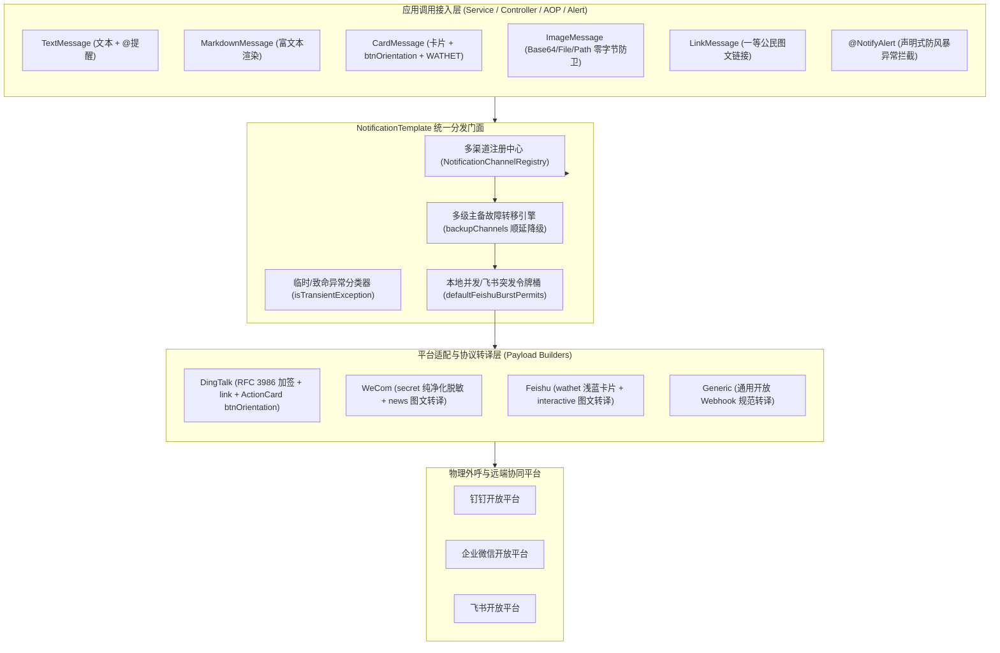

# 72. 协同机器人通知底座官方API权威对齐、全场景加固、高可用容灾演进与样例闭环架构决策 (Notification Full-Scenario Hardening, Official API Alignment, High-Availability Failover & Sample Closed-Loop Architecture)

## 状态
`Accepted`

---

## 背景与痛点 (Context & Problem Statement)

在现代企业协同办公与云原生微服务监控运维中，机器人通知是系统异常触达、审批流转、CI/CD 构建与里程碑通报的关键枢纽。`ateng-boot-notification` 基于纯原生 JDK 17 与 Spring 6 基础设施，构建了涵盖钉钉（DingTalk）、企业微信（WeCom）、飞书（Feishu）与 Generic 自定义 Webhook 的多渠道通知底座。

然而，在对标三大主流协同办公平台官方最新开放 API 契约与大规模生产环境高并发、高可用容灾演进中，原底座暴露出以下深度场景痛点：

1. **企业微信与钉钉凭据签名治理隐患 (Credential & Signing Vulnerabilities)**：
   - 企业微信机器人 Webhook 仅使用 URL 中的 `key` 鉴权，官方原生不支持任何 `secret` URL 签名；历史代码中若误配 `secret` 会被盲目拼接到 URL 导致企微底层返回 `40058 (bad parameter)` 拒绝服务；
   - 钉钉安全设置中的加签参数（`timestamp` 与 `sign`）在采用标准 Java `URLEncoder` 进行百分号编码时，由于未做 RFC 3986 字符清洗（如空格转换为 `+` 而非 `%20`、`*` 未转译为 `%2A`、`~` 误转为 `%7E` 等），在极端边界签名计算下会导致钉钉鉴权签名校验失败（`310000 sign not match`）。
2. **飞书突发流控刚性硬编码与官方颜色契约残缺 (Feishu Burst Rate Limit & Palette Gap)**：
   - 飞书官方机器人对突发请求具有严格的并发令牌桶限制；原框架中飞书渠道的突发令牌桶容量硬编码为 5，高并发批量分发或业务突发报警时无法按业务实际配额弹性调整；
   - 飞书最新交互式卡片官方规范已全面支持 `wathet`（浅蓝色），而原底座 `CardColor` 枚举未对齐该官方主视觉色彩，影响卡片视觉层次表现。
3. **卡片按钮排版方向缺失与跨平台图文链接契约空白 (Layout & LinkMessage Missing)**：
   - 钉钉独立跳转 ActionCard 原生支持 `btnOrientation`（0-按钮竖直排列，1-按钮横向并排），原底座缺失该排版控制，导致长短按钮无法自适应并排；
   - 钉钉 `link` 消息、企业微信 `news` 图文消息与飞书交互式卡片均原生支持图文链接卡片（Title + Text/Description + MessageUrl + PicUrl），原底座缺乏一等公民 `LinkMessage` 模型与跨端自适应转译。
4. **单点网络抖动与单渠道瘫痪缺乏高可用容灾 (Single Point of Failure & Disaster Recovery)**：
   - 原架构中单次通知仅针对指定单一渠道发起呼叫。当目标平台发生 DNS 故障、网络抖动、HTTP 5xx 网关瘫痪或服务宕机时，报警或重要审批通知将直接丢失或抛出异常，缺乏声明式多渠道顺延故障转移（Cascade Failover）机制。
5. **本地图片资源防卫与样例工程场景覆盖不全 (Resource Safety & Sample Gap)**：
   - `ImageMessage` 缺乏直接接收本地 `File` 或 `Path` 的工业级卫语句防卫（防范零字节空文件与不存在路径）；样例工程缺少图文链接、卡片排版与故障转移的端到端集成用例。

---

## 决策内容与架构拓扑 (Decision & Architecture)

经由深度场景推演与设计树决策收敛，正式确立并落地 **“协同机器人通知底座官方API权威对齐、全场景加固、高可用容灾演进与样例闭环”** 架构演进：

### 1. 凭据治理与 RFC 3986 权威签名对齐
- **企业微信 Secret 纯净脱敏**：
  - 在 `NotificationChannelProperties` 与 `WeComPayloadBuilder` 中明确企微 Webhook 凭据边界：企微官方 Webhook 鉴权仅依赖 URL 中的 `key`，严禁拼接 `secret` 签名参数；
  - 自动在入参及注释中净化误配的 `secret`，彻底消除 `40058 (bad parameter)` 异常。
- **钉钉签名 RFC 3986 权威转译**：
  - 钉钉官方 HMAC-SHA256 签名计算后经 Base64 生成密文，必须采用严格符合 RFC 3986 的百分号转译（`+` 替换为 `%20`、`*` 替换为 `%2A`、`%7E` 替换为 `~`）；
  - 确保极端字符集与特殊字符在钉钉鉴权时 100% 通过校验，彻底消除 `310000 sign not match` 隐患。

### 2. 飞书令牌桶弹性治理与官方视觉色彩扩展
- **飞书突发令牌桶弹性配置 (`defaultFeishuBurstPermits`)**：
  - 新增 `ateng.boot.notification.default-feishu-burst-permits` 配置项（默认 5），允许生产高负载场景根据企业飞书机器人配额平滑上调突发令牌容量，防范瞬时报警被本地令牌桶熔断。
- **飞书官方浅蓝配色 (`CardColor.WATHET`)**：
  - `CardColor` 新增 `WATHET("wathet", "wathet", "#1E88E5", "wathet")`；
  - 针对飞书卡片权威映射为官方 `wathet`，针对钉钉与企微自动平滑降级为对应浅蓝 HEX 十六进制与经典蓝，保障跨平台视觉一致性。

### 3. 排版方向受控与一等公民图文链接
- **卡片按钮方向 (`CardButtonOrientation`)**：
  - 引入枚举 `CardButtonOrientation`（`VERTICAL("0")`、`HORIZONTAL("1")`）；
  - `CardMessage` 增加 `btnOrientation` 属性与链式构造，1:1 精确映射钉钉 ActionCard `btnOrientation`。
- **图文链接消息 (`LinkMessage`)**：
  - 继承 `NotificationMessage`，封装 `title`、`text`、`messageUrl`、`picUrl` 与 `@提醒` 契约；
  - 跨平台自适应构建：
    - **钉钉**：转译为官方 `{"msgtype":"link","link":{...}}` 原生图文；
    - **企业微信**：转译为官方 `{"msgtype":"news","news":{"articles":[{...}]}}` 单图文；
    - **飞书**：转译为官方 `{"msgtype":"interactive","card":{...}}` 交互式卡片（图文并茂 + 跳转按钮）；
    - **Generic**：构建标准 JSON `{"msgtype":"link",...}` 载荷。

### 4. 高可用顺延故障转移 (Cascade Failover)
- **多级备用渠道契约 (`backupChannels`)**：
  - `NotificationChannel` 与 `NotificationChannelProperties` 新增 `backupChannels` 列表配置；
  - 允许主渠道绑定多个候选备用渠道（如 `backupChannels: ["dingtalk-backup", "feishu-ops"]`）。
- **智能因果故障判定 (`isTransientException`)**：
  - 严格区分瞬态网络/服务异常与致命配置异常：
    - **瞬态异常（触发顺延转移）**：网络超时（`SocketTimeoutException`、`ConnectTimeoutException`）、连接拒绝、HTTP 5xx 网关与平台服务不可用；
    - **致命异常（立即熔断拦截）**：渠道未注册、参数语法校验失败、企业凭据非法（HTTP 4xx 业务鉴权失败），严禁无脑轮询备用渠道以防污染下游。
- **完整因果链保留**：故障转移若全链路耗尽，以链式异常抛出带有所有尝试渠道名称的 `NotificationException`，绝不吞咽任何异常。

### 5. 资源防卫与 1:1 端到端样例闭环
- **本地图片零字节与非法路径前置防卫**：
  - `ImageMessage.fromFile(File)` 与 `ImageMessage.fromPath(Path)` 标配严格卫语句（非空、存在性、非目录、正向大小 `> 0` 强校验），防止空文件导致平台解析崩溃；
- **1:1 场景集成测试与纯内存沙箱**：
  - `ateng-boot-sample-notification` 新增 `LinkMessageRequest`、`btnOrientation` 与 `backupChannels` 全场景 REST 接入点；
  - `SampleNotificationIntegrationTest` 依托纯内存 `MockWebServer` 100% 覆盖图文链接跨端转译、卡片横向排版、浅蓝主视觉与主备渠道故障转移集成测试。

---

## 架构细则与演进矩阵 (Detailed Specifications)

### 1. 特性与公共 API 演进矩阵

| 特性分类 | 特性名称 | 核心门面 / 注解 / 枚举 | 关键配置项 | 核心行为 / 契约说明 | 验证源头 |
| :--- | :--- | :--- | :--- | :--- | :--- |
| **消息模型** | 图文链接消息 | `LinkMessage` | - | 跨端自适应转译钉钉 link、企微 news 与飞书卡片 | `LinkMessageTest` / `SampleNotificationIntegrationTest` |
| **卡片排版** | 卡片按钮方向 | `CardButtonOrientation` | - | 映射钉钉 ActionCard `btnOrientation`（0-竖直/1-横向） | `CardMessageTest` / `SampleNotificationIntegrationTest` |
| **色彩契约** | 官方浅蓝主视觉 | `CardColor.WATHET` | - | 权威对齐飞书官方 `wathet`，跨端平滑降级 | `CardMessageTest` / `SampleNotificationIntegrationTest` |
| **高可用容灾** | 多渠道故障转移 | `NotificationTemplate` | `ateng.boot.notification.channels.<name>.backup-channels` | 主渠道瞬态网络/5xx 异常时顺延降级至备用渠道 | `NotificationTemplateTest` / `SampleNotificationIntegrationTest` |
| **流量治理** | 飞书突发令牌桶 | `NotificationProperties` | `ateng.boot.notification.default-feishu-burst-permits` | 飞书机器人突发令牌桶容量参数化（默认 5） | `NotificationPropertiesTest` |
| **资源安全** | 本地图片防卫 | `ImageMessage` | - | `fromFile` / `fromPath` 零字节与文件存在性前置拦截 | `ImageMessageTest` |
| **签名安全** | 钉钉 RFC 3986 签名 | `DingTalkPayloadBuilder` | - | 加签百分号编码遵循 RFC 3986（`%20` / `%2A` / `~`） | `DingTalkPayloadBuilderTest` |
| **凭据安全** | 企微 Secret 纯净化 | `NotificationChannelProperties` | - | 废除企微误配 `secret` 签名，彻底杜绝 40058 异常 | `NotificationChannelPropertiesTest` |

---

## 效果与收益 (Consequences & Benefits)

1. **官方开放平台 100% 契约自洽**：
   钉钉 RFC 3986 签名与 ActionCard 横向排版对齐官方规范；飞书 `wathet` 浅蓝色卡片与突发令牌桶弹性调优；企微 Secret 脱敏杜绝参数非法异常。
2. **企业级高可用与告警零丢失**：
   引入主备渠道顺延故障转移体系，防御单公网服务商瘫痪或内网网关抖动，确保生产高危监控告警必达。
3. **零臃肿与纯原生一致性**：
   全部基于 JDK 17 与 Spring 6 原生设施构建，无第三方重型工具包污染，100% 保持内存真明文与受管生命周期安全。
