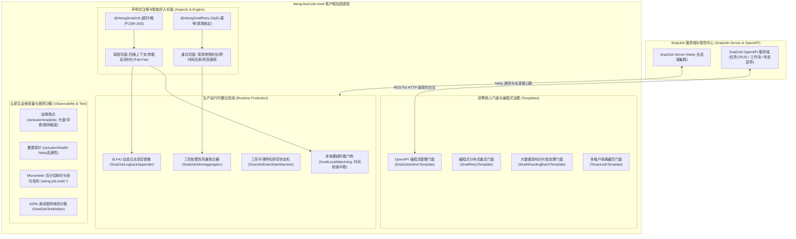

# 72. SnailJob 分布式调度与分布式重试双擎生产级加固架构决策 (SnailJob Dual-Engine Production Hardening and Resilient Distributed Architecture)

## 背景与痛点

在企业级分布式与微服务架构中，**分布式定时任务调度（Job）**与**分布式业务异常重试（Retry）**往往是紧密耦合的共性基础设施：定时批量任务执行失败需要受控重试；微服务 RPC/支付/消息投递失败需要分布式持久化补偿并在死信时人工介入。

SnailJob（原 EasyRetry，由 Aizuda 开源）作为国内新兴的现代化高可用双擎平台，凭借原生支持 Spring Boot 3 与 JDK 17、Netty 长连接通信、**普通任务 / 广播分片 / MapReduce 动态分布式切片计算 / 复杂 DAG 工作流**，以及**本地重试 / 远程持久化调度重试 / 死信队列**一体化治理，正迅速成为企业级核心底座的关键选型。

然而，在面对高并发生产落地、严苛的金融级数据一致性及云原生多租户隔离场景时，SnailJob 官方客户端 SDK 依然存在以下十大核心痛点与工程缺陷：

1. **远程重试四维上下文彻底断裂 (Context Loss & Tenant Cross-Talk Risk)**：
   当方法标注 `@Retryable` 遭遇异常并转入远程重试（`ONLY_REMOTE` 或 `LOCAL_REMOTE`）时，重试任务被持久化至服务端，数分钟或数小时后重新下发回调客户端执行。此时原请求的 MDC `traceId`、操作人 `userId`、租户 `tenantId` 彻底丢失，导致链路断层，更致命的是在 SaaS 多租户系统中极易引发**跨租户数据串写与越权更新**。
2. **缺乏本地硬看门狗与僵尸线程雪崩 (Zombie Thread & ThreadPool Exhaustion)**：
   服务端调度超时仅在管控台记录标记。如果客户端工作线程在执行任务或重试时陷入死锁、慢 SQL 或长连接无界阻塞，本地执行线程将被永久悬挂，最终耗尽线程池引发微服务雪崩。
3. **业务日志与调度中心断层 (SLF4J vs SnailJobLog Disconnect)**：
   官方通过 `SnailJobLog.REMOTE.info(...)` 上报远程日志。在实际工程中，业务代码普遍使用 SLF4J `log.info(...)`，导致业务日志无法同步至 SnailJob 管理控制台，严重破坏业务代码纯净度与故障排查体验。
4. **形参样板代码与缺乏 JSR-303 防卫 (Raw JobArgs & Missing Fail-Fast)**：
   官方 `@JobExecutor` 任务方法默认接收裸 `JobArgs`，业务开发者被迫编写冗余的 JSON 反序列化与参数判空代码；缺乏在传输边界自动将调度入参反序列化为强类型 DTO 并执行 JSR-303 Fail-Fast 校验的机制。
5. **大数据批处理缺乏流式防 OOM 规范 (Streaming Cursor & Sharding Blindspot)**：
   面对百万级持久化数据批处理时，开发者若缺乏标准流式步进抽象，极易陷入深分页（Deep Pagination）慢查询与堆内存 OOM 泥潭。
6. **OpenAPI 编程式治理缺乏强类型与因果异常保护 (OpenAPI SDK Decoupling Gap)**：
   SnailJob 官方自 `1.2.0-beta2` 及 `1.7.0+` 推出了 `SnailJobOpenApi`，但缺少微服务友好的强类型对称门面；底层网络与服务端异常未受控转译，容易造成 Log-and-Throw 污染或异常吞咽。
7. **编程式重试门面缺失 (Missing Imperative SnailRetryTemplate)**：
   针对动态计算幂等键、外部第三方 HTTP 接口调用无源码无法标注注解等场景，官方缺乏纯编程式对称执行门面，调用方被迫穿透底层复杂 SPI。
8. **高频重试与死信告警风暴 (Alert Storm & Dead-Letter Blindspot)**：
   网络抖动或下游系统宕机时，批量重试与任务失败高频轰炸，极易打爆协同机器人 Webhook；同时，重试耗尽真正进入**死信队列（Dead Letter）**的紧急事故缺乏高优先级领域事件与群卡片通道。
9. **K8s 缩容发版缺乏平滑排空状态机 (SIGTERM & In-flight Task Truncation)**：
   容器接收到 `SIGTERM` 信号停止时，SnailJob 默认缺乏对在途任务（In-flight Jobs）与正在重放重试任务的轮询排空机制，直接停机会导致数据库事务半提交与数据脏状态。
10. **本地单测与 CI 脱网环境脆弱 (Missing Hermetic Test Sandbox)**：
    SnailJob 客户端启动时默认尝试建立 Netty 长连接，在未部署服务端的本地开发与 GitHub Actions CI 环境中极易因连接超时抛错失败，阻断全自动流水线。

---

## 核心架构与决策内容

经由严格技术推演、盲点对标与全场景审查，正式确立 **`ateng-boot-job-snail`（工业级 SnailJob 分布式调度与重试加固底座）**，其整体架构拓扑如下：



---

## 关键技术决策明细

### 1. 2.0.2 基线与双擎模块化装配
- **依赖基线**：锁定 `com.aizuda:snail-job-client-starter:2.0.2`（原生 Spring Boot 3 与 JDK 17 Jakarta 体系），并在 `ateng-boot-bom` 中全局纳管。
- **细粒度特性开关**：
  ```yaml
  ateng:
    boot:
      job:
        snail:
          enabled: true                     # 总开关
          server: 127.0.0.1:7888            # 服务端 Netty 节点地址 (支持集群逗号分隔)
          group: ${spring.application.name} # 命名组
          namespace: default                # 命名空间
          token: default_token              # 鉴权令牌
          job:
            enabled: true                   # 任务调度功能开关
          retry:
            enabled: true                   # 分布式重试功能开关
          openapi:
            enabled: true                   # OpenAPI 门面开关
            port: 8080                      # 服务端 Web 端口
  ```

### 2. 远程重试四维上下文保真与多租户沙箱
- **快照封包与跨时间还原**：在重试拦截点，切面利用 `AsyncContext.capture()` 抓取当前四维上下文（MDC `traceId`、`userId`、`tenantId`、`ignoreTenant`），注入 SnailJob 重试请求元数据；服务端回调执行时，切面自动解包并还原至线程，并在 `finally` 执行确定性清理。
- **租户隔离策略**：调度任务支持 `JobTenantMode`（`IGNORE` / `PARAM` / `ITERATE`），多租户全量遍历依托 `TenantJobTemplate` 在独立沙箱上下文中流式安全执行。

### 3. OpenAPI 强类型管理门面 (`SnailJobAdminTemplate`)
- **生命周期完备性**：封装任务新增（集群、广播、静态分片、Map、MapReduce）、更新、按 `jobId` 详情查询、即时触发、启停状态切换、任务删除及工作流（DAG）触发。
- **因果异常转译**：严格遵循成熟度防线第七条，受控拦截底层网络与 HTTP 异常，保留原始 cause 转译为 `BusinessException`。

### 4. 本地硬超时看门狗与 SLF4J 动态日志镜像
- **`SnailLocalWatchdog`**：依托 Netty `HashedWheelTimer` 时间轮构建，超时强行触发 `workerThread.interrupt()`，广播 `SnailJobTimeoutEvent` 并记录异常现场堆栈。
- **`SnailJobLogbackAppender`**：向 Logback Root Logger 动态挂载镜像 Appender，在调度与重试线程中，标准 SLF4J 日志透明镜像至 SnailJob 服务端，脱离执行线程自动静默。

### 5. 分布式批处理与编程式重试双轨门面
- **`SnailShardingBatchTemplate`**：为主键步长游标查询、多线程背压并发消费及 MyBatis-Plus 流式游标（`StreamingQueryTemplate`）提供标准化封装，彻底杜绝深分页与堆 OOM。
- **`SnailRetryTemplate`**：提供对称的编程式重试门面，支持 SpEL 表达式与 SHA-256 结构摘要两种标准幂等键生成器。

### 6. 云原生运维度量、防风暴聚合与脱网沙箱
- **`/actuator/snailjobs`**：统一暴露已注册 JobHandler 与 Retry 场景大盘，提供单任务详情查询与脱网手动触发接口；
- **告警防风暴与死信通道**：任务失败三阶状态机抑制风暴（首发告警 -> 聚合摘要 -> 成功自愈），重试死信极速发布 `SnailRetryDeadLetterEvent` 直投协同机器人；
- **`SnailJobTestHelper`**：提供纯内存脱网驱动器，单测无需外部 SnailJob 服务端，配合 Sample 工程的双模机制保障 CI 100% 离线全绿。

---

## 结论与后续演进

本架构决策彻底补齐了 SnailJob 在生产级分布式微服务体系中的全部短板与非功能边界盲区，为后续编码实现确立了清晰的契约、防线与验收标准。
