# 73. Word 模板与 PDF 综合治理全场景加固、跨页骑缝章无损切片与可视化点检架构决策 (Word Template and PDF Full-Scenario Hardening, Cross-Page Seal Slicing & Visual Audit Architecture)

## 状态
`Accepted`

---

## 背景与痛点 (Context & Problem Statement)

在企业级合同协同、财务对账、电子政务准入与电子证据保全体系中，`ateng-boot-document` 基于纯原生 Apache 2.0 商业合规依赖体系（poi-tl 1.12.x + Apache PDFBox 3.x）确立了双核文档治理底座（参见 [ADR-0046](./0046-enterprise-word-template-and-pdf-governance-architecture.md)）。然而，在深入复杂金融、大型国企采购与法务合规等严苛生产业务场景时，原底座暴露出以下六大关键场景痛点与技术边界缺陷：

1. **Word 模板语法自省与动态表格空数据降级缺失 (Word Template Introspection & Empty Table Degradation)**：
   - 业务系统在动态加载外部或运营上传的 Word 模板时，无法逆向解析出模板中声明的变量集合（`{{variable}}`、`{{#items}}`、`{{@seal}}`），导致前端无法动态渲染参数表单，调用方无法在前置链路执行入参缺失校验；
   - 动态表格行在面对空数据集合（`items = []`）时，若缺乏优雅降级处理机制，生成的文档中极易残留未替换的动态占位符（如 `[projectName]`、`[role]`），导致正式交付给客户或法务的合同出现排版破损与裸语法暴露；
   - 模板图元（如可选骑缝公章或签名图）如果入参传入 `null`，原生解析器易产生阻断报错或遗留脏占位符，缺少自动清空防御。
2. **PDF AcroForm 表单域巡检空白与动态 XFA 潜伏隐患 (AcroForm Field Inspection & XFA Blind Spots)**：
   - 现存系统面对第三方机构或政府平台下发的交互式 PDF 表单，无法程序化枚举所有可交互表单域的字段名、控件类型（文本域/复选框/单选框/下拉框）与当前值，开发者只能依赖第三方桌面软件手动猜解字段名；
   - 部分政府与海关表格采用旧版 Adobe 动态 XFA（XML Forms Architecture）技术构建，PDFBox 底层并不支持动态 XFA 脚本引擎，若静默执行填充会导致渲染内容为空白或黑屏，极易引发生产事故；
   - 云原生 Docker/K8s 最小化容器环境缺失中文字体，AcroForm 填充中文时易因字体缺失抛出 `IllegalArgumentException: No glyph for ... in font SimSun` 异常崩溃。
3. **PDF 元数据自省与纯文本抽取空白 (PDF Metadata & Plain Text Extraction Gap)**：
   - 安全审计、涉密排查与内容防泄密链路需要快速读取 PDF 核心元数据（标题、作者、创建/修改时间、软件版本、页数、加密状态、版本号等），原底座缺乏结构化自省实体；
   - 全文检索（Elasticsearch/OpenSearch）或大模型 RAG 知识库构建需要抽取纯文本内容，原底座缺乏受管的分页纯文本抽取与密码自适应解密门面。
4. **PDFBox 原生页面转高清预览图缺失与显存防爆治理 (High-Definition Page Rendering & Raster Memory Leaks)**：
   - 移动端 App、微信小程序与 Web 审批流转中，亟需将 PDF 首页或指定页面转为高清 PNG/JPEG 缩略图以便于用户秒级预览，开发者往往被迫自行拼装底层 `PDFRenderer` 并引发各类资源未释放故障；
   - 大文档多页渲染时，PDFBox 渲染引擎分配的原生光栅数据（Raster）驻留 JVM 堆内存，若未在回调周期后即时执行 `image.flush()` 释放显存，极易引发连续大并发下的 FullGC 与 OOM 宕机；且缺乏对无界高 DPI（如 1200 DPI）的物理上限阈值防卫。
5. **多页合同跨页骑缝章(Cross-Page Seal)切片与贴合压印空白 (Cross-Page Seal Slicing & Edge Overlay)**：
   - 纸质物理合同在法务合规中的“骑缝章”（将公章均分压印在装订或折叠页面侧边，多页拼合可还原完整公章）是企业防抽页、防伪造的关键制度。在电子合同全生命周期中，迫切需要数字化自动切片压印能力；
   - 传统自研切片由于浮点除法截断，常产生像素丢失导致拼合缝隙露白；且缺乏对首页封面跳过、封底跳过、透明 Alpha 通道保真、自定义页面集合以及右侧/左侧/顶部贴合方向的工业级支持。
6. **缺乏端到端真实场景可视化落盘与 SHA-256 验真点检机制 (Lack of Human Visual Audit & Physical Artifacts)**：
   - 单元测试普遍使用 JUnit `@TempDir` 临时沙箱，测试结束后临时文件立即被底层物理销毁，导致研发人员与人工审核员无法直观打开生成的文件，无法审核 Word 复杂表格合并、浮动印章图层对齐、PDF -30° 动态平铺暗水印视觉通透度与骑缝章拼接效果。

---

## 决策内容与架构拓扑 (Decision & Architecture)

经由严格的场景推演与设计树收敛，正式确立 **“Word 模板与 PDF 综合治理全场景加固、跨页骑缝章无损切片与可视化点检”** 架构演进方案，整体架构演进拓扑如下：

```mermaid
flowchart TB
    subgraph ClientLayer["应用调用接入层 (Service / Controller / Scheduled / 审核员)"]
        direction TB
        WORD_FACADE["WordTemplate (Word 模板渲染/自省/抽取/拼接门面)"]
        PDF_FACADE["PdfTemplate (PDF 水印/表单/安全/骑缝章/光栅预览门面)"]
        AUDIT_TEST["DocumentAuditExportTest (9 大场景端到端真实落盘点检)"]
    end

    subgraph WordHardening["Word 模板深度加固引擎 (poi-tl 1.12.x)"]
        direction TB
        W_INTROSPECT["listVariableNames(source): 逆向解析 AST 变量占位符清单"]
        W_EXTRACT["extractText(source): 正文与表格纯文本流式抽取"]
        W_EMPTY_COLLAPSE["LoopRowTableRenderPolicy: 空列表优雅折叠 (零残留语法)"]
        W_FLOAT_SEAL["FloatingPictureRenderPolicy: null/损坏图元优雅清空占位符"]
        W_STITCH["stitchToBytes: 多文档物理无缝拼接 (主合同 + 附件保密协议)"]
    end

    subgraph PdfHardening["PDF 综合治理深度加固引擎 (Apache PDFBox 3.x)"]
        direction TB
        P_ACRO_INSPECT["listFormFields(source): AcroForm 交互字段元数据巡检自省"]
        P_XFA_DEFENSE["checkXfaSupport: 探测动态 XFA 结构并快速失败 (Fail-Fast 熔断)"]
        P_CJK_FALLBACK["DocumentFontResolver: 多级 CJK 字体自适应装配与无损降级"]
        P_META_INSPECT["inspectMetadata(source): 核心元数据结构化自省 (PdfMetadata)"]
        P_TEXT_EXTRACT["extractText(source, startPage, endPage, password): 正文全文/分页抽取"]
        P_RENDER_STREAM["renderPages(..., consumer): 150 DPI 高清页转图 + image.flush() 防 OOM 显存释放"]
        P_CROSS_SEAL["stampCrossPageSeal: 垂直/水平等分无缝切片 (保留 Alpha 通道) + 贴合压印"]
    end

    subgraph AuditPipeline["可视化点检流水线 (Human Visual Audit & Manifest)"]
        direction TB
        TARGET_DIR["target/test-output/ (物理持久化隔离落盘，避免 @TempDir 销毁)"]
        MANIFEST_JSON["audit-manifest.json: 记录文件名、场景名、文件大小、页数、SHA-256"]
        CONSOLE_REPORT["ASCII 格式化表格报告 + file:/// 点击直达链接 (Word/PDF 软件一键点检)"]
    end

    ClientLayer --> WordHardening
    ClientLayer --> PdfHardening
    AUDIT_TEST --> AuditPipeline
    WordHardening --> TARGET_DIR
    PdfHardening --> TARGET_DIR
```

---

## 核心设计决策与关键机制 (Key Mechanisms)

### 1. Word 模板语法自省与空数据安全折叠机制

- **逆向变量解析 (`listVariableNames`)**：
  基于 poi-tl 的 `Configure` 解析器与 AST 元素树，提取出模板中所有文本占位符、多行循环表格标记、浮动图元及条件块标签，过滤内部引用并输出保持声明顺序的有序去重变量名清单，为前端动态表单构建与入参前置校验提供基石。
- **正文纯文本抽取 (`extractText`)**：
  基于 Apache POI `XWPFDocument`，自顶向下抽取段落正文与多维表格内的全部文本内容，支持全文检索与审计留痕。
- **动态表格空数据降级**：
  当调用方传入的循环表格列表数据为 `null` 或空集合（`Collections.emptyList()`）时，`LoopRowTableRenderPolicy` 自动折叠并移除模板行占位符，保留表头结构，坚决杜绝在正式交付文档中残留 `{{items}}` 或 `[field]` 等未渲染原始语法。
- **可选图元印章优雅清空**：
  公章或签名图元为 `null` 时，`FloatingPictureRenderPolicy` 主动清理对应的 XML Run 元素，不抛出空指针，不残留占位符。

### 2. PDF AcroForm 表单域巡检自省、动态 CJK 字体装配与 XFA 快速失败

- **表单域深度自省 (`listFormFields`)**：
  递归遍历 `PDAcroForm` 树，提取字段全限定名（`fullyQualifiedName`）、部分名称（`partialName`）、底层字段类型代码（`Tx`/`Btn`/`Ch`/`Sig`）、结构化枚举类型（`TEXT_FIELD`/`CHECK_BOX`/`RADIO_BUTTON`/`CHOICE_LIST`/`SIGNATURE`）、当前值、默认值以及只读/必填/多选等 8 维状态元数据。
- **动态 XFA 快速失败防卫 (Fail-Fast)**：
  在表单填报与巡检入口处，显式调用 `acroForm.hasXFA()` 与 `acroForm.getXFA() != null` 探测。若检测到模板包含动态 XFA 结构，立即抛出语义化 `PdfOperationException(DocumentResultCode.PDF_OPERATION_FAILED)` 并附带明确指引，拒绝静默产生空白损毁文件。
- **多级中文字体装配与防崩保底**：
  集成 `DocumentFontResolver`，按照 `本地配置路径 -> classpath:fonts/ -> 操作系统系统字体 -> PDFBox 默认降级字体` 四级顺延装配中文字体，彻底防御容器化环境因缺失中文字体抛出的 `No glyph for U+xxxx` 崩溃。

### 3. PDF 核心元数据自省与正文纯文本抽取

- **结构化元数据自省 (`inspectMetadata`)**：
  封装 `PdfMetadata` 强类型实体，自省映射 Document Information 标量（Title, Author, Subject, Keywords, Creator, Producer, CreationDate, ModificationDate）与核心技术属性（`numberOfPages`, `encrypted`, `pdfVersion`），支持密文文档带口令探查。
- **分页受管文本抽取 (`extractText`)**：
  基于 `PDFTextStripper`，封装起止页码范围抽取（1-based），支持带密码文档安全解锁抽取与边界防卫校验。

### 4. PDFBox 原生页面转高清预览图与防 OOM 流式显存释放

- **强类型配置门面 (`PdfRenderOptions`)**：
  提供 `dpi`（生产建议 150.0f，硬防卫范围 72.0f ~ 600.0f，杜绝无界高 DPI 导致的内存膨胀）、`imageType`（RGB/ARGB/GRAY）、`imageFormat`（"PNG"）与 `maxPages`（默认 50，防止超大文档一次性打爆堆内存）。
- **流式光栅释放机制 (`PageImageConsumer`)**：
  引入流式页级消费接口 `void accept(BufferedImage image, int pageIndex)`。在内部循环遍历页面时光栅化单一页面，在执行用户回调之后，**在 `finally` 块中确定性调用 `image.flush()`**，强制底层 AWT/Graphics 清理 Display/DirectX/OpenGL 离屏显存与 Java 堆外光栅缓冲区，实现十万级并发或百页大文档极低堆内存恒定驻留。

### 5. 多页合同跨页骑缝章(Cross-Page Seal)无损切片与贴合压印

- **数学完备的无损等分切片算法**：
  对任意尺寸（宽 $W$，高 $H$）印章与任意页数 $N$（支持奇数页与偶数页），第 $k$ 页切片在原始图片上的像素坐标计算如下：
  $$\text{startX} = \text{round}\left(k \times \frac{W}{N}\right), \quad \text{endX} = \text{round}\left((k + 1) \times \frac{W}{N}\right), \quad \text{stripWidth} = \text{endX} - \text{startX}$$
  此算法确保 $\sum_{k=0}^{N-1} \text{stripWidth} = W$，百分之百零像素丢失、零露白缝隙、零重叠失真。
- **Alpha 透明通道百分之百保留**：
  切片创建采用独立 `BufferedImage(stripWidth, H, BufferedImage.TYPE_INT_ARGB)`，绘制时启用 `g2d.setComposite(AlphaComposite.Src)`，完美保真印章半透明边缘与边缘平滑羽化，压印至 PDF 时作为包含 `SMask` 透明掩码的 `PDImageXObject` 写入。
- **灵活的边缘对齐与页面区间控制**：
  `CrossPageSealOptions` 默认贴合在右侧边缘（`CrossPageSealEdge.RIGHT`）垂直居中，支持左侧（`LEFT`）、顶部（`TOP`）、底部（`BOTTOM`），支持自定义物理边距（`margin`）与中心偏移（`offset`）；天然支持 `skipCover`（跳过首页封面）、`skipBackCover`（跳过末页封底）及自定义页面集合（`targetPages`，含负数索引支持）。

### 6. 样例工程 9 大企业场景端到端真实落盘与 SHA-256 验真

在 `ateng-boot-samples/ateng-boot-sample-document` 实施 `DocumentAuditExportTest`，贯通端到端真实业务服务并将 9 大场景产物确定性落盘至 `target/test-output/` 目录：

| 序号 | 交付物文件名 | 企业场景说明 | 技术特征 |
| :---: | :--- | :--- | :--- |
| **1** | `contract-rendered.docx` | Word 劳动合同模板渲染 | 姓名/工号变量插值、项目经历多行循环表格、居右浮动公章 |
| **2** | `contract-merged.docx` | Word 主合同附件拼装 | 主合同正文与商业保密协议附件物理无缝拼装 |
| **3** | `contract-empty-table.docx` | Word 动态表格空数据安全折叠 | 空项目经历列表优雅降级折叠，零残留语法 |
| **4** | `statement-watermarked.pdf` | PDF 财务对账单暗水印与页码 | -30° 旋转操作人宏变量平铺暗水印、跳过封面页码重算 |
| **5** | `statement-encrypted.pdf` | PDF 256 位 AES 权限锁加密 | 密码保护锁（打开密码：`MyStrongPassword#2026`），禁止篡改复制 |
| **6** | `statement-cross-page-seal.pdf` | PDF 多页对账单跨页骑缝章 | 右侧边缘等分垂直无损切片压印，拼合还原完整印章 |
| **7** | `supplier-form-interactive.pdf` | PDF 供应商准入 AcroForm 预填报 | 预填充文本域与勾选复选框，保留可交互控件 |
| **8** | `supplier-form-flattened.pdf` | PDF 供应商准入 AcroForm 扁平化 | 矢量不可逆扁平化固化，交互式表单结构彻底销毁防篡改 |
| **9** | `statement-page-preview.png` | PDFBox 原生 150 DPI 高清页面光栅化 | 首页高质量光栅化渲染，可作为 Web/移动端缩略图预览 |

- **`audit-manifest.json` 元数据资产**：
  在输出目录伴生生成格式化 JSON 清单，记录每个落盘产物的文件名、场景名、文件大小（Bytes）、页数、SHA-256 摘要与绝对访问链接；
- **控制台 ASCII 点检报告**：
  测试运行结束后在控制台直接打印格式化表格，输出一键直达点击链接（`file:///...`），研发与测试人员在开发工具终端或文档中直接点击即可一键使用 Microsoft Word、WPS 或 Adobe Acrobat 打开原汁原味文件进行全真视觉点检。

---

## 验证源头与交付物 (Verification & Deliverables)

1. **核心底座单元测试**：
   - [`WordTemplateTest.java`](../../ateng-boot-document/src/test/java/io/github/atengk/boot/document/word/WordTemplateTest.java)：覆盖变量反查、正文抽取、空数据表格折叠与空图元清理；
   - [`PdfTemplateFormTest.java`](../../ateng-boot-document/src/test/java/io/github/atengk/boot/document/pdf/PdfTemplateFormTest.java)：覆盖表单域巡检自省、动态 CJK 字体装配与 XFA 快速失败熔断；
   - [`PdfTemplateMetadataTest.java`](../../ateng-boot-document/src/test/java/io/github/atengk/boot/document/pdf/PdfTemplateMetadataTest.java)：覆盖核心元数据自省、分页文本抽取与带密码文档探查；
   - [`PdfTemplateRenderTest.java`](../../ateng-boot-document/src/test/java/io/github/atengk/boot/document/pdf/PdfTemplateRenderTest.java)：覆盖单页/多页上限截断、DPI 范围保护、流式光栅消费与越界异常防卫；
   - [`PdfTemplateCrossPageSealTest.java`](../../ateng-boot-document/src/test/java/io/github/atengk/boot/document/pdf/PdfTemplateCrossPageSealTest.java)：覆盖 3 页、5 页跳首尾、单页、自定义页面、边缘贴合与切片精度无损验证。
2. **场景工程端到端点检**：
   - [`DocumentAuditExportTest.java`](../../ateng-boot-samples/ateng-boot-sample-document/src/test/java/io/github/atengk/boot/sample/document/DocumentAuditExportTest.java)：端到端运行 9 大场景，生成真实文件至 `ateng-boot-samples/ateng-boot-sample-document/target/test-output/` 并生成 `audit-manifest.json`；
   - 多线程测试命令全绿：`mvn test -pl ateng-boot-document,ateng-boot-samples/ateng-boot-sample-document -am -T 1C -nsu -B`。
3. **关联 Issue**：
   - Parent: [#530](https://github.com/atengk/ateng-boot/issues/530)
   - Sub-tickets: [#531](https://github.com/atengk/ateng-boot/issues/531), [#532](https://github.com/atengk/ateng-boot/issues/532), [#533](https://github.com/atengk/ateng-boot/issues/533), [#534](https://github.com/atengk/ateng-boot/issues/534), [#535](https://github.com/atengk/ateng-boot/issues/535), [#536](https://github.com/atengk/ateng-boot/issues/536)
