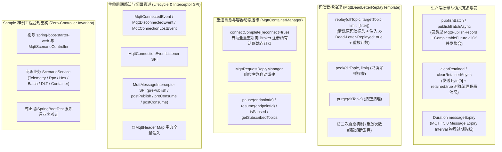

# 74. MQTT 全场景工业级加固、死信受控治理、批量下发与连接重连治理架构决策 (MQTT Full-Scenario Hardening, Dead Letter Replay Governance, Batch Publishing & Reconnect Governance Architecture)

## 状态
`Accepted`

---

## 背景与痛点 (Context & Problem Statement)

在 [ADR-0047](./0047-mqtt-iot-communication-and-edge-control-architecture.md) 中，`ateng-boot-mqtt` Starter 确立了基于 Eclipse Paho MQTT v5 官方原生客户端构建的轻量物联网双向通信底座，实现了基础发布/异步发布、双轨四维上下文透传（MQTT 5.0 User Properties + 3.1.1 降级）、`$share` 集群共享订阅、基于单客户端聚合响应主题的 Request-Response 同步 RPC 匹配、本地事务感知延迟发信（`sendAfterCommit`）、工业国标十六进制（`HexPayload`）双向转译、`PayloadGuard` 入站大报文熔断与 Netty In-Memory TestDouble 离线单测沙箱。

然而，随着工业智能制造、车联网（TSP 车机交互）、大规模边缘计算网关与高并发分布式微服务集群场景的深入，存量模块暴露出以下深水区痛点与成熟度断层：

1. **死信治理“半残门面”与缺乏处置闭环 (Unidirectional DLT Accumulation)**：
   原 Starter 仅在遇到反序列化崩溃等不可自愈毒丸时单向转发到 `${topic}/DLT`（“只死不救”），缺乏受控重放、只读探查与清空门面，严重违背工业级九道防线之第一防线“对称语义完备性”。当上游数据格式修复或下游服务恢复后，缺乏标准化手段安全恢复积压死信，易引发“二次死信雪崩”。
2. **保留消息清除 API 缺位 (Retained Message Asymmetry)**：
   门面提供设置保留消息的能力（`retained = true`），但缺失对称清除保留消息的公开方法（向主题发布空字节报文），违背增删对称原则。
3. **高并发物联网批量下发吞吐瓶颈 (Batch Publishing Void)**：
   在车联网多车指令广播、智慧工厂整产线传感器参数批量重置或固件升级（OTA）批量通知场景中，单条循环调用发信导致网络 RTT 累积与 I/O 阻塞，急需强类型批量发布门面。
4. **断网自动重连导致订阅永久丢失隐患 (Silent Subscription Loss on Reconnect)**：
   当微服务配置 `cleanStart=true`（MQTT 5.0 推荐模式）时，Paho 底层触发 `automaticReconnect` 成功后，Broker 会开启全新的 Clean Session，导致旧连接的全部订阅被抹除。当前底座 `connectComplete` 仅打印日志，未重新向 Broker 发起端点订阅，亦未重置 `MqttRequestReplyManager` 的私有响应主题，直接导致网络闪断恢复后所有监听器与 RPC 指令应答永久失效！
5. **运行期消费容器动态运维治理缺位 (Missing Container Pause/Resume Governance)**：
   在下游数据库慢查询、系统削峰维护或网络抖动时，缺乏针对特定 `@MqttListener` 端点动态挂起（Pause）与恢复（Resume）的受管门面。
6. **MQTT 5.0 消息过期原生属性未直接暴露 (Missing Message Expiry Governance)**：
   设备控制场景中，若目标设备离线积压数小时，重连后若收到过期的“开锁/启动”指令将引发严重物理安全事故，急需在门面直接暴露强类型 `Duration messageExpiry`。
7. **连接全生命周期无感知与切面拦截器缺失 (Missing Lifecycle Events & Interceptors)**：
   底座与 Broker 的连接建立、断开与掉线未融入 Spring 领域事件总线，业务层无法感知网关上下线状态；同时缺乏统一的 `MqttMessageInterceptor` SPI 实施横向审计、动态签名与打码。
8. **Sample 样例工程违规引入 Web 与 Controller (Violation of Zero-Controller Invariant)**：
   `ateng-boot-sample-mqtt` 违规引入了 `spring-boot-starter-web` 与 `MqttScenarioController`，违背了非 Web 底座零 Controller 污染的架构铁律。

---

## 决策内容与架构拓扑 (Decision & Architecture)

经过全场景对标与严谨架构推演，我们对 `ateng-boot-mqtt` 实施以下全场景工业级加固与治理升级：

### 1. 死信治理专职门面与防二次雪崩机制 (`MqttDeadLetterReplayTemplate`)
- **对称闭环**：新增 `MqttDeadLetterReplayTemplate`，提供 `replay(...)`、`peek(...)` 与 `purge(...)`，彻底解决死信“只进不出”的半残缺陷；
- **防二次死信雪崩**：重放时自动清洗 `x-original-topic`、`x-exception-class` 等原始异常头，并在 User Properties 注入 `X-Dead-Letter-Replayed: true`、`X-Replay-Count` 与时间戳；若重放后的报文二次失败且达上限（默认 1 次），强制阻断并告警，彻底杜绝死循环雪崩；
- **分层防卫限制**：强制限制单次最大重放数量（默认 ≤ 100，硬上限 1000），支持 `Predicate<MqttDeadLetterRecord>` 过滤谓词。

### 2. 生产端批量发布模型与对称保留消息清除
- **强类型批量发布契约 (`MqttPublishRecord`)**：封装 `topic`、`payload`、`qos`、`retained`、`userProperties` 与 `messageExpiry`；
- **无阻塞并发聚合**：`publishBatch` 与 `publishBatchAsync` 底层并发提交发信任务，依托 `CompletableFuture.allOf` 高效等待确认，极大缩减 RTT；
- **对称清理保留消息**：新增 `clearRetained(topic)` / `clearRetainedAsync(topic)`，向 Broker 发送空字节数组 `byte[0]` + `retained=true`，完全契合 MQTT 规范，达成第一防线对称性。

### 3. 断线自动重连全量订阅自愈与容器动态流控 (`MqttContainerManager`)
- **断网自愈重订阅**：在 `MqttListenerEndpointRegistry.connectComplete` 中捕获 `reconnect=true`，自动触发所有活跃端点的主题全量重新订阅；
- **RPC 响应主题自愈**：`MqttRequestReplyManager` 联动重连通知，主动清理过期的缓存并重新预订阅私有响应主题，彻底根除网络闪断后的消息黑洞；
- **容器动态运维**：新增 `MqttContainerManager` 门面，支持在运行期对指定端点执行 `pause(endpointId)`、`resume(endpointId)`，查询当前活跃订阅列表与健康状态。

### 4. 连接生命周期事件广播与切面拦截器 SPI
- **Spring 领域事件体系**：客户端完成连接、优雅断开或意外掉线时，自动向 Spring 容器广播 `MqttConnectedEvent`、`MqttDisconnectedEvent` 与 `MqttConnectionLostEvent`；
- **扩展点 SPI**：提供 `MqttConnectionEventListener` 与 `MqttMessageInterceptor`（`prePublish` / `postPublish` / `preConsume` / `postConsume`），支持第三方无侵入挂载审计、数据脱敏与动态验签；
- **全量标头注入**：当 `@MqttHeader` 标注于 `Map<String, Object>` / `Map<String, String>` 且未指定单个 key 时，自动将当前报文的所有 User Properties 注入为字典。

### 5. 架构边界与 Sample 样例工程红线整改 (Zero-Controller Invariant)
- **非 Web 底座零 Controller 铁律**：彻底移除 `ateng-boot-sample-mqtt` 中的 `spring-boot-starter-web` 与 `MqttScenarioController`；
- **专职场景服务**：按真实业务场景解耦为 `DeviceTelemetryScenarioService`、`DeviceControlRpcScenarioService`、`IndustrialHexScenarioService`、`BatchPublishScenarioService`、`DeadLetterReplayScenarioService` 与 `MqttContainerGovernanceScenarioService`；
- **纯正集成测试**：`SampleMqttE2eTest` 采用纯正 `@SpringBootTest` 驱动场景服务执行端到端强断言自验。

---

## 结论与收益

通过本架构决策，`ateng-boot-mqtt` 达成了以下工业级跃迁：
1. **语义对称完备**：补齐死信受控重放、清空与保留消息对称清除，九道防线无死角；
2. **高吞吐批量与过期安全**：强类型 `MqttPublishRecord` 支撑百万级批量下发，`messageExpiry` 守卫物理设备控制安全；
3. **断网弹性韧性**：重连全量自愈订阅与 RPC 响应通道重建，根除网络闪断后的死寂黑洞；
4. **云原生动态可控**：`MqttContainerManager` 赋能运行期削峰与端点流控；
5. **工程规范 100% 达标**：彻底消除 Sample 的 Controller 污染与 Spring BPP 早期加载告警。
