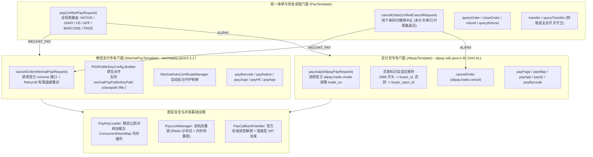

# 75. 支付底座官方SDK权威对齐、全场景加固、线下撤销冲正与双模样例闭环架构决策 (Payment Starter Official SDK Alignment, Full-Scenario Hardening, Offline Reversal & Dual-Mode Sample Architecture)

## 状态
`Accepted`

---

## 背景与痛点 (Context & Problem Statement)

在现代数字化零售、电商交易、SaaS 多租户订阅缴费与线下智能收银场景中，支付与资金结算属于企业系统的“命脉”。在前期架构中，`ateng-boot-pay` Starter 建立了微信支付 V3 与支付宝专有门面、统一轻量收单门面 `PayTemplate`、双轨防重锁与 Webhook 自动化验签解密底座。

然而，在对照腾讯官方权威 SDK `wechatpay-java:0.2.17` 源码、蚂蚁金服官方权威 SDK `alipay-sdk-java:4.40.1044.ALL` 源码以及两大官方最新生产规范的深度对标中，暴露出以下深水区痛点与安全隐患：

1. **微信线下扫码枪条码付（被扫）超时冲正接口缺位与资金安全风险 (Missing Codepay Reversal & Overcharge Risk)**：
   - 线下收银台或 POS 扫码枪在调用付款码扣款时，若发生网络抖动或超时未决（返回 `USERPAYING` 超出轮询窗口），官方 API V3 规范明确提供了专用的撤销接口：
     `POST /v3/pay/transactions/out-trade-no/{out_trade_no}/reverse`。官方定义该接口为终态处置：若订单未支付则直接关单；若已扣款则**原路退还资金**。
   - 原底座 `WechatPayTemplate` 缺失 `cancelOrder` 门面，顶层 `PayTemplate.cancelOrder` 针对微信渠道粗暴降级调用为关单 `closeOrder`。若顾客刚好在第 29 秒指纹扣款成功，第 30 秒收银台因超时执行关单，微信底层会直接报错 `ORDERPAID` 导致关单失败，进而引发“顾客被扣款、收银台显示超时失败、订单无法自动原路退款”的重大账实不符客诉事故。
2. **支付宝小程序支付 (`alipay.trade.create`) 核心高频收单场景缺失 (Missing Alipay Mini-Program Payment)**：
   - 支付宝小程序调起收银台（`my.tradePay`）必须由服务端先调用 `alipay.trade.create` 接口传入买家标识换取支付宝交易号 `trade_no`。
   - 原底座 `AlipayTemplate` 支持电脑网站、手机网站、App、扫码、条码付，唯独缺失小程序收单；在 `PayTemplate.pay(...)` 传入 `ALIPAY + JSAPI` 时直接硬编码抛出 `PayException` 异常，违背 Starter 开箱即用原则。
3. **微信支付公钥（2024+ 新规）未原生对齐官方类与配置路径缺失 (Missing RSAPublicKeyConfig Alignment & File Path)**：
   - 微信支付 2024 年推行静态平台公钥模式逐步取代平台证书轮换；官方 SDK 提供了专职第一公民类 `RSAPublicKeyConfig` 与 `RSAPublicKeyNotificationConfig`。
   - 原底座采用匿名子类 `new AbstractRSAConfig(...) {}` 拼装，且仅支持内联大段 PEM 字符串，缺少 `wechatPayPublicKeyPath`（支持 `classpath:` / `file:`）文件路径配置，在 Kubernetes 容器 Secret 挂载场景下体验不佳。
4. **四模密钥加载器（`PayKeyLoader`）公钥对称性与性能损耗 (Key Loader Asymmetry & CPU Overhead)**：
   - `PayKeyLoader` 仅对私钥和证书提供了完善的读取和缓存，缺少对静态公钥的原生加载与缓存，导致高并发验签时反复执行 RSA `KeyFactory.generatePublic()` 密码学计算。
5. **Sample 样例工程未驱动真实装配 (Sample Virtualization Gap)**：
   - `ateng-boot-sample-pay` 的集成测试直接使用了 `@MockBean PayTemplate`，虽然单元测试通过，但未能驱动真实的 `PayTemplate`、`WechatPayTemplate`、`AlipayTemplate` 以及自动装配流程，缺少真实生产参考价值。

---

## 决策内容与架构拓扑 (Decision & Architecture)

经由深度场景推演与设计树决策收敛，正式确立并落地 **“支付底座官方SDK权威对齐、全场景加固、线下撤销冲正与双模样例闭环”** 架构演进：

### 1. 微信支付 V3 官方撤销冲正（`/reverse`）权威对齐与退避重试
- 在 `WechatPayTemplate` 实现原生的 `cancelOrder(WechatPayRequest)` 与重载方法，调用官方：
  - 直连商户：`POST https://api.mch.weixin.qq.com/v3/pay/transactions/out-trade-no/{out_trade_no}/reverse`
  - 服务商模式：`POST https://api.mch.weixin.qq.com/v3/pay/partner/transactions/out-trade-no/{out_trade_no}/reverse`
- 引入 Core 原语 `RetryUtil`：遭遇微信网络抖动或 `SYSTEMERROR` 时，执行最多 3 次受控退避重试（间隔 3 秒），确保线下收银终态一致性；
- `PayTemplate.cancelOrder` 针对微信渠道全面对接真实的 `cancelOrder`，消除粗暴关单导致的客诉资金风险。

### 2. 支付宝小程序支付（`alipay.trade.create`）补齐与扁平凭据模型
- 在 `AlipayTemplate` 补齐 `payJsapi(AlipayPayRequest)`，调用官方 `AlipayTradeCreateRequest`；
- 在 `UnifiedPayRequest` 建立买家标识智能自适应推导：`openid` 长度为 16 位且以 `2088` 开头自动注入为 `buyer_id`，否则自动注入为 `buyer_open_id`；同时支持显式覆盖；
- 遵循 [ADR-0010](./0010-transport-pagination-contract-decoupling.md) 扁平凭据不变量，统一收单出参 `PayResponse` 直接填充 `tradeNo`（与 `res.data.tradeNo` 对应），供前端小程序直接传入 `my.tradePay`。

### 3. 微信支付公钥（2024+ 新规）原生 SDK 对齐与路径扩展
- 在 `WechatMerchantProperties` 扩展 `wechatPayPublicKeyPath` 属性；
- 在 `PayKeyLoader` 补齐 `loadPublicKey(String source)` 与 `loadPublicKeyPem(String source)`，并在内存中通过 `ConcurrentHashMap<String, PublicKey>` 缓存已解析密钥对象；
- 底层全量切换为官方第一公民类 `RSAPublicKeyConfig.Builder` 构建配置，并在 `PayCallbackHandler` 回调解析中保持 100% 对齐。

### 4. 专有服务高内聚与顶层统一门面边界固化
- 严格遵循 [ADR-0021](./0021-core-baseline-convergence-and-zero-bloat-freeze-strategy.md) 零臃肿与高内聚原则：`PayTemplate` 聚焦收单、查单、关单、撤销、退款、转账与对账，不进行削足适履式的大一统分账抽象；
- 分账业务由 `WechatProfitSharingService` 与 `AlipayProfitSharingService` 专有门面各自闭环，`PayTemplate` 暴露对应逃生舱。

### 5. Sample 场景工程真实双模自适应驱动
- 彻底废除 `ateng-boot-sample-pay` 中直接使用 `@MockBean PayTemplate` 的伪验证模式；
- 对齐 [ADR-0028](./0028-samples-modularization-and-incremental-integration-testing.md)，基于纯内存 `MockWebServer` 模拟微信与支付宝的网关通信，让真实的 `PayTemplate`、`WechatPayTemplate`、`AlipayTemplate` 及 `PayCallbackHandler` 全真跑起来，离线 100% 自洽。

---

## 影响与后果 (Consequences)

### 正向收益 (Positive)
1. **资金安全零风险**：线下扫码枪/条码付超时冲正 100% 对齐官方 `/reverse` 接口，已扣款订单自动原路退还资金，彻底杜绝账实不符重大客诉事故；
2. **全场景收单闭环**：支付宝小程序支付无缝打通，`PayTemplate` 统一收单对 Native 扫码、JSAPI/小程序、H5 网页、App 调起、条码收银和电脑网站实现 100% 全渠道统一覆盖；
3. **部署环境全适配**：微信支付公钥支持路径挂载，支持通过 Secret/ConfigMap 文件或环境变量无缝加载，密钥加载性能显著提升；
4. **测试自洽度大幅提升**：Sample 工程摆脱全量 MockBean，实现全自动装配全真驱动。

### 兼容性评估 (Compatibility & Non-breaking Guarantee)
- **100% 向后兼容**：所有对外暴露的既有 API 签名、返回值模型与字段保持 100% 兼容；
- 扩展属性均为可选（如 `wechatPayPublicKeyPath`、`buyerId`、`buyerOpenId`），不影响现有接入工程配置。
