# 75. XXL-Job 分布式任务调度生产级加固与分片治理架构决策 (XXL-Job Production Hardening and Distributed Scheduling Architecture)

## 背景与痛点

在大型微服务架构与云原生高可用体系中，定时任务往往从单机周期轮询演进至分布式批处理与集群协同调度。尽管 `ateng-boot-job-local`（参见 [ADR-0052](./0052-industrial-grade-standalone-local-job-and-scheduling-architecture.md)）为单机与轻量集群提供了完备的调度与防死锁互斥锁底座，但面对**大数据量分片广播、可视化集中运维管控、集群动态故障转移与工作流编排**等复杂场景，中心化分布式调度中间件依然是企业级系统的刚需核心。

作为国内生态最为成熟、普及度最高的分布式调度平台，XXL-JOB 虽已在官方 `3.5.0` 版本中完成了向 Spring Boot 3 与 JDK 17 的基线升级，但在真实生产落地与高并发运维场景下，仍存在以下十二大核心痛点与架构缺陷：

1. **零样板自动装配缺失 (Boilerplate Configuration Burden)**：
   官方 SDK 仍未提供现代 Spring Boot 体系的标准 Starter。每个微服务开发者都必须手动复制 30 余行的 `@Bean public XxlJobSpringExecutor` 样板代码；且当配置缺失时，启动期极易直接抛错崩溃，缺乏弹性探测机制。
2. **底层遗留裸野线程缺陷 (Wild Thread Invocation Invariant Violation)**：
   在官方 3.5.0 源码（`JobThread.java` 第 144 行）中，当配置了任务执行超时（`executorTimeout > 0`）时，底层依然采用 `futureThread = new Thread(futureTask)` 直接创建非受管的操作系统原生线程。高频调度下频繁裸启与销毁线程，不仅带来巨大的内存抖动，更严重违背了框架第 5 条“严禁私自使用 `new Thread()` 创建野线程”的成熟度铁律。
3. **业务日志与控制台断层 (SLF4J vs XxlJobHelper Logging Disconnect)**：
   官方执行日志仅能通过侵入式的 `XxlJobHelper.log(...)` 写入专用文件。业务代码中广泛使用的 SLF4J `log.info(...)` 输出只能落入控制台或微服务文件，在 XXL-JOB Admin 调度控制台呈现为一片空白，严重破坏了业务代码纯净度与运维排查体验。
4. **四维上下文断裂与租户穿透风险 (4D Context Loss & Multi-Tenant Blindspot)**：
   调度任务由中心端后台触发，天然缺乏 HTTP 请求上下文。执行器默认没有为任务注入 MDC `traceId`，导致日志无法关联链路；在 SaaS 多租户场景下，缺乏租户上下文直接导致数据库行级租户插件拦截失效或跨租户数据串写。
5. **裸字符串入参与弱类型反序列化 (Raw String Params & Missing Fail-Fast)**：
   官方通过 `XxlJobHelper.getJobParam()` 仅返回裸 `String`，业务代码中充斥着散落的 `JSON.parseObject` 与判空模板，缺乏第一道防线 JSR-303 格式校验快速失败。
6. **分片批处理缺乏流式防 OOM 规范 (Sharding Stream Batching & Subthread Loss)**：
   分片广播场景下，开发者常自行开辟子线程加速，导致上下文在子线程彻底丢失；同时，缺乏安全的分片游标步进机制，容易陷入深分页（Deep Pagination）慢查询与堆内存 OOM 泥潭。
7. **官方超时假中断与僵尸线程雪崩 (Zombie Thread & ThreadPool Exhaustion)**：
   XXL-JOB Admin 调度中心的“任务超时时间”仅在服务端记录超时标记，**默认绝不会在执行器本地可靠强制杀死挂死的 Java 线程**。当下游遭遇死锁或网络假死时，执行器工作线程逐渐被永久耗尽，最终瘫痪拒绝服务。
8. **K8s 滚动发布中断导致脏数据 (SIGTERM & Graceful Drain Gap)**：
   容器发版时，Pod 收到 `SIGTERM` 信号。官方执行器默认粗暴中断执行中的任务或直接退出，长耗时批处理任务（如算到 90% 的报表）直接夭折，导致数据库半提交与脏数据。
9. **网络端口踩踏与内网未授权渗透 (Port Conflicts & Security Exposure)**：
   同一宿主机或开发机部署多微服务实例时，默认 9999 端口冲突引发启动崩溃；K8s 容器多网卡环境下易上报内网假 IP；Netty EmbedServer 端口暴露易遭受未授权远程执行利用。
10. **高频异常告警风暴 (Alert Storm & Bot Ban)**：
    高频秒级任务一旦遭遇下游断连，几分钟内抛错数百次，缺乏滑动窗口聚合与防风暴抑制，极易打爆企业微信、钉钉等 Webhook 机器人导致被平台封禁。
11. **云原生健康探针与度量缺失 (Missing Actuator & Micrometer Metrics)**：
    官方 Netty 服务完全脱离 Spring Boot Actuator，缺少 `/actuator/health` 探针；微服务监控大盘无法度量 XXL-Job 执行次数、耗时直方图（P95/P99）与失败率。
12. **开发联调踩踏与脱网单测无门 (Dev Stealing Race & Hermetic Test Absence)**：
    多人开发共用测试环境 Admin 时经常发生任务被抢跑现象；在没有部署外部 Admin 的情况下，本地开发与 CI 流程无法对 Handler 执行离线自洽测试。

---

## 核心架构与决策内容

经由严格技术推演与多轮审查，正式确立 **`ateng-boot-job-xxl`（工业级 XXL-Job 分布式调度加固底座）**，其整体架构拓扑如下：

```mermaid
flowchart TD
    subgraph AdminCenter["调度中心与编程式交互 (XXL-JOB Admin & OpenAPI)"]
        ADMIN["XXL-JOB Admin 控制台 / 调度集群"]
        ADMIN_TEMPLATE["编程式管理门面 (XxlJobAdminTemplate: add/update/trigger/remove)"]
    end

    subgraph SecurityGuard["安全接入与端口自愈 (Security & EmbedServer)"]
        direction TB
        PORT_RESOLVER["端口防踩踏自愈 (PortConflictResolver: 递增/随机)"]
        IP_DETECTOR["K8s / 多网卡 IP 智能嗅探 (POD_IP / NetUtil)"]
        CIDR_FILTER["调度中心 CIDR IP 白名单防火墙 (Netty EmbedServer Guard)"]
        TOKEN_VERIFIER["AccessToken 强防空校验"]
    end

    subgraph AutoConfigurationAndCore["标准自动装配与四维上下文编排"]
        direction TB
        AUTOCONFIG["标准自动装配 (AtengXxlJobAutoConfiguration: @ConditionalOnMissingBean)"]
        MDC_INJECTOR["32位无锁 MDC traceId 全链路注入"]
        TENANT_RESOLVER["多租户全模态驱动 (IGNORE / PARAM / ITERATE)"]
        CONTEXT_DECORATOR["InheritableThreadLocal 跨线程治理 (ContextCopyingTaskDecorator 清理)"]
        STRONG_DTO["强类型入参绑定器 (JsonUtil + JSR-303 Fail-Fast + ShardingContext)"]
    end

    subgraph ExecutionAndResilience["生产执行、线程托管与韧性治理"]
        direction TB
        MANAGED_POOL["受管线程池全托管 (彻底替换 new Thread 裸野线程)"]
        WATCHDOG["本地硬超时看门狗 (LocalWatchdog: Thread.interrupt)"]
        SHARDING_TEMPLATE["分片流式批处理门面 (XxlShardingBatchTemplate + 游标防 OOM)"]
        LOG_APPENDER["SLF4J 动态日志镜像 (XxlJobLogbackAppender -> XxlJobHelper)"]
        DRAIN_SM["K8s 停机三阶平滑排空 (主动摘流 -> 宽限排空 -> 释放端口)"]
        CALLBACK_GUARD["回调落盘有界队列与磁盘防满保护"]
    end

    subgraph ObservabilityAndDev["云原生可观测性与本地自洽沙箱"]
        direction TB
        HEALTH_INDICATOR["健康探针 (XxlJobHealthIndicator -> /actuator/health)"]
        METRICS_BINDER["Micrometer 指标采集 (ateng.job.xxl.execution)"]
        ANTI_STORM["三阶告警防风暴聚合器 (首次告警 -> 聚合静默 -> 自愈闭环)"]
        NOTIFICATION["Notification 机器人联动 (企微 / 钉钉 / 飞书)"]
        TEST_HELPER["脱网调试门面 (XxlJobTestHelper / Actuator 触发端点)"]
        MOCK_SERVER["内嵌 Mock Admin Server 100% 离线自洽单测沙箱"]
    end

    ADMIN <--> SecurityGuard
    ADMIN_TEMPLATE <--> ADMIN
    SecurityGuard --> AutoConfigurationAndCore
    AutoConfigurationAndCore --> ExecutionAndResilience
    ExecutionAndResilience --> ObservabilityAndDev
```

### 十大核心落地规约

1. **标准装配与平滑探测 (AutoConfiguration Invariant)**：
   - 提供 `AtengXxlJobAutoConfiguration`，统一纳管 `ateng.boot.job.xxl.*` 强类型配置；
   - 标配 `@ConditionalOnMissingBean` 确保公共 Bean 可被平滑接管；未配置外部 `admin-addresses` 时自动处于静默旁路模式，严禁启动崩溃。
2. **受管线程池全托管 (No Wild Threads)**：
   - 彻底拦截并取代 `JobThread.java` 中的 `new Thread(futureTask)` 裸野线程创建逻辑；
   - 所有任务超时、异步分片及内部调度统一调度至 Core 模块受管线程池（`AtengAsyncAutoConfiguration` / `ThreadPoolTaskExecutor`）并支持 JDK 21 虚拟线程。
3. **`InheritableThreadLocal` 池化防污染治理**：
   - 针对 `XxlJobContext` 的 `InheritableThreadLocal` 浅拷贝泄露缺陷，在 `ContextCopyingTaskDecorator` 中挂载强治理切面，在异步子任务执行完毕后无条件强制执行现场清理。
4. **SLF4J 日志动态无感镜像 (`XxlJobLogbackAppender`)**：
   - 提供动态 Logback 追加器，仅在当前线程处于受管任务生命周期时激活，自动将 SLF4J 日志双向镜像至 XXL-JOB 控制台，业务代码彻底告别 `XxlJobHelper.log`。
5. **四维上下文透传与多租户全模态驱动**：
   - 任务启动时自动注入 MDC `traceId`，完成时严格清理；
   - 支持多租户三模态驱动：`IGNORE`（全表忽略租户）、`PARAM`（自解析参数绑定租户）、`ITERATE`（借助 `TenantJobTemplate` 流式遍历隔离执行）。
6. **强类型入参绑定与 JSR-303 防卫**：
   - 方法签名支持直接声明强类型自定义 DTO 与 `ShardingContext`，框架自动通过 `JsonUtil` 反序列化并触发 JSR-303 格式校验快速失败。
7. **分片流式批处理模板 (`XxlShardingBatchTemplate`)**：
   - 联动 MyBatis-Plus 流式游标（`StreamingQueryTemplate`），支持千万级分片大数据流式处理，子线程自动继承四维上下文与日志镜像句柄，消除深分页性能瓶颈与 OOM。
8. **本地硬看门狗与 K8s 三阶平滑排空**：
   - 本地独立时间轮监控硬超时，超时主动向当前线程发起强中断，防止僵尸线程耗尽线程池；
   - 接入 `SmartLifecycle` 停机状态机：`Step 1` 主动向 Admin 发起下线摘流；`Step 2` 宽限期等待在途长任务排空；`Step 3` 超时安全熔断退出并释放端口。
9. **网络端口防踩踏与 CIDR 防火墙**：
   - 支持端口占用自动顺延自愈或 `-1` 随机端口；智能探测绑定 `POD_IP`；提供 CIDR 调度中心 IP 白名单防御内网扫描。
10. **编程式门面、云原生度量与 100% 离线自洽**：
    - 封装官方 3.x OpenAPI 提供 `XxlJobAdminTemplate` 编程式门面；
    - 联动提供 `XxlJobHealthIndicator` 与 Micrometer 度量；
    - 提供 `XxlJobTestHelper` 本地脱网调试门面与内嵌 Mock Admin Server 测试沙箱（双模自适应：CI 离线 Mock + 本地真实联调）。

---

## 后果与权衡 (Consequences & Trade-offs)

### 正向收益 (Positive Consequences)
1. **现代化生产就绪**：彻底消除存量业务手写 30 行样板代码的历史包袱，实现开箱即用与生产就绪；
2. **零野线程与资源安全**：消灭官方 3.5.0 超时执行中的裸 `new Thread`，全域受管于 Core 线程池与虚拟线程；
3. **极佳研发与排查体验**：标准 SLF4J 日志直接上屏 Admin 控制台，强类型 DTO 消除繁琐解析与类型转换；
4. **高可用发版与大数据保障**：K8s 滚动发版零丢损，流式分片批处理模板杜绝内存溢出与深分页慢查询；
5. **100% 离线自洽构建**：内嵌 Mock 调度中心保障 GitHub Actions CI 在脱网环境下毫秒级全绿准出。

### 妥协成本 (Compromises & Neutral Invariants)
1. **轻量侵入与依赖管理**：引入 `com.xuxueli:xxl-job-core:3.5.0` 带来的传递依赖（如 `gson`、`xxl-tool`），需在根 BOM 集中锁定版本并做好防冲突说明；
2. **复杂环境配置认知**：为兼顾单机自洽、K8s 容器网络、CIDR 白名单与端口自愈，配置项相比官方裸配置略微丰富，需依托完善的 `@ConfigurationProperties` 与元数据提示降低认知负担。

---

## 落地规划与矩阵指引

- **归属模块**：`ateng-boot-job-xxl`
- **配置命名空间**：`ateng.boot.job.xxl.*`
- **基线版本**：`com.xuxueli:xxl-job-core:3.5.0`
- **1:1 场景工程**：`ateng-boot-samples/ateng-boot-sample-job-xxl`
- **本地参考源码**：[`D:\sources\my\xxl-job`](file:///D:/sources/my/xxl-job)
