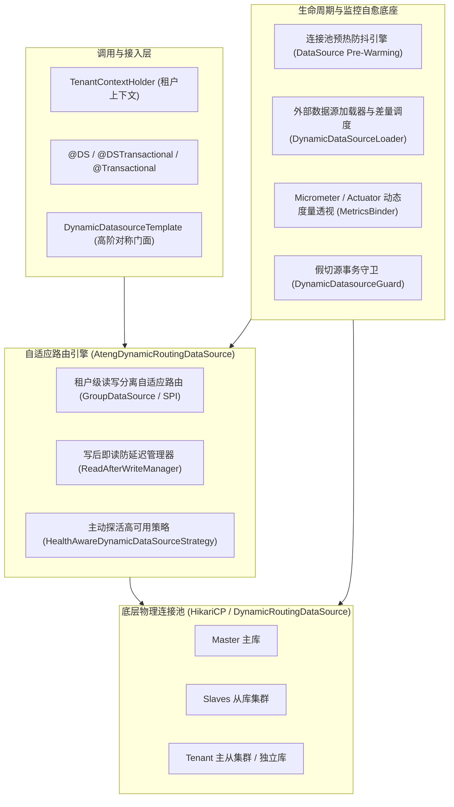

# 78. 动态数据源全场景加固与自愈治理架构决策 (Dynamic DataSource Full-Scenario Hardening and Resilient Governance Architecture)

## 背景与痛点

在企业级微服务与 SaaS 多租户云原生架构深水区中，多数据源基础设施不仅要处理基础的租户分库与主从分流，还需要直面以下四类高阶生产挑战：
1. **高净值大租户集群读写分离缺失**：大租户不仅需要独享物理库，其独享数据库自身通常也是主从集群拓扑，传统单一数据源映射无法支撑租户内部的读写分离；
2. **从库宕机恢复依赖真实业务流量试错**：传统的熔断黑名单在冷却期过后直接将业务请求作为探针，若从库未恢复会导致真实业务请求承受连接超时惩罚；
3. **运行时动态挂载冷启动连接抖动**：动态挂载新租户或新数据源后，连接池默认懒创建连接，导致首批高并发业务请求出现严重的连接排队建立抖动；
4. **外部配置中心数据源缺乏受管生命周期与度量透视**：外部租户库元数据拉取缺乏标准 SPI 与差量比对对齐机制，且动态挂载的数据源在 Prometheus/Grafana 中处于监控盲区。

---

## 核心架构与决策内容

正式确立 `ateng-boot-datasource` 全场景加固与自愈治理架构：

### 1. 租户级读写分离自适应路由拓扑
- 允许租户数据源为 Baomidou `GroupDataSource`（或通过 `TenantDataSourceProvider` SPI 显式解析租户主库与从库标识）；
- 在租户分库命中的基础上，透明感知当前 `@Transactional(readOnly = true)` 只读事务与写后读主防延迟标记，自动分流至租户从库集群或回退租户主库。

### 2. 后台主动探活自愈机制 (Active Probing)
- 废弃单纯依赖线上请求试错的被动探测机制；
- 从库发生异常被隔离进入黑名单后，由后台受管调度任务（统一接入 Core 模块调度设施）按轻量周期（默认 5s，`isValid(1)`）定期主动探活；
- 探活成功即刻安全恢复上线；连续失败自动退避（降频至 30s），杜绝高频打扰彻底故障的物理节点。

### 3. 连接池预热与冷启动防抖动引擎 (Pre-Warming)
- 在 `DatasourceProperties.DynamicLoadProperties` 提供 `preWarm`（默认 false）与 `preWarmConnections`（默认按 minimumIdle）；
- 在 `DynamicDatasourceTemplate` 增加 `addDataSource(dsKey, property, boolean preWarm)` 与 `preWarmDataSource(dsKey, int count)`；
- 预热失败遵循 Fail-Safe 宽容降级原则，记录警告日志但放行挂载，保障系统可用性。

### 4. 动态多数据源度量监控透视 (Metrics & Observability)
- 提供零外部依赖的 `DynamicDatasourceTemplate.getPoolStats(dsKey)` 与 `getAllPoolStats()` 状态快照 DTO；
- 当 classpath 存在 `MeterRegistry` 时，自动装配并对所有已注册及动态增删的数据源注册/注销 Micrometer 监控指标（活跃连接数、空闲数、等待线程数等）。

### 5. 外部数据源动态加载器与差量生命周期对齐 (DynamicDataSourceLoader)
- 抽象标准 `DynamicDataSourceLoader` SPI，提供可选的定时自动同步机制（`autoSync` 开关）；
- 引入智能三向差量比对（Smart Diff）：新增项自动探活预热挂载，缺失项超时优雅排空注销，配置变更项热重载替换；
- 静态配置核心库（`master`/`slave`）受绝对白名单防护，严禁被外部同步误删。
