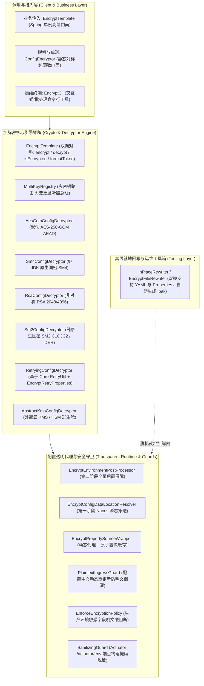

# 79. 配置加解密全场景工业级加固、对称编程式门面与 Properties 回写架构决策 (Configuration Encryption Full-Scenario Hardening and Symmetric Template Architecture)

## 背景与痛点

在微服务、分布式系统与多租户金融级应用落地中，`ateng-boot-encrypt` 作为核心配置机密保护底座，已成功实现了基于 JDK 17 原生算力的全算法加解密（AES-GCM、AES-CBC、SM4-CBC/ECB、SM2、RSA）、Nacos/Apollo 极早加载时序穿透以及生产敏感配置明文倒灌拦截。

然而，在对照企业级深度场景演进与“工业级代码成熟度九道防线”后，发现该模块在面对复杂业务场景与运维工具链时仍存在以下五大痛点：

1. **门面操作严重不对称与调用方被迫穿透底层 SPI (Violation of Symmetric Facades Invariant)**：
   现存 `ConfigEncryptor` 仅包含静态 `encrypt(...)` 方法，**缺失对称的 `decrypt(...)` 方法**；且 Starter 缺少 Spring 受管的统一操作门面（`EncryptTemplate`）。调用方在进行编程式单值解密或校验时，不得不手动获取并解析 `ConfigDecryptor` SPI 实例，代码臃肿且易引发异常处理不一致；
2. **非 Web 模块样例工程存在 Controller 污染 (Sample Architecture Non-Compliance)**：
   现存 `ateng-boot-sample-encrypt` 包含一个 `EncryptScenarioController` 用于演示。根据框架 SOP 铁律：“*非 Web 底座/驱动模块 Sample 零 Controller 污染，场景组件以真实业务命名，专职编写 `ScenarioService` 并配套 `@SpringBootTest` 跑通真实业务*”，生造无意义的 Controller 违背了模块职责正交性；
3. **配置文件就地智能回写器对 `.properties` 格式存在盲区 (Properties Format Blind Spot)**：
   脱机就地回写工具 `InPlaceRewriter` 仅支持 YAML 键值冒号（`:`）匹配，对传统基于等号（`=`）的标准 `.properties` 格式文件直接跳过，无法为非 YAML 配置项目提供脱机批量加解密与注释保真支持；
4. **外部云 KMS / HSM 缺乏强类型生产级重试退避配置 (Missing Strongly-Typed Retry Config)**：
   针对外部云 KMS 或网络硬件加密机的重试装饰器 `RetryingConfigDecryptor` 硬编码了重试 3 次与 300ms 间隔，`EncryptProperties` 缺少以 `Duration` 为量纲的强类型重试配置属性，形成生产黑盒；
5. **多 Key 动态轮换缺乏主动缓存失效事件 (Lack of Key Rotation Invalidation)**：
   在运行时向 `MultiKeyRegistry` 注册新 Key 或执行平滑轮换时，底层 `EncryptPropertySourceWrapper` 的解密内存缓存无法主动感知，存在潜在的脏读风险。

---

## 核心架构与决策内容

经由严格推演与决策树收敛，正式确立 `ateng-boot-encrypt` 全场景工业级加固架构：



---

### 1. 双层完备对称门面架构：新增 `EncryptTemplate` 与 `ConfigEncryptor.decrypt`

遵循代码成熟度第一道防线（对称语义完备性），建立双层对称 API：
- **静态工具层（`ConfigEncryptor`）**：
  - 补齐全算法对称的 `decrypt(String ciphertext, String password, EncryptAlgorithm algorithm)` 与 `decrypt(String ciphertext, String password)`（默认 AES-GCM）；
  - 纯原生无状态函数式实现，方便单元测试与脱离 Spring 上下文的脚本调用；
- **Spring 容器层（`EncryptTemplate`）**：
  - 作为 Spring 受管 Bean 自动装配，透明注入当前环境配置的默认算法、密文前后缀解析器及 `MultiKeyRegistry`；
  - 提供高阶业务语义：
    - `encrypt(String plaintext)`：使用全局默认密钥与算法加密；
    - `decrypt(String ciphertext)`：自动识别是否为 `ENC(...)` 标记或裸密文，自动从标记提取 KeyId 与算法，透明解密；
    - `encrypt(String plaintext, String keyId, EncryptAlgorithm algorithm)`：指定 Key 与算法加密；
    - `decrypt(String ciphertext, String keyId, EncryptAlgorithm algorithm)`：指定 Key 与算法解密；
    - `boolean isEncrypted(String text)`：判断文本是否为密文标记；
    - `String formatToken(String keyId, EncryptAlgorithm algorithm, String ciphertext)`：生成标准密文 Token。

---

### 2. 样例工程架构纯净化：彻底移除 Controller 污染，落地 5 大专职场景服务

严格服从 SOP 铁律，对 `ateng-boot-sample-encrypt` 进行架构治理：
- **彻底废除 `EncryptScenarioController`**，杜绝在纯基础设施模块样例中生造 Controller；
- **落地 5 个正交的业务场景服务（`*ScenarioService`）**：
  1. `ConfigDecryptionScenarioService`：演示 `@Value` 与 `@ConfigurationProperties` 透明懒解密；
  2. `MultiKeyRoutingScenarioService`：演示多 Key 别名路由（`ENC[db](...)`、`ENC[redis](...)`）及动态平滑轮换；
  3. `ProgrammaticCryptoScenarioService`：演示 `EncryptTemplate` 与 `ConfigEncryptor` 编程式双向对称加解密；
  4. `InPlaceRewriteScenarioService`：演示 YAML 与 Properties 配置文件的就地批量加解密与自动备份；
  5. `IngressGuardScenarioService`：演示配置中心热推刷新与明文倒灌刚性拦截；
- 在 `EncryptSampleApplicationTest` 中通过 `@SpringBootTest` 全真自洽跑通业务全流程。

---

### 3. 就地回写引擎双模扩展：支持 YAML 与 Properties 规范

升级 `InPlaceRewriter` 内部正则与语法解析引擎：
- **支持 YAML 格式**：基于冒号（`key: value`）及前导缩进保真；
- **支持 Properties 格式**：基于等号（`key = value`、`key=value`）及冒号，识别行首/行内 `#` 与 `!` 注释；
- **统一指令语法**：统一支持 `# @encrypt`, `# @encrypt[keyId]`, `# @encrypt(ALGO)`, `# @encrypt[keyId](ALGO)`；
- 无论 YAML 还是 Properties，均 100% 保持原始缩进、空格、注释与换行符（CRLF/LF）保真，并自动生成 `.bak` 备份文件。

---

### 4. 强类型重试配置：引入 `EncryptRetryProperties`

在 `EncryptProperties` 中挂载嵌套配置属性：
```java
@NestedConfigurationProperty
private EncryptRetryProperties retry = new EncryptRetryProperties();
```
包含以下强类型生产配置：
- `int maxAttempts = 3`：最大尝试次数；
- `Duration delay = Duration.ofMillis(300)`：初始重试间隔；
- `Duration maxDelay = Duration.ofSeconds(5)`：最大退避间隔；
- `double multiplier = 2.0`：指数退避倍数；
- `boolean jitter = true`：是否启用随机抖动打散洪峰。

提供 `retry.toRetryConfig(...)` 辅助方法，直接与 `RetryingConfigDecryptor` 及外部 KMS SPI 联动。

---

### 5. 多 Key 动态轮换与缓存主动失效机制

- 在 `MultiKeyRegistry` 中支持注册变更监听器（`addChangeListener(Consumer<String> listener)`）；
- 当通过 `registerKey`、`unregisterKey` 或 `rotateDefaultKey` 变更密钥时，主动触发监听器，通知所有 `EncryptPropertySourceWrapper` 实例调用 `clearCache()` 原子置换解密缓存；
- 当 Spring 上下文可用时，发布 `KeyRotatedEvent` 领域事件，实现分布式配置中心与运行时多密钥平滑轮换的一致性保障。

---

### 6. 双轨解密异常与保底逃生舱设计

在 `EncryptTemplate` 编程式门面中确立双轨失败处理原则：
- **严格主契约**：`decrypt(...)` 遇到密钥缺失、损坏或认证 Tag 校验失败时，严格抛出受管 `ConfigDecryptionException(cause)`，保留完整因果链，杜绝静默吞掉密码错误导致下游次生故障；
- **显式容错逃生舱**：额外提供 `decryptOrOriginal(ciphertext)`（解密失败或非密文时返回原始文本）与 `decryptOrDefault(ciphertext, defaultVal)`，显式将容错策略的选择权移交业务调用方。

---

### 7. 生产强制门禁三道防误伤过滤防线

针对 `enforce-encrypted: true` 时对带有 `token`、`secret` 但实际为非凭据字段的场景，建立三道智能过滤防线：
1. **协议与格式特征豁免**：属性值以 `http://`、`https://`、`classpath:`、`/` 等协议路径开头，或值为标准日志级别（`DEBUG`/`INFO` 等）时自动安全放行；
2. **显式白名单机制**：`EncryptProperties` 新增 `ignoredKeys` 集合，支持在 `application.yml` 中声明业务豁免字段；
3. **框架自身硬豁免**：`ateng.boot.encrypt.*` 属性前缀实施绝对硬编码白名单过滤。

---

### 8. 就地回写占位符绝对免疫与多文档保真

升级 `InPlaceRewriter` 文本识别机制：
- **占位符绝对免疫**：若扫描到的字段值符合 `${...}`（环境变量占位符）或 `#{...}`（SpEL 表达式），无论键名是否匹配敏感词，默认坚决不执行就地加密，杜绝将动态变量名误加密；
- **多文档分割保真**：完美兼容 YAML 标准的 `---` 分割符，支持跨 profile 多段配置连续识别与回写；
- **多行折叠块保真**：对 YAML 多行大文本块与 PEM 证书，保持原有缩进与排版，仅在带有显式 `# @encrypt` 指令时执行标准单行化加密。

---

### 9. Spring Cloud Config `{cipher}` 历史格式受控兼容

- 框架核心契约维持 `ENC(...)` 与 `ENC[keyId](algo@...)`；
- 在 `EncryptProperties` 提供受控开关 `compatible-cipher-prefix`（默认 false）；开启后 `CiphertextParser` 自动包容 `{cipher}` 前缀，为老旧系统平滑迁移提供无痛通道。

---

### 10. 国密 SM2 多格式互通性与双向转译

- **解密端全自动探测**：`Sm2Engine` 自动探测输入密文的首字节，若检测到 `0x30` 则自动解包 ASN.1 DER 还原 C1/C3/C2 解密；若为 `0x04` 或裸流则按标准 C1C3C2 解析，对外部异构工具生成的密文做到 100% 自适应；
- **加密端基准对齐**：内部加密与 CLI 默认输出权威标准的 `04 || C1 || C3 || C2`；
- **转译工具集**：在 `Sm2Engine` 中暴露 `c1c3c2ToDer(byte[])` 与 `derToC1c3c2(byte[])` 双向轻量转换工具。

---

## 后果与权衡 (Consequences & Trade-offs)

### 正向收益 (Positive Consequences)
1. **彻底达成对称语义完备性**：`ConfigEncryptor` 纯原生静态工具与 `EncryptTemplate` 受管 Bean 形成高低搭配，调用方再也无需手动注入或循环遍历 SPI 实例；
2. **消灭样例工程架构坏味道**：彻底废除 `sample-encrypt` 中的伪 Web Controller，将演示场景完全收敛于 5 大专职 `ScenarioService`，1:1 对齐规范；
3. **消除配置回写盲区与占位符损坏风险**：Properties 与 YAML 享受同等规格的就地无损加解密支持，且占位符免疫机制杜绝了动态变量被破坏的生产事故；
4. **消除超时重试黑盒与门禁误伤**：通过强类型 `Duration` 配置属性治理网络波动，通过三道过滤防线消除生产强制门禁误伤；
5. **杜绝密钥轮换缓存脏读与信创互通壁垒**：基于事件与监听器的主动失效机制保障实时生效，自适应 ASN.1 DER 抹平国密生态壁垒。

### 妥协成本与防御 (Trade-offs & Mitigations)
1. **Sample 升级对存量集成测试的调整**：移除 Controller 会导致原 `MockMvc` 测试下线，转为以 `@SpringBootTest` 注入 `ScenarioService` 开展更底层的全真断言；
2. **Properties 行解析性能防线**：正则双模引擎预编译常量 `Pattern`，对每一行执行轻量级前缀短路判断（如非敏感字段与无指令行快速跳过），确保大文件就地回写微秒级完成。


