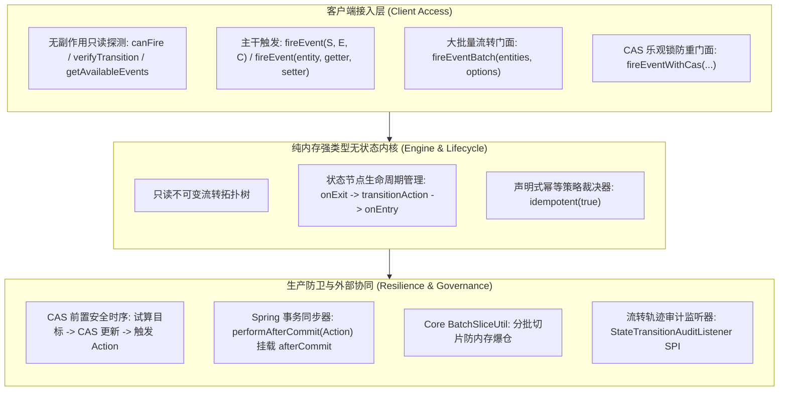

# 80. 状态机全场景工业级加固、无副作用预检、CAS安全时序与事务治理架构决策 (State Machine Full-Scenario Hardening and Resilient Governance Architecture)

## 背景与痛点

在 [ADR-0051](./0051-high-performance-stateless-business-state-machine-architecture.md) 中，团队确立了纯内存无状态、Fluent DSL 规则编排与零数据库元数据表的轻量状态机内核。然而，在复杂电商履约、高并发支付回调及定时任务海量批处理等纵深场景落地时，暴露了以下六大核心架构短板与生产隐患：

1. **预检探测混淆与副作用资损隐患 (Side-Effects in Probe Vacuum)**：
   既有设计中 `fireEventQuietly` 在卫语句校验通过后实际执行了 `action.execute()`。在前端页面渲染需要根据当前状态试算按钮是否展示或置灰（如“立即支付”、“取消订单”）时，若误调用该方法，将直接导致后置 Action 被静默执行（扣除余额、冻结库存或发送短信），引发致命资损。系统缺失真正 100% 无副作用的纯只读探测能力。
2. **CAS 乐观锁时序倒置与“幽灵副作用”泄漏 (Phantom Side-Effects via Inverted CAS)**：
   既有 `StateMachineCasTemplate` 采用“先触发 `fireEvent`（同步执行全部 Action） $\to$ 再执行持久层 CAS 条件更新”的执行时序。在高并发竞争场景下，若多个线程同时试算成功并分别执行了外部调用（如调用外部支付或物流接口），随后竞争更新数据库时其中一个 CAS 失败。尽管该事务回滚了本地 DB，但外部 Action 的副作用已经不可逆地泄漏到了外部系统。
3. **本地事务回滚与外部不可逆通知单边账 (Transactional Boundary & Ghost Notifications)**：
   业务流转中常包含发短信、推送 MQ、调用外部非事务 RPC 等操作。当业务方法挂载 `@Transactional` 时，若本地数据库事务在 Action 执行后因后续业务代码异常而回滚，外部通知已被提前发出，导致用户收到“支付成功”短信而实际订单未支付成功的单边账事故。
4. **高并发支付回调与 MQ 重试缺乏声明式幂等策略 (Missing Idempotent Strategy)**：
   在第三方支付回调重试或 MQ 重复消费时，订单往往已处于 `PAID` 目标状态，再次到达 `PAY` 事件时状态机默认抛出 `TRANSITION_NOT_FOUND`（59001），引发次生异常报警与 MQ 消费死信。业务层被迫漫天编写 `if (status == PAID) return;` 样板代码。
5. **状态节点自身生命周期动作 (Entry / Exit) 缺失 (Missing State Node Lifecycle)**：
   业务动作常与“进入或离开某个状态节点”强绑定（例如：无论经由超时关单、买家取消还是风控关闭进入 `CLOSED` 状态，均需释放冻结库存）。既有 DSL 仅支持连线级别的 Transition Action，导致开发者被迫在每一个指向 `CLOSED` 的跃迁上重复拷贝粘贴相同的 Action。
6. **样例工程违背非 Web 底座零 Controller 污染红线 (Sample Controller Pollution)**：
   既有 `ateng-boot-sample-statemachine` 引入了 `ateng-boot-web` 并生造了 `OrderStateMachineController`，违背了框架关于“非 Web 基础设施 Starter 严禁为了演示生造 Controller，专职编写 ScenarioService 并配套 @SpringBootTest 跑通”的代码成熟度铁律。

---

## 核心架构与决策内容

经由严格推演与两轮 Grilling 深度质询，正式确立 `ateng-boot-statemachine` 的全场景加固与韧性治理架构：

### 1. 无副作用只读预检探测体系 (Zero-Side-Effect Dry-run Architecture)
- **纯只读预检门面**：
  - `boolean canFire(S sourceState, E event, C context)` 与重载 `canFire(S sourceState, E event)`：试算是否存在匹配路由且 Guard 卫语句通过，**100% 杜绝触发任何 Action 动作**；
  - `TransitionResult<S> verifyTransition(S sourceState, E event, C context)`：返回结构化预检结果（目标状态、失败原因、因果异常），不执行 Action；
  - `Set<E> getAvailableEvents(S sourceState, C context)` 与重载 `getAvailableEvents(S sourceState)`：动态计算当前状态下所有满足 Guard 卫语句的合法事件集合，专供前端按钮灰化与工作流权限快速计算。
- **Guard 异常安全容错**：在只读预检过程中，若开发者 Guard 抛出业务异常，`canFire` 自动捕获并判定为 `false`，绝不打断上层视图渲染或审批流预检。

### 2. CAS 乐观锁防重执行时序重构 (CAS-First Safe Ordering)
- **时序重构**：重构 `StateMachineCasTemplate` 执行流程：
  $$\text{试算目标状态（不执行 Action）} \longrightarrow \text{执行持久层 CAS 原子条件更新} \longrightarrow \begin{cases} \text{成功 (rows > 0)}: & \text{回写实体状态} \to \text{触发 Action 执行} \\ \text{冲突 (rows = 0)}: & \text{Fail-Fast 抛出 CONCURRENT\_CAS\_CONFLICT，零副作用泄漏} \end{cases}$$
- 彻底根除并发冲突时的“幽灵副作用”，确保外部 RPC 与消息发送仅在数据库状态确立后发生。

### 3. Spring 事务提交后动作同步 (Post-Commit Action Synchronization)
- 在 Builder DSL 中提供 `performAfterCommit(Action<S, E, C>)` 门面；
- 依托 Spring 原生 `TransactionSynchronizationManager`，当当前线程处于活跃 `@Transactional` 本地事务时，自动挂载至 `afterCommit` 钩子；在事务成功提交后触发不可逆通知（发短信、推 MQ、第三方调用）；若事务回滚，外部通知绝对不触发；若当前环境无事务，则优雅就地退化执行；
- **提交后异常隔离**：提交后动作抛出的异常自动通过受管日志与拦截器告警捕获，绝不向外抛出次生异常污染已提交的主业务逻辑。

### 4. 声明式幂等策略 (Declarative Idempotency Strategy)
- 在 DSL 跃迁规则中支持 `.idempotent(true)` 或在状态机级别配置 `IdempotentStrategy`；
- 当业务实体当前已处于目标状态且再次收到同一事件时（如支付回调重复到达），状态机判定为幂等成功放行，不重复执行业务 Action，返回目标状态，避免误报 `TRANSITION_NOT_FOUND`。

### 5. 状态节点级生命周期 (State Entry / Exit Lifecycle)
- 扩展 DSL 状态节点编排：`builder.state(S).onEntry(Action).onExit(Action)`；
- 严格遵循 UML 状态机语义规范：外部跃迁完整执行 $\text{旧状态.onExit()} \to \text{跃迁.perform()} \to \text{新状态.onEntry()}$；内部自跃迁（`InternalTransition`）**绝对不触发**状态节点的 `onExit` 与 `onEntry`。

### 6. 大批量切片流转引擎 (Batch Transition Engine)
- 提供 `fireEventBatch(List<T> entities, ..., BatchOptions options)`，原生复用 `ateng-boot-core` 的 `BatchSliceUtil` 进行切片分批（默认批大小 200~500）；
- 返回结构化 `BatchTransitionResult<S, T>`（聚合成功条数、失败条数与失败明细），支持 Fail-Safe（收集错误继续推进）或 Fail-Fast（遇到首个错误熔断中断）。

### 7. 专职流转轨迹审计监听器 SPI (StateTransitionAuditListener)
- 抽象 `StateTransitionAuditListener<S, E, C>` SPI，携带结构化 `TransitionAuditEvent`（状态机 ID、源状态、目标状态、事件、上下文、耗时、TraceId、操作人与异常因果链）；
- 由 `StateMachineInitializer` 自动发现并挂载，供业务方异步落地流转轨迹日志表。

### 8. 样例工程架构纯净化 (Pure Non-Web Sample Alignment)
- 彻底移除 `ateng-boot-sample-statemachine` 中的 `ateng-boot-web` 依赖与 `OrderStateMachineController`；
- 重构为以真实业务场景命名的四大场景组件：`OrderLifecycleScenarioService`、`OrderProbeScenarioService`、`PaymentCallbackScenarioService`、`OrderTimeoutBatchScenarioService`，由 `@SpringBootTest` 全真覆盖。

---

## 架构准入不变量与红线 (Architectural Invariants & Review Redlines)

1. **只读探测零副作用不变量 (Zero-Side-Effect Dry-run Invariant)**：
   `canFire`、`verifyTransition` 与 `getAvailableEvents` 方法执行期间，**绝对禁止触发任何 Action、外部 RPC、事务同步器或持久层更新**。
2. **CAS 前置安全时序不变量 (CAS-First Safe Ordering Invariant)**：
   `StateMachineCasTemplate` 中，数据库条件更新必须严格在 Action 执行前完成；受影响行数为 0 时必须立即熔断阻断，绝对禁止在 CAS 失败前或失败后泄漏任何副作用 Action。
3. **UML 内部跃迁免进出不变量 (UML Internal Transition Exemption Invariant)**：
   内部自跃迁（`InternalTransition`）绝对不触发源状态的 `onExit` 与目标状态的 `onEntry`。
4. **非 Web 模块样例零 Controller 污染不变量 (Zero-Web Controller Sample Invariant)**：
   `ateng-boot-sample-statemachine` 作为非 Web 基础设施 Starter，严禁引入 Controller，演示用例必须且只能以真实业务场景 Service 和 `@SpringBootTest` 组织。

---

## 错误码标准契约补充 (StateMachineResultCode)

| 错误码 | 标识符 | 中文语义说明 | HTTP 映射 |
| :---: | :--- | :--- | :---: |
| `59001` | `TRANSITION_NOT_FOUND` | 当前状态未找到匹配的事件跃迁路由 | 400 Bad Request |
| `59002` | `CONDITION_FAILED` | 状态跃迁前置条件卫语句校验不通过 | 400 Bad Request |
| `59003` | `ACTION_EXECUTION_FAILED`| 状态跃迁动作执行失败（保留原始因果链） | 500 Internal Error |
| `59004` | `DUPLICATE_MACHINE_ID` | 状态机标识重复定义冲突 | 500 Internal Error |
| `59005` | `CONCURRENT_CAS_CONFLICT`| 状态并发更新冲突（CAS 乐观锁防重拦截） | 409 Conflict |
| `59006` | `MACHINE_NOT_FOUND` | 未找到指定标识的状态机实例 | 404 Not Found |
| `59007` | `STATE_LIFECYCLE_FAILED`| 状态进入(onEntry)或退出(onExit)生命周期执行异常 | 500 Internal Error |
| `59008` | `BATCH_TRANSITION_FAILED`| 批量状态流转部分或全量失败 | 500 Internal Error |
