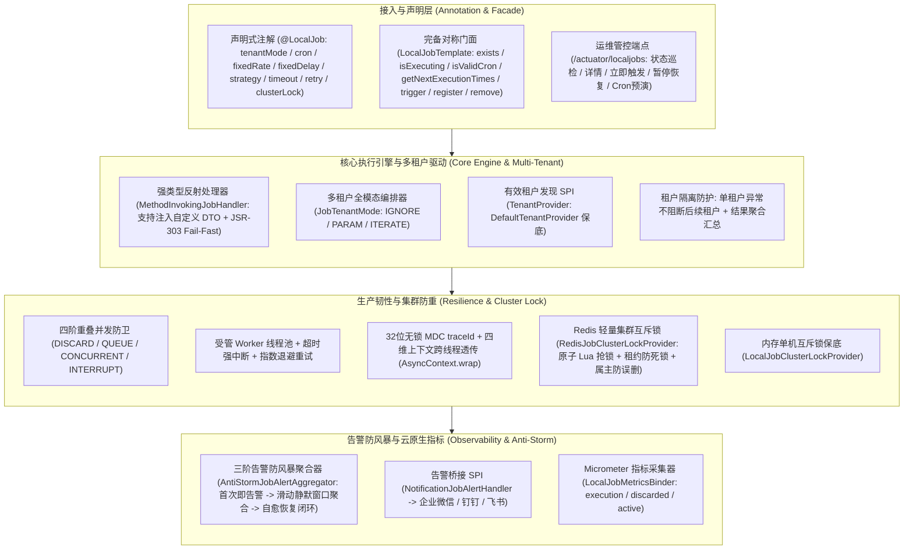

# 81. 单机定时任务全场景加固与韧性调度治理架构决策 (Standalone Local Job Full-Scenario Hardening and Resilient Scheduling Architecture)

## 背景与痛点

在 [ADR-0052](./0052-industrial-grade-standalone-local-job-and-scheduling-architecture.md) 中，团队正式确立了基于 Spring `ThreadPoolTaskScheduler`、Worker 执行线程池物理隔离、四阶重叠并发防卫（`OverlappingStrategy`）以及两级存储 SPI 的工业级单机定时任务底座 `ateng-boot-job-local`。然而，在纵深落地企业复杂生产环境、多租户 SaaS 架构与高并发集群部署时，暴露了以下六大核心架构短板与生产隐患：

1. **SaaS 多租户全模态隔离与全租户轮询调度缺失 (Multi-Tenant Execution Modes Gap)**：
   既有调度任务仅能在收到手动触发参数时被动提取 `tenantId`，缺乏统一的声明式多租户驱动模型。在 SaaS 系统中，定时任务往往需支持全局系统清理（`IGNORE` 忽略租户）、指定单租户核算（`PARAM`）、以及按租户独立循环批量生成账单/报表（`ITERATE` 全租户轮询）。当前缺乏遍历轮询驱动，且轮询中若某一租户发生异常，容易导致后续所有正常租户全部饥饿饿死。
2. **裸 Map 入参与 JSR-303 第一道防线缺失 (Raw Map Params & Missing Fail-Fast)**：
   `JobContext` 仅提供裸 `Map<String, Object>`，业务代码中充斥着手写类型转换与判空样板；当外部通过 REST/Actuator 传入非法入参时，缺乏第一道防线 JSR-303 注解格式校验，脏数据直接穿透至深层业务逻辑。
3. **秒级高频任务故障引发告警风暴打爆机器人 (Alert Storm & Bot Ban Vulnerability)**：
   既有 `LocalJobAlertListener` 针对每次任务失败或超时无条件直接向外部机器人 Webhook 发送报警。一旦秒级高频任务因下游数据库瞬时断连而持续抛错，数分钟内发出上千次通知，极易打爆企业微信、钉钉等群机器人导致被平台封禁，同时也严重干扰运维人员。
4. **轻量集群锁停留在单机内存与多 Pod 虚假防重隐患 (Cluster Lock Reality & Redis Integration Gap)**：
   既有 `LocalJobClusterLockProvider` 仅为单机 JVM 内存 `ConcurrentHashMap` 保底实现。在容器化与多 Pod 部署时，若未额外引入大型分布式调度中心，多实例依然会并发重复执行同一任务，引发数据脏写与重复扣款风险；缺乏原生低延迟、基于 Redis 的开箱即用轻量集群锁。
5. **云原生可观测性断层与 Prometheus 指标缺失 (Missing Micrometer & Cloud-Native Metrics)**：
   既有设计仅提供 `/actuator/localjobs` HTTP 巡检端点，未接入 Spring Boot Actuator Micrometer 度量采集。监控大盘（Prometheus/Grafana）无法观测单机任务的执行耗时直方图（P95/P99）、失败计数与并发丢弃率。
6. **门面对称性不足与样例工程 Controller 污染 (Template Asymmetry & Sample Controller Contamination)**：
   `LocalJobTemplate` 缺失 `exists(jobName)`、`isExecuting(jobName)` 状态查询，且无法在不启动调度的情况下校验 Cron 语法与预演未来触发时钟点；同时，样例工程 `ateng-boot-sample-job-local` 编写了 `JobSampleController`，违背了框架“非 Web 基础设施模块 Sample 零 Controller 污染”的一票否决红线。

---

## 核心架构与决策内容

经由严格技术推演与两轮 Grilling 深度质询，正式确立 **`ateng-boot-job-local` 全场景加固与韧性调度治理架构**：



### 1. SaaS 多租户全模态隔离与 Fail-Safe 遍历驱动架构
- **三阶多租户调度模态 (`JobTenantMode`)**：
  - `IGNORE`（默认）：忽略租户隔离，以全局视角执行系统级维护或跨租户聚合批处理；
  - `PARAM`：从触发参数中提取 `tenantId`，仅针对指定单租户执行；
  - `ITERATE`：调度触发时，自动通过 `TenantProvider` SPI 检索系统中所有有效租户清单，并依次切换 `TenantContextHolder` 隔离执行。
- **Fail-Safe 遍历与结果聚合**：在 `ITERATE` 模式下，单租户执行失败仅记录日志与失败指标，绝对不阻断后续其他正常租户的调度；最终在 `JobResult` 中聚合返回全量租户的执行统计摘要（如 `完成 10/10 租户调度，成功 9，失败 1`）。
- **`TenantProvider` 防崩溃保底**：框架提供默认 `DefaultTenantProvider`，当容器内未注册自定义租户仓储 Bean 时，安全回退到当前上下文租户或默认租户，并打印 WARN 日志引导，杜绝启动或执行崩溃。

### 2. 强类型入参 DTO 绑定与 JSR-303 双防校验
- **方法参数直接注入 DTO**：`MethodInvokingJobHandler` 增强反射参数解析能力。除了支持注入 `JobContext` 外，允许直接声明自定义参数对象（如 `public JobResult myJob(OrderCleanupParam param, JobContext context)`）；
- **参数反序列化与 JSR-303 格式校验**：利用 Core 模块 `JsonUtil` 将传入的 `Map` 或 JSON 字符串安全反序列化为目标 DTO，并立即通过 `ValidatorUtil.validate(dto)` 执行 Fail-Fast 校验，不符合规则立即阻断并记录失败结果；
- **编程式 Context 绑定**：`JobContext` 补齐泛型便捷方法 `<T> T bind(Class<T> targetClass)`，便于无侵入编程式获取校验后强类型对象。

### 3. 三阶告警防风暴聚合与自愈恢复闭环
- **`AntiStormJobAlertAggregator` 状态机**：
  1. **首发告警 (Immediate Alert)**：任务在健康状态下首次发生执行失败或超时熔断时，立即向群机器人发送告警通知；
  2. **静默窗口期聚合 (Sliding Window Suppression)**：在可配置的静默窗口内（默认 5 分钟），后续失败不再频繁打扰，而是在内存原子计数器中累计错误次数，并持续采样保留最新错误消息与异常堆栈；
  3. **自愈恢复通知 (Self-Healing Recovery Notice)**：当任务在连续失败后首次执行成功时，自动向群机器人推送绿色自愈恢复通知（附带本次故障期间累计失败次数与故障持续时长），实现运维闭环。

### 4. 基于 Spring `StringRedisTemplate` 与原子 Lua 脚本的轻量集群锁
- **纯原生零依赖扩展**：在类路径检测到 `StringRedisTemplate` 且启用集群锁时，自动装配 `RedisJobClusterLockProvider`，彻底解决多 Pod 部署下的重复执行竞态；
- **原子 Lua 脚本防死锁与防误删**：
  - 加锁：采用 `SET key nodeOwner PX leaseTime NX`，获得携带业务租约的安全锁；
  - 释放锁：采用原子 Lua 脚本安全核对属主：
    ```lua
    if redis.call('get', KEYS[1]) == ARGV[1] then
        return redis.call('del', KEYS[1])
    else
        return 0
    end
    ```
    彻底防止由于任务执行耗时超出租约、锁被其他节点接管后被当前节点误释放的重大事故。

### 5. 完备对称门面与 Cron 校验时序预演
- **对称状态判定**：`LocalJobTemplate` 补齐 `boolean exists(String jobName)` 与 `boolean isExecuting(String jobName)`；
- **Cron 语法校验与预演**：
  - `boolean isValidCron(String cronExpression)`：依托 Spring 6 原生 `CronExpression` 进行语法正确性验证；
  - `List<Instant> getNextExecutionTimes(String cronExpression, int count)`：预演计算未来 N 次触发时间；
- **Actuator 管控端点对齐**：`/actuator/localjobs` 端点同步暴露 Cron 校验与预演能力。

### 6. 云原生 Micrometer 指标采集器
- **零侵入自动装配**：当引入 `MeterRegistry` 且 `ateng.boot.job.local.metrics.enabled=true` 时，自动装配 `LocalJobMetricsBinder`；
- **三维核心度量**：
  - `ateng.job.local.execution`（Timer）：记录执行耗时与频次，打上 `jobName`、`status`、`triggerType` 标签；
  - `ateng.job.local.discarded`（Counter）：记录因重叠并发丢弃（`DISCARD`）或集群抢锁失败（`SKIPPED_CLUSTER_LOCKED`）的跳过次数；
  - `ateng.job.local.active`（Gauge）：实时度量当前正在执行中的 Worker 任务总数。

### 7. 纯净场景组件重构与无意义 Controller 清除
- **样例工程 100% 纯净化**：彻底删除 `JobSampleController`，杜绝非 Web 底座的 Controller 污染；
- **真实业务场景组件驱动**：在 `ateng-boot-sample-job-local` 中实装：
  - `DailyReconciliationScenarioJob`（每日健康对账批处理，Cron + 结构化日志 + 强类型 JobResult）；
  - `OrderTimeoutCancelScenarioJob`（超时订单自动关单，FixedDelay + 硬超时中断 + 指数退避重试）；
  - `MultiTenantBillingScenarioJob`（SaaS 多租户账单轮询，TenantMode.ITERATE + 租户隔离 + 聚合统计）；
  - `SystemMetricsSamplingScenarioJob`（系统心跳采样，FixedRate + Micrometer 指标采集）；
  - `TypedParamArchivingScenarioJob`（定时归档批处理，强类型 DTO 注入 + JSR-303 Fail-Fast 校验）；
  - `ClusterDeduplicationScenarioJob`（轻量集群互斥防重，Redis/内存集群锁防死锁租约）。
- **Actuator 端到端集成测试**：通过 Spring Boot 原生 Actuator 端点验证管控功能，保障 100% 离线自洽。

---

## 结论与影响

1. **生产成熟度跃迁**：彻底补齐多租户、强类型 DTO、告警防风暴、Redis 集群锁与 Micrometer 指标 5 大高频场景，使 `ateng-boot-job-local` 成为真正可替代轻量 XXL-Job/ShedLock 的单机与轻量集群全能底座；
2. **零破坏性升级**：所有新增特性（`tenantMode`、强类型入参、防风暴聚合、Redis 锁）均为纯向后兼容设计，未破坏现有 API 与注解定义；
3. **红线 100% 合规**：彻底消除样例工程的 Controller 异味，对齐框架代码成熟度规范。
