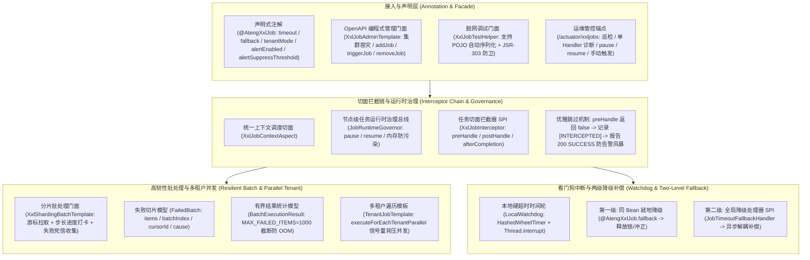

# 82. XXL-Job 全场景加固、切面拦截器生命周期与高韧性批处理架构决策 (XXL-Job Full-Scenario Hardening, Interceptor Lifecycle and Resilient Batch Architecture)

## 背景与痛点

在 [ADR-0075](./0075-xxl-job-production-hardening-and-distributed-scheduling-architecture.md) 中，团队基于官方 `com.xuxueli:xxl-job-core:3.5.0` 构建了面向生产级的 XXL-Job 增强 Starter `ateng-boot-job-xxl`，提供了原生无侵入增强注解 `@AtengXxlJob`、四维全链路上下文与租户透传、本地硬看门狗强中断、三阶停机排空状态机与 CIDR 防火墙。然而，在纵深落地企业复杂生产环境、千万级大数据分片批处理以及节点级敏捷运维时，仍暴露了以下七大核心架构短板与生产隐患：

1. **切面扩展点缺失与生命周期拦截孤岛 (Missing Interceptor SPI)**：
   既有设计中切面逻辑写死在 `XxlJobContextAspect` 内部，缺乏标准化的拦截器 SPI。企业在面临节点金丝雀灰度发布、前置权限校验、执行审计追溯或外部链路追踪跨度挂载等横切需求时，开发者被迫侵入业务 Job 方法或重写底层切面，缺乏统一的生命周期责任链机制。
2. **节点级任务运行时治理断层 (Missing Node-level Runtime Governance)**：
   微服务集群中某单个 Pod 节点发生局部数据库网络抖动或硬件降级时，运维人员无法在节点维度对特定任务实施临时静默（`pause`）与恢复（`resume`）。若在调度中心管理端全局停用任务，会导致整个集群所有正常节点全部停摆；若不处理，故障节点将持续抛错引发告警风暴。
3. **大数据分片批处理缺乏失败死信收集与进度打卡 (Missing Dead-Letter Batch & Progress Logging)**：
   `XxlShardingBatchTemplate` 在分片流式消费千万级数据时，若局部单批次发生业务异常，缺乏结构化失败切片封装模型（`FailedBatch`）与死信持久化回调，导致失败记录丢失、难以断点补跑；同时在大批量长时任务中缺乏定时进度打卡日志，运维人员难以掌握实时消费水位。
4. **多租户受管并发遍历缺失 (Missing Managed Parallel Tenant Iteration)**：
   针对 `JobTenantMode.ITERATE` 多租户轮询场景，既有 `TenantJobTemplate` 仅支持单线程顺序遍历。当平台租户数膨胀至数百上千时，按序遍历耗时过长甚至超时中断；缺乏基于信号量流量背压与受管线程池的并发遍历能力。
5. **看门狗超时中断缺乏方法级降级补偿 (Missing Watchdog Fallback Mechanism)**：
   当任务被本地硬看门狗时间轮判定为超时并强行中断（`Thread.interrupt()`）时，若任务处于持有分布式外部锁或未完成的状态流转阶段，缺乏与注解声明绑定的就地补偿方法，容易引发分布式死锁或业务单边账悬挂。
6. **脱网调试入参受限与端到端场景全覆盖缺失 (Offline POJO Debugging & Sample Alignment Gap)**：
   `XxlJobTestHelper` 仅支持传入纯字符串入参，无法直接传入业务 POJO/DTO 对象并完成自动 JSON 序列化与 JSR-303 防卫；同时样例工程缺乏对灰度拦截跳过、死信补偿、多租户并发与超时降级的端到端全真用例覆盖。
7. **底层日志清理与 Netty 线程受管规范缺失 (Thread & IO Defensive Governance)**：
   原生 `XxlJobFileAppender` 在历史日志清理时缺乏非法路径防御与并发读写防御，在 Windows/Linux 跨平台下易因文件句柄占用抛出次生异常；且 Netty 内部工作线程命名未规范化收敛。

---

## 核心架构与决策内容

经由严格技术推演与两轮 Grilling 深度质询，正式确立 **`ateng-boot-job-xxl` 全场景加固、切面拦截器生命周期与高韧性批处理架构**：

### 1. 任务执行切面责任链拦截器 SPI (`XxlJobInterceptor`)
- **三阶段执行挂载点**：
  - `boolean preHandle(XxlJobExecutionContext context)`：在任务执行前调用。若返回 `true` 继续执行；若返回 `false` 触发优雅拦截中断，框架自动输出 `[INTERCEPTED]` 日志并向调度中心报告 `200 SUCCESS`，彻底杜绝灰度跳过引发的管理台告警风暴；
  - `void postHandle(XxlJobExecutionContext context, Object result)`：在任务目标方法成功执行完成且未抛出异常时触发；
  - `void afterCompletion(XxlJobExecutionContext context, Throwable throwable)`：在任务生命周期终态无条件在 `finally` 块中调用，用于上下文绝对清理与审计指标归档；
- **强类型执行上下文 (`XxlJobExecutionContext`)**：
  包含 `jobHandler`、`jobId`、`traceId`、`tenantId`、`shardIndex`、`shardTotal`、`jobParam`、`targetBean`、`targetMethod` 与属性扩展 `attributes` 字典，支持跨阶段传递追踪数据；
- **有序责任链编排**：支持 Spring `@Order` 注解或 `Ordered` 接口定义执行时序，并在 `afterCompletion` 严格遵循逆序清理原则。

### 2. 节点级任务运行时治理总线 (`JobRuntimeGovernor`)
- **纯内存轻量治理**：负责单节点内存中受管任务的执行状态控制，提供 `pause(handler)`、`resume(handler)`、`isPaused(handler)` 与 `getPausedHandlers()` 对称方法；
- **防污染与无状态不变量**：静默状态完全驻留于单节点 JVM 内存（`ConcurrentHashMap.newKeySet()`），随 Pod/容器生命周期重启自动重置复位，绝不向数据库或全局注册中心写入持久化脏状态；
- **运维端点联动**：挂载至 Actuator 端点 `POST /actuator/xxljobs/{handler}/pause` 与 `POST /actuator/xxljobs/{handler}/resume`，支持运维在线一键隔离单节点故障任务。

### 3. 分片流式批处理有界失败收集 (`FailedBatch<T>`) 与进度打卡
- **失败切片结构化模型 (`FailedBatch<T>`)**：
  封装失败批次的数据明细不可变列表 `items`、批次序号 `batchIndex`、当前游标 `cursorId` 以及底层异常 `cause`；
- **对称失败补偿回调**：`XxlShardingBatchTemplate` 全系流式方法扩展 `Consumer<FailedBatch<T>> failureHandler` 回调参数，方便业务就地写入死信队列或落库补跑；
- **有界堆内存防 OOM 刚性熔断**：`BatchExecutionResult` 严格设置最大保留上限 `MAX_FAILED_ITEMS = 1000`；当失败条数溢出时自动截断并置位 `truncatedFailures = true`，彻底杜绝全量失败时将海量脏数据堆积在堆内存导致 JVM 崩溃；
- **实时进度打卡 (`progress-log-interval`)**：配置项 `ateng.boot.job.xxl.progress-log-interval`（默认 5000 条），在长时间批量消费中定期输出结构化进度日志（如 `已推进消费 50000 条 (耗时 12s)...`），消除长任务盲盒状态。

### 4. 多租户受管并发遍历与流量背压 (`TenantJobTemplate.executeForEachTenantParallel`)
- **受管异步线程池隔离**：多租户并发遍历接入 Core 模块受管异步线程池设施（`taskExecutor`），严格禁止私自创建野线程；
- **信号量背压流量保护**：采用 `Semaphore` 严格限制最大并发租户数（配置 `batch-max-concurrency`，默认 8），防止租户爆发时耗尽数据库连接池与 CPU；
- **四维上下文跨池快照透传**：在父线程通过 `TenantSnapshot` 与 `AsyncContext` 捕获快照，在并发子线程执行前还原 MDC `traceId`、操作人与 XXL-Job 镜像日志句柄，并在 `finally` 中严格执行双向现场清理，彻底杜绝跨租户脏读。

### 5. 本地硬看门狗两级超时降级补偿机制
- **第一级：同 Bean 就地降级 (`@AtengXxlJob.fallback`)**：
  在 `@AtengXxlJob(fallback = "methodName")` 声明同类降级方法名。当工作线程因超时被强中断（`interrupt()`）后，切面在捕获异常后优先调用该方法，用于释放本地/分布式锁、冲正流水或记录告警；
- **第二级：全局降级处理器 SPI (`JobTimeoutFallbackHandler`)**：
  针对更复杂的全局跨服务补偿，支持注册 `JobTimeoutFallbackHandler` Spring Bean。由 Core 受管异步线程池隔离触发 `onTimeout(JobExecutionMetadata, Duration)`，保障主执行线程在遭遇卡死时能安全退出并向调度中心报告终态。

### 6. 脱网调试 POJO 强类型自动绑定与 1:1 Sample 场景实测
- **POJO 自动序列化与防卫**：`XxlJobTestHelper.trigger(handler, Object pojo)` 自动使用 `JsonUtil.toJson(pojo)` 序列化为 JSON 字符串，并穿透调度切面完成强类型反射绑定与 JSR-303 Fail-Fast 校验；
- **1:1 独立场景样例工程对齐**：在 `ateng-boot-sample-job-xxl` 中提供 100% 覆盖上述特性的 14 项全真集成用例，涵盖问候、参数校验、分片广播、多租户全模态、告警风暴抑制与自愈、Actuator 启停、OpenAPI 门面、生命周期拦截灰度跳过、死信补偿回调、多租户受管并发及看门狗降级补偿。

### 7. 底层防崩日志清理器与 Netty 受管线程规约
- **防崩日志清理器 (`AtengJobLogFileCleanHelper`)**：
  重构历史日志清理逻辑，强制执行目录存在性检查、非法相对路径越权拦截与 IOException 降级容错，确保在 Windows 临时句柄锁定下平滑跳过而不抛出次生异常；
- **Netty 命名线程工厂规约**：规范执行器内嵌 Netty 服务器的工作线程命名（`xxl-job, AtengEmbedServer-boss` / `worker`），统合到受管线程规范。

---

## 权衡与后果 (Trade-offs & Consequences)

### 正向收益 (Benefits)
1. **企业级横切关注点解耦**：通过 `XxlJobInterceptor`，企业安全白名单、金丝雀灰度、全链路审计与租户动态路由完全独立于业务任务代码，代码成熟度大幅跃升；
2. **高可用集群运维敏捷性**：`JobRuntimeGovernor` 补齐了微服务单机维度的任务静默管控能力，配合 Actuator 端点实现分钟级单节点故障隔离；
3. **大数据批处理稳定性与可追溯性**：`FailedBatch<T>` 与 `MAX_FAILED_ITEMS` 有界截断彻底根治了大批量分片任务的 OOM 隐患，同时赋予了精准失败切片重试能力；
4. **多租户 SaaS 性能倍增**：受管并发遍历将海量租户的账单与报表生成耗时降低一个数量级，同时信号量背压防御了下层数据库过载。

### 妥协成本与规约 (Costs & Mitigations)
1. **拦截器返回值语义约定**：`preHandle` 返回 `false` 时必须约定向调度中心报告 200 成功，以避免调度中心误判并触发重试报警；该语义在 JavaDoc 与文档中显式声明；
2. **降级方法的反射开销**：同 Bean 降级方法基于反射调用，在启动期通过方法签名缓存与安全检查规避了重复反射查找的开销。
