# 83. TCP 通信底座全场景加固、背压流控与高韧性网络治理架构决策 (TCP Full-Scenario Hardening, Backpressure Flow Control and Resilient Network Governance Architecture)

## 背景与痛点

在 [ADR-0054](./0054-industrial-grade-dual-mode-tcp-networking-architecture.md) 中，团队基于 Netty 4.1.x 构建了工业级双模长连接通信底座 `ateng-boot-tcp`，实现了服务/客户双模协同、自适应切片分帧（Delimiter / FixedLength / LengthField）、会话管理、踢旧留新置换、双向全双工 RPC 与基础 TLS/mTLS 链路加密。然而，面对真实工业互联网、高并发物联网网关及边缘突发网络场景，既有架构在生产纵深层面暴露出以下五大核心隐患与成熟度短板：

1. **Netty 出站缓冲无界积压与直接内存 OOM (Missing Outbound Buffer Backpressure)**：
   既有 `TcpSession.send()` 与门面方法直接执行底层 `channel.writeAndFlush()`，未配置底层高低水位参数（`WRITE_BUFFER_WATER_MARK`），亦未检查通道可写状态（`channel.isWritable()`）。当对端设备遭遇网络抖动、4G/5G 弱网丢包或终端消费能力低下时，服务端高频推送的数据帧会在 Netty `ChannelOutboundBuffer` 中无界排队堆积，极易撑爆 JVM 直接内存或堆内存，触发 OOM Killer 杀掉进程。
2. **网络访问控制防火墙缺失与恶意扫描防御脆弱 (Missing IP Firewall & CIDR Rules)**：
   既有实现仅具备最大连接数上限（`max-connections`），缺乏网络层 IP 访问控制。暴露在公网或专网的 TCP 监听端口极易遭受端口扫描、伪造报文与未授权主机探测；缺乏在连接握手第一阶段即时切断阻断连接的 IP 黑白名单与 CIDR 掩码过滤机制。
3. **突发流量打满带宽与网络拥塞扩散 (Missing Bandwidth Traffic Shaping)**：
   在海量硬件终端突发重连或固件死循环疯狂上报时，缺乏全局与单连接维度的流量整形（Traffic Shaping）与带宽限速（Read/Write Limit），导致突发上行/下行流量瞬时占满服务器网卡物理带宽，拖垮同网卡共存的业务通信链路。
4. **集群跨节点分组组播断层与门面对称性缺失 (Missing Cluster Group Multicast)**：
   单机 `TcpSessionManager` 具备分组机制（`joinGroup` / `leaveGroup` / `getSessionsByGroup`），但集群跨节点桥接器 `TcpClusterBridge` 仅提供了设备单播与全网广播，缺乏集群“分组组播”抽象。业务在分布式多 Pod 拓扑下无法实现向特定车队或设备群的高效跨节点组播下发，违背了《对称语义完备性》红线。
5. **样例工程 Controller 污染与非 Web 规范偏差 (Sample Web Controller Pollution)**：
   配套样例 `ateng-boot-sample-tcp` 历史遗留了 `VehicleScenarioController`（HTTP 接口）。根据工程规范与模块演进铁律，非 Web 底座驱动模块严禁引入无意义的 Controller 污染，必须重构为纯净的 `ScenarioService` + `@SpringBootTest` 全真端到端闭环。

---

## 核心架构与决策内容

经由严格技术推演与三轮 Grilling 深度质询，正式确立 **`ateng-boot-tcp` 通信底座全场景加固、背压流控与高韧性网络治理架构**：

```mermaid
flowchart TD
    subgraph ClientAccess["业务接入与对称门面 (Client Access & Symmetric Facade)"]
        direction TB
        SERVER_TEMPLATE["TcpServerTemplate (单播 / 组播 / 广播 / 集群组播 / RPC)"]
        CLIENT_TEMPLATE["TcpClientTemplate (主动发信 / 客户端 RPC / 自愈重连)"]
        SESSION_MANAGER["TcpSessionManager (会话生命周期 / 踢旧留新 / 本地分组)"]
        CLUSTER_BRIDGE["TcpClusterBridge SPI (本地直发 + Redis 集群组播与广播)"]
    end

    subgraph DefensePipeline["Netty 通道核心防护流水线 (Defense Pipeline)"]
        direction TB
        IP_FILTER["0. IP Firewall (RuleBasedIpFilter: 白名单严控 + 黑名单过滤 + CIDR 匹配)"]
        SSL_HANDLER["1. TLS / mTLS Engine (双向证书加密握手)"]
        TRAFFIC_SHAPER["2. Traffic Shaping (Global/Channel 带宽限速削峰填谷)"]
        IDLE_DETECTOR["3. IdleStateHandler (双向心跳检测与断网假死剔除)"]
        FRAME_DECODER["4. Frame Length Guard (最大帧长切片防大包 OOM)"]
        PAYLOAD_CODEC["5. PayloadCodec (堆外直接内存 safe release 与真明文转义)"]
        PACKET_FILTER["6. TcpPacketFilter (工业转义清洗 + Checksum 校验)"]
        DISPATCHER["7. TcpDispatcher (MDC Trace 透传 + 受管线程池隔离调度)"]
    end

    subgraph BackpressureGovernance["出站背压与水位治理 (Backpressure Governance)"]
        direction TB
        WATER_MARK["WriteBufferWaterMark (low: 32KB, high: 64KB)"]
        WRITABLE_CHECK["channel.isWritable() 状态探测"]
        FAIL_FAST["默认 FAIL_FAST -> 抛出 TcpBackpressureException 防内存堆积"]
        WRITABLE_EVENT["TcpChannelWritabilityChangedEvent (发布可写状态跃迁事件)"]
    end

    SERVER_TEMPLATE --> WRITABLE_CHECK
    WRITABLE_CHECK -- "isWritable == false" --> FAIL_FAST
    WRITABLE_CHECK -- "状态跃迁" --> WRITABLE_EVENT
    DefensePipeline --> BackpressureGovernance
```

### 1. Netty 高低水位与 FAIL_FAST 出站背压流控机制
- **强类型配置纳管**：在 `ateng.boot.tcp.server` 与 `client` 配置中，增加 `write-buffer-low-water-mark`（默认 `32KB`）与 `write-buffer-high-water-mark`（默认 `64KB`），通过 `DataSize` 消除单位歧义；
- **快速失败防卫**：在 `TcpSession.send()` 与门面类中显式检查 `channel.isWritable()`。在高水位饱和时，默认策略为 `FAIL_FAST`，立即抛出受管语义异常 `TcpBackpressureException`，彻底阻断下游慢消费在服务端造成的内存无界堆积；可选支持 `WARN_AND_SEND` 与 `BLOCK_TIMEOUT`；
- **状态变迁事件总线**：在通道 Handler 中捕获 `channelWritabilityChanged` 事件，统一向 Spring 容器发布 `TcpChannelWritabilityChangedEvent`，供业务侧订阅以动态自适应降速或恢复推流。

### 2. IP 访问控制防火墙 (IP Firewall)
- **多段 CIDR 与白名单优先哲学**：新增 `ateng.boot.tcp.server.ip-filter` 配置项：
  - 白名单（`whitelist`）：若配置了白名单规则（支持具体 IP 及 CIDR 如 `192.168.1.0/24`），则执行“白名单严控模式”，非白名单 IP 一律在握手阶段强行拒绝；
  - 黑名单（`blacklist`）：若白名单为空，默认允许所有连接，但坚决阻断黑名单内的恶意 IP；
- **纳秒级前置切断**：IP 过滤器位于 Netty Pipeline 索引第 0 位（早于 TLS 握手与解码器），阻断时触发 `TcpIpBlockedEvent` 并直接关闭物理通道，零内存与算力开销。

### 3. 全局与单连接流量整形 (Traffic Shaping)
- **动态令牌桶限速**：新增 `ateng.boot.tcp.server.traffic-shaping` 配置项，支持全局带宽限制（`global-read-limit`、`global-write-limit`）与单连接带宽限制（`channel-read-limit`、`channel-write-limit`），统一采用 Spring `DataSize` 表达（如 `10MB`）；
- **生命周期安全闭环**：基于 Netty 原生 `GlobalTrafficShapingHandler` / `ChannelTrafficShapingHandler` 实现，其内部调度执行器绑定于受管生命周期中，在服务端停止时确定性释放，杜绝线程句柄悬挂。

### 4. 集群分组组播对称性完备 (Cluster Group Multicast)
- **SPI 契约与门面补齐**：
  - 在 `TcpClusterBridge` SPI 中增设 `boolean sendGroupToCluster(String group, Object payload)`；
  - 在 `TcpServerTemplate` 中增设对等的 `sendGroupToCluster(String group, Object payload)` 门面方法；
- **Redis 路由与排他防回环**：`RedisPubSubTcpClusterBridge` 在广播消息模型 `TcpClusterBroadcastMessage` 中增加 `group` 字段，各 Pod 节点按需匹配本地 `sessionManager.getSessionsByGroup(group)` 进行投递，实现集群多维组播的完全对称。

### 5. Sample 样例工程纯净化与零 Controller 铁律
- **彻底净化 Web 依赖**：从 `ateng-boot-sample-tcp` 中彻底移除 `VehicleScenarioController`；
- **纯净全场景业务闭环**：以车联网主线场景收敛为 `VehicleTelemetryScenarioService`，在 `SampleTcpE2eTest` 中通过标准 `@SpringBootTest` 跑通车机认证、JT/T 808 风格复合报文切片与校验、全双工 RPC 下行控制、背压高水位拦截、心跳保活与集群分组组播的端到端场景。

> **演进注记 (Superseding Note)**：本节关于“移除 Sample Web Controller、保持零 Controller 纯后台形态”的局部约定，已由全局 [工业级文档与样例工程标准规范](../agents/documentation-specification.md) 与 [ADR-0105](./0105-tcp-sample-multi-controller-and-documentation-specification-architecture.md) 正式取代（`Superseded by ADR-0105`）——`ateng-boot-sample-tcp` 按 `ADR-0105` 演进引入 `ateng-boot-web` 并按领域职责拆分为 5 大专职 `@RestController`，同时保留 `WebEnvironment.NONE` 纯后台回归测试形成双轨守护。

---

## 影响与收益

1. **内存零无界积压**：高低水位背压与 `channel.isWritable()` 结合，在极端网络波动与慢客户端场景下为 JVM 堆外内存构筑绝对防线；
2. **网络攻防就绪**：IP 防火墙与流量整形有效防御恶意探测、CC 拒绝服务攻击与突发流量占满带宽；
3. **门面语义完备**：跨微服务节点的分组组播填补了分布式协同拼图；
4. **架构风格纯粹**：样例工程严格遵循非 Web Starter 的零 Controller 准则，提供真实生产可复用的示范代码。
