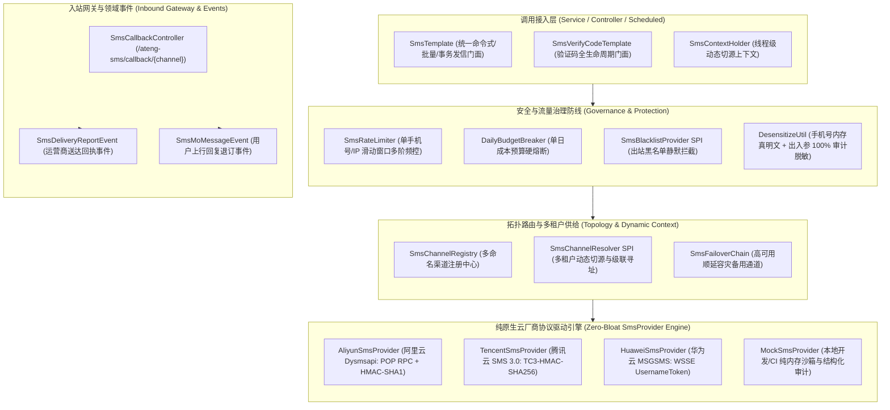
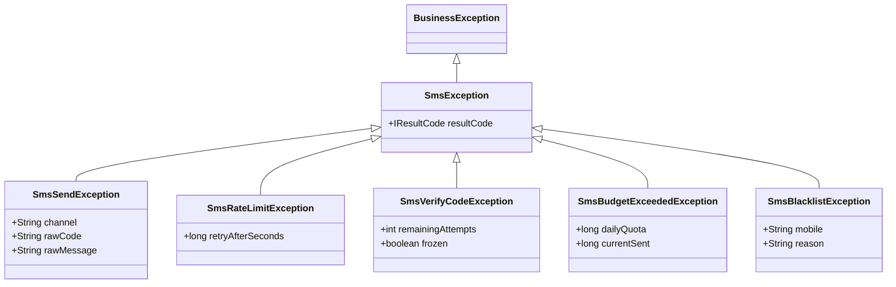

# 0084. 企业级专有多渠道短信底座与高韧性治理架构决策 (Enterprise Multi-Channel SMS Architecture)

- **状态 (Status)**: `Accepted`
- **日期 (Date)**: 2026-11-02
- **归属模块 (Scope)**: `ateng-boot-sms` / `ateng-boot-bom` / `ateng-boot-samples/ateng-boot-sample-sms` / `ateng-boot-core`

---

## 1. 背景与痛点

在企业级应用研发、用户身份验证、交易状态通知与大规模营销群发体系中，短信（SMS）是触达终端用户最直接、最权威的核心通道。然而，企业在自研或集成短信能力时普遍面临以下六大核心生产痛点：

1. **厂商依赖碎片化与第三方 SDK 依赖膨胀 (SDK Bloat & Classpath Pollution)**：
   业界开源聚合库（如部分开源 Starter）普遍深度捆绑 `hutool-all` 等重型第三方全量包；而各大公有云官方 SDK（如阿里云 `dysmsapi`、腾讯云 `tencentcloud-sdk-java`）动辄拉入 Tea-OpenAPI、OkHttp、Gson/Fastjson 等大量传递依赖，极易引发版本冲突、内存膨胀及 CVE 安全审计红牌。
2. **异构协议与模板参数语义割裂 (Heterogeneous Protocols & Param Mismatch)**：
   各云厂商的发信协议、鉴权算法及模板参数格式存在巨大差异：阿里云采用 POP RPC 协议、HMAC-SHA1 签名与 JSON Key-Value 键值对参数（`{"code":"123"}`）；腾讯云采用 API 3.0、TC3-HMAC-SHA256 签名与有序字符串数组（`["123","5"]`）；华为云采用 WSSE 规范 UsernameToken 鉴权与表单 POST。若缺乏统一抽象，业务更换或引入多云通道时将面临灾难性的代码重构。
3. **验证码全生命周期与防刷重复造轮子 (Captcha Lifecycle & Anti-Brushing Reinvention)**：
   短信验证码是中后台及 C 端高频核心场景。大量业务系统由各业务开发人员自行手写随机数生成、Redis 缓存与过期校验，普遍缺乏重发冷却（Interval）、滑动窗口频控（Rate Limit）、最大错误次数冻结（防暴力破解）等安全防御，开发效率低下且极易出现安全漏洞。
4. **短信轰炸与灰产盗刷导致天价账单 (SMS Bombing & Skyrocketing Budget Risk)**：
   对外暴露的短信发信接口是黑客“短信轰炸机”和恶意刷量脚本的重灾区。很多系统缺乏单日发信总预算硬熔断机制与出站黑名单拦截，一旦接口被刷，常导致单日产生数万元非预期短信欠费。
5. **超大批量营销群发缺乏受管分片与并发治理 (Unmanaged Batch Slicing & Wild Threads)**：
   云厂商单次 API 调用对手机号数量有严格限制（腾讯云限制 200 个，阿里云限制 1000 个）。当业务需向数万用户群发营销通知时，业务开发往往自行编写循环或滥用裸 `new Thread()` 并发，容易造成内存积压、连接池枯竭或厂商接口限流抛错。
6. **缺乏事务一致性与四维上下文透传断流 (No Transaction Sync & Context Disconnection)**：
   在 Spring 本地事务（`@Transactional`）中，若先发短信而后置数据库操作抛出异常回滚，外部用户已收到短信通知（幽灵短信）；且异步线程发信时常丢失 MDC `traceId` 与当前租户/用户上下文，导致跨系统链路无法审计追踪。

---

## 2. 核心架构与决策内容

经由严格前沿推演与场景对标，正式确立 **`ateng-boot-sms`（企业级专有多渠道短信底座）**，其整体架构拓扑如下：



### 2.1 纯原生 Spring 6 RestClient 零依赖驱动体系

复刻 `ateng-boot-notification` 的极简纯净自研范式，彻底摒弃任何第三方聚合库及官方重型 SDK：
1. **纯标准库驱动**：100% 基于 Spring 6 原生 `RestClient` + JDK 17 `javax.crypto.Mac` 与 `MessageDigest` 实现；
2. **阿里云驱动 (`AliyunSmsProvider`)**：直接对接 `dysmsapi.aliyuncs.com`，遵循官方 POP RPC 协议，实现 RFC 3986 规范编码与 `HMAC-SHA1` 签名计算；
3. **腾讯云驱动 (`TencentSmsProvider`)**：直接对接 `sms.tencentcloudapi.com`，遵循官方 API 3.0 规范，在 HTTP Header 注入 `TC3-HMAC-SHA256` 签名凭据；
4. **华为云驱动 (`HuaweiSmsProvider`)**：直接对接华为云 MSGSMS API，遵循官方 `WSSE` 规范，动态生成 `UsernameToken` 并计算 `PasswordDigest = Base64(SHA256(Nonce + Created + AppSecret))`；
5. **本地开发沙箱 (`MockSmsProvider`)**：无需配置真实公有云 AK/SK，纯内存记录发信请求并打印结构化脱敏日志，保障持续集成与白板环境 100% 离线自洽。

### 2.2 统一操作门面与异构参数智能推导

1. **统一发信门面 (`SmsTemplate`)**：
   - 提供命令式 API：`send(SmsRequest)`、`sendBatch(BatchSmsRequest)`、`sendAsync(SmsRequest)`、`sendAfterCommit(SmsRequest)` 与 `getProvider(name)` 底层逃生舱；
   - 对齐 Core 模块 `BatchSliceUtil`，对超大批量手机号**自动透明分批切片**（如按腾讯云 200 个、华为云 500 个、阿里云 1000 个分片），利用 Core 受管异步线程池受控并发投递，聚合返回 `BatchSmsResult`。
2. **统一参数模型 (`SmsParam`) 与智能推导**：
   - 统一入参支持键值对链式构建：`SmsParam.of("code", "123456").add("minute", "5")` 与原生数组直通 `SmsParam.ofArray("123456", "5")`；
   - 异构自适应转换：
     - 对阿里云：自动组装为 JSON 字符串；
     - 对腾讯云/华为云：优先根据配置项声明的模板参数顺序（`ateng.boot.sms.channels.<name>.templates.<id>.param-order: [code, minute]`）按序投影为数组；若 Map Key 为数字则按数字升序投影；若直接传入数组则无损直通。

### 2.3 验证码全生命周期治理门面 (`SmsVerifyCodeTemplate`)

针对企业高频核心场景提供开箱即用闭环：
1. **核心 API**：
   - `generateAndSend(phone, bizType)`：原子生成、防刷检查、存入缓存并通过 `SmsTemplate` 投递；
   - `verify(phone, code, bizType)`：核验验证码，校验成功立即原子物理销毁（防止重放攻击）；
   - `check(phone, code, bizType)`：只读探测校验（不作核销）。
2. **安全防御矩阵**：
   - **防暴力破解**：限制最大连续重试错误次数（如 5 次），达到上限立即强制销毁作废并冻结，抛出 `SmsVerifyCodeException`；
   - **重发冷却间隔**：两次获取验证码强制间隔（如 60 秒），冷却期内重复请求快速拦截；
   - **有效期控制**：强类型 `Duration` 配置 TTL（如 5 分钟）；
   - **双模自适应存储**：优先采用 `ateng-boot-redis`（StringRedisTemplate + 原子 Lua 脚本）；无 Redis 时自动平滑降级为单机 `ConcurrentHashMap` + 本地锁保底，保障极速离线自洽。

### 2.4 多重防盗刷防线与单日预算硬熔断

1. **单号/IP 滑动窗口多阶频控 (`SmsRateLimiter`)**：
   - 支持细粒度阶梯频控：1 分钟最多 1 条、1 小时最多 5 条、1 天最多 10 条，支持 IP 维度协同防刷；
2. **出站黑名单前置拦截 (`SmsBlacklistProvider`)**：
   - 提供黑名单 SPI，发信前对已退订用户或涉诈高危手机号实施出站前置静默拦截，避免向云厂商产生非必要调用；
3. **单日成本预算硬熔断 (`DailyBudgetBreaker`)**：
   - 支持配置单日全局发信总配额阈值（如 `ateng.boot.sms.guard.daily-max-quota: 10000`）；
   - 达到配额上限时触发硬熔断，直接抛出 `SmsBudgetExceededException` 阻断外发，并联动 `ateng-boot-notification` 发送群机器人高危预警，彻底防御灰产盗刷引发的天价账单。

### 2.5 级联渠道路由、动态切源与自动容灾 (Failover)

1. **多命名渠道注册中心 (`SmsChannelRegistry`)**：
   - 配置前缀统一纳管：`ateng.boot.sms.channels.<channel-name>.*`；
2. **三级级联寻址策略**：
   - 第一级：显式编程式上下文 `SmsContextHolder.getChannel()`；
   - 第二级：多租户 `SmsChannelResolver` SPI（自动桥接 `TenantContextHolder` 获取租户专属短信渠道）；
   - 第三级：全局默认兜底渠道 `ateng.boot.sms.default-channel`；
3. **自动容灾降级链 (`SmsFailoverChain`)**：
   - 渠道支持配置 `failover-channel: tencent-backup`；
   - 当主渠道遭遇云厂商网络超时、接口限流（Rate Limit）或 5xx 故障时，自动快速切换至备用渠道重试，并输出降级审计日志；
4. **事务感知与最终补偿**：
   - `sendAfterCommit` 感知 Spring 事务，确保仅在事务成功 COMMIT 后触发真实发信；
   - 提供 `SmsSendFailureHandler` 补偿 SPI，在所有通道（含 Failover）均失败时执行兜底（如记录重试表或发信告警）。

### 2.6 运营商异步回执与上行短信 Webhook 事件网关

1. **统一端点**：提供开箱即用控制器（`ateng.boot.sms.callback.enabled = true`，端点路径 `/ateng-sms/callback/{channel}`）；
2. **异构转译**：自动验签并转译各厂商推送的异构回调报文；
3. **Spring 领域事件解耦**：
   - 送达状态报告广播为 `SmsDeliveryReportEvent`（包含手机号、状态码、送达时间、是否成功）；
   - 上行回复短信广播为 `SmsMoMessageEvent`（包含手机号、回复文本内容、接收时间），业务直接使用 `@EventListener` 即可消费。

---

## 3. 语义化因果异常体系与结果契约

### 3.1 异常层次结构



### 3.2 统一领域结果模型 (`SmsResult`)

```java
public record SmsResult(
    boolean success,
    String channel,
    SmsSupplier supplier,
    String bizId,
    String requestId,
    String rawCode,
    String rawMessage,
    Integer fee,
    SmsDeliveryStatus deliveryStatus
) {}
```

---

## 4. 配置属性契约全景 (`ateng.boot.sms.*`)

```yaml
ateng:
  boot:
    sms:
      enabled: true
      default-channel: aliyun-main
      channels:
        aliyun-main:
          supplier: aliyun
          access-key-id: "YOUR_ALIYUN_AK"
          access-key-secret: "YOUR_ALIYUN_SK"
          sign-name: "我的应用"
          region: "cn-hangzhou"
          failover-channel: tencent-backup
          templates:
            SMS_123456:
              param-order: [code, minute]
        tencent-backup:
          supplier: tencent
          access-key-id: "YOUR_TENCENT_SECRET_ID"
          access-key-secret: "YOUR_TENCENT_SECRET_KEY"
          app-id: "1400000000"
          sign-name: "我的应用"
          region: "ap-guangzhou"
      verify-code:
        length: 6
        ttl: 5m
        resend-interval: 60s
        max-retry-attempts: 5
        char-type: NUMERIC
      rate-limit:
        per-minute: 1
        per-hour: 5
        per-day: 10
      guard:
        daily-max-quota: 10000
        blacklist-enabled: true
      callback:
        enabled: true
        path-prefix: "/ateng-sms/callback"
```

---

## 5. 权衡与后果 (Consequences & Trade-offs)

### 正向收益 (Positive Consequences)
1. **绝对零臃肿 (Zero Bloat)**：0 外部第三方 SDK 依赖，避免了 Tea OpenAPI、OkHttp、Gson/Fastjson 等数兆冗余依赖与类冲突风险，启动秒级完成；
2. **业务无感平滑切源 (Zero Lock-in)**：统一门面结合异构参数智能推导，使业务系统随时可在阿里云、腾讯云、华为云之间平滑切源，彻底杜绝单厂商锁定；
3. **开箱即用与生产防刷闭环 (Production Ready Out-of-the-Box)**：集成验证码生命周期、滑动窗口频控与单日预算熔断，解决线上高危漏洞与黑产盗刷痛点；
4. **100% 离线自洽测试 (Hermetic Test)**：内置 `MockSmsProvider`，单元测试与持续集成（CI）完全脱离真实网络，零费用损耗。

### 妥协成本 (Compromises & Liabilities)
1. **签名算法自研维保**：不使用官方 SDK 意味着必须自行维护阿里云 POP HMAC-SHA1、腾讯云 TC3-HMAC-SHA256 与华为云 WSSE 签名逻辑。由于三大公有云短信鉴权协议高度成熟稳定（近几年均无破坏性变更），维护自研算法代码量均在百行以内，ROI 极高。
