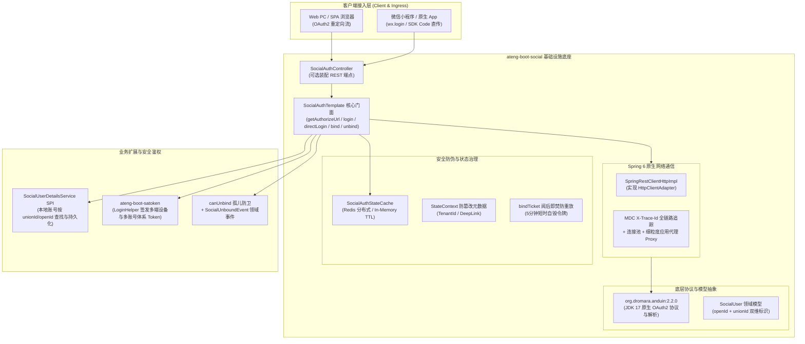

# ADR-0085: 企业级第三方社会化登录、OAuth2 协议与 Sa-Token 会话治理架构决策

- **状态**：`Accepted`
- **日期**：2026-11-03
- **作者**：Ateng
- **归属模块**：`ateng-boot-social` / `ateng-boot-satoken` / `core` / `samples`
- **相关决策**：
  - [ADR-0002: 显式统一返回契约，严禁全局拦截包装](./0002-explicit-result-contract-no-response-body-advice.md)
  - [ADR-0010: 传输契约与持久层解耦与流式转换工具](./0010-transport-pagination-contract-decoupling.md)
  - [ADR-0011: 零重型外部依赖与上下文就近内聚工具集](./0011-zero-bloat-and-co-located-utilities.md)
  - [ADR-0021: 存量核心基线收敛与零冗余封版战略决策](./0021-core-baseline-convergence-and-zero-bloat-freeze-strategy.md)
  - [ADR-0024: 企业级 Sa-Token 鉴权生态与安全防御/分布式会话一体化架构决策](./0024-enterprise-satoken-authentication-and-security-architecture.md)
  - [ADR-0026: 生产级基线加固与底层设施大一统架构决策](./0026-production-hardening-and-foundations-unification.md)
  - [ADR-0028: 示例工程多模块解耦与精准增量集成测试架构决策](./0028-samples-modularization-and-incremental-integration-testing.md)

---

## 1. 背景与业务痛点 (Context & Problem Statement)

随着企业数字化系统向移动端、小程序、协同办公平台（企微/钉钉/飞书）及全渠道生态的拓展，第三方社会化登录（Social OAuth2 Authentication）成为中后台系统与 C 端应用的基础标配能力。然而，在现有技术选型与业界常见开源实现中，普遍存在以下严重痛点：

1. **依赖臃肿失控与安全隐患 (Bloat & CVE Risks)**：
   业界经典的第三方登录组件（如早期的 JustAuth 1.16.x）大量强捆绑旧版 Fastjson、Hutool-all、OkHttp 等第三方重型依赖，不仅造成 classpath 依赖膨胀与类库版本冲突，更引入了高危反序列化漏洞风险；
2. **底层 HTTP 通信与 Spring 6 割裂**：
   传统 Starter 多强制引入额外的网络客户端（如 `simple-http` + OkHttp3/Hutool-http），无法享用 Spring Boot 3 / Spring 6 原生的 `RestClient` 生产级连接池、JDK 21 虚拟线程支持及全链路 MDC `X-Trace-Id` 出站追踪透传；
3. **数据库结构强侵入与模型越权 (Coupled Persistence)**：
   部分 Starter 强行内置固定的 `sys_user_social` 表结构与 ORM 映射实体，强制要求业务数据库迎合其字段设计，破坏了企业级系统的租户模型、主键策略（Snowflake/Long/UUID）与持久化分层解耦原则（违背 [ADR-0010](./0010-transport-pagination-contract-decoupling.md)）；
4. **两阶段绑定与非重定向流程割裂 (Broken Lifecycle)**：
   业务中不仅包含传统的“Web 浏览器重定向授权换码”，更普遍包含“微信小程序静默 `wx.login` 换码”与“移动端原生 App SDK 授权直接回传 Code”。传统方案将这两类流程人为撕裂为两套独立逻辑；同时在首次登录“未绑定本地账号”时缺乏标准安全的临时凭证防伪与防重放机制；
5. **身份同一性与孤儿账号防卫缺位 (Identity Governance)**：
   微信体系内 `openId` 与 `unionId` 跨端识别混乱，极易造成同一真实用户被割裂为多个孤立账户；同时在解绑场景下缺乏账号安全核验，误解绑导致用户产生无密码、无手机号的永久“孤儿死号”。

为此，`ateng-boot` 启动 Phase 7.2 `ateng-boot-social` 模块，旨在打造一套**纯原生、零持久化污染、支持多端多应用、与 Sa-Token 深度联动且具备完备安全防卫的企业级社会化认证底座**。

---

## 2. 核心架构设计与决策矩阵 (Decisions & Architecture)

经两阶段 13 轮 `/grill-with-docs` 架构推演，确立以下 13 项核心设计不变量与架构决策：



### 决策 1：纯协议门面与持久化 100% SPI 解耦 (Zero DB Intrusion)
- 底座严格定位为**无状态协议交换与安全认证门面**，坚决不引入任何数据库依赖、持久化框架（JPA/MyBatis-Plus）与实体表。
- 抽象标准 SPI 接口 `SocialUserDetailsService`：
  ```java
  public interface SocialUserDetailsService {
      // 1. 根据第三方画像检索已绑定的本地用户
      String loadUserIdBySocialUser(SocialUser socialUser, String appKey);
      // 2. 完成本地用户与第三方身份的绑定
      void bindSocialUser(String userId, SocialUser socialUser, String appKey);
      // 3. 解绑前置安全核验（防孤儿死号）
      boolean canUnbind(String userId, String appKey);
      // 4. 执行解绑
      void unbindSocialUser(String userId, String appKey);
  }
  ```
- 业务方自主掌控本地表结构（如租户字段、主键类型、额外业务字段），底座保持纯净。

### 决策 2：动静双轨多应用与多租户拓扑 (Dynamic & Static App Routing)
- **静态配置**：支持以命名多应用（`ateng.boot.social.apps.<key>.*`）方式配置多平台凭证，同一平台（如 WECHAT_OPEN）支持声明多个应用实例；
- **动态切源 SPI**：提供 `SocialAppConfigProvider` SPI 扩展点，大型 SaaS 平台可基于租户 ID 或动态数据库实时拉取与刷新配置，彻底解决多租户多小程序/多开放平台凭据动态切源难题。

### 决策 3：Spring 6 RestClient 原生 HTTP 驱动 (Zero-Bloat HTTP Engine)
- 依托全新迁移的 `org.dromara.anduin:dromara-anduin:2.2.0`（全面对齐 JDK 17，彻底剔除 Fastjson，重型依赖全为 provided）；
- 自研 `SpringRestClientHttpImpl implements HttpClientAdapter`，100% 接入 Spring 6 `RestClient`：
  - 自动挂载 MDC `X-Trace-Id` 跨出站网络追踪标头；
  - 强类型 `Duration` 纳管连接与读取超时，杜绝线程挂起；
  - 彻底排除 OkHttp3、Hutool-http 等传递依赖，保持工程 0 臃肿。

### 决策 4：统一双规流式门面与非重定向流程支持 (Unified Facade & Direct Login)
`SocialAuthTemplate` 对称暴露标准 Web 重定向与小程序/App 直传两大模式：
```java
public interface SocialAuthTemplate {
    // Web OAuth2 渲染授权跳转地址（携带 StateContext 防伪与深链上下文）
    String getAuthorizeUrl(String appKey, StateContext context);
    
    // Web OAuth2 回调换码认证
    SocialAuthResult login(String appKey, AuthCallback callback);
    
    // 小程序 (wx.login) / 原生 App SDK 直接凭证换码认证
    SocialAuthResult directLogin(String appKey, String code, SocialLoginOptions options);
    
    // 两阶段完成绑定并签发会话
    SocialAuthResult bind(String bindTicket, String userId, SocialLoginOptions options);
    
    // 安全解绑（受 canUnbind 守卫保护）
    void unbind(String userId, String appKey);
}
```

### 决策 5：结构化两阶段契约与“阅后即焚”防重放 (Two-Phase Result & Burn-After-Reading)
统一出参契约 `SocialAuthResult` 承载两阶段状态流转：
- **状态 A (`LOGGED_IN`)**：第三方账号已绑定本地用户，底座直接调用 `LoginHelper.login(...)` 签发 Sa-Token 会话，返回 `tokenInfo` 与本地 `userId`；
- **状态 B (`REQUIRE_BIND`)**：第三方账号首次访问未绑定，底座生成高熵随机 `bindTicket` 并存入 Cache（5 分钟 TTL），返回第三方画像快照 `socialUser`；前端引导输入账号密码或短信验证码调用 `bind(...)`；
- **阅后即焚安全网**：一旦触发 `bind(...)`，底座原子消费并物理销毁 `bindTicket`，杜绝令牌拦截重放攻击。

### 决策 6：微信多形态“跨端身份同一性”双维匹配 (OpenID & UnionID Dual Modeling)
- 领域模型 `SocialUser` 同时暴露 `openId` 与 `unionId`；
- 明确 SPI 标准查找指引：三阶判定逻辑（优先按 `unionId` 全局匹配 -> 降级按 `openId` 应用内匹配 -> 绑定时双写落库），彻底解决同一微信用户在公众号、小程序、PC 扫码中分裂为多账号的行业顽疾。

### 决策 7：StateContext 服务端防篡改存储与深链还原 (StateContext Restoration)
- 杜绝在浏览器 URL Query 中明文传递重定向目标地址与业务参数；
- 业务传入 `StateContext`（包含 `tenantId`、`redirectUrl`、`extraParams`），底座生成随机防伪 State 并作为 Key 存入 `SocialAuthStateCache`；
- 回调验证通过后，自动在服务端还原 `StateContext` 交付给业务前端执行 Deep-Link 安全重定向。

### 决策 8：Sa-Token 多端多设备精细化治理与设备自适应 (Device Governance)
- 登录参数模型 `SocialLoginOptions` 原生挂载 `deviceType`、`loginType` 与 `extraData`；
- 针对小程序自动注入 `deviceType = MINI_PROGRAM`，PC 扫码自动注入 `PC`；深度联动 `LoginHelper`，实现多设备互踢控制与多账号体系隔离。

### 决策 9：孤儿账号双重前置防卫与领域事件 (Anti-Orphan Defense)
- 解绑前置显式断言 `SocialUserDetailsService.canUnbind(userId, appKey)`；若该账号未绑定手机号或未设密码，底座刚性拦截并抛出受管业务异常 `SocialUnbindRejectedException`；
- 解绑成功后，确定性发布 `SocialUnboundEvent` Spring 领域事件，实现审计流水留存与异步风控联动。

### 决策 10：应用级细粒度出站代理拓扑 (Per-App Egress Proxy)
- 配置属性支持 `ateng.boot.social.apps.<key>.proxy.*`；
- 海外平台（GitHub/Google）独立路由至 HTTP/SOCKS 代理客户端，国内平台（微信/QQ/钉钉）保持直连，兼顾合规连通与网络极速。

---

## 3. 后果与权衡 (Consequences & Trade-offs)

### 正向收益 (Positive Consequences)
1. **纯净零污染**：100% 依托 Spring 6 `RestClient` 与 JDK 17，彻底消灭 Fastjson 与第三方 HTTP 工具包依赖；
2. **场景完备覆盖**：一套统一门面统吃 Web 扫码、微信公众号网页、微信小程序及 App 原生 SDK 授权；
3. **架构松耦合**：零持久化代码侵入，业务自由定义本地用户与第三方绑定的存储结构；
4. **金融级安全防护**：防 CSRF 状态缓存、`bindTicket` 阅后即焚防重放、`canUnbind` 孤儿账号防卫及应用级代理隔离；
5. **100% 离线自洽测试**：依托 OkHttp `MockWebServer` 驱动真实协议换码与端到端验证，单测秒级全绿，CI 矩阵稳定无扰。

### 妥协成本 (Trade-offs & Mitigations)
- **业务接入需实现 SPI**：相比于直接在库中生造表的傻瓜式 Starter，业务开发者必须实现 1 个 `SocialUserDetailsService` Bean；
  - *缓解措施*：在 `ateng-boot-sample-social` 中提供 1:1 开箱即用的内存 Map 参考实现与 MyBatis-Plus 绑定参考实现，复制即可使用。

---

## 4. 验证源头与交付对齐 (Verification & Alignment)

- **主模块**：`ateng-boot-social`
- **1:1 独立场景沙箱**：`ateng-boot-samples/ateng-boot-sample-social`
- **单测离线自洽保障**：基于轻量 `MockWebServer` 模拟微信/GitHub/Gitee OAuth2 换码与用户信息响应，离线跑通 `directLogin`、两阶段 `bind`、防重放拦截与 `unbind` 安全防卫。
- **配置属性前缀**：`ateng.boot.social.*`（配置类 `AtengSocialProperties` 统配 `Duration`，并由 `spring-boot-configuration-processor` 生成 IDE 补全元数据）。
