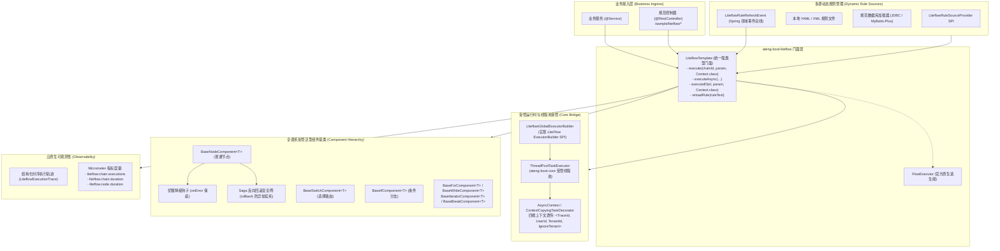

# ADR-0086: 企业级业务规则与流程管道编排、受管线程池接管与四维上下文透传架构决策

- **状态**：`Accepted`
- **日期**：2026-11-03
- **作者**：Ateng
- **归属模块**：`ateng-boot-liteflow` / `ateng-boot-core` / `ateng-boot-observability` / `samples`
- **相关决策**：
  - [ADR-0002: 显式统一返回契约，严禁全局拦截包装](./0002-explicit-result-contract-no-response-body-advice.md)
  - [ADR-0011: 零重型外部依赖与上下文就近内聚工具集](./0011-zero-bloat-and-co-located-utilities.md)
  - [ADR-0021: 存量核心基线收敛与零冗余封版战略决策](./0021-core-baseline-convergence-and-zero-bloat-freeze-strategy.md)
  - [ADR-0025: 核心基础底座跨中间件解耦与通用原语下沉架构决策](./0025-core-module-expansion-and-future-proof-middleware-foundations.md)
  - [ADR-0026: 生产级基线加固与底层设施大一统架构决策](./0026-production-hardening-and-foundations-unification.md)
  - [ADR-0028: 示例工程多模块解耦与精准增量集成测试架构决策](./0028-samples-modularization-and-incremental-integration-testing.md)
  - [ADR-0029: 虚拟线程与自适应异步运行时架构决策](./0029-virtual-threads-and-adaptive-async-runtime.md)
  - [ADR-0051: 高性能无状态业务状态机架构决策](./0051-high-performance-stateless-business-state-machine-architecture.md)

---

## 1. 背景与业务痛点 (Context & Problem Statement)

在企业中后台系统、电商交易中心与金融风控平台中，业务规则（如营销叠加算价、信贷多维风控准入、订单履约调度）具备极高的复杂度与频繁变更特征。传统硬编码 `if-else` 面条代码不仅可维护性极差，且无法支持可视化编排与运行期热重载；而重型 BPMN 工作流引擎（如 Flowable/Camunda）因强依赖数十张持久化数据库表，单次流转耗时过长，无法满足微秒/毫秒级的在线高并发计算。

作为轻量级规则编排框架的代表，LiteFlow 以其卓越的性能与优雅的 EL（Execution Language）语法获得了广泛应用。然而在将其融入 `ateng-boot` 工业级微服务底座的过程中，暴露出以下严重的架构痛点：

1. **子线程四维上下文断流与租户穿透失效**：
   LiteFlow 在执行并行异步编排（如 `WHEN(a, b)`）时，默认使用其内部构建的异步线程池。此机制会导致子线程完全丢失主线程的四维上下文 $\langle\text{MDC TraceId}, \text{UserId}, \text{TenantId}, \text{IgnoreTenant}\rangle$。不仅导致并行节点日志链路追踪断流，更会导致持久层 MyBatis-Plus 行级多租户插件失效，引发跨租户数据泄露高危安全隐患；
2. **原生 `FlowExecutor` 弱类型与非抛式静默吞异常陷阱**：
   官方核心执行器返回非受检响应对象 `LiteflowResponse`（需手动检查 `response.isSuccess()`）。业务开发者极易遗漏判断，导致底层异常被静默吞没；同时上下文提取依赖弱类型 `response.getContextBean(...)`，缺乏泛型强类型契约保障；
3. **组件强类型上下文缺失与重复样板代码**：
   业务节点继承原生 `NodeComponent` 时，需反复手写 `this.getContextBean(OrderContext.class)` 与判空强转，代码冗长且充斥空指针风险；同时缺乏统一的节点执行耗时监控、参数合法性防御断言与优雅降级钩子；
4. **规则源存储僵化与中后台动态热更脱节**：
   企业生产中，规则通常由产品或运营人员在中后台管理界面维护并存储于 MySQL/PostgreSQL 数据库中。官方仅支持本地静态文件或需引入其专属的重量级外部 Starter，缺乏轻量通用的规则源拉取与领域事件广播机制；
5. **依赖失控与动态脚本安全风险**：
   LiteFlow 传递依赖了 `hutool-core`；同时官方推崇的 Groovy 等动态脚本引擎会引入数十兆重型 Jar 包，并在生产环境中带来类加载器泄漏与远程命令执行（RCE）注入漏洞风险；
6. **节点黑盒运行与云原生可观测性缺位**：
   复杂 DAG 编排在生产执行时缺乏白盒化的结构化步骤轨迹输出（Step-Trace），且未与 Prometheus / Micrometer 度量指标打通，运维人员难以快速定位拖慢整体链路的“慢节点”。

为此，`ateng-boot` 启动 Phase 7.3 `ateng-boot-liteflow` 模块孵化，打造一套**纯原生、强类型、受管线程池全局接管、四维上下文无缝穿透且与 Spring 领域生态深度自洽的企业级规则编排基础设施**。

---

## 2. 核心架构设计与决策矩阵 (Decisions & Architecture)

经两阶段 11 轮 `/grill-with-docs` 架构推演，确立以下 12 项核心设计不变量与架构决策：

---

### 2.1 决策详解

#### 1. 版本锁定 2.16.3.1 与 Hutool 严格黑盒隔离 (Decision 1)
- **决策**：底座基于当前最新稳定版 `com.yomahub:liteflow-spring-boot-starter:2.16.3.1` 构建，全面拥抱 JDK 17 / 21 虚拟线程支持、直接 EL 表达式执行与活跃规则智能缓存；
- **依赖防线**：针对 LiteFlow 传递引入的 `cn.hutool:hutool-core`，确立**严格隔离红线**：`hutool-core` 仅作为 LiteFlow 内部运行时私有黑盒，`ateng-boot-liteflow` 自身源码、公共 API 及业务代码严禁引用任何 `cn.hutool.*` 类，100% 强制复用 JDK 17 原生能力与 `ateng-boot-core` 原语（`JsonUtil`、`IdUtil`、`RetryUtil` 等），捍卫 ADR-0011 与 ADR-0021 纯净底座。

#### 2. 受管线程池全局强制接管与四维跨线程上下文透传 (Decision 2)
- **决策**：实现 LiteFlow 官方 `com.yomahub.liteflow.thread.ExecutorBuilder` SPI，提供 `LiteflowGlobalExecutorBuilder` 并由自动装配默认激活（绑定 `liteflow.global-thread-pool-executor-class`）；
- **核心机制**：底层直接桥接 `ateng-boot-core` 的受管线程池设施（`ThreadPoolTaskExecutor`），自动注入 `AsyncContext` 任务包装器。在并行 `WHEN(a, b)` 执行时，透明快照透传 $\langle\text{MDC TraceId}, \text{UserId}, \text{TenantId}, \text{IgnoreTenant}\rangle$，并在子任务完成时在 `finally` 块中绝对清理现场，从根源上杜绝日志追踪断流与租户串门。

#### 3. 强类型统一操作门面 `LiteflowTemplate` 与原生逃生舱 (Decision 3)
- **决策**：对外暴露统一门面 `LiteflowTemplate`，屏蔽底层非抛式响应与繁琐强转，提供纯净的强类型 API：
  - `execute(String chainId, Object param, Class<T> contextClass): T`：执行并校验成功状态，若失败自动转译抛出受管 `LiteflowExecutionException`，成功直接解包返回强类型上下文 `T`；
  - `execute(String chainId, Object param, Class<?>... contextClasses): LiteflowResponse`：支持多上下文复杂流转；
  - `executeAsync(...)`：受管异步流式调度，返回 `CompletableFuture<T>`；
  - `executeEl(String el, Object param, Class<T> contextClass): T`：无需预注册 chainId，直接执行动态 EL 表达式；
  - `reloadRule(String ruleContent)` / `reloadChain(String chainId, String el)`：动态规则热更新；
- **逃生舱保证**：Spring 容器同时保留暴露官方原生 `FlowExecutor` Bean，业务若需调用小众高级 SPI 均可无缝穿透。

#### 4. 全谱系泛型受管组件基类体系 (Decision 4)
- **决策**：打造涵盖规则全场景的强类型泛型受管基类全家桶，彻底废除手动 `getContextBean`：
  - `BaseNodeComponent<T>`：普通处理节点，提供强类型 `getContext(): T`，执行前后自动挂载性能采样与审计；
  - `BaseSwitchComponent<T>`：选择路由节点，提供 `String processSwitch(T context)`；
  - `BaseIfComponent<T>`：二元条件节点，提供 `boolean processIf(T context)`；
  - `BaseForComponent<T>`：计次循环节点，提供 `int processFor(T context)`；
  - `BaseWhileComponent<T>`：条件循环节点，提供 `boolean processWhile(T context)`；
  - `BaseIteratorComponent<T>`：集合迭代节点，提供 `Iterator<?> processIterator(T context)`；
  - `BaseBreakComponent<T>`：循环跳出节点，提供 `boolean processBreak(T context)`。

#### 5. 强类型组件入参与动态数据提取 (Decision 5)
- **决策**：在组件基类中封装高直觉的参数提取辅助方法：
  - `getTag()`：直接读取当前节点标签（Tag）；
  - `getCmpData(Class<D> dataClass)`：底层自动桥接 Core 模块 `JsonUtil` 序列化门面，将组件绑定的动态配置（`cmpData`）无缝映射为强类型 Java Bean 或 Record，严禁业务手写脆弱的反序列化解析。

#### 6. 规则多源存储扩展 SPI 与数据库标准加载规范 (Decision 6)
- **决策**：抽象轻量级扩展接口 `LiteflowRuleSourceProvider`（包含 `loadRules()` 方法），支持从本地文件、关系型数据库（JDBC / MyBatis-Plus）、Redis 及配置中心加载规则；
- **数据库规范**：提供标准轻量数据库规则元数据表 DDL 建议（`rule_id`, `rule_name`, `el_expression`, `status`）及开箱即用的加载器模版，业务系统无需引入臃肿的官方扩展包即可轻松实现“中后台管理界面在线配规则”。

#### 7. Spring 原生规则热刷新领域事件总线 (Decision 7)
- **决策**：定义 Spring 标准领域事件 `LiteflowRuleRefreshEvent`。无论是管理后台保存规则入库、收到 Redis Pub/Sub 广播还是 Nacos 监听回调，业务仅需发布该事件，底座监听器自动拉取最新规则文本并调用 `LiteflowTemplate.reloadRule()` 完成零停机增量/全量平滑热更新。

#### 8. 并行硬超时隔离熔断与组件就地优雅降级 (Decision 8)
- **决策**：支持在配置或 EL 语法中（`maxWaitSeconds`）声明并行执行硬超时，超时后受管线程池协同发出线程中断信号，防止慢下游拖垮应用线程；
- **优雅降级**：组件基类中提供可选的 `T onError(Exception e, T context)` 钩子，当节点异常时允许就地捕获并返回保底兜底数据（如外部风控接口闪断时自动标记为“需人工初审”），保障主流程不发生阻断性崩溃。

#### 9. Saga 反向回滚安全网 (Decision 9)
- **决策**：规范组件基类的 `rollback(T context)` 机制，当链路下游节点发生不可逆故障时，LiteFlow 自动按逆序触发已成功组件的补偿回滚；
- **安全防线**：在基类中对 `rollback` 执行逻辑挂载确定性 `try-catch` 保护与异常告警审计，坚决杜绝回滚逻辑自身的次生异常导致状态悬挂。

#### 10. 纯 Java 组件优先与脚本引擎解耦按需扩展 (Decision 10)
- **决策**：坚持纯原生 Java 强类型组件优先，核心 Starter 默认**零动态脚本依赖**（不引入 Groovy、QLExpress 等重型包），从根源杜绝依赖体积膨胀与 RCE 表达式注入高危漏洞；
- **解耦扩展**：底座预留官方脚本插件通道，若极端特殊业务需要在线写脚本，由业务工程显式按需引入对应 `liteflow-script-*` 依赖。

#### 11. 结构化执行轨迹与 Micrometer 云原生度量 (Decision 11)
- **决策**：提供白盒化的可观测性全景：
  - **结构化轨迹**：单次执行输出 `LiteflowExecutionTrace`，按时序记录 `[nodeId, tag, timeSpentMs, status(SUCCESS/FAIL/SKIPPED), errorSummary]`，可直接注入 MDC 审计日志或随响应返回；
  - **Micrometer 指标**：与 `ateng-boot-observability` 联动，自动暴露 `liteflow.chain.executions`（执行计数器，按 `chainId`, `status` 打标）、`liteflow.chain.duration`（链耗时直方图，支持 P95/P99 报警）与 `liteflow.node.duration`（节点耗时直方图，秒级识别慢节点）。

#### 12. 1:1 独立沙箱工程与 4 大典型高频业务 Controller 闭环 (Decision 12)
- **决策**：配套专属样例工程 `ateng-boot-samples/ateng-boot-sample-liteflow`，全面 Web 体验化，按功能领域拆分为 4 个独立 Controller，路由统一收敛于 `/sample/liteflow/*`，出参统配强类型 `Result<T>`，依托纯内存自验：
  1. `LiteflowPriceCalculationController`（电商复杂营销算价管道：串行校验 -> 并行 `WHEN` 查询卡券/等级 -> 满减/折扣/运费核算）；
  2. `LiteflowRiskControlController`（金融风控信贷审批流：黑名单 `IF` -> 并行反欺诈 `WHEN` -> `SWITCH` 路由放款/人工/拒绝）；
  3. `LiteflowOrderFulfillmentController`（订单履约与 Saga 反向回滚：扣库存 -> 制出库单 -> 发信 -> 模拟异常反向触发 rollback 补偿解冻）；
  4. `LiteflowDynamicRuleController`（动态规则热重载与在线即时 EL 执行：验证免重启动态更新算价策略与即时执行临时 EL）。

---

## 3. 后续影响与落地指引 (Consequences)

### 3.1 积极影响 (Positive)
1. **线程与上下文零风险**：并行编排与 `ateng-boot-core` 受管线程池及四维上下文体系 100% 对齐，彻底杜绝多租户穿透与日志 TraceId 断流；
2. **开发体验与健壮性跃升**：泛型组件基类 + 强类型 `LiteflowTemplate` 彻底消除强转与非受检静默吞异常风险；
3. **运维与中后台无缝打通**：通过 `LiteflowRuleSourceProvider` 与 Spring 领域事件，轻松实现中后台数据库存规则与在线即时生效；
4. **全天候白盒化治理**：结构化时序轨迹与 Micrometer 云原生指标让复杂规则链的运行状态与耗时一览无余。

### 3.2 潜在代价与消减措施 (Trade-offs & Mitigations)
1. **Hutool-core 传递依赖**：LiteFlow 内部引用了 `hutool-core`，无法物理排除。
   *消减措施*：通过架构契约红线与 CI 静态代码扫描，严禁在 `ateng-boot-liteflow` 自研源码及业务代码中直接 import Hutool 类库。
2. **动态脚本引擎缺失**：默认不支持直接在 XML 中写内联 Groovy 脚本。
   *消减措施*：引导开发者使用纯 Java 强类型组件；若确实需要，文档清晰给出显式引入 `liteflow-script-groovy` 的指南。
