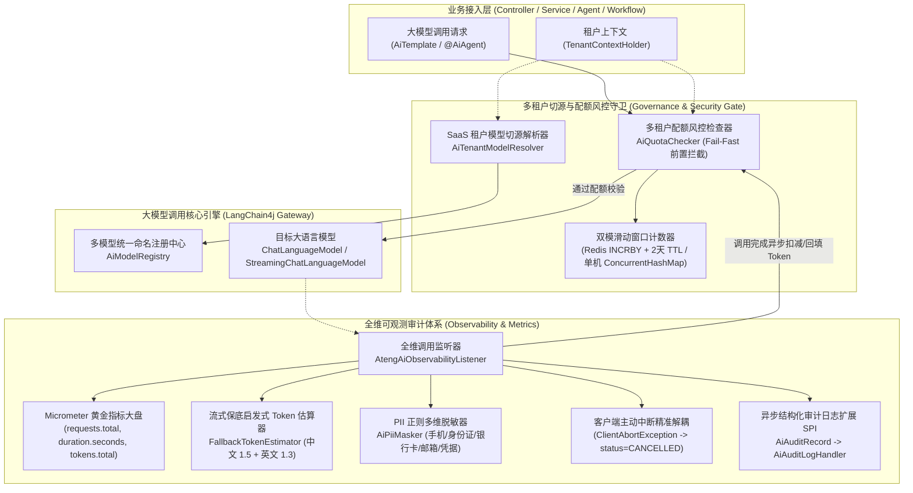

# ADR-0088: 企业级 AI 全维可观测审计、SaaS 多租户切源与双模配额风控治理架构

- **状态**：`Accepted`
- **日期**：2026-11-04
- **作者**：Ateng
- **归属模块**：`ateng-boot-ai` / `ateng-boot-core` / `ateng-boot-redis` / `samples`
- **相关决策**：
  - [ADR-0002: 显式统一返回契约，严禁全局拦截包装](./0002-explicit-result-contract-no-response-body-advice.md)
  - [ADR-0004: HTTP 200 语义错误码与异常安全掩码](./0004-http-200-with-business-code-and-exception-masking.md)
  - [ADR-0010: 传输契约与持久层绝对解耦设计](./0010-transport-pagination-contract-decoupling.md)
  - [ADR-0011: 零重型外部依赖与上下文就近内聚工具集](./0011-zero-bloat-and-co-located-utilities.md)
  - [ADR-0012: 生命周期分离的数据安全体系：入库加密、出库明文与展示脱敏](./0012-lifecycle-separated-data-security.md)
  - [ADR-0021: 存量核心基线收敛与零冗余封版战略决策](./0021-core-baseline-convergence-and-zero-bloat-freeze-strategy.md)
  - [ADR-0024: 企业级无状态安全防卫、内网穿透防护与多设备登录治理](./0024-enterprise-satoken-authentication-and-security-architecture.md)
  - [ADR-0025: 核心基础底座跨中间件解耦与通用原语下沉架构决策](./0025-core-module-expansion-and-future-proof-middleware-foundations.md)
  - [ADR-0026: 生产级基线加固与底层设施大一统架构决策](./0026-production-hardening-and-foundations-unification.md)
  - [ADR-0028: 示例工程多模块解耦与精准增量集成测试架构决策](./0028-samples-modularization-and-incremental-integration-testing.md)
  - [ADR-0087: 基于 LangGraph4j 的认知状态图编排、双模检查点持久化与人机协作 (HITL) 恢复架构决策](./0087-langgraph4j-cognitive-stategraph-and-hitl-architecture.md)

---

## 1. 背景与业务痛点 (Context & Problem Statement)

随着大语言模型（LLM）与认知智能体（AI Agents）全面融入企业核心生产业务系统，大模型已由边缘探索走向中心化调度支撑。然而，由于大模型具备黑盒生成、高延迟计算、计费昂贵（按 Token 计费）、公网跨端通信等固有特性，企业在将其规模化生产落地时暴露出以下严峻的技术矛盾与治理痛点：

1. **链路可观测黑盒与 Token 计量断崖**：
   开源大模型框架（如原生 LangChain4j）在执行流式推流（Streaming）时，部分服务商网关（如早期 OpenAI 流式端点、某些本地代理模型）在 SSE 流结束时并不返回 `usage` 元数据，导致监控大盘捕获的 Token 消耗量归零或剧烈波动，无法建立精细的成本核算模型；
2. **敏感个人信息（PII）泄露与合规审查风险**：
   业务提示词与大模型应答中常夹杂用户手机号、身份证号、银行卡号、电子邮箱乃至 API Key 凭据。若直接将原始明文落盘日志系统或审计库，极易违反网络安全与数据隐私法规；但若在内存中直接对实体打星号，又严重破坏“内存真明文”不变量，导致掩码脏数据写回数据库；
3. **客户端网络抖动与真实系统故障混淆**：
   在长时间 SSE 打字机流式推流过程中，终端用户关闭浏览器标签页、移动端网络信号切换等行为会触发 `ClientAbortException`、`AsyncRequestTimeoutException` 等 Socket 断开异常。现存系统若将其粗暴捕获并上报为 500 系统故障或引发错误告警，会严重污染大盘健康度并导致值班团队告警疲劳；
4. **SaaS 多租户资源混用与模型特化缺失**：
   在多租户平台中，不同企业租户付费等级差异显著（如 VIP 租户接入专用高吞吐模型，普通租户接入通用模型），缺乏统一透明的“租户 $\to$ 专用模型拓扑”动态解析机制，迫使业务层在每次调用时编写大量脆弱的硬编码分支；
5. **缺少用量配额熔断风控导致账单爆炸**：
   单个租户如果遭遇脚本恶意高频刷取、死循环调用或过长上下文轰炸，会在数分钟内耗尽全平台的 API 额度，引发全站服务瘫痪并产生天价账单。开源框架缺乏开箱即用的租户级单日请求次数与 Token 消耗滑动窗口风控拦截器。

为此，`ateng-boot` 在 Phase 8 (Spec 4) 构建了一套**面向工业级生产就绪的 AI 全维可观测审计、SaaS 多租户切源与双模滑动配额风控治理基础设施**。

---

## 2. 核心架构设计与决策矩阵 (Decisions & Architecture)



### 决策一：全维链路可观测监听器与 Micrometer 黄金指标矩阵
- **统一生命周期监听**：基于 LangChain4j 标准 SPI 注册 `AtengAiObservabilityListener`，透明接入同步对话（`ChatModelListener`）与流式推流全生命周期，严禁侵入具体业务逻辑；
- **云原生黄金三大指标矩阵**：自动集成 Micrometer `MeterRegistry`，统一向 Prometheus/Grafana 暴露符合云原生工业规范的三大度量指标：
  1. `ateng.ai.requests.total` (Counter)：包含维度 `model`、`tenant_id`、`status`（SUCCESS、ERROR、CANCELLED）；
  2. `ateng.ai.duration.seconds` (Timer)：记录大模型单次请求全链路耗时，提供 P50、P90、P99 分位数监控；
  3. `ateng.ai.tokens.total` (Counter)：包含维度 `model`、`tenant_id`、`type`（prompt、completion），精准统计输入与输出 Token 消耗。

### 决策二：流式保底启发式 Token 估算器 (FallbackTokenEstimator)
- **零依赖纯函数启发式估算**：当流式大模型网关或代理未返回实际 `TokenUsage` 时，框架自动激活 `FallbackTokenEstimator.estimate(text)` 启发式估算器；
- **行业标准经验加权公式**：采用纯原生正则表达式分词算法：
  $$\text{Token 预估} = \lceil\text{中文字符数} \times 1.5 + \text{英文单词数} \times 1.3 + \text{其他符号数}\rceil$$
- **消除监控断崖**：彻底杜绝大盘 Token 统计由于底层网关缺失导致断崖式归零，确保多租户用量核算的连续性与单调递增性。

### 决策三：PII 敏感数据多维度正则脱敏与“内存真明文”防卫 (AiPiiMasker)
- **多维敏感正则引擎**：通过 `AiPiiMasker` 针对中国大陆手机号（前3后4保留）、18位身份证号（前6后4保留）、16-19位银行卡号（前6后4保留）、电子邮箱（前1后域名保留）以及 API Key 凭据（`sk-...` 仅保留前3后4）执行高效无状态正则替换；
- **仅在审计落盘边界生效**：恪守 ADR-0012“内存真明文”铁律，业务代码和向大模型发送的实际提示词在内存中始终保持 100% 原始真实明文，仅在审计日志落盘与外部系统投递时进行掩码渲染，坚决杜绝打星号脏数据污染下游。

### 决策四：客户端主动中断与真实系统故障精准解耦
- **中断异常精准识别**：在 `AtengAiObservabilityListener` 错误捕获分支中，通过异常原因链深度递归探测 `ClientAbortException`、`AsyncRequestTimeoutException`、`SocketException`（Broken pipe / Connection reset by peer）等客户端非预期断开标志；
- **转译为 `status=CANCELLED` 正常归档**：将该类场景标记为 `CANCELLED` 并输出轻量级 WARN 日志，严禁记录错误堆栈并排除出 500 系统故障告警统计，保护系统 SRE 大盘的真实性。

### 决策五：SaaS 多租户动态切源与平滑回退解析 (AiTenantModelResolver)
- **统一切源门面契约**：定义 `AiTenantModelResolver` SPI，内置提供 `DefaultAiTenantModelResolver` 实现；
- **租户映射路由拓扑**：配置 `ateng.boot.ai.tenant-models.<tenantId>=<modelName>`；当业务发起调用时，优先从 Core 底座 `TenantContextHolder` 获取租户标识并解析映射。若命中映射则自动重定向底层模型别名；未配置或未找到时平滑退避至系统默认主模型，支持随时通过 Spring Bean 覆盖自定义策略。

### 决策六：双模自适应滑动窗口租户配额风控守卫 (AiQuotaChecker)
- **统一风控守卫契约**：定义 `AiQuotaChecker` SPI，提供 `checkQuota(tenantId, modelName, promptTokens)` 与 `recordUsage(tenantId, modelName, totalTokensUsed)` 对称方法；
- **前置 Fail-Fast 阻断**：在调用大模型网关前执行前置卫语句防卫；凡超过单日调用次数限制（`daily-request-limit`）或 Token 消耗上限（`daily-token-limit`）时，立即抛出强类型 `AiException(AiResultCode.AI_QUOTA_EXCEEDED)`，杜绝无意义的网络 IO 与成本消耗；
- **双模自适应存储机制**：
  1. **分布式 Redis 模式**（类路径存在 `StringRedisTemplate` 时自动激活）：依托 Redis 原子 `INCRBY` 与 2 天滑动 TTL 物理自毁，支持高并发多 Pod 集群共享风控状态；
  2. **单机并发内存模式**（无 Redis 时保底自洽）：基于 `ConcurrentHashMap` 与跨天原子滑动淘汰设计，保证本地开发与无外部中间件环境下 100% 离线自洽，防御无界内存泄漏；
- **租户隔离豁免机制**：支持 `TenantContextHolder.setIgnoreTenant(true)` 声明式跳过配额风控，保障平台超管与系统后台异步巡检任务顺畅执行。

### 决策七：防御性自动装配与平滑待命机制
- **四道铁律落地**：
  1. **平滑探测 API Key**：当未配置任何大模型 API Key 时，输出 INFO 级友好待命日志，严禁应用启动崩溃；
  2. **Bean 缺省守卫**：所有对外暴露的公共 Bean（`AiModelRegistry`、`AiTemplate`、`AtengAiObservabilityListener`、`AiTenantModelResolver`、`AiQuotaChecker`、`ChatMemoryStore`、`GraphCheckpointSaver`、`GraphResumeTemplate` 等）必须 100% 显式标注 `@ConditionalOnMissingBean`；
  3. **条件装配隔离**：涉及可选外部依赖（如 Redis、Micrometer）时，通过静态配置类隔离与 `@ConditionalOnClass(name = "...")` 字符防卫，防止反射扫描触发 `ClassNotFoundException`。

---

## 3. 架构影响与收益评估 (Consequences & Benefits)

### 正向收益 (Positive Impacts)
1. **全生命周期可观测闭环**：通过 Micrometer 黄金指标与结构化审计事件，大模型调用延迟、Token 消耗与错误分布实现 100% 白盒化，支撑企业级成本归因与容量规划；
2. **零合规风险与内存真明文**：PII 敏感脱敏引擎与生命周期分离架构，确保日志落盘合规的同时不破坏业务数据的真实性；
3. **精准告警与降噪**：客户端断开与系统异常彻底解耦，消除误报告警风暴；
4. **多租户安全隔离与精细化风控**：支持租户级专有模型动态切源与单日配额熔断，彻底阻断由于异常死循环或恶意攻击造成的云账单失控；
5. **高度弹性与无缝退避**：分布式 Redis 与单机并发内存双模自洽运行，生产环境支持水平集群扩展，测试与本地单机环境零依赖极速启动。

### 潜在代价与消解手段 (Trade-offs & Mitigations)
1. **启发式 Token 估算误差**：
   - *代价*：FallbackTokenEstimator 是基于字符与词法统计的启发式预估，与特定模型分词器（BPE / WordPiece）存在约 5%~10% 的合理偏差；
   - *消解*：该机制仅作为大模型网关完全缺失 usage 时的保底防御手段，只要网关返回了真实 usage，系统一律以真实数据为准。
2. **Redis 计数与业务调用的原子性**：
   - *代价*：调用前检查配额与调用后记录消耗存在时间差，在极端并发下可能产生轻微超配；
   - *消解*：配额风控定位于防止账单爆炸与宏观资源治理（软限制），轻微超配完全可接受，避免引入重型分布式两阶段锁从而拖垮系统吞吐。

---

## 4. 验证与落地依据 (Verification & Evidence)

本架构设计已在 `ateng-boot-ai` 底座及其场景样例工程 `ateng-boot-sample-ai` 中完成 100% 全维自动化测试验证：
- **可观测审计监听器**：`AtengAiObservabilityListenerTest`
- **PII 多维脱敏器**：`AiPiiMaskerTest`
- **流式保底估算器**：`FallbackTokenEstimatorTest`
- **多租户动态切源解析器**：`AiTenantModelResolverTest`
- **双模配额风控检查器**：`DefaultAiQuotaCheckerTest`
- **防御性自动装配守卫**：`AtengAiAutoConfigurationTest`
- **端到端 Web 场景验证**：`MetricsControllerIntegrationTest` (`/sample/ai/metrics/*`)
- **多模块自动化准出命令**：
  ```bash
  mvn test -pl ateng-boot-ai,ateng-boot-samples/ateng-boot-sample-ai -am -T 1C -nsu -B
  ```

---

## 5. 工业级代码成熟度九道防线依从性分析 (Robustness Invariants Compliance)

对照框架九道代码成熟度防线，本架构落地执行情况如下：

| 防线编号 | 核心防线要求 | 架构落地与对齐细节 |
| :--- | :--- | :--- |
| **防线一** | **对称语义完备性 (Symmetric Facades Invariant)** | `AiQuotaChecker` 提供对称方法契约：前置检查 `checkQuota` 与后置累计 `recordUsage` 对称；读配额状态 `getDailyRequests` / `getDailyTokens` 与清理重置 `resetQuota` 对称；`ChatMemoryManager` 与 `GraphResumeTemplate` 均提供完备的读写、保存与销毁对称门面。 |
| **防线二** | **分层防卫与快速失败 (Defense-in-Depth & Fail-Fast)** | 双层防卫体系：传输边界（Controller）统一采用 JSR-303 注解（`@NotBlank`、`@Min(0)` 等）Fail-Fast；业务核心层（Service/Model）在执行远程调用前通过前置卫语句严格校验入参非空，配额超额即刻抛出 `AiException(AiResultCode.AI_QUOTA_EXCEEDED)` 熔断阻断。 |
| **防线三** | **确定性生命周期与资源清理 (Deterministic Lifecycle & Cleanup)** | 流式推流 `SseTokenStreamBridge` 与可观测监听器在正常完成、异常中断与客户端断开（`ClientAbortException`）时，保证 SSE 连接与 MDC 现场确定性闭合与还原；Redis 租户配额键原子自增时统一挂载 2 天滑动 TTL 物理自毁，单机内存配额自动按日滑动淘汰，杜绝存储与内存无界泄漏。 |
| **防线四** | **环境宿主中立与弹性防御 (Platform-Agnostic & Host Resilience)** | `AiPiiMasker` 正则脱敏与 `FallbackTokenEstimator` 保底估算纯函数均采用 JDK 17 原生算法与跨平台 UTF-8 字符集；多模态动态模型处理兼容 `TextContent` 与 `ImageContent`，消除跨操作系统与数据编码差异。 |
| **防线五** | **严格无状态与并发纪律 (Strict Statelessness & Concurrency Safety)** | 单例监听器、解析器与配额检查器均保持严格无状态；异步审计日志投递接入受管线程池（`ThreadPoolTaskExecutor`）并透传四维上下文快照（MDC、TenantId、UserId 等），严禁私建野线程；单机内存配额采用 `ConcurrentHashMap` 与原子淘汰，Redis 采用原子 `INCRBY` 并防卫 TTL 遗漏。 |
| **防线六** | **生产就绪配置与防无界悬挂 (Safe Config & Production Defaults)** | 所有配置项提供生产级默认值（`enabled=true`、合理请求上限与前缀）；网络交互与 SSE 推流统配连接超时与 180s 打字机生产安全超时，杜绝无超时无限挂起。 |
| **防线七** | **因果异常体系与底层驱动解耦 (Causal Exceptions & SDK Decoupling)** | 底层网络通信、HTTP 与 SDK 驱动异常统一由 `AiExceptionTranslator` 转译为框架受管的语义化业务异常 `AiException(IResultCode)`，100% 传递原始 `cause` 保留因果链，杜绝 Log-and-Throw 双重污染与静默吞咽。 |
| **防线八** | **原生优先与零臃肿底座收敛 (Zero-Bloat & Core Convergence)** | 坚持万能 OpenAI 兼容协议收敛主流模型，坚决杜绝引入厂商私有 SDK；通用原语（四维上下文、异步透传、安全校验、脱敏规则等）100% 收敛复用 `ateng-boot-core`。 |
| **防线九** | **对抗性极限用例守护 (Adversarial & Edge-Case Testing)** | 单测与集成测试全面覆盖客户端主动中断、模型 usage 缺失流式保底估算、跨天跨模型滑动淘汰、租户忽略豁免、多模态图文混合过滤与非法入参拦截校验，全真覆盖非玩具场景。 |

---

## 6. 未来演进路线 (Roadmap)

1. **多层配额缓冲架构 (L1 Local Memory + L2 Distributed Redis)**：
   - 在高并发海量 QPS 场景下，引入本地内存微批缓冲（如每累计 10 次或每隔 1s 批量上报 Redis），进一步平滑网络毛刺，降低分布式缓存网络 IO 负载。
2. **动态模型费率与多维成本核算**：
   - 由单一的 Token 数量统计演进为支持不同大模型（如 deepseek-v3 vs deepseek-r1 vs gpt-4o）的动态费率折算系数（Ratio-weighted tokens），统一换算为标准计费单元或金额，实现精细化成本归因。
3. **自适应熔断降级联动**：
   - 联动自研或标准熔断中间件，当大模型网关发生高频 429、504 或延迟断崖式升高时，配额守卫与路由模块支持按租户优先级实行动态削峰与弹性降额。
