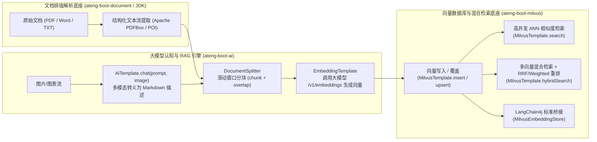
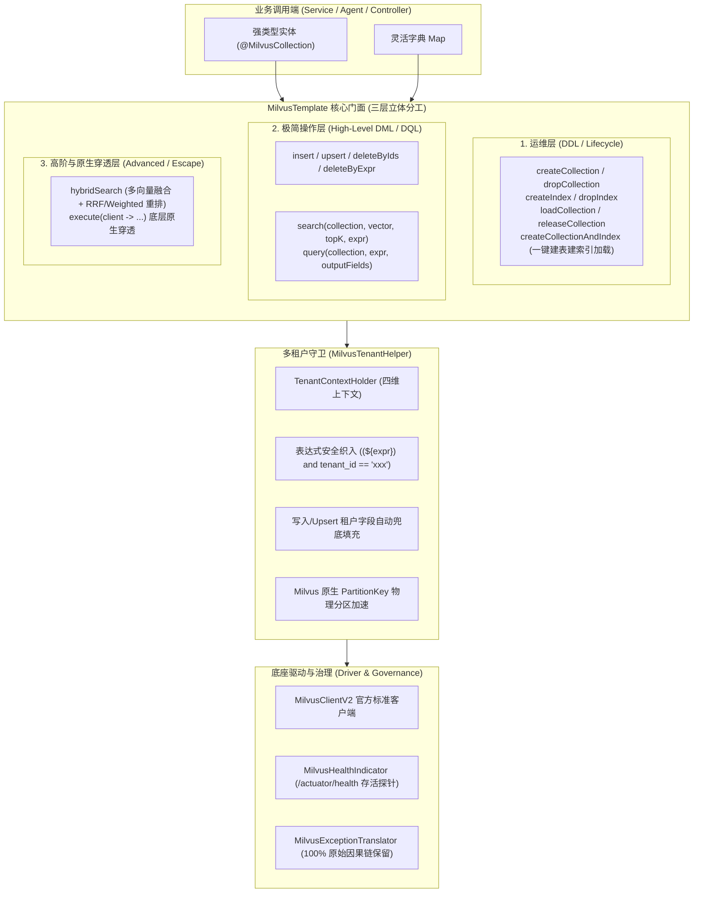

# ADR-0089: 企业级 Milvus 向量数据库、多向量混合检索与 SaaS 租户隔离架构

- **状态**：`Accepted`
- **日期**：2026-11-04
- **作者**：Ateng
- **归属模块**：`ateng-boot-milvus` / `ateng-boot-bom` / `ateng-boot-ai` / `samples`
- **相关决策**：
  - [ADR-0002: 显式统一返回契约，严禁全局拦截包装](./0002-explicit-result-contract-no-response-body-advice.md)
  - [ADR-0004: HTTP 200 语义错误码与异常安全掩码](./0004-http-200-with-business-code-and-exception-masking.md)
  - [ADR-0010: 传输契约与持久层绝对解耦设计](./0010-transport-pagination-contract-decoupling.md)
  - [ADR-0011: 零重型外部依赖与上下文就近内聚工具集](./0011-zero-bloat-and-co-located-utilities.md)
  - [ADR-0017: 基于 MyBatis-Plus 的行级多租户安全隔离架构设计](./0017-multi-tenant-row-level-isolation-architecture.md)
  - [ADR-0021: 存量核心基线收敛与零冗余封版战略决策](./0021-core-baseline-convergence-and-zero-bloat-freeze-strategy.md)
  - [ADR-0025: 核心基础底座跨中间件解耦与通用原语下沉架构决策](./0025-core-module-expansion-and-future-proof-middleware-foundations.md)
  - [ADR-0026: 生产级基线加固与底层设施大一统架构决策](./0026-production-hardening-and-foundations-unification.md)
  - [ADR-0028: 示例工程多模块解耦与精准增量集成测试架构决策](./0028-samples-modularization-and-incremental-integration-testing.md)
  - [ADR-0040: 云原生全链路可观测性健康探针与 Actuator 生产加固架构决策](./0040-observability-metrics-health-and-cloud-native-architecture.md)
  - [ADR-0087: 基于 LangGraph4j 的认知状态图编排、双模检查点持久化与人机协作 (HITL) 恢复架构决策](./0087-langgraph4j-cognitive-stategraph-and-hitl-architecture.md)
  - [ADR-0088: 企业级 AI 全维可观测审计、SaaS 多租户切源与双模配额风控治理架构](./0088-enterprise-ai-observability-quota-governance-and-production-architecture.md)

---

## 1. 背景与业务痛点 (Context & Problem Statement)

随着大语言模型应用从玩具级对话向企业级真实生产系统（如深度 RAG 检索增强生成、以图搜图、推荐引擎、风控近邻比对）纵深演进，非结构化数据与高维语义向量的存储与检索成为企业级核心基础设施。然而，当前在微服务中集成 Milvus 向量数据库面临以下严峻挑战：

1. **驱动割裂与 API 冗余复杂度**：
   开源 Milvus Java SDK 存在早期基于建造者的 V1 `MilvusServiceClient` 与现代面向微服务的 V2 `MilvusClientV2` 双套体系。V1 API 充满大量深层嵌套的 `*Param.newBuilder()` 样板代码，缺乏微服务工程开箱即用的高阶操作门面；
2. **多向量混合检索（Hybrid Search）门槛高**：
   单纯的稠密向量（Dense Vector）检索对特定料号、术语缩写容易发生语义漂移，而稀疏向量（Sparse Vector / BM25）倒排匹配缺乏泛化能力。生产环境急需“稠密向量 + 稀疏/关键词”多向量通道召回，并依托 RRF（Reciprocal Rank Fusion）或加权加分（Weighted Ranker）完成重排序，开源生态缺少声明式 Fluent 请求封装；
3. **职责越界与垃圾桶模块风险**：
   部分团队在设计向量数据库组件时，将文档解析（PDF/Word）、图片 OCR 视觉理解、文本滑动分块、大模型 Embedding 向量生成全部捆绑塞入向量客户端模块，导致依赖急剧膨胀数以百兆，严重违背 [ADR-0011](./0011-zero-bloat-and-co-located-utilities.md) 零臃肿与单一职责铁律，使得纯向量业务（以图搜图、特征库）无法轻量化集成；
4. **SaaS 多租户数据越权与隔离痛点**：
   企业私有知识库通常要求多租户严格物理/逻辑隔离。若全靠开发者在业务查询时手工拼接 `expr = "tenant_id == 'xxx'"`，不仅存在运算符优先级逃逸的注入漏洞，而且无法利用 Milvus 2.4+ 原生 `PartitionKey` 物理分区加速；
5. **生命周期割裂与检索崩溃**：
   Milvus 在集合创建后必须建立向量索引并显式装载到内存（`loadCollection`）后方可检索，否则抛出运行时异常。缺乏原子化、自闭环的建表建索引一体化辅助与加载探测机制。

为此，`ateng-boot` 孵化面向生产就绪的工业级独立 Starter **`ateng-boot-milvus`**。

---

## 2. 职责边界与多模块协同矩阵 (Responsibility & Collaboration Matrix)

恪守单一职责原则，知识库 RAG 与向量检索流水线由各专职模块分工协作：

| 核心工序 | 承载模块 | 依赖核心能力 | 产出物 |
| :--- | :--- | :--- | :--- |
| **文档与排版解析** | `ateng-boot-document` / JDK | Apache PDFBox 3.x / Apache POI / 原生字符流 | 纯文本与内嵌图片二进制流 |
| **图片语义化转义** | `ateng-boot-ai` | `AiTemplate.chat(prompt, image)` 多模态视觉模型 | 结构化 Markdown 表格与语义描述 |
| **文档切块分片** | `ateng-boot-ai` | `DocumentSplitter` 滑动窗口与重叠边界算法 | `List<TextSegment>` 文本片段 |
| **文本向量化生成** | `ateng-boot-ai` | `EmbeddingTemplate` (`/v1/embeddings`) | `List<Float>` 稠密/稀疏向量 |
| **向量存储与检索** | `ateng-boot-milvus` | `MilvusTemplate` / `MilvusEmbeddingStore` | ANN TopK 命中结果 (`MilvusHit<T>`) |

---

## 3. 核心架构设计与决策矩阵 (Decisions & Architecture)

### 决策 1：官方 MilvusClientV2 驱动主核与双核透传
- **决策**：以 `milvus-sdk-java` 官方主推的 `MilvusClientV2` 为底座主核，支持原生多向量检索、动态字段（`$meta`）与简洁 Request 体系；同时在 `MilvusTemplate` 中提供 `getClient()` 方法，允许高级开发者无障碍穿透至底层原生客户端，兼顾极简体验与无界扩展。

### 决策 2：三层立体抽象门面（`MilvusTemplate`）
遵循九道防线第一条“对称语义完备性”：
1. **运维层 (Collection & Partition & Index Ops)**：集合生命周期（创建/销毁/装载/释放）、分区管理、一键建索引与预加载（`createCollectionAndIndex`）、集合加载状态安全探针（`isCollectionLoaded`）；
2. **极简操作层 (High-Level DML & DQL)**：单行向量相似度搜索（`search`）、标量过滤查询（`query`）、主键删除（`deleteByIds`）、批量写入与覆盖（`insert` / `upsert`）；
3. **高级与原生穿透层 (Advanced & Escape)**：支持多向量混合检索（`hybridSearch`）与原生客户端回调（`execute`）。

### 决策 3：轻量双模实体映射（POJO 注解 + 动态 Map）
- 提供轻量级实体注解：`@MilvusCollection`、`@MilvusId`、`@MilvusVector`、`@MilvusPartitionKey`，框架解析并缓存元数据，支持实体与 Milvus 数据行的双向反序列化；
- 原生支持自由字典模式 `insert(collection, List<Map<String, Object>>)`，默认开启 `$meta` 动态字段支持，既满足强类型安全，又兼顾大数据无 Schema 快速写入。

### 决策 4：多向量混合检索（Hybrid Search）一级公民支持
- 在 `MilvusTemplate` 中原生提供 `hybridSearch(MilvusHybridSearchRequest)` 门面；
- 提供 Fluent 构造器，聚合多个向量子检索（`AnnSearch`）并挂载重排融合策略（`ReRanker.rrf(k)` 或 `ReRanker.weighted(weights)`）；
- 返回强类型标准化结果 `List<MilvusHit<T>>` 或 `SearchResultsWrapper`。

### 决策 5：SaaS 多租户安全织入与 PartitionKey 协同
- 自动联动 `TenantContextHolder`：当检测到当前租户且未开启穿透时：
  - **检索与过滤**：通过 `MilvusTenantHelper` 以防御性括号包裹原表达式并织入租户条件：`(${expr}) and (tenant_id == 'xxx')`，杜绝运算符优先级逃逸；
  - **写入与覆盖**：若写入实体或字典中缺失租户字段，框架自动从上下文提取并填充；
  - **物理分区加速**：原生支持指定字段为 `partition_key`，享受 Milvus 服务端物理分区路由性能提升；
  - **合法穿透**：严格遵循 `ignoreTenant` 契约，支持显式单次穿透与全局上下文穿透。

### 决策 6：LangChain4j 标准 SPI（`MilvusEmbeddingStore`）条件装配弱依赖
- `langchain4j` 核心依赖声明为 `<optional>true</optional>`；
- 基于 `@ConditionalOnClass(EmbeddingStore.class)` 条件注解装配 `MilvusEmbeddingStore`；
- 当引入 `ateng-boot-ai` 时自动激活，纯向量应用引入时不污染任何 AI 依赖。

### 决策 7：因果异常体系与云原生健康探针
- 定义专有异常 `MilvusException extends BusinessException` 与结果码枚举 `MilvusResultCode`；
- 通过 `MilvusExceptionTranslator` 统一拦截原生驱动异常，并 **100% 携带原始 cause 链**向上抛出；
- 标配 `MilvusHealthIndicator` 对接 Spring Boot Actuator，提供无损 `testConnection()` / `getServerVersion()` 探针。

### 决策 8：大批量数据透明分批切片（Bulk Ingestion & Batch Slicing）
- 依托 `ateng-boot-core` 的 `BatchSliceUtil` 提供 `insertBatch` / `upsertBatch` 门面；
- 默认按照 500-1000 条切片执行，规避 gRPC 单次传输帧大小（4MB/64MB）超限与服务端内存暴涨；
- 结合 `RetryUtil` 支持单批次可重试与结构化 `BatchResult` 聚合回执。

### 决策 9：多级一致性级别与“写后即查”保障（Consistency Level）
- 配置支持全局 `ateng.boot.milvus.consistency-level`（`STRONG`、`BOUNDED`、`SESSION`、`EVENTUALLY`，默认 `BOUNDED`）；
- 检索与查询方法重载支持动态传入 `ConsistencyLevel`，在数据写入后的强敏感业务场景支持单次提升为 `STRONG`，彻底杜绝异步日志流带来的幽灵未命中。

### 决策 10：主键点查与轻量存在性探测门面（Point Lookup & Existence Probe）
- 极简操作层标配对偶的 `getById(collection, id)`、`getByIds(collection, ids)`、`existsById(collection, id)` 与 `count(collection, expr)`；
- 统一转译为原生高效查询，彻底免除业务方手工拼接 `id in [...]` 表达式与语法出错风险。

### 决策 11：流式标量表达式构造器（`MilvusExprHelper`）与 BM25 全文匹配
- 提供轻量流畅的表达式构造工具 `MilvusExprHelper`；
- 原生支持 `MilvusExprHelper.textMatch(field, query)`，对齐 Milvus 2.4+ 内置的文本分词器与倒排关键词匹配（`TEXT_MATCH`），满足标量文本精确检索；
- 辅助生成 `in`、`and`、`or` 等常用条件，并自动处理引号转义。

### 决策 12：大数据游标流式遍历防 OOM 治理（Streaming Cursor Query）
- 针对 Milvus `limit + offset` 超过 16384 的深度分页硬限制，封装底层 `QueryIterator`；
- 提供消费式流式遍历门面 `streamingQuery(collection, expr, batchSize, Consumer<List<Map<String, Object>>> consumer)`；
- 游标生命周期受管并在消费完毕或异常时安全关闭，彻底杜绝全量导出时的 JVM OOM。

### 决策 13：动态切库与多 Database 治理（Multi-Database Governance）
- 支持配置默认数据库 `database: default`，并在运维层提供 `listDatabases`、`createDatabase`、`dropDatabase` 对偶管理；
- 提供 `milvusTemplate.useDatabase(dbName, template -> { ... })` 临时切库执行块与 `MilvusContextHolder` 线程级动态切库，操作完成后自动清理还原上下文，杜绝串库。

### 决策 14：物理分区配置化弹性容错创建（Auto-Create Partition）
- 提供配置项 `ateng.boot.milvus.auto-create-partition`（默认 false 保持严格校验）；
- 开启后，在向特定物理分区（如按月归档分区 `p_202611`）插入数据时，若分区不存在由框架原子自动创建并重试，保障时序归档场景高韧性零中断。

---

## 4. 影响与后效 (Consequences)

### 正向收益 (Positive)
- **单一职责与底座纯粹**：文档解析、图片视觉、分块向量化与向量存储严格解耦，`ateng-boot-milvus` 可独立服务于人脸比对、以图搜图、商品推荐等多场景；
- **微服务接入极速化**：消除原生 SDK 冗长的 gRPC 样板代码，单行即可完成相似度搜索与混合检索；
- **多租户安全固若金汤**：上下文透明注入结合 AST 括号防逃逸，根除租户越权漏洞并支持原生 PartitionKey 加速；
- **平滑支持 RAG 闭环**：通过 `MilvusEmbeddingStore` SPI 与后续 `ateng-boot-ai` 的 `VectorContentRetriever` 无感对接。

### 规避的风险 (Mitigations)
- 严禁在 `ateng-boot-milvus` 中引入 Apache PDFBox、POI、LangChain4j 强依赖；
- 单测与 Sample 遵循双模自适应规范，CI 环境以 TestDouble 纯内存桩保证 100% 离线自洽与构建极速全绿。
