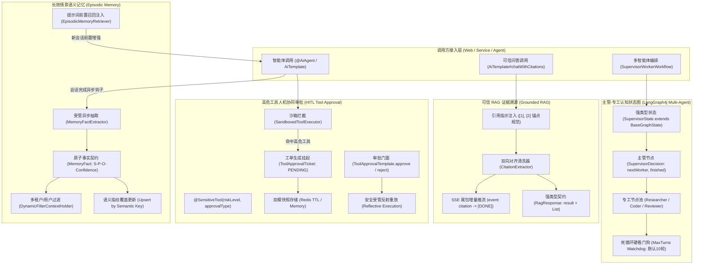

# ADR-0091: 工业级智能体自省、高危工具人机协作审批 (HITL)、主管专工状态图与长效情景记忆架构

- **状态**：`Accepted`
- **日期**：2026-11-06
- **作者**：Ateng
- **归属模块**：`ateng-boot-ai` / `ateng-boot-core` / `samples`
- **相关决策**：
  - [ADR-0002: 显式统一返回契约，严禁全局拦截包装](./0002-explicit-result-contract-no-response-body-advice.md)
  - [ADR-0010: 传输契约与持久层绝对解耦设计](./0010-transport-pagination-contract-decoupling.md)
  - [ADR-0011: 零重型外部依赖与上下文就近内聚工具集](./0011-zero-bloat-and-co-located-utilities.md)
  - [ADR-0012: 生命周期分离的数据安全体系：入库加密、出库明文与展示脱敏](./0012-lifecycle-separated-data-security.md)
  - [ADR-0021: 存量核心基线收敛与零冗余封版战略决策](./0021-core-baseline-convergence-and-zero-bloat-freeze-strategy.md)
  - [ADR-0025: 核心基础底座跨中间件解耦与通用原语下沉架构决策](./0025-core-module-expansion-and-future-proof-middleware-foundations.md)
  - [ADR-0026: 生产级基线加固与底层设施大一统架构决策](./0026-production-hardening-and-foundations-unification.md)
  - [ADR-0087: 基于 LangGraph4j 的认知状态图编排、双模检查点持久化与人机协作 (HITL) 恢复架构决策](./0087-langgraph4j-cognitive-stategraph-and-hitl-architecture.md)
  - [ADR-0088: 企业级 AI 全维可观测审计、SaaS 多租户切源与双模配额风控治理架构](./0088-enterprise-ai-observability-quota-governance-and-production-architecture.md)
  - [ADR-0090: 企业级 AI 知识库 RAG、双向安全护栏与物理流式取消加固架构](./0090-enterprise-ai-rag-guardrail-and-streaming-cancellation-architecture.md)

---

## 1. 背景与业务痛点 (Context & Problem Statement)

随着企业大语言模型应用从“信息问答助手”向“自主决策执行智能体（Autonomous Agents）”与“生产级智能体编排网络”纵深演进，单纯的单智能体提示词对话与同步函数调用已无法满足企业级严谨生产环境的要求，暴露出一系列致命痛点：

1. **高危动作缺乏人机协同管控，企业“不敢放权”**：
   传统 Agent 工具调用（Tool Calling / Function Calling）为全自动同步反射执行。当智能体调用具有副作用的高危写操作（如转账付款、删除数据库、批量发送营销邮件、更改核心系统配置）时，模型幻觉或对抗诱导可能导致灾难性后果。企业急需机制在模型发起高危调用时主动挂起、生成结构化工单并通知人工审批确认，审批通过后安全重放；
2. **多智能体协作缺乏严谨受控的状态机拓扑，容易陷入发散或死循环**：
   复杂业务（如智能投研、多角色需求评审、代码生成与多轮对抗审计）需要多个专职 Agent 协同。业界部分框架采用非结构化的松散广播或 P2P 聊天总线，缺乏确定性状态边界与终止条件，易引发 Token 无限空转与死循环漂移；
3. **长期记忆缺失，跨 Session 用户事实完全遗忘**：
   现有的 `ChatMemory` 仅服务于单个短会话窗口，一旦用户开启新 Session，历史完全丢失；简单将历史对话全量持久化又会导致 Prompt 膨胀、无关噪音堆叠与互相冲突的历史偏好干扰，缺乏原子化事实（`MemoryFact`）抽取、更新与跨会话按需注入机制；
4. **RAG 问答缺乏可信溯源证据链与显式引用强类型契约**：
   现有 RAG 仅返回生成的自由文本，无法向前端明确展示“第几句话来源于哪篇文档的哪一段切片”，导致用户无法校验回答真伪，无法满足企业合规审计与可解释性要求。

为此，`ateng-boot` 制定本 ADR，正式确立一套面向生产就绪的高危工具人机协作审批（HITL）、主管-专工认知状态图、长效情景语义记忆与 RAG 可信溯源引用的工业级架构体系。

---

## 2. 核心架构设计与决策矩阵 (Decisions & Architecture)

---

## 3. 核心设计契约与关键不变量 (Key Invariants & Technical Contracts)

### 3.1 声明式高危工具人机协作审批契约 (`@SensitiveTool` & `ToolApprovalTemplate`)
1. **声明式标记**：在受管工具方法上挂载 `@SensitiveTool(riskLevel = RiskLevel.HIGH, approvalType = "ORDER_REFUND", timeout = "PT30M")`；
2. **拦截挂起不变量**：大模型触发该工具时，`SandboxedToolExecutor` 拦截并生成带有全局唯一 ID 的工单 `ToolApprovalTicket`（记录工具全限定方法、反序列化参数、调用方四维上下文快照 `traceId`/`userId`/`tenantId`、生成时间与过期时间），状态置为 `PENDING`，向大模型返回结构化挂起提示（如 `[APPROVAL_REQUIRED:ticketId=xxx] 操作涉及高危权限，已生成审批工单，请等待人工审批`），阻断即时物理执行；
3. **自适应双模快照存储**：通过 `ToolApprovalStore` SPI 实现自适应存储。检测到 Redis 时基于 `StringRedisTemplate` 存储并挂载滑动 TTL（默认 30 分钟），物理超时自毁防内存泄漏；无 Redis 时无缝降级为单机并发安全内存存储；
4. **审批重放与因果闭环**：管理端通过 `ToolApprovalTemplate.approve(ticketId, comment)` 执行审批。框架校验工单状态与有效性，还原原调用上下文，通过反射安全重放执行真实方法，更新工单为 `APPROVED` 并记录执行结果与耗时；若调用 `reject(ticketId, reason)` 则置为 `REJECTED` 并抛弃执行。

### 3.2 基于 LangGraph4j 的主管-专工协作工作流 (`SupervisorWorkerWorkflow`)
1. **原生零依赖算力**：100% 依托模块现有的 `GraphWorkflow` 与 LangGraph4j 底座，严禁为了多 Agent 引入外部重型专有总线依赖；
2. **强类型状态契约**：拓扑状态统配 `SupervisorState`（继承 `BaseGraphState`），显式收敛 `taskObjective`、`currentPlan`、`nextWorker`、`workerResults`（历史专工产出结果集 Map）与 `turnCount`；
3. **结构化路由决策**：主管节点依托 `chatForObject` 输出强类型决策对象 `SupervisorDecision(nextWorker, instructions, isFinished)`，状态图基于条件边动态分流至专工节点；
4. **防死循环硬看门狗不变量**：在状态机跃迁卫语句中强置 `maxTurns`（默认 10 轮）。当轮次超过限制时，强制熔断跳转至终态 `FALLBACK_FINISH` 节点并记录告警日志，绝对杜绝模型发散无限空转。

### 3.3 跨 Session 长效情景语义记忆 (`EpisodicMemoryTemplate` & `MemoryFact`)
1. **短短期会话与长效事实双轨分离**：`ChatMemory` 专职负责单个短会话的消息滑动窗口与短期摘要；`EpisodicMemoryTemplate` 专职负责跨会话原子化事实（`MemoryFact`）的全生命周期治理；
2. **非阻塞异步提取**：在多轮对话请求完成后，通过受管异步线程池调度轻量模型提取 `List<MemoryFact>`（包含 `subject` 主体、`predicate` 谓词、`object` 客体、`confidence` 置信度），主调用线程零延迟；
3. **语义槽位去重覆写（Upsert by Semantic Key）**：按 `subject + ":" + predicate`（如 `user:preferred_language`）建立语义槽位。新事实提取后若命中已有槽位，直接更新事实内容与时间戳，彻底解决陈旧事实冲突问题；
4. **多租户与用户物理隔离**：持久化至向量库时强制携带 `tenant_id` 与 `user_id` 元数据；检索时联动 `DynamicFilterContextHolder` 自动复合下推过滤表达式，杜绝跨租户与越权脏读。

### 3.4 企业级 RAG 证据溯源引用 (`RagResponse` & `CitationExtractor`)
1. **强类型统一契约**：同步调用返回强类型 `RagResponse<T>`，包含回答正文 `result`、引用的结构化证据切片清单 `citations`（含引用索引、切片ID、文档名、引用文本片段、置信度）与可选的事实忠实度评分 `groundingScore`；
2. **确定性双向对齐与清洗**：`CitationExtractor` 基于正则与双向指针扫描模型生成的 `[N]` 标记，与召回的真实候选切片严格比对。超出合法范围的幻觉引用编号自动清洗剔除并记录 WARN 监控，保障前端绝对安全渲染；
3. **SSE 流式协议增量尾包**：流式推流（`stream` / `TokenStream`）时，打字机下发正文文本；在模型生成结束触发 `onComplete` 时，增量推送专属事件 `event: citation`（载荷为 `List<Citation>` JSON），最后发送 `[DONE]` 标识安全闭合连接。

---

## 4. 影响与收益评估 (Consequences & Trade-offs)

### 正向收益
- **企业生产合规落地**：彻底解决企业因担心大模型越权造成资金/数据损失的痛点，提供审计追踪与人工防线；
- **复杂任务高阶可控**：主管-专工模式将复杂任务分解为专业小 Agent，配合硬看门狗，兼顾了多模型协同能力与确定性执行安全；
- **真正的个性化与持续演进**：长期情景记忆让 AI 具备真正“认识并记住用户”的能力，跨会话体验大幅跃升；
- **RAG 可解释性与防幻觉**：强类型结构化引用使业务系统具备清晰的合规核验界面与溯源能力。

### 架构权衡
- 引入工单快照机制需要占用微量 Redis 内存，但通过 30 分钟强 TTL 自动淘汰机制彻底消除泄漏风险；
- 异步长效记忆提取消耗额外微量 Token，但通过轻量模型提示词与单日配额风控（`AiQuotaChecker`）实现了成本可控。
