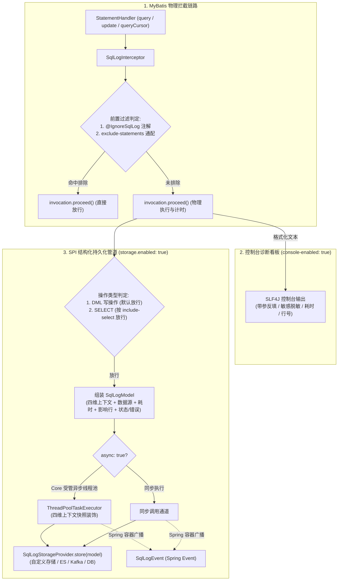

# 92. 物理 SQL 操作审计日志与 SPI 持久化架构决策 (SQL Operation Log & Storage SPI Architecture)

## 背景与痛点

在企业级微服务、金融合规监管与等保三级安全审计场景中，系统不仅需要针对 Web 请求层（如 `OperateLog`）进行审计，更需要在持久层对底层物理执行的 SQL 操作实施高保真审计溯源。此前框架在持久层存在以下生产痛点：

1. **物理 SQL 审计结构化流转缺失 (Lack of Structured SQL Telemetry)**：
   - 现有的 `SqlLogInterceptor` 仅面向控制台输出美化 ASCII 文本看板，未提取结构化元数据模型，无法直接对接下游日志汇聚中心（如 Elasticsearch、Kafka、ClickHouse 或企业专有审计库）；
2. **读写无差别记录易引发存储风暴 (Storage Explosion by Read Queries)**：
   - 物理 SQL 的执行频率通常是 Web 请求的数十倍，高频的只读查询（`SELECT`）若无差别持久化，会急剧膨胀下游存储，造成昂贵的存储浪费与性能拖累；
3. **高频执行与数据库长事务性能损耗 (High Frequency & Transaction Throughput Hazard)**：
   - SQL 拦截处于数据库物理事务（`@Transactional`）执行的核心链路。若持久化过程采用同步阻塞方式，外部网络抖动或存储延迟将直接延长数据库行锁与连接持有时间，甚至导致长事务与死锁；若 SPI 发生异常直接抛出，更会反噬业务事务引发非预期回滚；
4. **内部心跳与高频任务轮询污染审计库 (Noisy Internal Heartbeats & Job Polling)**：
   - 框架内部定时任务调度器（如 Snail Job、XXL-Job 轮询表）、数据库探活心跳（如 `SELECT 1`）执行极度频繁，若缺乏声明式与配置式双轨排除手段，极易淹没真实业务审计记录。

---

## 核心决策与架构内容

立足于纯原生、零臃肿依赖与生产级防灾铁律，`ateng-boot` 正式确立 **物理 SQL 操作审计日志与 SPI 持久化双轨架构**：



### 1. 一体化拦截升级与双轨分流 (Unified Interceptor & Dual Pipelines)
- 避免在 MyBatis 的 `StatementHandler` 上重复挂载两套几乎相同的 SQL 插件，将原有的 `SqlLogInterceptor` 一体化升级为“控制台诊断看板”与“结构化 SPI 存储持久化”双轨执行管道；
- 通过 `console-enabled` 与 `storage.enabled` 双开关实现物理隔离，支持生产环境关闭控制台控制台刷屏、仅静默派发结构化审计数据。

### 2. 默认 DML 写操作防爆过滤 (Default DML-Only Safety Invariant)
- 遵循生产防灾铁律，SPI 持久化管道**默认仅采集 DML 写操作**（`INSERT`、`UPDATE`、`DELETE`、`UPSERT`）；
- 只读查询（`SELECT`）默认跳过，通过配置开关 `storage.include-select=true` 满足等保合规全量审计诉求。

### 3. 跨层模型下沉与强类型契约 (Core Convergence & Strong Typing)
- 遵循 [ADR-0021](./0021-core-baseline-convergence-and-zero-bloat-freeze-strategy.md) 底座收敛铁律，将通用物理 SQL 审计元数据模型 [`SqlLogModel`](file:///d:/My/dev/ateng-boot/ateng-boot-core/src/main/java/io/github/atengk/boot/core/audit/SqlLogModel.java) 与强类型枚举 [`SqlTypeEnum`](file:///d:/My/dev/ateng-boot/ateng-boot-core/src/main/java/io/github/atengk/boot/core/enums/SqlTypeEnum.java) 下沉收敛至 `ateng-boot-core`；
- 模型包含 `traceId`、`tenantId`、`userId`、`userName`、`datasource`、`statementId`、`sql`、`sqlType`、`costTime`、`affectedRows`、`status`、`errorMsg`、`callLocation`、`operateTime` 与 `extra`，下游日志微服务无需依赖 MyBatis-Plus 即可直接反序列化。

### 4. 标准 SPI 契约与开箱即用保底 (SPI Contract & Out-of-the-Box Fallback)
- 提供 [`SqlLogStorageProvider`](file:///d:/My/dev/ateng-boot/ateng-boot-mybatis-plus/src/main/java/io/github/atengk/boot/mybatisplus/sqllog/SqlLogStorageProvider.java) 函数式 SPI 契约供业务接入；
- 当启用 `storage.enabled=true` 且下游未注册任何自定义 SPI Bean 时，自动装配 [`DefaultSqlLogStorageProvider`](file:///d:/My/dev/ateng-boot/ateng-boot-mybatis-plus/src/main/java/io/github/atengk/boot/mybatisplus/sqllog/DefaultSqlLogStorageProvider.java)，基于 SLF4J 打印标准紧凑 JSON 保底；
- 同步通过 Spring 原生事件总线发布 [`SqlLogEvent`](file:///d:/My/dev/ateng-boot/ateng-boot-mybatis-plus/src/main/java/io/github/atengk/boot/mybatisplus/sqllog/SqlLogEvent.java)，支持单体应用内基于 `@EventListener` 异步消费。

### 5. 受管异步调度与失败现场采集 (Managed Async Dispatch & Failure Telemetry)
- 默认接入 Core 受管异步线程池设施（`taskExecutorProvider`），携带 $\langle\text{MDC}, \text{User}, \text{TenantId}, \text{IgnoreTenant}\rangle$ 四维上下文快照跨线程透传；
- 派发逻辑由 `try-catch` 严密防护，SPI 异常受控捕获并记录 WARN，绝不影响数据库正常业务事务；
- 当物理 SQL 执行发生异常（如唯一索引冲突、死锁等）时，全真捕获 `status = 1` 与异常错误信息派发至 SPI，随后将原始异常原样向外抛出以保障事务正常回滚。

### 6. 细粒度过滤与多数据源动态感知 (Granular Exclusion & Dynamic Datasource)
- **代码级声明式防卫**：提供 [`@IgnoreSqlLog`](file:///d:/My/dev/ateng-boot/ateng-boot-mybatis-plus/src/main/java/io/github/atengk/boot/mybatisplus/annotation/IgnoreSqlLog.java) 注解，可标记于 Mapper 接口或方法，纳秒级缓存短路；
- **配置级全局通配防卫**：提供 `exclude-statements` 配置项，支持 Ant 风格通配排除特定 StatementId；
- **多数据源感知**：主动探测动态路由数据源上下文及活跃连接元数据，自动填充 `SqlLogModel.datasource` 标识。

---

## 配置规范示例

```yaml
ateng:
  boot:
    mybatis-plus:
      sql-log:
        enabled: true                     # 拦截器总开关
        console-enabled: true             # 是否在控制台输出 ASCII 诊断看板（默认 true）
        format-sql: true                  # 是否美化格式化 SQL（默认 true）
        mask-sensitive: true              # 是否脱敏敏感凭据与 @FieldEncrypt（默认 true）
        show-call-location: true          # 是否输出代码调用行号（默认 true）
        max-sql-length: 4096              # 控制台单条 SQL 截断上限（默认 4096 字符）
        exclude-statements:               # 全局排除的 StatementId 通配规则
          - "*.selectHeartbeat"
          - "io.github.atengk.boot.job.*"
        storage:
          enabled: false                  # 是否开启结构化 SPI 存储派发（默认 false，按需开启）
          include-select: false           # 是否包含只读 SELECT 查询（默认 false，防存储暴涨）
          async: true                     # 是否通过受管异步线程池派发（默认 true）
          max-sql-length: 8192            # 存储持久化时的 SQL 截断上限（默认 8192 字符）
```

---

## 关联与后续影响

1. **底座一致性**：与 Web 模块的 `OperateLog` 形成端到端的全链路审计双翼，`SqlLogModel` 统一在 `ateng-boot-core` 收敛；
2. **零侵入与兼容性**：完全向后兼容现有的控制台日志输出行为，保持默认关闭的防灾标准。
