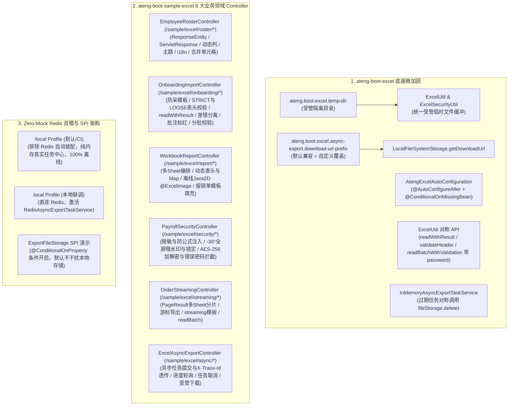

# 93. Excel 样例多控制器解耦、底座对称加固与双模自适应架构决策 (Excel Sample Multi-Controller, Production Hardening & Dual-Mode Adaptive Architecture)

## 背景与痛点

在 [ADR-0057](./0057-excel-multi-sheet-streaming-and-native-workbook-encryption-architecture.md) 中，框架确立了 `ateng-boot-excel` 的多 Sheet 异构流式编排、动态列投影裁剪、整工作簿 AES-256 加密与 Web 客户端防中断治理机制。然而随着框架演进至《工业级文档与样例工程标准规范》与全场景 Web 体验化阶段，原有实现与样例工程暴露出以下结构性痛点：

1. **单控制器收窄与场景体验缺失 (Single-Controller Bottleneck & Incomplete Coverage)**：
   - 原 `ADR-0057` 第 5 节规定样例工程仅保留极简 `ExcelWebContractController`（仅 3 个端点），导致导入防呆模板导出、表头契约校验、JSR-303 行级校错、差错数据隔离剥离、原表高亮标红批注回写、多 Sheet 联合读写、无实体动态导出、报销单模板填充、图片画册导出、公式注入防卫、全屏暗水印锁定、整工作簿 AES-256 加解密及海量流式游标等能力在 Web 接入层完全缺乏 HTTP 交互体验；
2. **测试桩残留与业务语义失真 (Test Mock Artifacts & Generic Data)**：
   - 样例工程中存留大量以 `Mock*` 为前缀或伪数据构造的工具类，未演进为贴合真实企业级中后台业务（员工花名册、新员工入职、部门考勤合并、费用报销填报、薪资发放防泄密、亿级对账单流式分片及异步账单中心）的业务模型；
3. **底座关键配置与加解密门面对称性缺口 (Facade Asymmetry & Unwired Managed Temp Dir)**：
   - `ExcelProperties.tempDir` 虽已声明，但在 `ExcelUtil.export(..., password)` 与 `ExcelSecurityUtil.encryptWorkbook` / `decryptWorkbookToTempFile` 中仍裸调用操作系统默认临时目录，未能被受管路径真正接管；
   - 异步导出下载链接硬编码了默认前缀，缺乏可配置的 `downloadUrlPrefix` 支撑定制业务下载路由；
   - `readWithResult`、`readBatchWithValidation` 与 `validateHeader` 缺乏带 `password` 的重载，导致带校错/表头预检解析加密 Excel 时破坏了门面的对称完备性；
4. **异步导出任务中心双模联调与清理对称性缺失 (Async Task Dual-Mode & Cleanup Asymmetry)**：
   - 异步导出缺乏对分布式 Redis 任务中心的双模自适应验证（离线 `!local` 与真实联调 `local`）；且内存实现清理过期任务时未对称回调 `ExportFileStorage#delete`，存在远端对象存储泄漏隐患。

---

## 核心决策与架构内容

立足于纯原生算力、零臃肿依赖与工业级代码成熟度九道防线，正式确立 **Excel 样例多控制器解耦、底座对称加固与双模自适应架构**：

### 1. 修订原 ADR-0057 第 5 节契约
- 正式废止原 `ADR-0057` 第 5 节关于将样例工程收缩为极简 `ExcelWebContractController`（3 个端点）的局部旧规；
- 依据《工业级文档与样例工程标准规范》，全面推行全模块 Web 体验化与多 Controller 领域分治架构，将 `ateng-boot-sample-excel` 拆解为 6 大高内聚 `@RestController`（统一路由 `/sample/excel/<feature>/<action>`，出参统配强类型 `Result<T>` 或流式响应）；
- 上传类接口配套提供样本文件生成端点，实现纯 `curl` 端到端自闭环。

### 2. Starter 零破坏性向后兼容微加固
1. **受管临时目录贯通**：`ExcelProperties.tempDir` 接入 `ExcelUtil.initProperties`，供 `ExcelUtil` 与 `ExcelSecurityUtil` 加解密缓冲安全创建临时文件；未配置时回退至系统临时目录，保留无配置静态调用与单测兼容性；
2. **下载前缀解耦**：`ExcelAsyncExportProperties` 增加 `downloadUrlPrefix`（默认锁定为 `"/api/excel/async-download?taskId="`），`LocalFileSystemStorage` 统一读取该配置项拼装下载链接；
3. **自动装配防卫**：`AtengExcelAutoConfiguration` 补充 `@AutoConfigureAfter` 显式对齐 Redis 与国际化装配时序，为初始化 Bean 挂载 `@ConditionalOnMissingBean`；
4. **水印角度与文档对齐**：统一修正 `ExcelWatermarkUtil` 与 `WatermarkSheetWriteHandler` Javadoc 默认旋转角为 `-30°`（并说明可配置重载）；
5. **对称解密读取重载**：为 `readWithResult`、`readBatchWithValidation` 与 `validateHeader` 增补纯增量 `password` 重载（复用 `ExcelSecurityUtil.decryptIfEncrypted` 与 `finally` 确定性回收）；
6. **过期存储对称清理**：`InMemoryAsyncExportTaskService#cleanExpiredTasks` 在删除本地记录时，若 `task.getStorageKey() != null` 同步触发 `fileStorage.delete(taskId, task.getStorageKey())`。

### 3. Zero-Mock Redis 双模自适应架构
- 在 `ateng-boot-sample-excel` 中引入 BOM 纳管的 `spring-boot-starter-data-redis`；
- 在默认 `!local` Profile 下，通过 `autoconfigure.exclude` 排除 Redis 自动装配并配置 `ateng.boot.excel.async-export.redis.enabled: false`，使得应用在默认态与 CI 环境中真实运行 `InMemoryAsyncExportTaskService`，零外部依赖、零 Mockito 生产污染；
- 在激活 `local` Profile 时，启用 Spring Data Redis 自动装配并连接本地中间件，自动无缝切换至分布式 `RedisAsyncExportTaskService`；
- 提供受 `@ConditionalOnProperty` 条件控制的自定义 `ExportFileStorage` SPI 演示组件，默认关闭以保持标准 `LocalFileSystemStorage` 生效。

---

## 权衡与收益考量 (Consequences)

### 正向收益
1. **真实可交互的开箱体验**：开发者启动样例后，可通过一组直观的 cURL 指令在 1 分钟内完成 Excel 核心特性（从普通导出到整文件 AES-256 加密与异步任务）的调用体验；
2. **消灭测试桩与生产契约对齐**：彻底移除魔术字符与通用测试模型，样例代码与 DTO/VO 直接作为企业级生产参考实现；
3. **强对称性与零资源泄漏**：临时文件受管落盘、过期任务远端文件回收与加解密透明重载，严守代码成熟度九道防线；
4. **双模测试 100% 绿灯守卫**：默认态纯离线通过全部单测与集成测试，同时支持开发者按需连接物理 Redis 验证分布式状态流转。

### 妥协与成本
1. **测试用例维护量增加**：由于将单控制器扩展为 6 大领域控制器，`SampleExcelIntegrationTest` 需全量维护针对 6 大控制器的 MockMvc 端到端断言；
2. **多 Sheet 与模板资产维护**：内置 `.xlsx` 报销模板作为类路径资源归档，需确保格式与占位符长期保持规范。

---

## 演进落地状态与交付审计 (Delivery & Verification Audit)

- **当前状态**：`Accepted (切片落地中)`
- **关联工单**：#785（Parent Spec）、#786（Slice 1）、#787（Slice 2）、#788（Slice 3）
- **前置修订追溯**：本决策全面演进并替代 [ADR-0057](./0057-excel-multi-sheet-streaming-and-native-workbook-encryption-architecture.md) 第 5 节。
