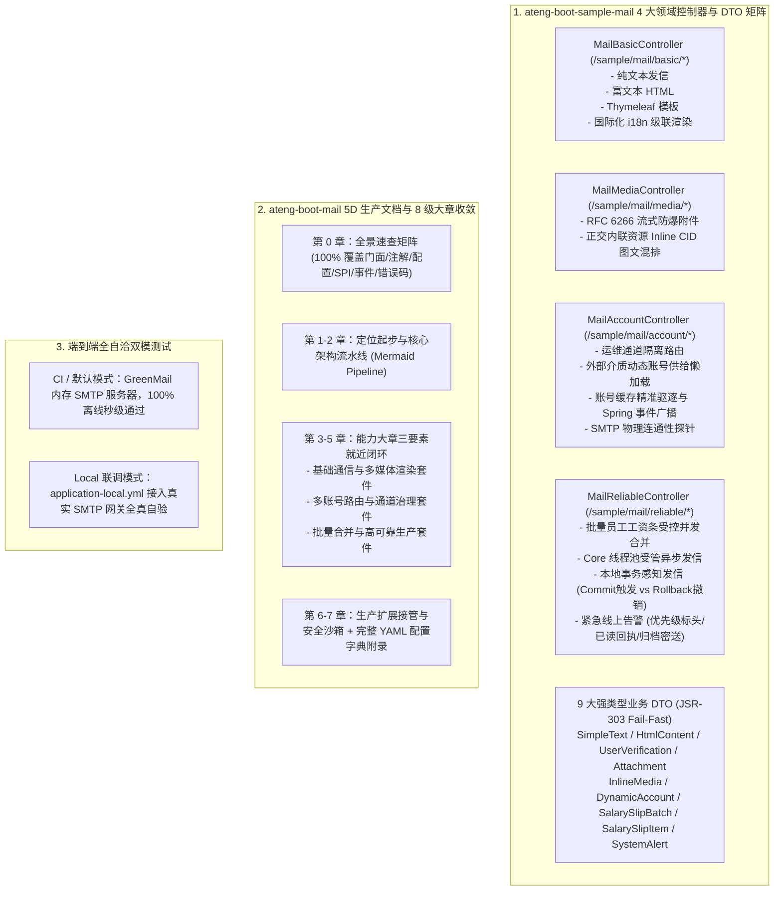

# 95. 邮件样例多控制器解耦、强类型 DTO 矩阵与生产级文档规范架构决策 (Mail Sample Multi-Controller, Typed DTO Matrix & Production Documentation Architecture)

## 背景与痛点

在 [ADR-0042](./0042-industrial-grade-asynchronous-mail-and-template-architecture.md) 与 [ADR-0069](./0069-mail-full-scenario-hardening-batch-merge-and-sandbox-governance-architecture.md) 中，框架确立了 `ateng-boot-mail` 的出站 SMTP 多账号动态路由、受管异步发信、本地事务感知发信（`sendAfterCommit`）、模板引擎国际化渲染、批量受控并发合并、多模测试安全沙箱与物理连通性探针机制。

然而随着框架演进至《工业级文档与样例工程标准规范》（`docs/agents/documentation-specification.md`）阶段，原有样例工程与技术文档暴露出以下结构性痛点：

1. **单体控制器职责杂糅与场景体验收窄 (Monolithic Controller & Incomplete Coverage)**：
   - 原样例仅提供单一胖控制器 `MailScenarioController`，将基础文本发信、运维通道路由、Thymeleaf 模板、异步发信、动态账号等场景强行揉合在一起；
   - 缺少对富文本 HTML、正交内联资源 (Inline CID)、员工工资条批量合并、事务提交与回滚对照、国际化级联变体、多账号缓存驱逐及紧急告警优先级标头的清晰隔离与 HTTP 交互体验。
2. **数据泥团与参数契约模糊 (Data Clumps & Permissive Signatures)**：
   - 依赖旧通用 DTO `SendMailRequest` 与 `BatchMailItemRequest`，入参存在空泛可选字段，破坏了边界契约的高内聚性与“第一道防线”JSR-303 格式强校验；
   - 批量发信入参未采用强类型模型与 `ValidList` 进行级联防卫，存在大批量长参数数据泥团隐患。
3. **技术文档未满足 5D 生产就绪标准 (Documentation Hierarchy & Co-location Deficit)**：
   - 原 `ateng-boot-mail/README.md` 仅包含 5 个章节，缺少统一的能力大章收敛；
   - 缺少宏观 Mermaid 消息生命周期流转图与编排流水线；
   - 特性小节缺乏“专属 YAML + 真实 Sample Java + 机制边界”三要素就近闭环，配置项分散在正文多处或文末；
   - 样例 README 混入长篇原理与方案设计，未落实标准的“四段式极简体验卡”。

---

## 核心决策与架构内容

立足于纯原生算力、零臃肿依赖与工业级代码成熟度九道防线，正式确立 **邮件样例多控制器解耦、强类型 DTO 矩阵与生产级文档规范架构**：

### 1. 样例工程领域解耦与多 Controller 矩阵
- 将样例工程拆解为 4 大高内聚 `@RestController`：
  - `MailBasicController` (`/sample/mail/basic`)
  - `MailMediaController` (`/sample/mail/media`)
  - `MailAccountController` (`/sample/mail/account`)
  - `MailReliableController` (`/sample/mail/reliable`)
- 严格遵循 `/sample/mail/<feature>/<action>` 语义化路由契约；
- 所有 Controller 边界严守 Zero-Entity-Leakage 铁律，入参收敛至 9 大专用 DTO，出参统一显式返回强类型 `Result<T>`。

### 2. 9 大强类型业务 DTO 矩阵与边界防卫
- 摒弃通用大一统请求模型，新增 `SimpleTextMailRequest`、`HtmlContentMailRequest`、`UserVerificationMailRequest`、`AttachmentMailRequest`、`InlineMediaMailRequest`、`DynamicAccountMailRequest`、`SalarySlipBatchRequest`、`SalarySlipItemRequest` 与 `SystemAlertMailRequest`；
- 入参全量挂载 JSR-303 注解（`@NotBlank`、`@Email`、`@Size`、`@Valid` 等），在 Controller 边界实现快速失败（Fail-Fast）。

### 3. Starter 文档 8 级大章收敛与三要素就近闭环
- Starter `README.md` 全面重构为 8 级大章骨架：
  - **第 0 章**：全景速查矩阵 100% 覆盖对外暴露的门面（`MailTemplate`、`DynamicMailSession`、`MailAccountRegistry`）、注解、SPI、领域事件与全量配置项；
  - **第 1-2 章**：模块定位、Maven 坐标及 Mermaid 消息构建与调度流转拓扑；
  - **第 3-5 章**：基础通信套件、多账号治理套件、批量合并与高可靠套件。各二级小节当前屏幕内闭环“专属 YAML + 真实 Sample Java + 机制边界”；
  - **第 6 章**：发信拦截器、失败补偿安全网、生命周期事件与多模安全沙箱生产接管；
  - **第 7 章**：全量 YAML 配置字典速查附录。
- Sample `README.md` 收敛为四段式极简体验卡（端口启动、双模切换、16 接口 cURL 体验矩阵、回归命令）。

### 4. 全自洽双模测试守护
- `SampleMailIntegrationTest` 依托内嵌 GreenMail 服务器与 MockMvc，编写 20 项端到端全真用例，离线自洽覆盖所有领域端点与异常分支；
- 保留 `SampleMailLocalRealIntegrationTest` 作为激活 `local` Profile 时的真实远程服务验证通道。

---

## 权衡与收益考量 (Consequences)

### 正向收益
1. **开发者体验与可读性质的飞跃**：开发者可在 1 分钟内通过直观的 cURL 表格体验邮件通信全场景，文档三要素闭环消除了在长篇文档中反复跳转寻找配置的痛苦；
2. **契约强健与边界防卫**：细粒度强类型 DTO 彻底消除了数据泥团与参数遗漏风险，第一道防线格式强校验避免非法入参穿透至底层 SMTP 协议栈；
3. **全自洽免外部依赖**：CI 流水线依托 GreenMail 秒级完成全真网络回归，彻底杜绝外部 SMTP 抖动引发的偶发构建失败；
4. **架构资产标准化**：完全满足全仓库 12 项准出自检清单，为后续中间件 Starter 的文档与样例改造树立标杆。

### 妥协与成本
1. **DTO 数量增加**：由原 2 个通用 DTO 扩容为 9 个高内聚专用 DTO，维护的代码资产文件数增加，但换来了绝对的模型解耦与类型安全；
2. **文档维护同步性要求高**：Starter 文档示例 100% 逆向提取自 Sample 工程，后续若修改底层 API 必须同步更新 Sample 与文档。

---

## 演进落地状态与交付审计 (Delivery & Verification Audit)

- **当前状态**：`Accepted`
- **关联工单**：#852（Parent Spec）、#853（Sample Controller & DTO Refactor）、#854（Sample 4-Section README）、#855（Starter 5D README & ADR）
- **前置决策演进**：本决策全面演进并深化了 [ADR-0042](./0042-industrial-grade-asynchronous-mail-and-template-architecture.md) 与 [ADR-0069](./0069-mail-full-scenario-hardening-batch-merge-and-sandbox-governance-architecture.md)。
