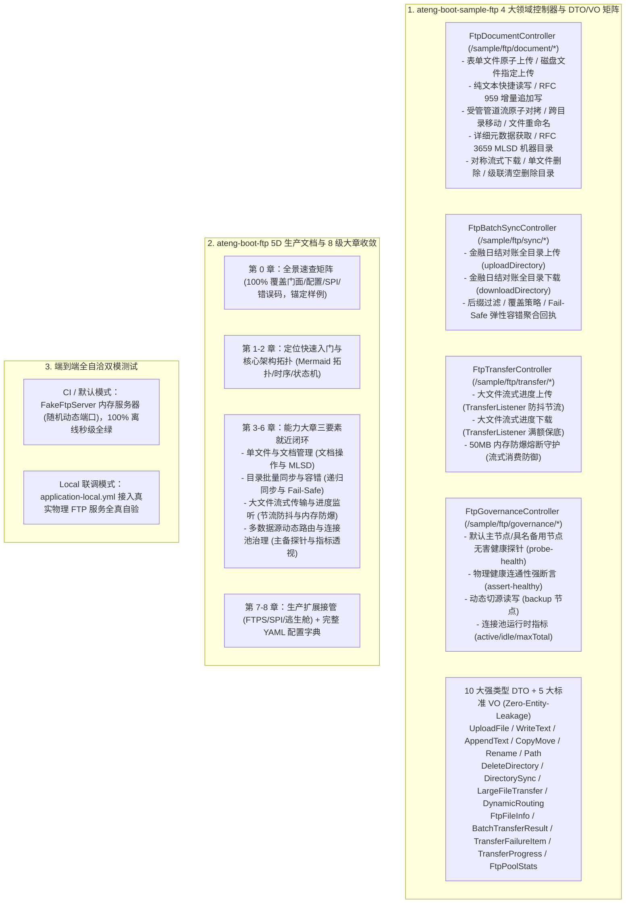

# 96. FTP 样例多控制器解耦、强类型 DTO 矩阵与 5D 生产文档规范架构决策 (FTP Sample Multi-Controller, Typed DTO Matrix & 5D Production Documentation Architecture)

## 背景与痛点

在 [ADR-0043](./0043-ftp-and-ftps-connection-pooling-and-resilient-client-architecture.md) 与 [ADR-0070](./0070-ftp-full-scenario-hardening-directory-sync-and-progress-monitoring-architecture.md) 中，框架确立了 `ateng-boot-ftp` 基于 Apache Commons Net 与 Commons Pool2 的连接池化底座、RFC 2640 编码防乱码、原子临时上传与路径防穿越、全目录递归同步、流式进度平滑监听以及物理连通性自验探针机制。

然而随着框架演进至《工业级文档与样例工程标准规范》（`docs/agents/documentation-specification.md`）阶段，原有样例工程与技术文档暴露出以下结构性痛点：

1. **样例去 Web 化过度与交互体验收窄 (Over-Purification & Incomplete Experience)**：
   - 在早期 ADR-0070 的“样例纯净化”决策中，样例工程完全剥离了 Web 控制器，仅保留了无外部交互入口的后台场景服务（`ScenarioService`）；
   - 开发者无法在启动后通过标准的 HTTP 请求或 cURL 体验 FTP 核心能力（单文件生命周期、整目录批处理、大文件流式传输与动态多源路由），无法满足现行标准规范对 Sample 工程“开箱即用、一分钟 cURL 闭环”的体验要求。
2. **缺乏强类型契约与边界防卫缺失 (Lack of Typed DTO Matrix & Boundary Defense)**：
   - 原后台场景服务直接使用散落的方法传参，缺少面向 RESTful 接入边界的强类型 DTO/VO 矩阵；
   - 无法借助 JSR-303 实现“第一道防线”Fail-Fast 参数校验（如远程路径非空、递归层级限制、并发阈值防爆等）。
3. **技术文档未满足 5D 生产就绪标准 (Documentation Hierarchy & Co-location Deficit)**：
   - 原 `ateng-boot-ftp/README.md` 缺少全景速查矩阵对对外 API、配置、SPI 与错误码的 100% 覆盖与样例代码锚定；
   - 缺乏宏观 Mermaid 架构拓扑图、双重 CWD 复位时序图与原子上传状态机图表；
   - 特性小节缺乏“专属 YAML + 真实 Sample Java + 机制边界”三要素就近闭环，配置项与代码分散割裂；
   - Sample README 未采用标准的“四段式极简体验卡”。

---

## 核心决策与架构内容

立足于纯原生算力、零臃肿依赖与工业级代码成熟度九道防线，正式确立 **FTP 样例多控制器解耦、强类型 DTO 矩阵与 5D 生产文档规范架构**：

### 1. 样例工程 Web 化与 4 大高内聚领域控制器
- 引入 `ateng-boot-web` 基础设施，解耦为 4 大业务领域 `@RestController`：
  - `FtpDocumentController` (`/sample/ftp/document/*`)：覆盖单文件全生命周期操作与元数据检索；
  - `FtpBatchSyncController` (`/sample/ftp/sync/*`)：覆盖多层级目录递归批量同步与弹性容错聚合；
  - `FtpTransferController` (`/sample/ftp/transfer/*`)：覆盖大文件流式传输、防抖节流进度监听与内存防爆守卫；
  - `FtpGovernanceController` (`/sample/ftp/governance/*`)：覆盖主备连通性探针、动态切源与连接池运行时治理。
- 严格遵循 `/sample/ftp/<domain>/<action>` 统一 REST 路由规范；
- 遵循 Zero-Entity-Leakage 契约，入参全部采用专用强类型 DTO，出参统一显式返回强类型 `Result<T>`。

### 2. 10 大强类型 DTO 与 5 大业务 VO 矩阵
- 入参建立细粒度强类型 DTO 矩阵：
  - `UploadFileRequest`、`WriteTextRequest`、`AppendTextRequest`、`CopyMoveRequest`、`RenameRequest`、`PathRequest`、`DeleteDirectoryRequest`、`DirectorySyncRequest`、`LargeFileTransferRequest`、`DynamicRoutingRequest`；
  - 全量字段挂载 JSR-303 注解（`@NotBlank`、`@NotNull`、`@Min`、`@Max`、`@Size` 等），实现传输边界第一道防线 Fail-Fast。
- 出参提供语义化业务 VO：
  - `FtpFileInfoVO`、`BatchTransferResultVO`、`TransferFailureItemVO`、`TransferProgressVO`、`FtpPoolStatsVO`；
  - 彻底杜绝底层 Apache Commons Net 原生 `FTPFile` 或受管内部连接对象泄漏至网络层。

### 3. Starter 文档 8 级大章收敛与三要素就近闭环
- 重构 `ateng-boot-ftp/README.md` 为 8 级大章骨架：
  - **第 0 章 全景速查矩阵**：100% 覆盖核心门面（`FtpTemplate`）、配置前缀（`ateng.boot.ftp.*`）、扩展 SPI（`FtpClientCustomizer`、`FtpKeyStrategy`）与业务错误码（`FTP_CONNECTION_ERROR`、`FTP_FILE_NOT_FOUND`、`FTP_PATH_TRAVERSAL`、`FTP_TRANSFER_TIMEOUT` 等），逐项锚定样例控制器与测试用例；
  - **第 1-2 章 定位与架构不变量**：提供极简起步配置，集成 Mermaid 架构拓扑图、双重 CWD 复位时序图（借出与归还双重 `cwd("/")` 复位）与原子上传状态机（写入 `.tmp` $\to$ 流完整闭合 $\to$ 原子 `rename` $\to$ 异常补偿独立清理）；
  - **第 3-6 章 能力领域大章**：各能力领域独立成章，同屏就近闭环“专属 YAML + 真实 Sample Java + 机制边界防坑”；
  - **第 7-8 章 生产扩展与全量配置字典**：FTPS 安全加密、自定义 SPI、`execute` 逃生通道、路径穿越过滤与全量配置字典表。
- 重构 Sample `README.md` 为标准 **四段式极简体验卡**（端口启动、双模测试、24 项 cURL 体验矩阵、端到端回归命令）。

### 4. 端到端全自洽双模测试守护
- 编写 `SampleFtpWebIntegrationTest`，基于 Spring MockMvc 与内嵌 `FakeFtpServer`（动态端口分配与 `@DynamicPropertySource` 动态绑定），覆盖 4 大控制器 24 个端点的全真 HTTP 交互，确保 CI 离线自洽 100% 全绿；
- 保留 `application-local.example.yml` 模板，支持通过真实物理 FTP 服务进行联调与压力验证。

---

## 权衡与收益考量 (Consequences)

### 正向收益
1. **交互体验与上手效率质的飞跃**：开发者可在 1 分钟内通过 24 条开箱即用的 cURL 命令直接验证 FTP 文件操作、批量同步、大文件传输与多节点切换，学习与排查成本极低；
2. **契约强健与边界防卫完备**：10 大专用强类型 DTO 矩阵杜绝了长参数与数据泥团隐患，JSR-303 格式校验在接入层直接拦截非法路径与越界数值，彻底保护底层 FTP 协议栈；
3. **架构资产标准化**：完全满足全仓库 12 项准出自检清单与 5D 文档标准，统一了全工程 Starter/Sample 的交互体验模式；
4. **CI 稳定零抖动**：测试套件基于 `FakeFtpServer` 随机动态端口，并发执行互不干扰，100% 离线秒级全绿。

### 妥协与成本
1. **模型资产数量增加**：新增 10 个 DTO 与 5 个 VO 类文件，工程资产数增加，但换来了绝对的架构清晰度与类型安全；
2. **样例依赖增加**：Sample 引入了 `ateng-boot-web` 依赖，但在 `-DskipSamples` 与 `<maven.deploy.skip>true</maven.deploy.skip>` 隔离策略守护下，绝不影响 Starter 本身的纯净轻量。

---

## 演进落地状态与交付审计 (Delivery & Verification Audit)

- **当前状态**：`Accepted`
- **关联工单**：#856（Parent Spec）、#857（Sample Web Controller & DTO/VO Matrix）、#858（Starter 5D README & Sample 4-Section Card）、#859（ADR-0096 & Domain Glossary）
- **前置决策演进 (Superseding Note)**：本决策全面演进并深化了 [ADR-0043](./0043-ftp-and-ftps-connection-pooling-and-resilient-client-architecture.md) 与 [ADR-0070](./0070-ftp-full-scenario-hardening-directory-sync-and-progress-monitoring-architecture.md)。原 ADR-0070 中关于“移除 Sample Web Controller、重构为纯后台 ScenarioService”的样例形态决策，正式由本 ADR 与《工业级文档与样例工程标准规范》（`docs/agents/documentation-specification.md`）取代。
