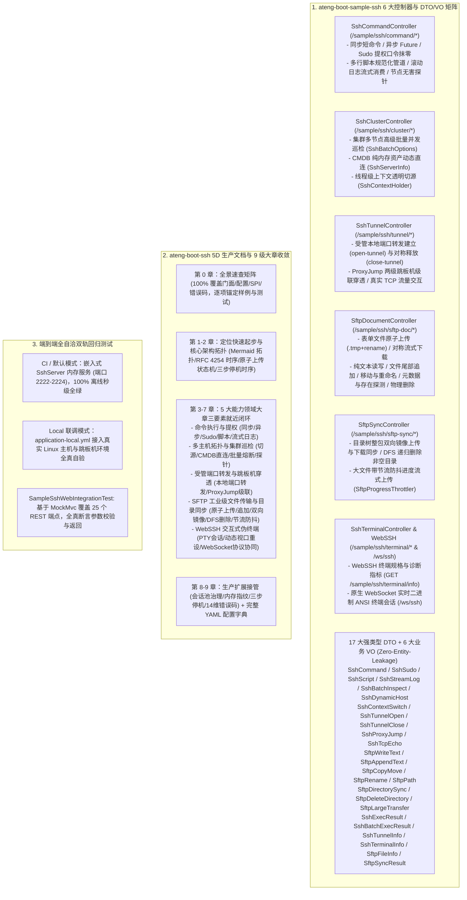

# 97. SSH 样例多控制器解耦、强类型 DTO 矩阵与 5D 生产文档规范架构决策 (SSH Sample Multi-Controller, Typed DTO Matrix & 5D Production Documentation Architecture)

## 背景与痛点

在 [ADR-0044](./0044-ssh-and-sftp-remote-governance-architecture.md) 与 [ADR-0071](./0071-ssh-and-sftp-full-scenario-hardening-and-governance-architecture.md) 中，框架确立了 `ateng-boot-ssh` 基于 Apache MINA SSHD 的异步 NIO 双模底座，实现了长连接池化复用（`SshSessionPool`）、原生 Sudo 提权安全管道与口令内存抹零、RFC 4254 孤儿进程超时信号防卫、集群多节点并发受控巡检（`SshBatchOptions` / `SshBatchExecResult`）、受管本地端口转发（`SshTunnelHandle`）、ProxyJump 两级跳板机穿透、SFTP 原子上传与高频节流防抖（`SftpProgressThrottler`）、DFS 递归删除非空目录树，以及 WebSSH 交互式伪终端会话（`SshShellHandle`）。

然而随着框架演进至《工业级文档与样例工程标准规范》（`docs/agents/documentation-specification.md`）阶段，原有样例工程与技术文档暴露出以下结构性痛点：

1. **样例去 Web 化过度与交互体验断层 (Over-Purification & Experience Disconnect)**：
   - 在早期 ADR-0071 的“样例纯净化”决策中，样例工程移除了 Web 控制器，仅保留后台场景服务（`SshScenarioService` 与 `SftpScenarioService`）与孤立的 WebSocket 终端端点；
   - 开发者无法在启动后通过标准的 HTTP 请求或 cURL 快速体验 SSH 命令执行、提权、集群巡检、隧道转发、SFTP 文件生命周期与目录镜像同步，无法满足现行标准规范对 Sample 工程“开箱即用、一分钟 cURL 闭环”的体验要求；文档中遗留的旧版 `/api/ssh/*` 路由未被真实代码承载，存在虚构契约隐患。
2. **缺乏强类型契约与边界防卫缺失 (Lack of Typed DTO Matrix & Boundary Defense)**：
   - 原后台场景服务直接采用散落的基础类型传参，缺少面向 RESTful 接入边界的强类型 DTO/VO 矩阵；
   - 无法借助 JSR-303 实现“第一道防线”Fail-Fast 参数校验（如远程路径非空、并发度有界约束、端口有效性探测、口令非空等），且存在潜在的内部对象直接泄露风险。
3. **技术文档未满足 5D 生产就绪标准 (Documentation Hierarchy & Co-location Deficit)**：
   - 原 `ateng-boot-ssh/README.md` 缺少全景速查矩阵对对外 API、配置、SPI 与错误码的 100% 覆盖与样例代码锚定；
   - 缺乏宏观 Mermaid 架构拓扑图、RFC 4254 孤儿进程信号防卫时序图、SFTP 原子上传状态机与确定性三步优雅停机时序图；
   - 特性小节缺乏“专属 YAML + 真实 Sample Java + 机制边界”三要素就近闭环，配置项与代码分散割裂；
   - Sample README 未采用标准的“四段式极简体验卡”。

---

## 核心决策与架构内容

立足于纯原生算力、零臃肿依赖与工业级代码成熟度九道防线，正式确立 **SSH 样例多控制器解耦、强类型 DTO 矩阵与 5D 生产文档规范架构**：

### 1. 样例工程 Web 化与 5 大高内聚领域控制器 + 终端诊断
- 引入 `ateng-boot-web` 基础设施，按业务能力领域拆分为 5 大领域 `@RestController` 与 1 个 WebSSH 终端诊断接口：
  - `SshCommandController` (`/sample/ssh/command/*`)：覆盖单机同步/异步命令、原生 Sudo 提权安全管道、多行脚本规范化、滚动日志按行流式消费与无害健康探针；
  - `SshClusterController` (`/sample/ssh/cluster/*`)：覆盖多节点高级受控批量巡检、CMDB 纯内存资产直连与线程级上下文动态切源；
  - `SshTunnelController` (`/sample/ssh/tunnel/*`)：覆盖受管本地端口转发开启与对称释放、ProxyJump 两级跳板机级联穿透与端到端 TCP 流量透传；
  - `SftpDocumentController` (`/sample/ssh/sftp-doc/*`)：覆盖表单文件原子上传、流式下载、纯文本配置读写、文件尾部增量追加、跨目录移动、原地重命名、元数据查询与单文件物理删除；
  - `SftpSyncController` (`/sample/ssh/sftp-sync/*`)：覆盖目录树整包双向镜像上传与下载同步、DFS 深度优先递归清空删除非空目录，以及大文件流式传输进度节流防抖；
  - `SshTerminalController` (`/sample/ssh/terminal/info`)：提供 WebSSH 终端规格与诊断指标，与底层 `/ws/ssh` WebSocket 实时二进制 ANSI 终端会话流正交互补。
- 严格遵循 `/sample/ssh/<domain>/<action>` 统一 REST 路由规范；
- 遵循 Zero-Entity-Leakage 契约，入参全部采用专用强类型 DTO，出参统一显式返回强类型 `Result<T>`。

### 2. 17 大强类型 DTO 与 6 大业务 VO 矩阵
- 入参建立细粒度强类型 DTO 矩阵：
  - `SshCommandRequest`、`SshSudoRequest`、`SshScriptRequest`、`SshStreamLogRequest`、`SshBatchInspectRequest`、`SshDynamicHostRequest`、`SshContextSwitchRequest`、`SshTunnelOpenRequest`、`SshTunnelCloseRequest`、`SshProxyJumpRequest`、`SshTcpEchoRequest`、`SftpWriteTextRequest`、`SftpAppendTextRequest`、`SftpCopyMoveRequest`、`SftpRenameRequest`、`SftpPathRequest`、`SftpDirectorySyncRequest`、`SftpDeleteDirectoryRequest`、`SftpLargeTransferRequest`；
  - 全量字段挂载 JSR-303 注解（`@NotBlank`、`@NotNull`、`@Min`、`@Max` 等），实现传输边界第一道防线 Fail-Fast。
- 出参提供语义化业务 VO：
  - `SshExecResultVO`、`SshBatchExecResultVO`、`SshTunnelInfoVO`、`SshTerminalInfoVO`、`SftpFileInfoVO`、`SftpSyncResultVO`；
  - 彻底杜绝底层 Apache MINA SSHD 原生 `ClientSession`、`Channel` 或持久层实体泄露至网络层。

### 3. Starter 文档 9 级大章收敛与三要素就近闭环
- 重构 `ateng-boot-ssh/README.md` 为 9 级大章骨架：
  - **第 0 章 全景速查矩阵**：100% 覆盖核心门面（`SshTemplate`、`SftpTemplate`、`SshTunnelHandle`、`SshShellHandle`、`SshContextHolder`、`SshClientRegistry` 等）、配置项（`ateng.boot.ssh.*`）、扩展 SPI 与 14 维错误码（`56001`~`56014`），逐项精准锚定样例控制器与测试用例；
  - **第 1-2 章 定位与架构不变量**：提供极简起步配置，集成 Mermaid 异步分层拓扑图、RFC 4254 孤儿进程超时信号防卫时序图（TERM -> INT -> 强制销毁）、SFTP 原子上传状态机（`.uploading.tmp` + `rename` + 异常补偿物理清理）与确定性三步优雅停机时序图（1. 终端/隧道 -> 2. 池化会话 -> 3. MINA NIO 内核）；
  - **第 3-7 章 5 大能力领域大章**：各能力领域独立成章，同屏就近闭环“专属 YAML + 真实 Sample Java + 机制边界防坑”；
  - **第 8-9 章 生产扩展接管与全量配置字典**：会话池治理、云原生纯内存主机指纹校验（只读容器适配）、三步停机、因果异常体系与全量配置字典表。
- 重构 Sample `README.md` 为标准 **四段式极简体验卡**（端口启动、双模测试、29 项 cURL 体验矩阵、端到端回归命令）。

### 4. 端到端全自洽双轨回归测试守护
- 保持原有的底层场景测试 `SampleSshIntegrationTest` 专注于验证协议层与长连接；
- 新增 `SampleSshWebIntegrationTest`，基于 Spring MockMvc 与嵌入式 `EmbeddedSshTestConfig` 内存服务器，覆盖 25 个 REST 端点的全真 HTTP 交互（Happy Path、参数边界校验、异常拦截），确保 CI 离线自洽 100% 全绿；
- 保留 `application-local.example.yml` 模板，支持通过真实 Linux 主机与跳板机网络进行联调与压力自验。

---

## 权衡与收益考量 (Consequences)

### 正向收益
1. **交互体验与上手效率质的飞跃**：开发者可在 1 分钟内通过 29 条开箱即用的 cURL 命令直接体验命令执行、Sudo 提权、批量巡检、端口转发、跳板机穿透、SFTP 文档存取、目录整包同步与终端诊断，彻底告别旧版无 HTTP 入口与虚构 `/api/ssh/*` 路由的尴尬；
2. **契约强健与边界防卫完备**：17 大专用强类型 DTO 矩阵杜绝了数据泥团，JSR-303 格式校验在接入层直接拦截非法参数，6 大出参 VO 严格阻断底层 SDK 连接泄露，实现彻底的模型解耦；
3. **架构资产标准化**：完全满足全仓库 12 项准出自检清单与 5D 文档标准，统一了全工程 Starter/Sample 的交互体验模式；
4. **CI 稳定零抖动**：测试套件基于嵌入式内存 SSH 服务端，秒级执行完成，100% 离线自洽。

### 妥协与成本
1. **模型资产数量增加**：新增 17 个 DTO 与 6 个 VO 类文件，工程类数量增加，但换来了绝对的架构清晰度与类型安全；
2. **样例依赖增加**：Sample 引入了 `ateng-boot-web` 依赖，但在 `-DskipSamples` 与 `<maven.deploy.skip>true</maven.deploy.skip>` 隔离策略守护下，绝不影响 Starter 本身的纯净轻量。

---

## 演进落地状态与交付审计 (Delivery & Verification Audit)

- **当前状态**：`Accepted`
- **关联工单**：#860（Parent Spec）、#861（Sample Web Controller & DTO/VO Matrix）、#862（Starter 5D README & Sample 4-Section Card）、#863（ADR-0097 & Domain Glossary）
- **前置决策演进 (Superseding Note)**：本决策全面演进并深化了 [ADR-0044](./0044-ssh-and-sftp-remote-governance-architecture.md) 与 [ADR-0071](./0071-ssh-and-sftp-full-scenario-hardening-and-governance-architecture.md)。原 ADR-0071 中关于“移除 Sample Web Controller、重构为纯后台 ScenarioService”的样例形态决策，正式由本 ADR 与《工业级文档与样例工程标准规范》（`docs/agents/documentation-specification.md`）取代。
