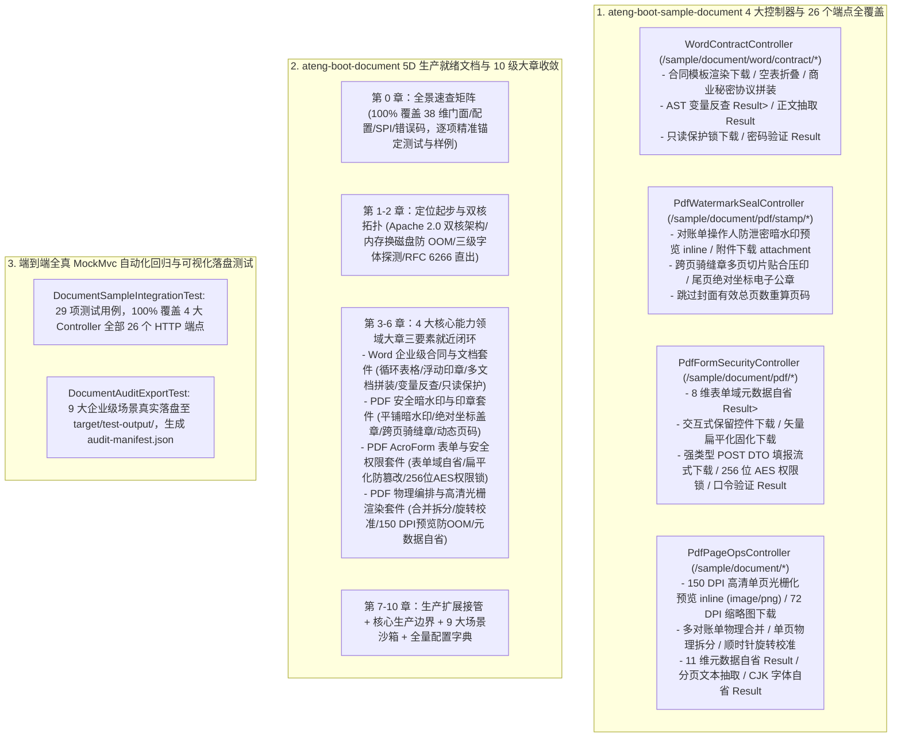

# 98. Office/PDF 文档治理样例工程多控制器领域解耦与 5D 规范重塑架构 (Document Sample Multi-Controller Domain Decoupling, Web Regression & 5D Documentation Architecture)

## 背景与痛点

在 [ADR-0046](./0046-enterprise-word-template-and-pdf-governance-architecture.md) 与 [ADR-0073](./0073-word-template-and-pdf-full-scenario-hardening-and-visual-audit-architecture.md) 中，框架确立了 `ateng-boot-document` 基于 `poi-tl` 与 Apache PDFBox 3.x 的纯 Apache 2.0 商业合规双核底座，实现了 Word 动态表格多行循环与跨行跨列合并、OpenXML `CTAnchor` 浮动印章嵌入、多文档物理无缝连续拼装、Word 占位符 AST 变量反查与正文纯文本抽取、PDF 平铺防泄密暗水印（宏变量解析与手机号脱敏）、绝对物理坐标盖章、多页跨页骑缝章无损切片（保留 Alpha 通道）、动态页码跳过封面重算、256 位 AES 权限锁加密解密、AcroForm 动态表单填报与矢量扁平化不可逆防篡改、150 DPI 高清单页光栅化预览（防 OOM 显存释放）、11 维核心元数据自省，以及 CJK 中文字体云原生容器三级弹性探测。

然而，对照《工业级文档与样例工程标准规范》（`docs/agents/documentation-specification.md`），既有样例工程与技术文档暴露出以下结构性缺陷与架构断层：

1. **单体控制器收窄与场景体验严重缺失 (Single-Controller Bottleneck & Incomplete Coverage)**：
   - 历史 `ateng-boot-sample-document` 仅包含一个极度收窄的单体控制器 `DocumentExportController`，仅暴露出 4 个基础文件导出接口；
   - 路由采用了非标的 `/document/*` 前缀，严重违背规范统一遵循的 `/sample/<module>/<feature>/<action>` 语义化路由契约；
   - Starter 核心能力（如 Word 模板 AST 变量反查、正文纯文本抽取、只读保护锁验证、PDF 8 维表单域元数据自省、绝对物理坐标盖章、跨页骑缝章切片压印、多 PDF 物理合并与拆分、顺时针旋转校准、150 DPI 高清单页光栅化图片预览，以及 CJK 中文字体云原生探测诊断状态）在 Web 接入层完全缺乏可交互的 HTTP 端点。
2. **出参契约单一，缺乏元数据结构化返回 (Lack of Structured `Result<T>` Contracts)**：
   - 旧版接口出参均为 `void`（向 `HttpServletResponse` 直接写入二进制文件流），完全缺乏返回强类型 `Result<T>` 的自省与管理类接口，违背了 ADR-0002 显式契约原则。
3. **样例配置悬挂与幽灵键名 (Configuration Misalignment & Phantom Keys)**：
   - 样例工程 `application.yml` 中，`in-memory-threshold` 与 `watermark` 属性被错误缩进在 `pdf:` 节点之下，导致配置项与 `DocumentProperties` 根属性脱节；同时残留幽灵键名 `word.auto-detect-fields: true`（源码中不存在该字段）。
4. **技术文档未满足 5D 生产就绪标准 (Documentation Hierarchy & Co-location Deficit)**：
   - Starter `README.md` 正文将示例平铺在 2.2 节的“五板斧”中，违背了“能力领域大章收敛架构”；特性小节缺乏同屏闭环“专属 YAML + 真实 Sample Java + 机制边界说明”三要素；文末缺失全量 YAML 配置字典；
   - 样例工程 `README.md` 仅 28 行，缺少标准的“四段式极简体验卡”与一键 cURL 体验矩阵。

---

## 核心决策与架构内容

立足于纯原生算力、零臃肿依赖与工业级代码成熟度九道防线，正式确立 **Office/PDF 文档治理样例工程多控制器领域解耦与 5D 规范重塑架构**：

### 1. 样例工程 Web 化与 4 大高内聚领域控制器
- 彻底取缔历史单体 `DocumentExportController`，按业务领域拆分为 4 大高内聚 `@RestController`：
  1. `WordContractController` (`/sample/document/word/contract/*`，7 个端点)：覆盖合同模板渲染、空数据动态表格优雅折叠、多文档物理无缝拼装、模板 AST 变量反查（`Result<List<String>>`）、正文纯文本抽取（`Result<String>`）、只读保护加密下载与口令校验（`Result<Boolean>`）；
  2. `PdfWatermarkSealController` (`/sample/document/pdf/stamp/*`，5 个端点)：覆盖操作人倾斜平铺防泄密暗水印在线预览（`inline`）与附件下载（`attachment`）、跨页骑缝章无损切片贴合压印、尾页绝对坐标电子印章压印与跳过封面页码重算；
  3. `PdfFormSecurityController` (`/sample/document/pdf/*`，6 个端点)：覆盖 AcroForm 8 维表单域元数据自省（`Result<List<PdfFormFieldDescriptor>>`）、交互式控件保留下载、矢量扁平化固化不可逆防篡改下载、强类型 POST DTO 填报流式下载、256 位 AES 权限锁受控加密下载与口令验证（`Result<Boolean>`）；
  4. `PdfPageOpsController` (`/sample/document/*`，8 个端点)：覆盖 150 DPI 高清单页光栅化预览流直出（`inline`，`image/png`）、缩略图附件下载（`attachment`，`image/png`）、多文档物理无损合并、单页物理切片、页面顺时针旋转、11 维核心元数据结构化自省（`Result<PdfMetadata>`）、起止范围纯文本抽取（`Result<String>`）以及 CJK 中文字体云原生探测诊断状态（`Result<ResolvedFont>`）。
- 严格遵循 `/sample/document/<feature>/<action>` 统一 RESTful 语义化路由契约；
- 遵循 Zero-Entity-Leakage 契约，入参使用 DTO/Request，非流式自省接口 100% 显式返回强类型 `Result<T>`。

### 2. 样例配置卫生度治理与幽灵键清理
- 彻底修正 `application.yml` 缩进缺陷：将 `in-memory-threshold: 10MB` 与 `watermark` 节点提升至 `ateng.boot.document` 根节点下，与 `DocumentProperties` 源码属性强类型绑定；
- 彻底清除源码不存在的幽灵配置项 `ateng.boot.document.word.auto-detect-fields`，杜绝认知误导。

### 3. Starter 文档 10 级能力领域大章收敛与三要素就近闭环
- 重塑 `ateng-boot-document/README.md` 为 10 级能力领域大章骨架：
  - **第 0 章 全景速查矩阵**：100% 覆盖核心门面（`WordTemplate`、`PdfTemplate`、`WordWebUtil`、`PdfWebUtil`、`DocumentFontResolver`、`DocumentConverter` SPI 等）、配置项（`ateng.boot.document.*`）与错误码（`57000`~`57007`），逐项精准锚定测试与样例代码源头；
  - **第 1-2 章 定位与核心架构拓扑**：提供极简起步配置，阐明纯 Apache 2.0 商业合规双核拓扑、内存-磁盘分级防爆缓冲机制、CJK 字体三级阶梯探测与 RFC 6266 / RFC 5987 浏览器防乱码标头；
  - **第 3-6 章 4 大核心能力领域大章**：同屏就近闭环“专属 YAML + 真实 Sample Java + 机制边界说明”三要素；
  - **第 7-10 章 生产扩展接管、非功能语义、9 大场景沙箱与全量配置字典**。
- 重构 Sample `README.md` 为标准 **四段式极简体验卡**（端口启动、双模环境说明、26 项完整 cURL 体验矩阵、端到端自动化回归命令）。

### 4. 全量端到端 MockMvc 自动化回归测试守护
- `DocumentSampleIntegrationTest` 覆盖全部 4 大 Controller 的 26 个 HTTP 端点，全真断言 HTTP 200、Content-Type（`application/pdf`、`application/vnd.openxmlformats-officedocument.wordprocessingml.document`、`image/png`、`application/json`）、RFC 6266 标头，并通过 POI/PDFBox 解包验证内容；
- 保持 `DocumentAuditExportTest` 9 大企业级场景真实落盘测试全绿，持续生成 `audit-manifest.json` 与控制台 ASCII 直达表格。

---

## 后果与权衡 (Consequences)

### 正向收益 (Positive Gains)
1. **开发者体验飞跃**：开发者启动 Sample 后，可通过 26 条开箱即用的 cURL 命令快速体验 Starter 包含的全部 Word 模板渲染与 PDF 综合治理能力；
2. **契约显式强类型**：元数据自省、变量反查、密码校验接口显式返回 `Result<T>`，彻底解决“只能流式下载、无法结构化查询”的单向死角；
3. **消除配置认知隐患**：修复了配置缩进缺陷并移除了幽灵配置键，保障配置项与 `@ConfigurationProperties` 100% 逐字对齐；
4. **技术债务与死代码清零**：安全下线历史单体 `DocumentExportController`，消除割裂的旧路由，全量代码 100% 被端到端测试覆盖守护。

### 妥协与边界 (Trade-offs & Boundaries)
1. **历史非标路由移除**：移除了旧版 `/document/*` 4 个基础端点，调用方需对齐至现行 `/sample/document/*` 规范路由；
2. **光栅化图片显存开销**：150 DPI 高清单页渲染虽然耗费显存，但框架在 `PdfTemplate.renderPages` 回调后强制执行 `image.flush()` 确定性回收显存，保障高并发安全。

---

## 规范遵从度评估 (12-Point Audit Checklist)

| 检查项 | 判定 | 落地凭证 |
| :--- | :---: | :--- |
| **1. Sample 100% 场景对齐** | ✅ 通过 | 4 大 Controller 完整承载 Starter 全部对外暴露能力 |
| **2. Sample 多 Controller 暴露** | ✅ 通过 | 按领域解耦为 `WordContract`、`PdfWatermarkSeal`、`PdfFormSecurity`、`PdfPageOps` 4 个控制器 |
| **3. Sample README 极简体验卡** | ✅ 通过 | 严格采用四段式结构，包含端口、双模、26 条 cURL 矩阵与回归命令 |
| **4. 文档三要素就近与大章收敛** | ✅ 通过 | Starter 文档重构为 10 级能力领域大章，特性小节同屏闭环三要素 |
| **5. 真实业务语义场景驱动** | ✅ 通过 | 全面基于电子劳动合同、财务对账单、供应商准入登记等真实高频业务语义 |
| **6. Sample-First 逆向提取** | ✅ 通过 | 文档中的 Java 与 YAML 100% 逆向提取自已跑通全绿的 Sample 源码 |
| **7. 维度零 100% 全景速查矩阵** | ✅ 通过 | 第 0 章收录 38 维公共门面/配置/SPI/错误码，逐项锚定样例与测试源头 |
| **8. 排版防裂与路径纯净** | ✅ 通过 | 泛型均反引号包裹，代码块使用四反引号阶梯，文档内 100% 相对路径 |
| **9. 九道成熟度防线对齐** | ✅ 通过 | 对称门面、前置 Fail-Fast、确定性资源清理、DataSize 强类型与因果异常转译 |
| **10. 单测全自洽三铁律** | ✅ 通过 | 无外部中间件依赖，测试数据在 `@AfterEach` 与 `@TempDir` 中安全隔离清理 |
| **11. 远程服务双模真实验证** | ✅ 通过 | 内置本地模板 100% 离线自洽，双模机制完备 |
| **12. 传输契约绝对解耦** | ✅ 通过 | Controller 边界零 ORM 实体泄露，非流式接口返回强类型 `Result<T>` |
