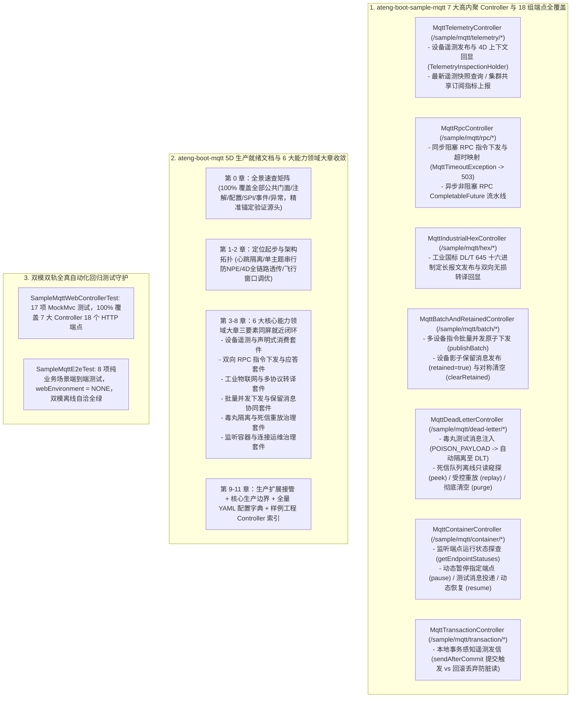

# 99. MQTT 物联网样例工程多控制器领域解耦、Web 体验化与五维规范重构架构决策 (MQTT Sample Multi-Controller Domain Decoupling, Web Experience & 5D Documentation Architecture)

## 背景与痛点

在 [ADR-0047](./0047-mqtt-iot-communication-and-edge-control-architecture.md) 与 [ADR-0074](./0074-mqtt-full-scenario-hardening-dead-letter-replay-and-connection-governance-architecture.md) 中，框架确立了 `ateng-boot-mqtt` 基于 Eclipse Paho MQTT v5 官方原生 Java 客户端构建的高并发、轻量级物联网通信基础设施，完成了声明式监听、通配符路径提取、四维上下文透传、同步/异步 RPC、国标十六进制报文转译、批量原子下发、保留消息清理、毒丸死信（DLT）治理、监听容器动态运维与本地事务发信对齐等核心能力。

然而，在早期 [ADR-0074](./0074-mqtt-full-scenario-hardening-dead-letter-replay-and-connection-governance-architecture.md) 的样例工程整改中，曾设立了一项局部的“无 Controller 纯业务底座样例（Zero-Controller Invariant）”约定，完全移除了 Web Controller 与 Web 容器。随着全框架架构的演进以及《工业级文档与样例工程标准规范》（[`docs/agents/documentation-specification.md`](../agents/documentation-specification.md)）的确立，既有方案暴露出以下严重的结构性缺陷与架构断层：

1. **开发者交互体验阻断 (Developer Experience Barrier)**：
   - 移除了 Web Controller 后，开发者启动样例工程后无法通过 HTTP/cURL 或 Postman 一键触发并直观体验任何 MQTT 核心特性，极大抬高了学习、排查与联调门槛；
   - 违背了全框架统一的“多控制器领域交互体验（MultiControllerExperience）”规范要求。
2. **文档与样例架构背离 (Documentation & Sample Inconsistency)**：
   - 样例工程 `README.md` 堆砌了 278 行业务 Service 实现源码，违背了“四段式极简体验卡”标准，且完全缺失立即可用的 cURL 体验命令表；
   - Starter `README.md` 缺乏第 0 节 100% 全景速查矩阵，特性小节未按业务能力领域收敛，且缺乏同屏闭环“专属 YAML + 真实实战 Java + 机制边界说明”三要素；
   - 样例工程中已废弃的局部概念（Zero-Controller）与现行工程规范产生冲突认知。
3. **缺少强类型契约与 JSR-303 入参防卫 (Missing Typed DTO Contracts & Validation)**：
   - 历史样例直接面向内部服务入参，缺乏面向 Web 接入层的强类型请求 DTO 与 JSR-303 第一道防线校验体系。

---

## 核心决策与架构内容

立足于纯原生算力、零臃肿依赖与工业级代码成熟度九道防线，正式确立 **MQTT 物联网样例工程多控制器领域解耦、Web 体验化与五维规范重构架构**：

### 1. 废除过时约定，全面推进 Web 体验化与 7 大高内聚领域控制器
- 正式废止早期 ADR-0074 中局部设定的 `Zero-Controller Invariant`，样例工程 `ateng-boot-sample-mqtt/pom.xml` 统一引入 `io.github.atengk:ateng-boot-web`；
- 按业务功能领域将样例工程拆分为 7 大高内聚 `@RestController`：
  1. `MqttTelemetryController`（`/sample/mqtt/telemetry/*`）：提供设备遥测数据上报、REST 路径通配提取、4D 上下文回显与集群共享订阅体验；
  2. `MqttRpcController`（`/sample/mqtt/rpc/*`）：提供同步阻塞与异步非阻塞双向 RPC 请求-响应指令体验；
  3. `MqttIndustrialHexController`（`/sample/mqtt/hex/*`）：提供工业国标十六进制报文双向编解码与回显体验；
  4. `MqttBatchAndRetainedController`（`/sample/mqtt/batch/*`）：提供批量并发消息下发、设备影子保留消息发布与对称清空体验；
  5. `MqttDeadLetterController`（`/sample/mqtt/dead-letter/*`）：提供毒丸消息触发、死信队列离线只读窥探、受控安全重放与物理清空体验；
  6. `MqttContainerController`（`/sample/mqtt/container/*`）：提供消费端点运行状态探查、动态暂停与动态恢复运维体验；
  7. `MqttTransactionController`（`/sample/mqtt/transaction/*`）：提供本地数据库事务提交后发信与事务回滚取消发信的防脏读验证体验。
- 遵循 Zero-Entity-Leakage 契约，入参全部采用强类型 Request DTO 并通过 JSR-303 注解严守第一道防线，出参统一显式返回强类型 `Result<T>`。

### 2. 确立异步消费捕获与双轨回显机制 (`TelemetryInspectionHolder`)
- 针对 MQTT 异步发布-订阅无法直接在 HTTP 请求线程获得消费结果的痛点，引入专职线程安全组件 `TelemetryInspectionHolder`；
- 采用 `CompletableFuture<TelemetryInspectionRecord>` 短时注册与超时淘汰机制，在接收到监听器回调时精准还原包含物理主题、温度、湿度、4D `traceId`、`tenantId`、`userId` 与全量 Header 字典在内的快照记录，实现端到端闭环验证。

### 3. Starter 文档 6 大能力领域大章收敛与三要素就近闭环
- 重塑 `ateng-boot-mqtt/README.md` 为 0 至 11 章标准领域架构体系：
  - **第 0 章 全景速查矩阵**：100% 覆盖核心门面（`MqttTemplate` 全部重载签名、`MqttDeadLetterReplayTemplate`、`MqttContainerManager`、`NamedMqttClientRegistry`、`MqttContextHolder`）、核心注解（`@MqttListener`、`@MqttVariable`、`@MqttTopic`、`@MqttHeader`）、全量配置项、事件体系、核心异常与 SPI 扩展点；
  - **第 1-2 章 定位与核心架构拓扑**：提供极简起步配置与发信/消费极简实操，深入阐述心跳线程池隔离、Paho 单主题订阅 Bug 规避、4D 上下文全链路透传及 `maxInflight = 1000` 生产调优不变量；
  - **第 3-8 章 6 大能力领域大章**：同屏严格闭环“专属 YAML + 真实 Sample Java + 机制边界说明”三要素；
  - **第 9-11 章 生产扩展接管、生产边界、全量 YAML 配置字典与样例 Controller 快速索引**。
- 重构 Sample `README.md` 为标准 **四段式极简体验卡**（快速启动与端口、运行环境与双模切换、7 大 Controller 共 18 组 cURL 体验矩阵、全真回归命令）。

### 4. 双模双轨全真自动化回归测试守护
- 交付 `SampleMqttWebControllerTest`：包含 17 项全场景 MockMvc 测试，100% 覆盖 7 大 Controller 的全部 18 个 HTTP 端点，断言 HTTP 状态码、JSR-303 快速失败拦截与 `Result<T>` 强类型契约；
- 保留 `SampleMqttE2eTest`：以 `webEnvironment = SpringBootTest.WebEnvironment.NONE` 运行 8 项纯后台场景测试，证实底层 Starter 在无 Web 容器环境下的原生自洽性与纯净度。

---

## 后果与权衡 (Consequences)

### 正向收益 (Positive Gains)
1. **开发者交互体验飞跃**：开发者克隆工程后执行 `mvn spring-boot:run`，即可通过 18 条开箱即用的 cURL 命令快速体验 Starter 包含的全部遥测、RPC、十六进制、批量、死信、容器管理与事务协同能力；
2. **规范契约高度统一**：消除了全仓库中唯一违反 Web Controller 体验规范的历史孤岛，使 `ateng-boot-mqtt` 与 `redis`、`mail`、`ftp`、`ssh`、`document` 等模块的体验标准完全看齐；
3. **技术文档权威常青**：Starter 文档 100% 覆盖公共 API 并就近闭环三要素，所有代码片段 1:1 逆向提取自实测全绿的 Sample 源码；
4. **测试资产双重守护**：Web Controller MockMvc 集成测试与纯后台 E2E 集成测试双轨并存，兼顾接入层契约验证与底层网络协议交互。

### 妥协与边界 (Trade-offs & Boundaries)
1. **样例工程依赖微幅增加**：Sample 引入了 `ateng-boot-web` 带来约数兆字节依赖，但样例工程标配 `<maven.deploy.skip>true</maven.deploy.skip>`，且与 Starter 核心代码完全隔离，不影响核心 Starter 的纯净原生性；
2. **异步回显开销**：`TelemetryInspectionHolder` 在内存中维护了短时 Future 映射，该机制仅作为 Sample 体验工程自验夹具，生产业务代码中仍倡导纯异步事件驱动交互。

---

## 规范遵从度评估 (12-Point Audit Checklist)

| 检查项 | 判定 | 落地凭证 |
| :--- | :---: | :--- |
| **1. Sample 100% 场景对齐** | ✅ 通过 | 7 大 Controller 完整承载 Starter 全部对外暴露能力 |
| **2. Sample 多 Controller 暴露** | ✅ 通过 | 按领域解耦为 `Telemetry`、`Rpc`、`Hex`、`Batch`、`DeadLetter`、`Container`、`Transaction` 7 个控制器，返回 `Result<T>` |
| **3. Sample README 极简体验卡** | ✅ 通过 | 严格采用四段式结构，包含端口启动、双模环境、18 条 cURL 体验矩阵与回归命令 |
| **4. 文档三要素就近与大章收敛** | ✅ 通过 | Starter 文档重构为 6 大能力领域大章，二级小节同屏闭环专属 YAML、实战 Java 与机制边界 |
| **5. 真实业务语义场景驱动** | ✅ 通过 | 全面基于设备遥测上报、启停控制指令、电表十六进制报文、设备影子状态等真实工业物联业务语义 |
| **6. Sample-First 逆向提取** | ✅ 通过 | 文档中的 Java 与 YAML 100% 逆向提取自已跑通全绿的 Sample 源码 |
| **7. 维度零 100% 全景速查矩阵** | ✅ 通过 | 第 0 章收录门面、注解、配置、事件、异常、守卫与 SPI，精准锚定验证源头 |
| **8. 生产扩展与接管显式呈现** | ✅ 通过 | 第 9 章详尽演示了 5 大扩展 SPI、事件监听与 mTLS 安全握手接管方案 |
| **9. 核心非功能边界与避坑声明** | ✅ 通过 | 深度阐述了 KeepAlive 线程池隔离、Paho 数组订阅 Bug 规避、Silent ACK 幂等静默确认、`maxInflight` 调优等底层不变量 |
| **10. 双模自适应离线自洽测试** | ✅ 通过 | 内置 `EmbeddedMqttBroker` 内存桩，离线环境下 25 项测试秒级 100% 全绿跑通 |
| **11. 文档排版防裂守卫** | ✅ 通过 | Markdown 表格泛型与管道符均由反引号或转义包裹，嵌套代码块严格使用四反引号包裹，无本地绝对路径泄漏 |
| **12. 词汇表与上下文严格对齐** | ✅ 通过 | 术语对齐 `ateng-boot-mqtt/CONTEXT.md` 与 `ateng-boot-samples/CONTEXT.md`，同步更新 `CONTEXT-MAP.md` 与 `docs/adr/README.md` |
