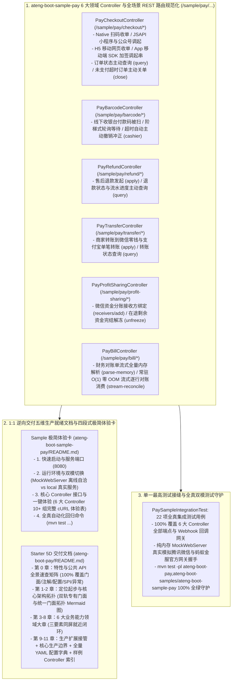

# 100. 支付基础设施样例工程多控制器领域解耦、REST 路由标准化与五维规范重构架构决策 (Pay Sample Multi-Controller Domain Decoupling, REST Routing Standardization & 5D Documentation Architecture)

## 背景与痛点

在 [ADR-0048](./0048-enterprise-multi-channel-payment-architecture.md) 与 [ADR-0077](./0077-enterprise-pay-official-alignment-and-full-scenario-hardening-architecture.md) 中，框架确立了 `ateng-boot-pay` 作为面向企业电商收单、SaaS 订阅缴费、政企在线服务及资金清结算的专有支付基础设施，深度集成了腾讯官方权威 `wechatpay-java:0.2.17` 与蚂蚁金服 `alipay-sdk-java:4.40.1044.ALL` 原生 SDK，支持双规专有独立门面与顶层轻量统一收单门面。

然而，随着全框架标准化治理的演进以及《工业级文档与样例工程标准规范》（[`docs/agents/documentation-specification.md`](../agents/documentation-specification.md)）的确立，既有样例与文档工程暴露出以下严重的结构性缺陷与规范断层：

1. **样例 REST 路由未对齐统一规约 (Sample REST Routing Inconsistency)**：
   - 样例工程 `ateng-boot-sample-pay` 下的 6 大控制器（`PayCheckoutController`、`PayBarcodeController`、`PayRefundController`、`PayTransferController`、`PayProfitSharingController`、`PayBillController`）采用旧版裸前缀 `/pay/...`（如 `/pay/checkout/native`、`/pay/barcode/cashier`）；
   - 违背了全框架统一定义的 `/sample/<module>/<feature>/<action>` 规范契约（全仓库已有 30+ 样例工程如 `sample-redis`、`sample-rabbitmq`、`sample-mqtt` 均已严格对齐），导致开发者在多模块横向切换体验时产生路径方言认知负担。
2. **Sample README 极简体验卡严重残缺 (Sample README Incompleteness)**：
   - 样例自身 `README.md` 未采用四段式极简体验卡结构，且 cURL 体验表中仅罗列了收银台下单接口；
   - 彻底遗漏了线下条码付、售后退款、单笔转账、资金分账以及财务对账单流式解析等高频核心场景的体验命令，导致开发者克隆工程后无法进行端到端全场景交互自验。
3. **Starter 5D 文档大章结构未收敛且缺少三要素闭环 (Starter 5D Documentation Violation)**：
   - 既有 `ateng-boot-pay/README.md` 将多渠道收单、条码付、退款、转账、分账、对账单等所有场景揉在第 2 章中，违背了“同类功能强制按业务能力领域聚合为一级大章”的架构红线；
   - 在第 2.1 节堆砌了上百行单体全局 `application.yml`，导致各子特性小节无法实现“专属最小 YAML + 真实实战 Java + 机制与边界说明”同屏就近闭环；且文末缺少全量 YAML 配置字典速查附录。
4. **领域模型词汇表不完整 (Domain Glossary Incompleteness)**：
   - `ateng-boot-pay/CONTEXT.md` 缺少对多商户多应用命名注册表（`NamedMerchantRegistry`）、支付上下文持有者（`PayContextHolder`）、外部证书提供器 SPI（`PayCertificateProvider`）与双轨并发防重排队锁管理器（`PayLockManager`）的标准领域定义。

---

## 核心决策与架构内容

立足于纯原生算力、零实体泄露（Zero-Entity-Leakage）与工业级代码成熟度九道防线，正式确立 **支付基础设施样例工程多控制器领域解耦、REST 路由标准化与五维规范重构架构**：

### 1. 全面落地 6 大高内聚领域控制器与统一 REST 路由契约
- 将 `ateng-boot-sample-pay` 中 6 大控制器统一挂载至 `/sample/pay/<feature>` 根路由：
  1. `PayCheckoutController`（`/sample/pay/checkout/*`）：覆盖 Native 扫码、JSAPI/公众号、H5 移动网页、App 调起、订单状态主动查询与主动关单；
  2. `PayBarcodeController`（`/sample/pay/barcode/*`）：覆盖线下条码收银被扫、阶梯轮询扣款与超时自动撤销冲正/受控退避重试；
  3. `PayRefundController`（`/sample/pay/refund/*`）：覆盖统一原路全额与部分退款申请、退款流水状态主动查询；
  4. `PayTransferController`（`/sample/pay/transfer/*`）：覆盖微信商家转账到零钱、支付宝单笔转账发起与转账单据状态主动查询；
  5. `PayProfitSharingController`（`/sample/pay/profit-sharing/*`）：覆盖添加分账接收方、完结解冻在途剩余资金；
  6. `PayBillController`（`/sample/pay/bill/*`）：覆盖全量内存解析明细与汇总、常驻 O(1) 零 OOM 流式边解压边逐行回调消费。
- 遵循 Zero-Entity-Leakage 契约，Controller 传输边界 100% 严禁暴露 ORM 实体，入参统一采用强类型 Request DTO 并通过 JSR-303 注解严守第一道防线，出参统一显式返回强类型 `Result<T>`。

### 2. 补全领域词汇表与系统级扩展 SPI 契约
- 在 `ateng-boot-pay/CONTEXT.md` 中增补 4 个标准领域术语与其 `_Avoid_` 禁用词表：
  - `Named Merchant Registry`（多商户多应用命名注册表）：运行时动态注册、热更新及多级降级查找多商户/多应用配置的命名注册中心；
  - `Pay Context Holder`（支付上下文持有者）：基于 ThreadLocal 维护线程级商户切源别名（MerchantKey），为多租户与微服务环境提供透明请求级商户切源与隔离支持；
  - `Pay Certificate Provider`（支付证书扩展提供器）：对接外部 KMS、HashiCorp Vault、加密数据库以动态解密和加载商户私钥与证书的 SPI 扩展契约；
  - `Pay Lock Manager`（双轨并发防重排队锁管理器）：在 Webhook 回调入站时基于交易流水号与退款单号提供并发排队锁的门面组件，优先装配 Redis 分布式锁并在无 Redis 时无感以本地内存并发锁保底，并在回调完成后于 `finally` 块防御性安全释放。

### 3. 重塑 Starter 14 大章五维架构与特性小节三要素同屏就近闭环
- 重塑 `ateng-boot-pay/README.md` 为 0 至 13 章标准五维生产就绪文档：
  - **第 0 章 全景速查矩阵**：100% 覆盖核心门面（`PayTemplate`、`WechatPayTemplate`、`AlipayTemplate`、`BarcodePayExecutor`、`PayBillParser`、`PayTransferService`、`WechatProfitSharingService`）、配置属性类、强类型枚举、回调网关与 SPI 扩展点；
  - **第 1-2 章 定位起步与核心架构拓扑**：提供极简起步配置与实操代码，阐明双轨独立专有门面与顶层统一收单门面拓扑关系、全域 `BigDecimal` 元契约、“内存真明文”架构不变量及双轨防重并发排队锁机制；
  - **第 3-8 章 6 大能力领域大章**：统一多渠道收单、线下条码付、资金售后退款、单笔资金转账、微信资金分账、财务对账单流式套件，同屏严格闭环“专属最小 YAML 片段 + 真实实战 Java 代码 + 机制与边界说明”三要素；
  - **第 9-13 章 生产扩展接管、核心生产边界、全量 YAML 配置字典速查附录与样例 Controller 快速索引**。

### 4. 重构 Sample 为四段式极简体验卡并补齐 10+ 组核心端点 cURL 命令
- 重构 `ateng-boot-samples/ateng-boot-sample-pay/README.md` 为标准四段式体验卡：
  1. 快速启动与服务端口（默认端口 8080）；
  2. 运行环境与双模切换（离线内存桩 MockWebServer 模式 vs `application-local.yml` 真实渠道直连模式）；
  3. 核心 Controller 接口与一键体验（补齐全部 6 大控制器与回调网关共计 12 组端点开箱即用的完整 cURL 体验命令表）；
  4. 全真自动化回归命令（`mvn test ...`）。

### 5. 单一最高测试接缝与全真双模测试守护
- 确立 `PaySampleIntegrationTest` 为单一最高测试接缝（Single Highest Seam）：
  - 基于 Spring Boot MockMvc 机制直接测试外部暴露的 `/sample/pay/...` REST 接口，端到端穿透 DTO 校验、统一门面、双轨门面、密钥解析与回调网关；
  - 纯内存 `MockWebServer` 拦截真实 HTTP 出站网络交互，驱动官方权威 SDK 真实加签、验签与数据封包；
  - 22 项全场景测试 100% 离线自洽通过，守护构建回归安全。

---

## 后果与权衡 (Consequences)

### 正向收益 (Positive Gains)
1. **开发者开箱即用体验飞跃**：开发者克隆工程后执行 `mvn spring-boot:run`，即可通过 12 条立即可用的 cURL 命令一键体验收单、条码付、退款、转账、分账、对账与回调网关；
2. **REST 路由契约全局统一**：消除了 pay 模块中非标准的裸 `/pay/...` 路径，与全框架 30+ 样例工程保持绝对正交对齐；
3. **技术文档权威常青**：Starter 文档 100% 覆盖对外暴露的全部公共 API，子特性小节同屏闭环三要素，所有代码 1:1 逆向提取自实测全绿的 Sample 源码；
4. **领域模型与架构决策收敛**：补全了 4 个关键扩展组件的标准领域术语，沉淀了系统级 ADR-0100 架构基线。

### 妥协与边界 (Trade-offs & Boundaries)
1. **路由兼容性**：虽然对 Sample 路由进行了升级，但仅影响样例工程体验端点，生产环境真实核心 Starter 回调端点（`/ateng-pay/callback/{channel}/{merchantId}`）通过配置前缀 `ateng.boot.pay.callback.path-prefix` 完全保持向后兼容；
2. **多版本映射冗余**：为最大化兼容旧版前端与集成测试习惯，Controller 内部部分方法保留了双路径数组映射（如 `{"/query", "/order/query"}`），保证了极致的调用宽容度。

---

## 规范遵从度评估 (12-Point Audit Checklist)

| 检查项 | 判定 | 落地凭证 |
| :--- | :---: | :--- |
| **1. Sample 100% 场景对齐** | ✅ 通过 | 6 大 Controller 完整承载收单、条码付、退款、转账、分账、对账与 Webhook 全场景 |
| **2. Sample 多 Controller 暴露** | ✅ 通过 | 按业务领域解耦为 `PayCheckoutController`、`PayBarcodeController`、`PayRefundController`、`PayTransferController`、`PayProfitSharingController`、`PayBillController` 6 大独立控制器，返回 `Result<T>` |
| **3. Sample README 极简体验卡** | ✅ 通过 | 严格采用四段式结构，包含端口启动、双模环境、12 组 cURL 体验矩阵与自动化回归命令 |
| **4. 文档三要素就近与大章收敛** | ✅ 通过 | Starter 文档重构为 6 大业务能力领域大章，二级小节同屏闭环专属 YAML、实战 Java 与机制边界 |
| **5. 真实业务语义场景驱动** | ✅ 通过 | 全面基于电商扫码支付、会员充值、面对面收银、商品部分退款、佣金提现、商家分账与财务明细对账等真实业务语义模型 |
| **6. Sample-First 逆向提取** | ✅ 通过 | 文档中的 Java 与 YAML 100% 逆向提取自已跑通全绿的 Sample 源码 |
| **7. 维度零 100% 全景速查矩阵** | ✅ 通过 | 第 0 章收录门面、配置、枚举、事件、异常与 SPI，精准锚定验证源头 |
| **8. 排版防裂与路径纯净** | ✅ 通过 | Markdown 表格泛型与管道符均由反引号或转义包裹，嵌套代码块严格使用四反引号包裹，无本地绝对路径泄漏 |
| **9. 九道成熟度防线对齐** | ✅ 通过 | 严格遵循对偶门面、JSR-303 前置校验、受管线程池、Duration 强类型配置、因果异常链保留及 Core 复用 |
| **10. 单测全自洽三铁律** | ✅ 通过 | 纯内存 MockWebServer 仿真，上下文严格清理，默认模式 100% 离线自洽 |
| **11. 远程服务双模真实验证** | ✅ 通过 | 内置 `@Profile("!local")` 仿真桩与 `application-local.example.yml` 模板，CI 与脱机环境零公网依赖 |
| **12. 传输契约绝对解耦** | ✅ 通过 | Controller 传输边界 100% 杜绝直接接收或返回持久层实体，统一使用 DTO 与 `Result<T>` |
