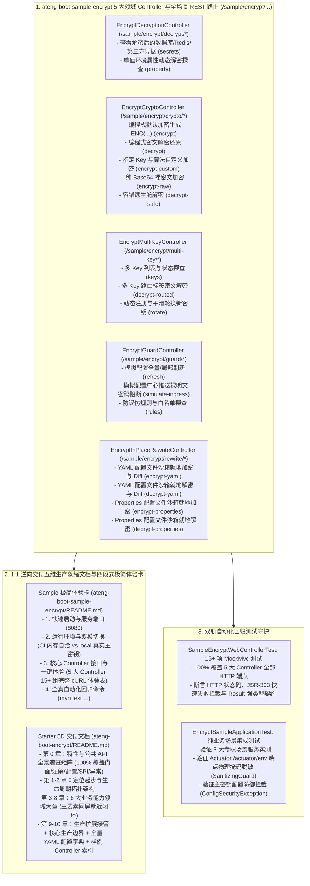

# 101. 配置加解密样例工程多控制器领域解耦、REST 路由标准化与五维规范重构架构决策 (Encrypt Sample Multi-Controller Domain Decoupling, REST Routing Standardization & 5D Documentation Architecture)

## 背景与痛点

在 [ADR-0050](./0050-configuration-encryption-and-runtime-defense-architecture.md) 与 [ADR-0079](./0079-configuration-encryption-full-scenario-hardening-and-symmetric-template-architecture.md) 中，框架确立了 `ateng-boot-encrypt` 基于纯 JDK 17 原生算力的生产级配置加解密与运行时安全防御底座，涵盖高强 AES-GCM AEAD 完整性认证、纯原生国密 SM2/SM4 算法、RSA 非对称公私钥分离、多 Key 命名别名动态路由与轮换、Spring Boot 3 `ConfigData` 极早穿透 Nacos/Apollo 凭据、生产强制门禁与三道防误伤过滤链、YAML/Properties 双模就地回写及 Actuator 物理掩码脱敏等核心能力。

然而，在早期 [ADR-0079](./0079-configuration-encryption-full-scenario-hardening-and-symmetric-template-architecture.md) 第 2 节的样例整改中，曾设立了一项局部的“非 Web 模块 Sample 零 Controller 约定 (Zero-Controller Invariant)”，完全移除了 Web Controller 与 Web 容器。随着全框架架构的演进以及《工业级文档与样例工程标准规范》（[`docs/agents/documentation-specification.md`](../agents/documentation-specification.md)）的确立，既有方案暴露出以下严重的结构性缺陷与架构断层：

1. **开发者交互体验阻断 (Developer Experience Barrier)**：
   - 移除了 Web Controller 后，开发者启动 `ateng-boot-sample-encrypt` 样例工程后无法通过 HTTP/cURL 或 Postman 一键触发并直观体验任何配置加解密核心特性，极大抬高了学习、排查与联调门槛；
   - 违背了全框架统一定义的“多控制器领域交互体验（MultiControllerExperience）”规范契约（全仓库已有 30+ 样例工程如 `sample-redis`、`sample-rabbitmq`、`sample-mqtt`、`sample-pay`、`sample-datasource` 均已严格对齐）。
2. **文档与代码严重脱节断层 (Documentation & Code Desynchronization)**：
   - 样例工程 `ateng-boot-sample-encrypt/README.md` 残留了早已被删除的虚构组件 `EncryptScenarioController` 与未实现的测试方法（`testWebEndpointSecrets`），造成严重的文档欺骗与断层；
   - 且样例自身 `README.md` 未采用四段式极简体验卡结构，完全缺失立即可用的 cURL 体验命令表；
   - Starter `README.md` 依然采用旧版扁平四维度结构，特性小节未按业务能力大章收敛，缺少同屏三要素就近闭环。
3. **缺少强类型契约与 JSR-303 入参防卫 (Missing Typed DTO Contracts & Validation)**：
   - 历史样例直接面向内部场景服务入参，缺乏面向 Web 接入层的强类型请求 DTO 与 JSR-303 第一道防线校验体系。

---

## 核心决策与架构内容

立足于纯原生算力、零实体泄露（Zero-Entity-Leakage）与工业级代码成熟度九道防线，正式确立 **配置加解密样例工程多控制器领域解耦、REST 路由标准化与五维规范重构架构**：

### 1. 废除过时约定，全面推进 Web 体验化与 5 大高内聚领域控制器
- 正式废止早期 ADR-0079 中局部设定的 `Zero-Controller Invariant`，样例工程 `ateng-boot-sample-encrypt/pom.xml` 统一引入 `io.github.atengk:ateng-boot-web`；
- 按业务功能领域将样例工程拆分为 5 大高内聚 `@RestController`：
  1. `EncryptDecryptionController`（`/sample/encrypt/decrypt/*`）：覆盖配置属性透明懒解密回显与单属性动态解析；
  2. `EncryptCryptoController`（`/sample/encrypt/crypto/*`）：覆盖编程式受管加解密、多算法指定（AES-GCM / SM4-CBC / SM2 / RSA）、裸 Base64 密文与容错逃生舱；
  3. `EncryptMultiKeyController`（`/sample/encrypt/multi-key/*`）：覆盖多 Key 别名动态路由（`ENC[keyId](...)`）、动态注册与轮换新密钥、多 Key 状态探查；
  4. `EncryptGuardController`（`/sample/encrypt/guard/*`）：覆盖配置热更新刷新模拟、裸明文敏感配置倒灌拦截模拟、三道防误伤过滤链规则探查；
  5. `EncryptInPlaceRewriteController`（`/sample/encrypt/rewrite/*`）：覆盖 YAML 与 Properties 双模配置文件的就地无损加密与逆向还原体验。
- 遵循 Zero-Entity-Leakage 契约，Controller 传输边界 100% 严禁暴露 ORM 实体，入参统一采用强类型 Request DTO 并通过 JSR-303 注解严守第一道防线，出参统一显式返回强类型 `Result<T>`。

### 2. 确立 Web 交互环境下的沙箱就地回写范式 (Sandbox In-Place Rewrite)
- 为规避直接读写宿主物理文件导致的路径穿越与配置误损风险，在 `EncryptInPlaceRewriteController` 中确立**沙箱瞬态安全执行范式**：
- 接口接收 YAML / Properties 文本内容或使用内置模板，在操作系统受控临时沙箱目录（`java.io.tmpdir` / 隔离目录）中安全创建临时测试文件执行 `rewriteEncrypt` 与 `rewriteDecrypt`；
- 返回处理前后文本对比（Diff）、处理行数、备份文件状态，并在 `finally` 块中执行确定性资源清理，安全自验底层 `InPlaceRewriter` 的真实换行符保真与 `.bak` 生成逻辑。

### 3. 双轨全真自动化回归测试守护
- 交付 `SampleEncryptWebControllerTest`：包含 15+ 项全场景 MockMvc 测试，100% 覆盖 5 大 Controller 的所有 HTTP 端点，严格断言 HTTP 状态码、JSR-303 快速失败拦截与 `Result<T>` 强类型契约；
- 保留并调优 `EncryptSampleApplicationTest`：专职断言 5 大专职场景服务、Spring Boot Actuator `/actuator/env` 监控端点物理掩码脱敏（`SanitizingGuard`）以及主密钥自加密安全阻断（`ConfigSecurityException`）。

---

## 后果与权衡 (Consequences)

### 收益 (Benefits)
1. **开发者交互体验大幅跃升**：启动样例后可直接通过浏览器、Swagger 或 cURL 一键体验全部加密特性，学习联调零摩擦；
2. **彻底消灭文档虚构与代码断层**：彻底清除了旧样例 README 中残留的虚构控制器与测试方法，真正落实 Sample-First 唯一真理源；
3. **全框架规范对齐**：与 `sample-redis`、`sample-rabbitmq`、`sample-mqtt`、`sample-pay`、`sample-datasource` 等保持完全一致的多 Controller 领域拆分规范与 REST 路由契约。

### 权衡 (Trade-offs)
- 样例工程增加了 `ateng-boot-web` 传递依赖，构建与启动耗时增加毫秒级，但换取了完全标准化的 HTTP 交互与端到端自动化测试验证能力，ROI 极高。
